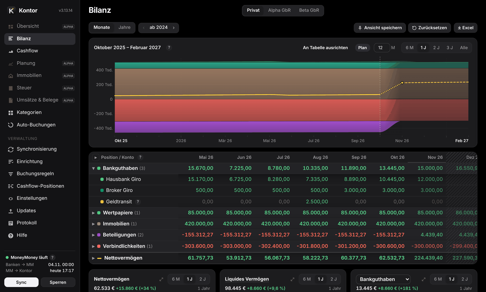
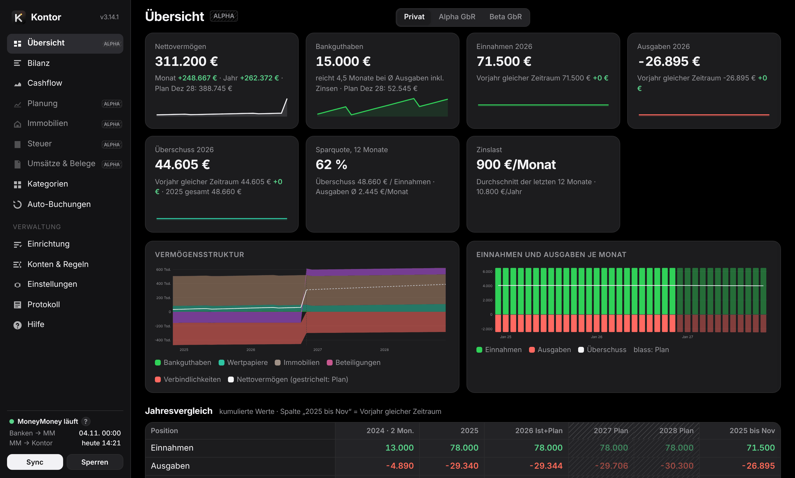
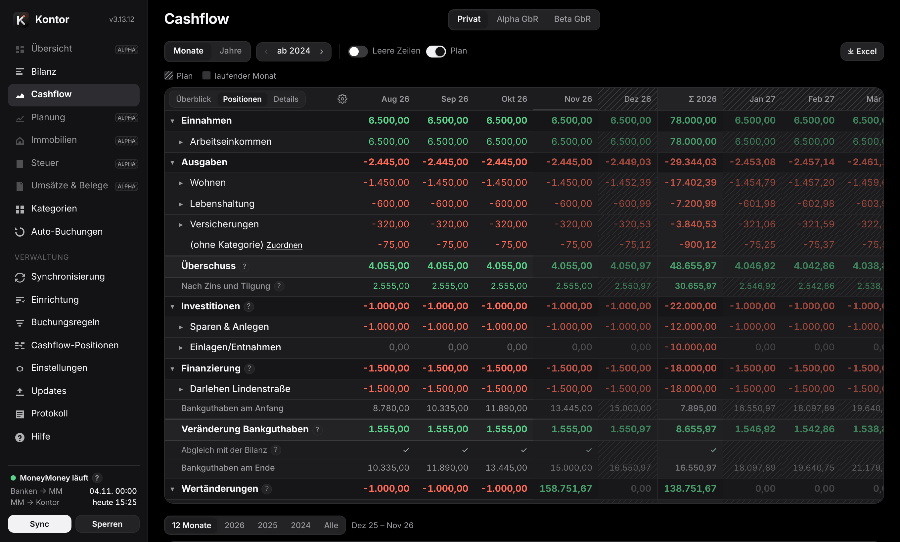
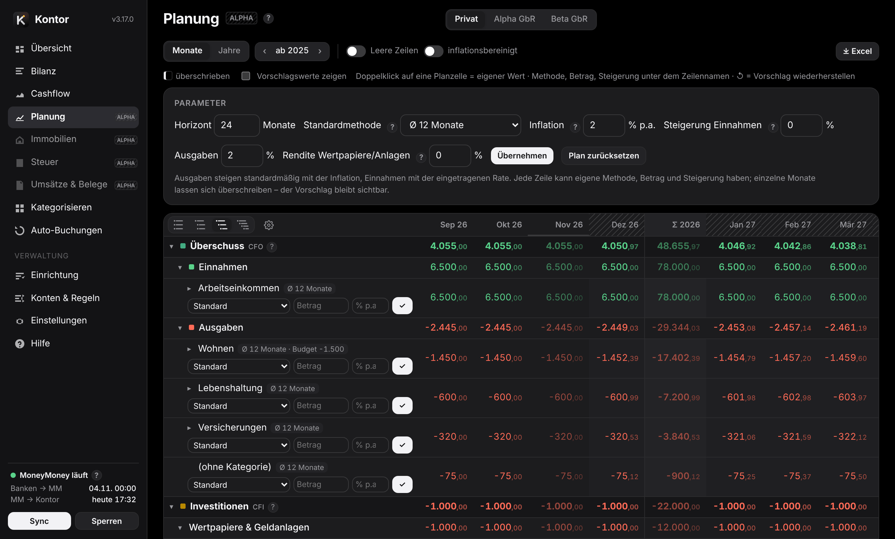
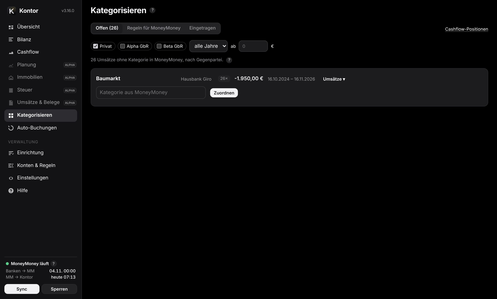
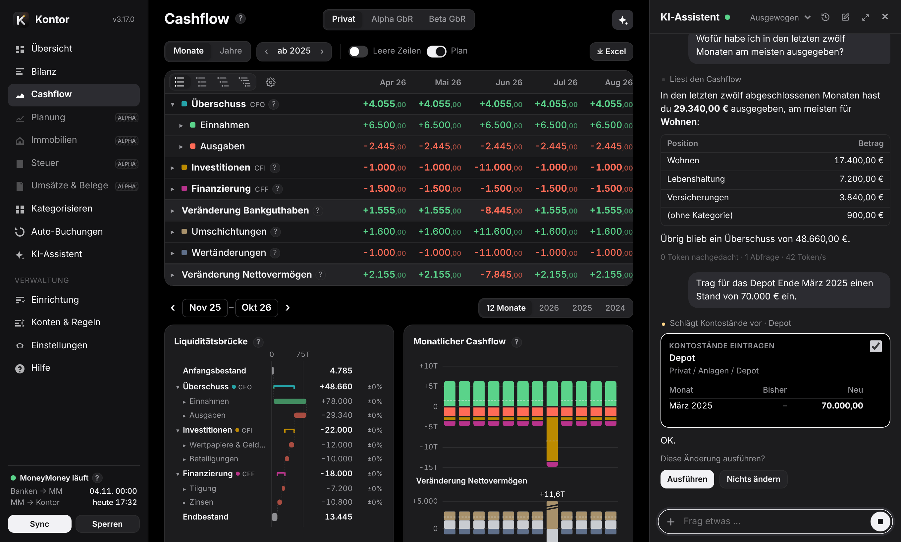
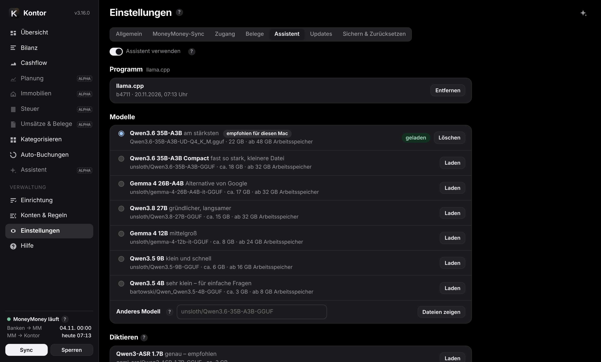
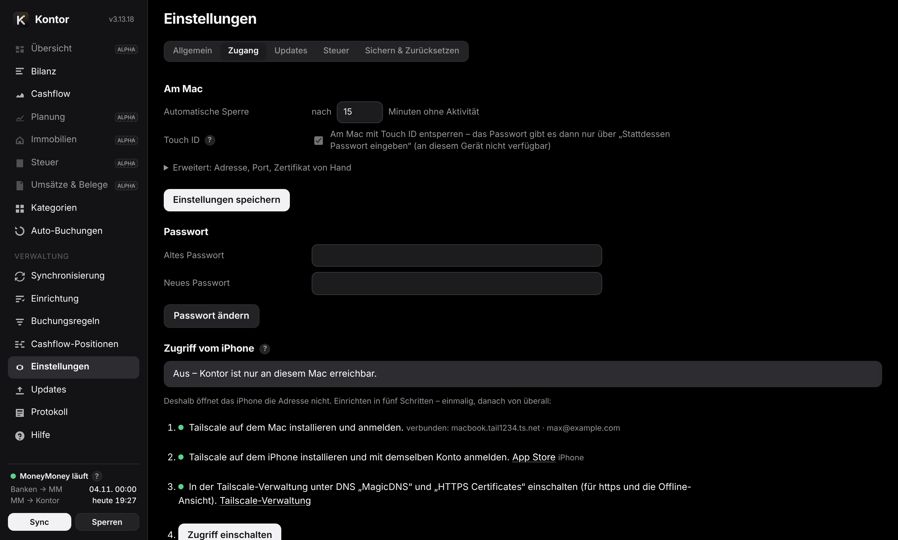

<p align="center"></p>

# Kontor

**Dein digitaler CFO.** Der Überblick über dein Privatvermögen und die Gesellschaften dahinter – Bilanz, Cashflow, Planung und Steuerübersicht auf Basis von [MoneyMoney](https://moneymoney-app.com) (macOS), für dich privat und für jede Gesellschaft getrennt – und ein KI-Assistent, der nur auf deinem Mac läuft, sich erinnert und Routine abnimmt.

Ein kleiner Dienst, der dauerhaft auf dem Mac läuft, mit einer Oberfläche unter `http://127.0.0.1:8765/` – im Browser, als eigene Mac-App und vom iPhone. Nur Bordmittel von macOS (Python 3, `openssl`, `osascript`, Swift für kleine Helfer), keine Fremdbibliotheken, keine Zugangsdaten außerhalb von MoneyMoney. Kontor enthält keine Annahmen über deine Konten: Alles wird in der Oberfläche eingerichtet.

- **Alles bleibt auf dem Mac:** verschlüsselt, lesbar erst nach deiner Anmeldung (Passwort oder Touch ID) – auch für jemanden am entsperrten Mac.
- **Ins Netz nur, wo du es zulässt:** von selbst fragt Kontor nur nach neuen Versionen (abschaltbar); alles andere – Wertpapiernamen per ISIN, das Laden des Assistenten, seine Internetsuche zum Lesen – erst nach deinem Klick, nie mit deinen Daten ([Sicherheit](docs/help.de.md#security)).
- **In MoneyMoney nur der enge Rahmen:** Buchungen der Buchungsregeln in Offline-Konten und die Kategorie eines Umsatzes, den du zuordnest – nie Überweisungen.

## Installation

Auf einem Mac mit MoneyMoney diese Zeile im Terminal ausführen (Programme → Dienstprogramme → Terminal):

```
bash <(curl -fsSL https://raw.githubusercontent.com/stecrz/Kontor/main/install.sh)
```

Sie lädt Kontor, richtet es als Dienst im Hintergrund ein und öffnet die Oberfläche im Browser – dort ein Passwort festlegen, dann führt die [Einrichtung](docs/help.de.md#setup) durch alles Weitere. Eigener Installationsordner, Aktualisieren und Entfernen: [Hilfe](docs/help.de.md#install).

## Was Kontor zeigt



**Bilanz** – das Vermögen je Bereich nach Positionen, Konten und bis zu den einzelnen Wertpapieren, Monat für Monat oder Jahr für Jahr, mit Plan:

- Große Grafik und Tabelle arbeiten zusammen: Klick auf eine Fläche klappt sie in der Grafik und in der Tabelle auf, Klick auf einen Wert zeigt ihn in der Grafik; Werte am Monatsende, Zeiträume bis zum letzten abgeschlossenen Monat (der laufende Monat gepunktet, der Plan gestrichelt).
- Depots mit ihren Wertpapieren, auch rückwirkend – der Verlauf wird einmalig aus MoneyMoney übernommen; fehlende Namen per ISIN nachschlagbar.
- Drei einzelne Grafiken (Nettovermögen, frei gewählte Positionen wie „Geldanlagen“, Zusammensetzung einer Position); jede kann die große werden.
- Ansicht je Gerät speichern, Anordnung frei, dunkel (Standard) oder hell, Excel-Export mit aufklappbaren Zeilen.

**Cashflow** – Überschuss (CFO), Investitionen (CFI) und Finanzierung (CFF) je Monat, Quartal oder Jahr, bis zu den Kategorien aus MoneyMoney:

- Jede Zahl führt zu den Umsätzen dahinter (Seitenfenster), auch zusammengefasste Zeilen wie „Unklar“; Monat für Monat gegen die Bilanz abgestimmt (Bankguthaben und Nettovermögen), Abweichungen mit Grund.
- Liquiditäts- und Vermögensbrücke, Monatlicher Cashflow (zoombar), Gesamtcashflow als Sankey (Mittelherkunft und -verwendung), Vorjahresvergleich und Ausgaben je Monat – für einen frei wählbaren Zeitraum, auch in den Plan hinein.
- Umbuchungen zwischen eigenen Konten werden gepaart (Gegen-IBAN, Kategorie, Betrag), Umsätze ohne Kategorie sichtbar geschätzt – ohne etwas in MoneyMoney einzutragen.

**Übersicht** – die wichtigsten Grafiken auf einer Bildschirmseite: Nettovermögen, Vermögensstruktur, monatlicher Cashflow, Vermögensbrücke und Vermögensaufbau; ein Klick führt an ihre Stelle in Bilanz oder Cashflow.

**KI-Assistent** (optional) – ein Sprachmodell, das nur auf deinem Mac läuft ([llama.cpp](https://github.com/ggml-org/llama.cpp) mit einem Modell deiner Wahl, in Kontor geladen und aktualisiert): Fragen in normaler Sprache zu deinen Zahlen und zur Bedienung, als Fenster neben jeder Seite – getippt, diktiert oder per Rechtsklick auf eine Zahl. Er öffnet die passende Ansicht, hebt hervor, wovon er spricht, zeichnet Diagramme aus Kontors Zahlen und liest Dateien, die du ihm gibst: Belege, Excel-Tabellen und PDFs mit Tabellen über mehrere Seiten.

- **Er schlägt vor, du entscheidest:** Kontostände und Planwerte, Kategorien, wartende Auto-Buchungen, Buchungsregeln, Belege – alle Änderungen einer Antwort stehen auf einer Karte, ausgeführt erst nach deinem Klick, danach zurücknehmbar und im Protokoll. Jedes Recht ist einzeln schaltbar; Einstellungen, Zugang, Updates und Überweisungen fasst er nie an.
- **Er merkt sich, was du ihm sagst** (Ziele, Entscheidungen, Menschen, Vorlieben) – nur aus deinen eigenen Worten, verschlüsselt, nur auf diesem Mac, jederzeit einsehbar und löschbar.
- **Nichts verlässt den Mac:** Die Modelle laufen ohne Netz in der Abschirmung von macOS. Ins Netz geht Kontor dafür nur, um nach neueren Versionen zu fragen (von selbst, einstellbar) und – auf Klick – Programm und Modelle zu laden.
- **Internet nur zum Lesen** (ab Werk aus): Kontor sucht selbst bei festen, überwiegend amtlichen Quellen; was gesendet wird, steht vorher auf einer Karte im Chat, nie etwas aus deinen Daten.

**Mac-App** – Kontor in einem eigenen Fenster mit Menüleiste, Tastaturkürzeln und Suche (⌘F); am Mac gebaut, öffnet nur Kontors eigene Seite (Einstellungen → Allgemein → Als App).

**[Demo](docs/help.de.md#demo)** – zum Vorzeigen: eine eigene Umgebung mit erfundenen Beispieldaten (Privatperson, UG, GbR) statt deiner, geöffnet mit deiner Anmeldung unten auf der Anmeldeseite.

**Stand:** Übersicht, Bilanz, Cashflow, Kategorisieren, Auto-Buchungen, Synchronisierung und Einrichtung sind geprüft. Planung, Immobilien, Steuer sowie Umsätze & Belege sind nutzbar, aber noch als „Alpha“ markiert – Zahlen dort bitte gegenprüfen.

**Anleitung: [Hilfe](docs/help.de.md)** · English: [help](docs/help.en.md) – dieselbe Hilfe steht in Kontor unter „Hilfe“ (durchsuchbar). Dort steht alles Weitere: was MoneyMoney und was Kontor macht, die Einrichtung, jede Seite, [Sicherheit](docs/help.de.md#security), Kommandozeile und Datenordner, Hilfe bei Fehlern. Alle Bilder zeigen frei erfundene Daten.

| | |
|:---:|:---:|
| <br>[Übersicht](docs/help.de.md#overview) | <br>[Cashflow](docs/help.de.md#cash-flow) |
| <br>[Planung](docs/help.de.md#planning) | <br>[Immobilien](docs/help.de.md#properties) |
| <br>[Kategorisieren](docs/help.de.md#categories) | <br>[Einrichtung](docs/help.de.md#setup) |
| <br>[KI-Assistent](docs/help.de.md#assistant) | <br>[KI-Assistent einrichten](docs/help.de.md#assistant-setup) |
| <br>[Zugriff vom iPhone](docs/help.de.md#iphone) | <br>[Auf dem iPhone](docs/help.de.md#iphone) |

## Entwicklung

- Tests: `python3 -m pytest -q tests` – Regeln und Zinsmodelle, Verschlüsselung, Lauf gegen ein simuliertes MoneyMoney, HTTP-API, Immobilienkalkulation gegen eine handgerechnete Tabellenkalkulation (auf den Cent), der Assistent mit einem Platzhalter statt llama.cpp (ohne Netz, ohne Modell), Zufallswelten für Cashflow und Buchungsregeln und die Oberfläche im Browser (Playwright). Testdaten sind frei erfunden.
- Bilder für Hilfe und README: `python3 tests/screenshots.py [Ordner|-] [de|en]` (aus denselben erfundenen Daten).
- Seiten ansehen (hell/dunkel, Mac/iPhone): `python3 tests/preview.py <Ordner> ['#route' …]`.
- Regeln für Änderungen (Version, Sprache, Sicherheit): [CLAUDE.md](CLAUDE.md). Fahrplan: [ROADMAP.md](ROADMAP.md). Änderungen: [CHANGELOG.md](CHANGELOG.md).
- Jeder Push wird automatisch getestet (GitHub Actions: Python 3.9 und neu, Chrome und Safari-Engine, dazu macOS mit den Swift-Helfern und der Mac-App); nachts laufen 1000 feste und so viele neue Zufallsfälle, wie in drei Stunden passen.

## Lizenz

Apache License 2.0 ([LICENSE](LICENSE), Hinweise in [NOTICE](NOTICE)): Nutzen, Ändern und Weitergeben ist erlaubt – privat wie geschäftlich –, solange der Lizenztext und die Hinweise aus NOTICE erhalten bleiben und Änderungen als solche gekennzeichnet sind. Rechte an Name und Logo gibt die Lizenz nicht.

Entwickelt von stecrz mit Hilfe von KI (Claude von Anthropic). Kontor ist ein unabhängiges Projekt und nicht mit dem Hersteller von MoneyMoney verbunden.

Keine Gewähr, keine Steuer- oder Anlageberatung.
