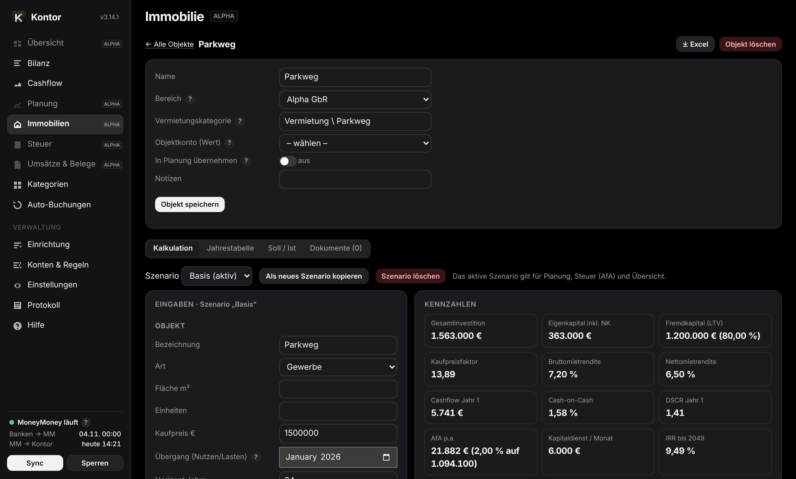
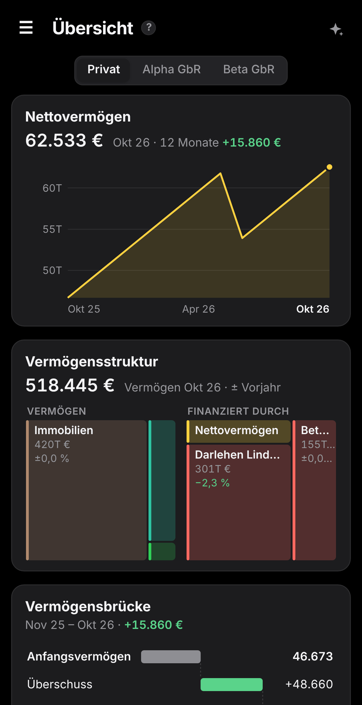

<p align="center"></p>

# Kontor

Bilanz, Cashflow, Planung und Steuerübersicht auf Basis von [MoneyMoney](https://moneymoney-app.com) (macOS) – für dich privat und für jede Gesellschaft getrennt. Ein kleiner Dienst, der dauerhaft auf dem Mac läuft, mit einer Web-Oberfläche unter `http://127.0.0.1:8765/`. Nur Bordmittel (Python 3, `openssl`, `security`, `osascript`), keine Fremdbibliotheken, keine Zugangsdaten außerhalb von MoneyMoney, keine Netzverbindung außer der abschaltbaren Update-Prüfung bei GitHub (und, nur auf Klick, dem Nachschlagen von Wertpapiernamen per ISIN und dem Laden des optionalen Assistenten). Kontor enthält keine Annahmen über deine Konten: Alles wird in der Oberfläche eingerichtet.

## Installation

Auf einem Mac mit MoneyMoney diese Zeile im Terminal ausführen (Programme → Dienstprogramme → Terminal):

```
bash <(curl -fsSL https://raw.githubusercontent.com/stecrz/Kontor/main/install.sh)
```

Sie lädt Kontor, richtet es als Dienst im Hintergrund ein und öffnet die Oberfläche im Browser – dort ein Passwort festlegen, dann führt die [Einrichtung](docs/help.de.md#setup) durch alles Weitere. Eigener Installationsordner, Aktualisieren und Entfernen: [Hilfe](docs/help.de.md#install).

## Was Kontor zeigt


**Bilanz** – das Vermögen je Bereich nach Positionen, Konten und bis zu den einzelnen Wertpapieren, Monat für Monat oder Jahr für Jahr, mit Plan:

- Große Grafik und Tabelle arbeiten zusammen: Klick auf eine Fläche klappt sie in der Grafik und in der Tabelle auf, Klick auf einen Wert zeigt ihn in der Grafik; Werte am Monatsende, Zeiträume bis zum letzten abgeschlossenen Monat (der laufende Monat gepunktet, der Plan gestrichelt).
- Depots mit ihren Wertpapieren, auch rückwirkend – der Verlauf wird einmalig aus MoneyMoney übernommen; fehlende Namen per ISIN nachschlagbar.
- Drei einzelne Grafiken (Nettovermögen, frei gewählte Positionen wie „Geldanlagen“, Zusammensetzung einer Position); jede kann die große werden.
- Ansicht je Gerät speichern, Anordnung frei, dunkel (Standard) oder hell, Excel-Export mit aufklappbaren Zeilen.

**Cashflow** – Überschuss (CFO), Investitionen (CFI) und Finanzierung (CFF) je Monat, Quartal oder Jahr, bis zu den Kategorien aus MoneyMoney:

- Jede Zahl führt zu den Umsätzen dahinter (Seitenfenster), auch zusammengefasste Zeilen wie „Unklar“; Monat für Monat gegen die Bilanz abgestimmt (Bankguthaben und Nettovermögen), Abweichungen mit Grund.
- Liquiditäts- und Vermögensbrücke, Monatlicher Cashflow (zoombar), Gesamtcashflow als Sankey (Mittelherkunft und -verwendung), Vorjahresvergleich und Ausgaben je Monat – für einen frei wählbaren Zeitraum, auch in den Plan hinein.
- Umbuchungen zwischen eigenen Konten werden gepaart (Gegen-IBAN, Kategorie, Betrag), Umsätze ohne Kategorie sichtbar geschätzt – ohne etwas in MoneyMoney einzutragen.

**Übersicht** – die wichtigsten Grafiken auf einer Bildschirmseite: Nettovermögen, Vermögensstruktur, monatlicher Cashflow, Vermögensbrücke und Vermögensaufbau; ein Klick führt an ihre Stelle in Bilanz oder Cashflow.

**Assistent** (optional) – ein Sprachmodell, das nur auf deinem Mac läuft ([llama.cpp](https://github.com/ggml-org/llama.cpp) mit einem Modell deiner Wahl, in Kontor geladen und aktualisiert): Fragen in normaler Sprache zu deinen Zahlen und zur Bedienung, als Fenster neben jeder Seite – getippt oder diktiert. Er öffnet die passende Ansicht, hebt hervor, wovon er spricht, und schlägt Einträge vor, die erst dein Klick einträgt.

- Nichts verlässt den Mac: Das Modell läuft ohne Netz in der Abschirmung von macOS; ins Netz geht Kontor dafür nur auf Klick, um Programm und Modell zu laden.
- Es liest, was Kontor zeigt, öffnet Seiten und schlägt Einträge vor – eingetragen wird erst nach deinem Klick, und jedes Recht ist einzeln schaltbar. Einstellungen, Regeln und MoneyMoney fasst es nie an.

**Stand:** Übersicht, Bilanz, Cashflow, Kategorisieren, Auto-Buchungen, Synchronisierung und Einrichtung sind geprüft. Planung, Immobilien, Steuer sowie Umsätze & Belege sind nutzbar, aber noch als „Alpha“ markiert – Zahlen dort bitte gegenprüfen.

**Anleitung: [Hilfe](docs/help.de.md)** · English: [help](docs/help.en.md) – dieselbe Hilfe steht in Kontor unter „Hilfe“ (durchsuchbar). Dort steht alles Weitere: was MoneyMoney und was Kontor macht, die Einrichtung, jede Seite, [Sicherheit](docs/help.de.md#security), Kommandozeile und Datenordner, Hilfe bei Fehlern. Alle Bilder zeigen frei erfundene Daten.

| | |
|:---:|:---:|
| <br>[Übersicht](docs/help.de.md#overview) | <br>[Cashflow](docs/help.de.md#cash-flow) |
| <br>[Planung](docs/help.de.md#planning) | <br>[Immobilien](docs/help.de.md#properties) |
| <br>[Kategorisieren](docs/help.de.md#categories) | <br>[Einrichtung](docs/help.de.md#setup) |
| <br>[Assistent](docs/help.de.md#assistant) | <br>[Assistent einrichten](docs/help.de.md#assistant-setup) |
| <br>[Zugriff vom iPhone](docs/help.de.md#iphone) | <br>[Auf dem iPhone](docs/help.de.md#iphone) |

## Entwicklung

- Tests: `python3 -m pytest -q tests` – Regeln und Zinsmodelle, Verschlüsselung, Lauf gegen ein simuliertes MoneyMoney, HTTP-API, Immobilienkalkulation gegen eine handgerechnete Tabellenkalkulation (auf den Cent), der Assistent mit einem Platzhalter statt llama.cpp (ohne Netz, ohne Modell) und die Oberfläche im Browser (Playwright). Testdaten sind frei erfunden.
- Bilder für Hilfe und README: `python3 tests/screenshots.py [Ordner|-] [de|en]` (aus denselben erfundenen Daten).
- Seiten ansehen (hell/dunkel, Mac/iPhone): `python3 tests/preview.py <Ordner> ['#route' …]`.
- Regeln für Änderungen (Version, Sprache, Sicherheit): [CLAUDE.md](CLAUDE.md). Fahrplan: [ROADMAP.md](ROADMAP.md). Änderungen: [CHANGELOG.md](CHANGELOG.md).
- Jeder Push wird automatisch getestet (GitHub Actions, Python 3.9 und neu), nachts mit 1000 Zufallsläufen der Buchungsregeln.

## Lizenz

Apache License 2.0 ([LICENSE](LICENSE), Hinweise in [NOTICE](NOTICE)): Nutzen, Ändern und Weitergeben ist erlaubt – privat wie geschäftlich –, solange der Lizenztext und die Hinweise aus NOTICE erhalten bleiben und Änderungen als solche gekennzeichnet sind. Rechte an Name und Logo gibt die Lizenz nicht.

Entwickelt von stecrz mit Hilfe von KI (Claude von Anthropic). Kontor ist ein unabhängiges Projekt und nicht mit dem Hersteller von MoneyMoney verbunden.

Keine Gewähr, keine Steuer- oder Anlageberatung.
