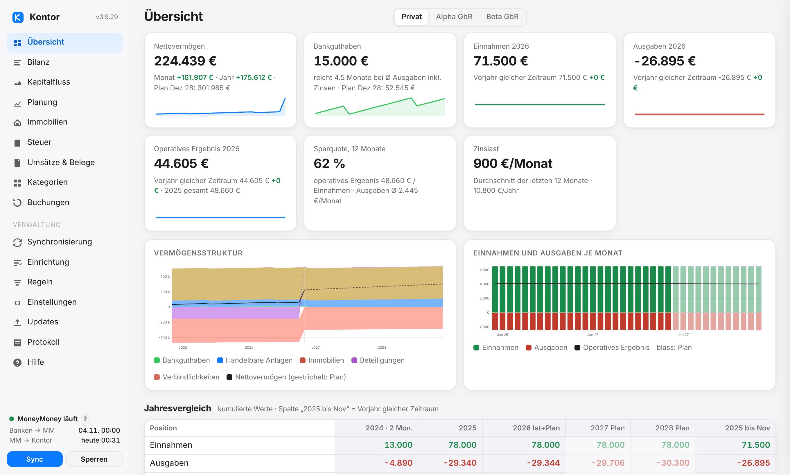
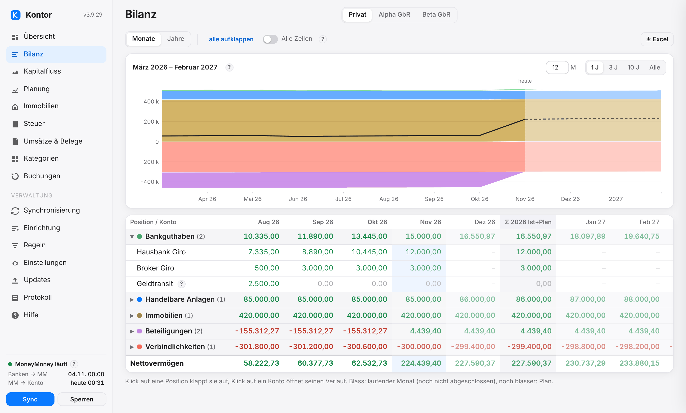
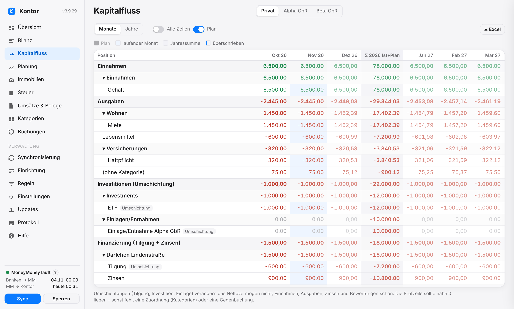
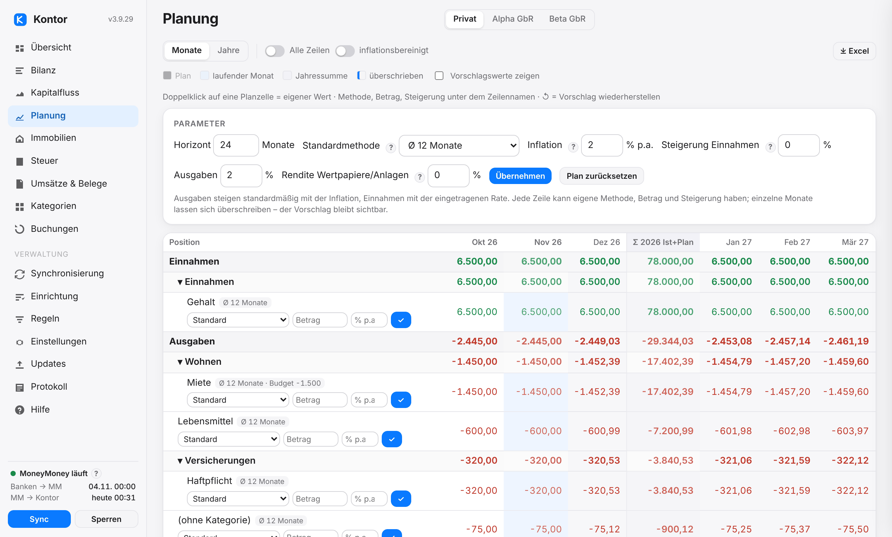
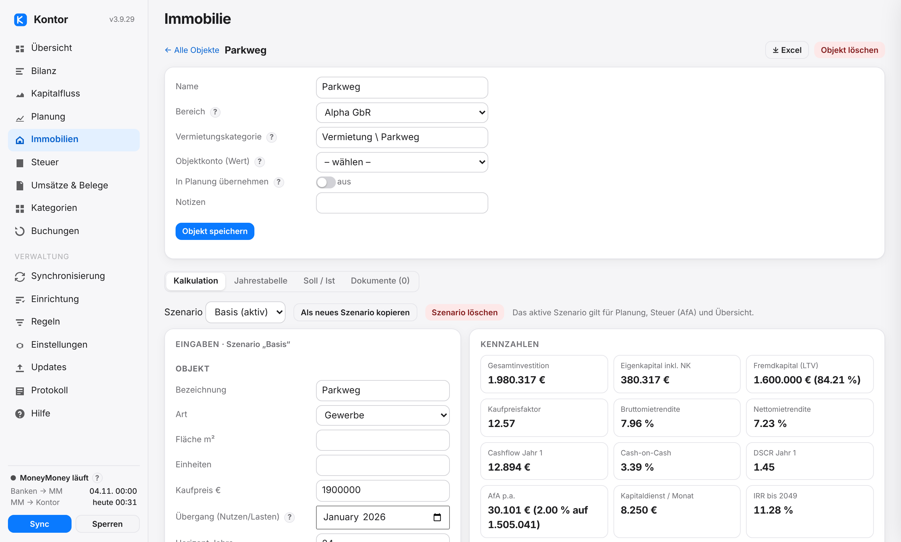
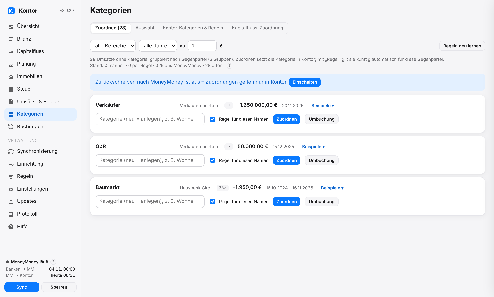
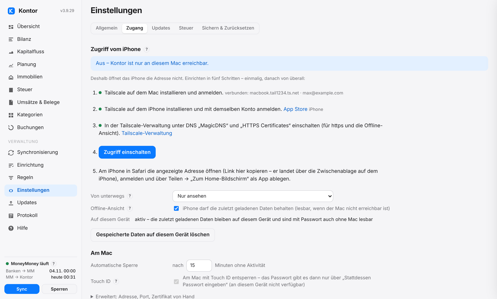
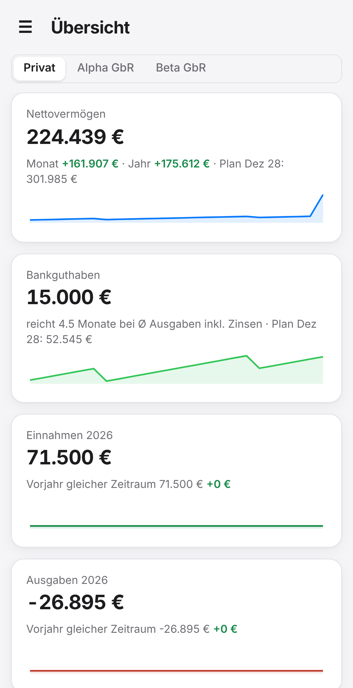

# Kontor

Bilanz, Kapitalfluss, Planung und Steuerübersicht auf Basis von [MoneyMoney](https://moneymoney-app.com) (macOS) – für dich privat und für jede Gesellschaft getrennt. Ein kleiner Dienst, der dauerhaft auf dem Mac läuft, mit einer Web-Oberfläche unter `http://127.0.0.1:8765/`. Nur Bordmittel (Python 3, `openssl`, `security`, `osascript`), keine Fremdbibliotheken, keine Konten- oder Zugangsdaten außerhalb von MoneyMoney, keine Netzverbindung außer der abschaltbaren Update-Prüfung bei GitHub.



**Ausführliche Anleitung mit Bildern: [Hilfe](docs/hilfe.md)** – dieselbe Hilfe steht in Kontor unter „Hilfe“ (durchsuchbar). English: [help](docs/help.md).

Kontor enthält keine Annahmen über deine Konten. Alles – Bereiche, Regeln, Kategorien, Steuerzuordnung – wird in der Oberfläche eingestellt oder als Einstellungspaket geladen. Alle Bilder zeigen frei erfundene Daten.

| | |
|:---|:---|
| <br>**[Bilanz](docs/hilfe.md#bilanz)** – Vermögen je Bereich nach Positionen, Monat für Monat, mit Plan und Verlauf je Konto | <br>**[Kapitalfluss](docs/hilfe.md#kapitalfluss)** – Einnahmen und Ausgaben nach Kategorien, Investitionen, Finanzierung, Prüfzeile |
| <br>**[Planung](docs/hilfe.md#planung)** – rollierend aus der Vergangenheit, je Zeile anpassbar, mit Darlehen, Ereignissen und Immobilien | <br>**[Immobilien](docs/hilfe.md#immobilien)** – Kalkulation je Objekt mit Darlehen, AfA, Steuer, Kennzahlen und Soll/Ist |
| <br>**[Kategorien](docs/hilfe.md#kategorien)** – MoneyMoney ist maßgeblich; offene Umsätze in Kontor zuordnen, auf Wunsch zurückschreiben | <br>**[Einrichtung](docs/hilfe.md#einrichtung)** – alle Bausteine in einer Reihenfolge, jeder mit Stand |
| <br>**[Zugriff vom iPhone](docs/hilfe.md#iphone)** – über das eigene Tailscale-Netz, Schritt für Schritt, standardmäßig nur ansehen | <br>**Auf dem iPhone** – als App auf dem Home-Bildschirm, mit Offline-Ansicht |

## Was MoneyMoney macht und was Kontor macht

| MoneyMoney | Kontor |
|---|---|
| Holt Umsätze und Salden von Banken, Depots und Zahlungsdiensten. | Liest diese Daten über die Skript-Schnittstelle. Zugangsdaten zu Banken sieht Kontor nie. |
| Kategorisiert Umsätze, von Hand oder per Regel. | Nutzt diese Kategorien. Offene Umsätze ordnest du in Kontor zu; auf Wunsch setzt Kontor sie auch in MoneyMoney – nur das Kategoriefeld, vorher geprüft, vorhandene Kategorien nur nach Rückfrage. |
| Führt Offline-Konten: private Darlehen, Beteiligungen, Immobilien, Kapitalkonten. | Bucht nach deinen Regeln **nur in solche Offline-Konten**: Darlehensraten spiegeln und Zinsen berechnen, Beteiligungswerte, Saldo-Spiegel. |
| Hat keine Bilanz, keine Planung, keine Steuerübersicht. | Bilanz je Bereich, Kapitalfluss mit Prüfzeile, rollierende Planung, Immobilienkalkulation, Steuer-Jahresübersicht, Belege, Excel-Export. |

Kontor ändert in MoneyMoney nie Buchungen, den Kategorienbaum oder Regeln und löst keine Überweisungen aus.

## Installation

Voraussetzungen: macOS, MoneyMoney, Kommandozeilen-Werkzeuge von Apple (`xcode-select --install`, liefert `python3` und `swiftc`).

1. Eine Zeile im Terminal (Programme → Dienstprogramme → Terminal), lädt nach `~/Kontor` und richtet alles ein:
   ```
   bash <(curl -fsSL https://raw.githubusercontent.com/stecrz/Kontor/main/get.sh)
   ```
   Dieselbe Zeile aktualisiert später auf den neuesten Stand. Alternativ von Hand: `git clone https://github.com/stecrz/Kontor.git ~/Kontor && cd ~/Kontor && bash install.sh`. (Ein ZIP aus dem Browser geht auch, aber Gatekeeper blockiert dann Skripte per Doppelklick; `bash install.sh` im entpackten Ordner entfernt die Sperre. Ein echter Doppelklick-Installer bräuchte eine Apple-Entwicklersignatur.)
2. Der Browser öffnet `http://127.0.0.1:8765/`: Passwort festlegen, dann **Einrichtung** – MoneyMoney-Verbindung, Bereiche, Konten, Kontostände aus MoneyMoney, Kategorien, Regeln, Immobilien, Planung, Steuer, Belege, Zugriff vom iPhone, Betrieb. Jeder Baustein zeigt, ob er eingerichtet ist; die „?“ erklären jedes Feld und führen in die [Hilfe](docs/hilfe.md#einrichtung).
3. Beim ersten Zugriff fragt macOS, ob das Programm MoneyMoney steuern darf (Automation) – erlauben.

`install.sh` ist jederzeit wiederholbar: Es ersetzt den Dienst, lässt Datenordner und Einstellungen unangetastet. Updates gehen aus der Oberfläche (Updates → installieren), per `python3 kontor.py update --install` oder mit der Terminal-Zeile von oben – mehr unter [Updates](docs/hilfe.md#updates). Entfernen: `python3 kontor.py uninstall` oder `Uninstall.command` (fragt, ob Daten und Schlüssel gelöscht werden sollen).

Der Dienst startet beim Anmelden, läuft dauerhaft und startet nach Abstürzen neu (launchd, Label `de.kontor.dienst`).

## Sicherheit

- Oberfläche nur auf diesem Mac (`127.0.0.1`); optional eine Tailscale-Adresse (`100.64.0.0/10`) für das eigene iPhone – nie `0.0.0.0`, nie das Heimnetz. Keine Fremdinhalte (CSP `default-src 'self'`), keine Telemetrie.
- Passwort (PBKDF2-SHA256, 600 000 Runden) oder Touch ID (nur am Mac). Sitzungscookie HttpOnly/SameSite=Strict, CSRF-Token, Origin-Prüfung, 5 Fehlversuche → 5 Minuten Sperre, automatische Sperre nach Leerlauf.
- Alle Dateien im Datenordner sind verschlüsselt (AES-256-CBC + HMAC-SHA256), Schlüssel im macOS-Schlüsselbund. Belege liegen als normale Dateien in einem Ordner deiner Wahl.
- Buchen, Updates, Zurückschreiben von Kategorien, Sicherung, Zurücksetzen und Zugangseinstellungen nur an diesem Mac. Vom iPhone standardmäßig nur ansehen; wahlweise auch Planung, Zuordnungen in Kontor und Einstellungen bearbeiten.
- Die Kontostand-Übernahme aus der Datenbank von MoneyMoney entschlüsselt nur im Arbeitsspeicher; das MoneyMoney-Passwort gibst du in einem macOS-Fenster ein, Kontor speichert es nirgends.
- Das Protokoll enthält keine IBANs, Salden oder Passwörter. Die Diagnosedatei (für Hilfe bei Problemen) maskiert zusätzlich Kontonamen und den Benutzerordner.
- Grenze: Der Datenschlüssel liegt im Login-Schlüsselbund, damit der Dienst nach dem Anmelden ohne Eingabe läuft. Wer den entsperrten Mac bedient, kann ihn lesen – das Oberflächen-Passwort schützt dann den Zugang, nicht die Dateien. FileVault bleibt die Basis.

Mehr: [Sicherheit](docs/hilfe.md#sicherheit), [Zugriff vom iPhone](docs/hilfe.md#iphone), [Sichern und Zurücksetzen](docs/hilfe.md#sichern).

## Funktionen

Alles ausführlich in der [Hilfe](docs/hilfe.md):

- [Bereiche](docs/hilfe.md#bereiche) und [Konten](docs/hilfe.md#konten) – welche Konten zusammengehören, Bilanzposition und Verlaufsquelle je Konto
- [Verlauf eines Kontos](docs/hilfe.md#verlauf) und [Kontostände aus MoneyMoney](docs/hilfe.md#kontostaende) – Monatsstände ohne Schätzung, auch für Depots
- [Synchronisierung](docs/hilfe.md#synchronisierung) – schnelles Lesen der letzten drei Monate, vollständig alle 24 Stunden
- [Tabellen, Schalter und Excel](docs/hilfe.md#tabellen)
- [Bilanz](docs/hilfe.md#bilanz), [Kapitalfluss](docs/hilfe.md#kapitalfluss), [Planung](docs/hilfe.md#planung)
- [Kategorien](docs/hilfe.md#kategorien), [Zurückschreiben nach MoneyMoney](docs/hilfe.md#kategorien-zurueckschreiben), [Auswahl](docs/hilfe.md#kategorien-auswahl)
- [Immobilien](docs/hilfe.md#immobilien), [Steuer](docs/hilfe.md#steuer), [Umsätze und Belege](docs/hilfe.md#belege)
- [Regeln (Gegenbuchungen)](docs/hilfe.md#regeln) – Darlehen, Beteiligungen, Saldo-Spiegel
- [Zugriff vom iPhone](docs/hilfe.md#iphone), [Sichern und Zurücksetzen](docs/hilfe.md#sichern), [Updates](docs/hilfe.md#updates)
- [Wenn etwas nicht klappt](docs/hilfe.md#fehler)

## Kommandozeile

`python3 kontor.py …`: `start` (Dienst im Vordergrund), `open`, `run [--dry-run|--live] [--force]`, `accounts` (Kontenbaum mit UUIDs, Typ, Rolle), `check` (Einrichtung gegen MoneyMoney prüfen), `status`, `password` (zurücksetzen), `package-export [DATEI] [--without-uuid] [--with-plan]`, `package-import DATEI [--replace] [--anyway]`, `diagnostics [DATEI]`, `update [--install]`, `install` / `uninstall`, `tls [--off]` (Zugriff über Tailscale), `version`. Die früheren deutschen Befehle funktionieren weiter.

## Datenordner

`~/Library/Application Support/Kontor/` (Umgebungsvariable `KONTOR_DIR` ändert das): `config.json.enc`, `plan.json.enc`, `state.json.enc` (Verlauf, Depot-Monatsstände), `categories.json.enc` (Kontor-Kategorien, Zuordnungen, Regeln), `dataset.json.enc` (Auswertungen), `transactions.json.enc` (Umsatzliste ohne Gegen-IBAN), `receipts.json.enc` (Belegindex), `mm-history.json.enc` (aus MoneyMoney übernommene Monatsstände), `auth.json.enc` (Passwort-Hash), `kontor.log` (Klartext, rotiert bei 5 MB × 5, ausführlich: jede Anfrage, jeder MoneyMoney-Aufruf mit Dauer, Berichtsumfang, Update-Schritte, Fehler mit Rückverfolgung – ohne Passwörter, IBANs oder Beträge). Time Machine sichert den Ordner als Chiffretext; der Schlüssel liegt im Login-Schlüsselbund.

## Grenzen

- Schreiben nur in manuelle Konten; Markierungen stehen im Verwendungszweck (die Schnittstelle kennt beim Anlegen kein Kommentarfeld). Kategorien kann Kontor in MoneyMoney nur setzen, nicht anlegen.
- Depots liefern über MoneyMoneys Schnittstelle keine Wertehistorie; die Bilanz nutzt die einmalig aus MoneyMoneys Datenbank übernommenen Stände, danach Kontors Aufzeichnung, eigene Einträge oder einen Saldenexport.
- Immobilienkalkulation: Steuer je Gesellschafter als Anteil × Ergebnis × Steuersatz (keine Progression, kein Verlustausgleich); AfA linear; keine Steuerberatung.
- Zinsmodelle sind vereinfacht (30/360, monatlich); einmal jährlich mit der Zinsabrechnung abgleichen.
- Touch ID braucht `swiftc` (Kommandozeilen-Werkzeuge); der Dienst übersetzt den Helfer selbst nach `.touchid/Kontor` (der Name erscheint im macOS-Dialog). Ohne Helfer gilt nur das Passwort.
- MoneyMoney muss laufen und entsperrt sein – Kontor startet es nicht selbst.

## Tests

`python3 -m pytest -q tests` – Regeln und Zinsmodelle, Kontenbaum und Referenzen, Verschlüsselung, Kern-Lauf gegen ein simuliertes MoneyMoney (auch schnelles Lesen und Zurückschreiben von Kategorien), HTTP-API, Immobilienkalkulation gegen eine handgerechnete Tabellenkalkulation (auf den Cent) und die Oberfläche im Browser (Playwright, falls vorhanden). Testdaten sind frei erfunden. `python3 tests/screenshots.py [Ordner|-] [de|en]` erzeugt die Bilder in `docs/img` aus denselben erfundenen Daten.

Lizenz: CC0. Keine Gewähr, keine Steuer- oder Anlageberatung.
