# Kontor – Hilfe

Kontor ist dein digitaler CFO: der Überblick über dein Privatvermögen und die Gesellschaften dahinter. Es macht aus deinen Daten in [MoneyMoney](https://moneymoney.app) eine Bilanz, einen Cashflow, eine Planung und eine Steuerübersicht – für dich privat und für jede Gesellschaft getrennt – und bucht nach deinen Regeln in deine Offline-Konten. Ein [KI-Assistent](#assistant), der nur auf deinem Mac läuft, beantwortet Fragen dazu, merkt sich, was du ihm sagst, und schlägt Änderungen vor – ausgeführt wird erst nach deinem Klick. Alles bleibt auf deinem Mac.

Kontor läuft als kleiner Dienst auf deinem Mac; die Oberfläche öffnest du als eigene [Mac-App](#app) aus dem Dock oder im Browser unter `http://127.0.0.1:8765/`. Nach einem Neustart des Macs oder einem Update meldest du dich einmal an – erst das öffnet deine Daten ([Sicherheit](#security)). Diese Hilfe steht auch in Kontor selbst (Menü „Hilfe“, durchsuchbar).

<a id="overview"></a>
## Übersicht

Die Startseite: die wichtigsten Grafiken auf einen Blick – ohne Tabellen und ohne Planwerte, aus den abgeschlossenen Monaten, am Mac in drei Spalten auf einer Bildschirmseite:

- **Nettovermögen**: die letzten zwölf abgeschlossenen Monate, daneben der Stand und die Veränderung.
- **Vermögensstruktur**: der letzte abgeschlossene Monat – links das Vermögen als Kacheln, rechts, was dafür steht: Nettovermögen und Schulden im selben Maßstab; je Kachel Betrag und Veränderung zum Vorjahr (nur wo der Stand vor einem Jahr bekannt ist). Keine Bilanzsumme: bei einer Gesellschaft fehlt, was auf keinem Konto steht (Ware, offene Rechnungen, Rückstellungen).
- **Monatlicher Cashflow**: die letzten zwölf abgeschlossenen Monate – Einnahmen und andere Zuflüsse nach oben, Ausgaben und Abflüsse nach unten; der gestrichelte Strich zeigt die Veränderung des Bankguthabens.
- **Vermögensbrücke**: woher die Veränderung des Nettovermögens in diesen zwölf Monaten kam.
- **Vermögensaufbau**: je Baustein – Beteiligungen, Immobilien (nach ihren Darlehen, wenn sie unter Immobilien verknüpft sind), Liquidität & Anlagen, übrige Schulden – der Wert und die Veränderung in zwölf Monaten, aufgeteilt in Geldfluss (Einlagen, Käufe, Sparen, Tilgung) und Wertänderung. Ist für ein Konto zu Beginn kein Stand bekannt, steht „unbekannt“.

Ein Klick auf eine Grafik öffnet ihre Stelle in Bilanz oder Cashflow. Rechts unten steht unter **Offen**, was zu tun ist (z. B. Umsätze ohne Kategorie, Konten ohne bestätigte Zuordnung, ein verfügbares Update) – ein Klick auf einen Punkt öffnet die Seite, auf der er sich erledigen lässt. Ist nichts offen, fehlt der Kasten, und der Vermögensaufbau nimmt seinen Platz.

**Hilfe auf jeder Seite**: Das **?** neben dem Seitentitel sagt in einem Satz, was die Seite tut; ein Klick darauf öffnet ihren Abschnitt in dieser Hilfe. Die **?** an Tabellen und Grafiken führen jeweils zu deren eigenem Absatz.

**Drucken**: ⌘P druckt die Seite so, wie sie zu sehen ist – mit allen Grafiken, ohne Menü, Schalter und Knöpfe, auf A4 quer verkleinert, damit nichts abgeschnitten wird (breite Tabellen: der sichtbare Ausschnitt). Oben steht, was gedruckt ist (Seite, Bereich, beim Cashflow der Zeitraum), die Kontor-Version, wann gedruckt wurde und von wann die Daten aus MoneyMoney sind. Als PDF: im Druckdialog „Als PDF sichern“. Eine einzelne Grafik: Rechtsklick auf sie → „Grafik drucken …“ (mit gedrückter Umschalttaste erscheint stattdessen das Menü des Browsers).

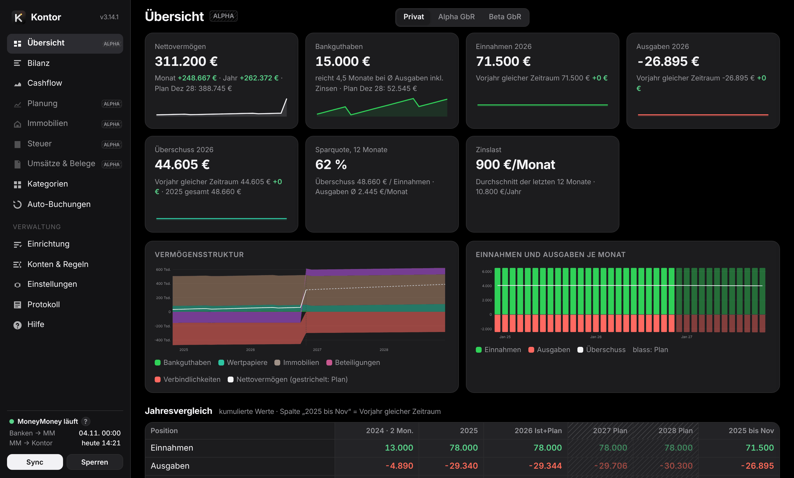

<a id="kontor-and-moneymoney"></a>
## Was MoneyMoney macht und was Kontor macht

Der Unterschied in einer Tabelle:

| MoneyMoney | Kontor |
|---|---|
| Holt Umsätze und Salden von Banken, Depots und Zahlungsdiensten. | Liest diese Daten über die Skript-Schnittstelle von MoneyMoney. Zugangsdaten zu Banken sieht Kontor nie. |
| Kategorisiert Umsätze, von Hand oder per Regel – die einzige Stelle für Kategorien. | Nutzt diese Kategorien. Was noch keine hat, ordnest du in Kontor zu; Kontor trägt es in MoneyMoney ein und schlägt Regeln vor. |
| Führt Offline-Konten: private Darlehen, Beteiligungen, Immobilien, Kapitalkonten. | Bucht nach deinen Regeln nur in solche Offline-Konten: Darlehensraten spiegeln und Zinsen berechnen, Beteiligungen und Kontenspiegel deiner Gesellschaften. |
| Hat keine Bilanz, keine Planung, keine Steuerübersicht. | Bilanz je Bereich, Cashflow mit Abgleich gegen die Bilanz, rollierende Planung, Immobilienkalkulation, Steuer-Jahresübersicht, Belege, Excel-Export, KI-Assistent. |

Was Kontor in MoneyMoney schreibt: nur die Kategorie der Umsätze, die du zuordnest, und Buchungen in Offline-Konten nach deinen Regeln. Kontor ändert in MoneyMoney nie Buchungen, den Kategorienbaum oder Regeln und löst keine Überweisungen aus.

**Alpha**: Seiten, die im Menü blass und mit „Alpha“ markiert sind (derzeit Planung, Immobilien, Steuer sowie Umsätze & Belege), sind nutzbar, aber noch nicht vollständig geprüft – Zahlen dort bitte gegenprüfen. Ebenso die Eigenkapitalquote in der Bilanz. Geprüft sind Bilanz, Cashflow, Kategorien, Auto-Buchungen, Buchungsregeln, Synchronisierung, Einrichtung, Einstellungen, Updates, Protokoll und Hilfe.

<a id="setup"></a>
## Einrichtung

Kontor einrichten: Die Einrichtung führt dich in ersten Schritten durch alles, was nötig ist – sie ist nur ein Weg durch die Seiten, die du auch später findest. Die „?“ neben Feldern erklären kurz; ein Klick darauf (am iPhone: zweites Tippen) öffnet den passenden Abschnitt dieser Hilfe.

**Wo was liegt** – eine Faustregel: Was deine Zahlen bestimmt, steht unter **Konten & Regeln** (Konten, Bereiche, Kontostände, Cashflow-Positionen, Buchungsregeln, Steuer). Wie Kontor arbeitet, steht unter **Einstellungen** (Allgemein, MoneyMoney-Sync, Zugang, Belege, KI-Assistent, Updates, Sichern & Zurücksetzen).

Die **Einrichtung** ist ein geführter Weg durch genau diese Seiten: alle Bausteine in einer sinnvollen Reihenfolge, jeder zeigt, ob er schon eingerichtet ist, und öffnet seine Seite. Beim ersten Start öffnet Kontor sie von selbst. Nötig sind MoneyMoney, Bereiche und Konten – sie bauen aufeinander auf –, der Rest ist optional und jederzeit nachholbar; „Kategorisieren“ steht bewusst spät, weil es am meisten Arbeit macht und Buchungsregeln und Cashflow-Positionen es leichter machen. Sind die nötigen Schritte erledigt, blendet **Einrichtung abgeschlossen** sie aus dem Menü aus; „Einrichtung prüfen“ oben rechts unter Konten & Regeln öffnet sie wieder. Dort liest „Einrichtung prüfen“ MoneyMoney und meldet, ob alle Konten und Kategorien, auf die sich deine Einstellungen beziehen, noch existieren – etwa nachdem du in MoneyMoney etwas umbenannt hast.


1. **Als App im Dock** (optional) – Kontor in einem eigenen Fenster: „Mac-App öffnen“, im Dock behalten und dort weitermachen ([Als App](#app)).
2. **MoneyMoney** – MoneyMoney läuft und ist entsperrt; macOS fragt beim ersten Mal, ob Kontor MoneyMoney steuern darf (Automation). Erlauben.
3. **Bereiche** – welche Konten zusammengehören.
4. **Konten** – Bereich, Position und Verlauf jedes Kontos bestätigen.
5. **Historische Kontostände** – den bisherigen Verlauf einmalig aus MoneyMoney übernehmen.
6. **Buchungsregeln** und **Cashflow-Positionen** (wo jede Kategorie zählt; mit einer Empfehlung für deine Kategorien in MoneyMoney).
7. **Immobilien**, **Planung**, **Steuer**, **Belege**, **iPhone-Zugriff**, **KI-Assistent**.
8. **Kategorisieren** (Umsätzen ohne Kategorie eine geben) und zum Schluss **Abgleich und Freigabe**.

Danach erstellt „Auswertung erstellen“ die erste Auswertung. Die Sprache (Deutsch oder Englisch) wählst du auf der Anmeldeseite, in der Einrichtung oder unter Einstellungen → Allgemein. Dort stellst du auch das Erscheinungsbild ein: dunkel (Standard), hell oder wie das System – je Gerät. Beides gilt sofort, ohne Speichern.

<a id="app"></a>
### Als App

Am Mac baut Kontor seine eigene App (`Kontor.app` im Programmordner; die Installation öffnet sie): ein Fenster nur für Kontor, ohne Tabs und Adressleiste, auch über Spotlight zu öffnen. **Mac-App öffnen** steht in der Einrichtung (Schritt 1) und unter Einstellungen → Allgemein → Als App; damit sie im Dock bleibt: Rechtsklick auf ihr Symbol → Optionen → Im Dock behalten. In der App führt das Menü überallhin (Wischen mit zwei Fingern blättert nicht zurück), Exporte und Sicherungen landen im Ordner „Downloads“, das Symbol im Dock zeigt, wie viele Auto-Buchungen warten (abschaltbar unter Einstellungen → Allgemein → Zahl im Dock), und nach dem Mikrofon fragt macOS nur einmal ([Diktieren](#assistant-dictation)). Sie zeigt nur Kontor: Links nach außen öffnet der Browser.

Lässt sich die App nicht bauen (sie braucht die Kommandozeilen-Werkzeuge von Apple), zeigt Kontor stattdessen den Weg über den Browser – Safari: Ablage → Zum Dock hinzufügen; Chrome und Edge: „Als App installieren“. Am iPhone: in Safari Teilen → Zum Home-Bildschirm ([Zugriff vom iPhone](#iphone)).

**Tastaturkürzel**: ⌘K blendet den Assistenten ein und aus, ⌘S speichert die Buchungsregeln (Einstellungen speichern sich bei jeder Änderung von selbst), ⌘P druckt, ⌘R lädt die Seite neu. ⌘F sucht – in der Hilfe und unter Umsätze & Belege im eigenen Suchfeld (in der Hilfe Wort für Wort, wie du es sagen würdest – „Kredit tilgen“, „Passwort vergessen“ –, jedes Wort in seinen Formen; die Suche springt gleich in den passendsten Abschnitt, ↩ oder ⌘G zum nächsten Fund, ⇧↩ oder ⇧⌘G zum vorigen), sonst in der Mac-App mit einer Suchleiste (Treffer markiert und gezählt; ⌘G und ⇧⌘G oder ↩ springen zum nächsten und zum vorigen, esc schließt sie). Zuverlässig nur als App – ein Browser belegt diese Tasten meist selbst: ⌘L sperrt, ⇧⌘R gleicht mit MoneyMoney ab, ⌘1 bis ⌘9 öffnen die Seiten in der Reihenfolge des Menüs. Die Mac-App hat dazu eine Menüleiste, unter anderem mit ⌘, für die Einstellungen und ⌘+, ⌘− und ⌘0 für die Größe der Darstellung. Wo ein Kürzel wirkt, nennt es der Tooltip des Knopfs. esc schließt, was offen ist – Seitenfenster, Rückfrage, das Menü eines Rechtsklicks und bei schmalem Fenster das Menü links.

<a id="areas"></a>
### Bereiche

Ein Bereich ist eine Menge von Konten mit eigener Bilanz, eigenem Cashflow, eigener Planung, Steuerübersicht, Umsätzen und Belegen – zum Beispiel „Privat“ und je eine Gesellschaft. Eine Firma, GbR oder GmbH anlegen: als eigenen Bereich der Art „Gesellschaft“ (hinzufügen unten in der Liste). Vorschlag: jede Kontengruppe auf oberster Ebene in MoneyMoney. Du kannst Konten und Gruppen aber beliebig zuordnen, zusammenlegen oder weglassen. Ein Bereich ist der Hauptbereich (privat); er ist beim Öffnen vorausgewählt. Gesellschaften bekommen Art und deinen Anteil – mit dem Anteil rechnet Kontor deine Beteiligung und die Steuer. Art und Hauptbereich sind aus den Namen vorbelegt; bitte prüfen. Mit ▲ ▼ legst du die Reihenfolge fest, in der die Bereiche oben in der Leiste stehen. Bereiche lassen sich umbenennen, löschen, zusammenlegen oder aus einzelnen Konten und Gruppen zusammenstellen; Konten, die keinem Bereich angehören, zählen nirgends.

<a id="accounts"></a>
### Jedes Konto: Bereich, Position, Verlauf

Jedes Konto bekommt einen Bereich, eine Position in der Bilanz (die Kontoart: Bankguthaben, Wertpapiere, Darlehen …) und eine Verlaufsquelle – zuordnen und ändern unter Konten & Regeln → Konten. Kontor schlägt alles vor; gestrichelt heißt „Vorschlag gewählt“, durchgezogen „eigene Wahl“. Nach dem Speichern bleibt es fest: Umbenennen oder Verschieben in MoneyMoney ändert nichts mehr. Neue Konten erscheinen als „neu“, bis du sie bestätigst. Konten erscheinen überall in der Reihenfolge von MoneyMoney.


**Positionen** (Zeilen der Bilanz, sortiert nach Verfügbarkeit). Für jedes Konto wählst du, wie schnell und ohne Abschlag es zu Geld wird – oder ob es eine Schuld ist:

| Position | Was dazugehört |
|---|---|
| Bankguthaben | Giro, Tagesgeld, Kreditkarte – sofort verfügbar |
| Wertpapiere | Depots mit Aktien, Fonds, ETF/ETC, Derivaten, dazu Krypto und Edelmetall – in Tagen verkäuflich, mit Kursrisiko |
| Festanlagen | Festgeld, P2P-Kredite, Bausparvertrag, Lebens- und Rentenversicherung – vor Ende nur mit Wartezeit oder Abschlag zu Geld; zählen nicht als verfügbar |
| Immobilien, Beteiligungen, Sachwerte | langfristig gebunden; zu Beteiligungen gehören auch Guthaben auf Kapital- und Gesellschafterkonten (auch Gesellschafterdarlehen) |
| Forderungen | Darlehen an andere, Kautionen |
| Verbindlichkeiten | Darlehen, Kreditkartenschulden, Schulden auf Kapitalkonten |
| außerhalb des Nettovermögens | Avale & Bürgschaften, „nicht bilanzieren“ |

Faustregel zwischen Wertpapieren und Festanlagen: In wenigen Tagen ohne Abschlag zu Geld? Dann Wertpapiere, sonst Festanlagen. Kontor schlägt eine Position vor – nach Depot, Kontoname (z. B. „Immobilie“, „Darlehen“, „Kapitalkonto“, „Aval“, „Bauspar“), Kontotyp und Gruppe in MoneyMoney. Darlehen und Kautionen zählen mit Guthaben als Forderung, mit Schuld als Verbindlichkeit. Kapital- und Gesellschafterkonten (auch Gesellschafterdarlehen) zählen mit Guthaben zu den Beteiligungen – es ist Risikokapital, das Verluste mitträgt und erst beim Ausscheiden zurückfließt –, mit Schuld als Verbindlichkeit: In der Gesellschaft ist das eine Schuld an den Gesellschafter. Der Wert einer Beteiligung ist dann dein Anteil am Rest; zusammen mit dem Kapitalkonto ergibt das deinen ganzen Anteil, auch bei ungleichen Einlagen.

**Anzeige**: „nach Aktivität“ blendet Konten aus, die seit N Monaten weder Bestand noch Umsatz haben; „immer anzeigen“ oder „ausblenden“ legt es fest. Ausgeblendete Konten zählen in allen Summen mit.

<a id="history"></a>
### Verlauf eines Kontos

Woher die Monatsstände eines Kontos kommen – sein Kontostand früher, Monat für Monat:

- **Umsätze** (Standard für Bankkonten): Stand am Monatsende = heutiger Saldo minus alle späteren gebuchten Umsätze – so rechnet auch MoneyMoney. Vorgemerkte Umsätze zählen nicht. Vor dem ersten Umsatz gibt es keinen Stand – außer das Konto bestand schon länger mit 0 (aus MoneyMoney übernommene oder eigene Kontostände, alle 0, und kein eigener Anfangssaldo): dann steht ab dort 0.
- **Kontostände**: eingetragene oder übernommene Stände sind Anker; die Monate dazwischen rechnet Kontor mit den Buchungen. Abweichungen erscheinen im Cashflow als „Korrektur Kontostand“.
- **Depots**: haben keine Buchungen. Kontor nimmt die aus MoneyMoney übernommenen Stände und zeichnet danach jeden Monat selbst auf.

Kontor schätzt nichts. Ein Klick auf ein Konto in der Bilanz öffnet sein Verlauf-Fenster mit Grafik, Monatsständen und Prüfhinweisen; dort lassen sich Stände eintragen oder aus einer Datei übernehmen. Bei Depots stehen oben die Positionen (Menge, Wert, Gewinn/Verlust).

Das Fenster prüft auch die Rückrechnung: Anfangssaldo vor der ersten Buchung in MoneyMoney, vorgemerkte Umsätze, negative Stände bei Konten, die nicht ins Minus können. Bei Depots ohne übernommenen Verlauf steht „vor … unbekannt“.

**Stände aus einer Datei** (Konten & Regeln → Kontostände oder Verlauf-Fenster): CSV oder Excel (.xlsx), als Liste (Datum, Konto, Saldo) oder als Tabelle mit Stichtagen in der Kopfzeile oder in der ersten Spalte. Importierte Konten stehen danach auf „Kontostände“.


<a id="balances"></a>
### Historische Kontostände

Alte Kontostände laden: MoneyMoney gibt den Verlauf der Kontostände über seine Schnittstelle nicht heraus – vor allem bei Depots fehlt sonst die Vergangenheit. Einmalig liest Kontor ihn deshalb aus der Datenbankdatei von MoneyMoney: MoneyMoney beenden, „Im Finder zeigen“, die Datei `MoneyMoney.sqlite` ins Fenster ziehen (die Datenbank hochladen) und das MoneyMoney-Passwort in einem macOS-Fenster eingeben. Kontor bekommt nur einen daraus berechneten Schlüssel, entschlüsselt nur im Arbeitsspeicher, prüft die Werte am aktuellen Saldo und speichert nur Monatsend-Stände, verschlüsselt. In MoneyMoney wird nichts verändert. Erneutes Einlesen ersetzt den bisherigen Stand.

**Namen der Wertpapiere** (optional): Nach dem Einlesen erscheint darunter ein weiterer Schritt. Kennt MoneyMoney ein Wertpapier nur mit seiner ISIN, kannst du seinen Namen nachschlagen lassen. Auf Klick schlägt Kontor die Namen einmalig bei OpenFIGI nach, einem frei zugänglichen Verzeichnis für Wertpapiere. Gesendet werden nur diese ISINs (vorher aufklappbar zu sehen) – keine Beträge, Mengen, Konten oder Namen. Das geschieht nur auf deinen Klick, nie von selbst (alle Verbindungen nach außen: [Sicherheit](#security)). Außerdem listet der Schritt alle Wertpapiere mit ISIN und ihrem Namen (aus MoneyMoney, sonst nachgeschlagen); dort kannst du Namen ändern oder fehlende eintragen. Geänderte und nachgeschlagene Namen werden getrennt abgelegt – in MoneyMoney ändert sich nichts – und lassen sich wieder entfernen.

Erneutes Einlesen ersetzt alle bisher eingelesenen Stände – ein Zurücksetzen vorher ist nicht nötig. Wertpapiere, zu denen MoneyMoney weder Namen noch ISIN mehr gespeichert hat (oft lange verkaufte), heißen „Unbenannt 1, 2, …“ und lassen sich nicht nachschlagen. Hält das Depot früher wie heute nur ein einziges Wertpapier, zählt der Verlauf ohne Namen zu ihm.

**Danach zeichnet Kontor selbst auf**: Bankkonten rechnet Kontor ohnehin exakt aus den Umsätzen zurück. Für Depots merkt sich Kontor bei jedem Lesen den aktuellen Wert. Der Dienst läuft im Hintergrund, auch ohne geöffnetes Kontor-Fenster – nach einem Neustart des Macs oder einem Update, sobald du dich einmal bei Kontor angemeldet hast –, und liest innerhalb von etwa 20 Sekunden, sobald MoneyMoney offen und entsperrt ist – ein kurzer Blick in MoneyMoney genügt. Jeder Stand zählt für den Monat, in dem MoneyMoney ihn bei der Bank abgerufen hat. Hat MoneyMoney abgerufen, während Kontor nicht lief, oder fehlt ein Monat, weist Konten & Regeln → Kontostände darauf hin; dort steht auch je Depot, ab wann Kontor Stände kennt.

<a id="setup-loans"></a>
### Darlehen einrichten

Wie du ein Darlehen in MoneyMoney führst, damit Bilanz, Cashflow und Steuer stimmen – für geliehenes Geld (Verbindlichkeit) und verliehenes (Forderung, die Vorzeichen umgekehrt):

- **Mit eigenem Konto bei der Bank in MoneyMoney** (etwa eine Baufinanzierung, die MoneyMoney abruft): nichts weiter zu tun – die Bank bucht Auszahlung, Tilgung und Zinsen, Kontor findet die Gegenbuchungen.
- **Sonst ein manuelles Konto** (Offline-Konto) in MoneyMoney anlegen – für ein Privatdarlehen von Familie oder Freunden, ein Verkäuferdarlehen oder ein Bankdarlehen, das MoneyMoney nicht abruft – und unter Konten & Regeln → Konten die Position **Verbindlichkeiten** wählen (verliehen: **Forderungen**).
- **Auszahlung**: zum Eingang auf dem Bankkonto die Gegenbuchung im Darlehenskonto (geliehen: minus). Im Cashflow steht das als **Aufnahme** unter Finanzierung.
- **Rate**: zu jeder Zahlung die Gegenbuchung mit der **vollen Rate** im Darlehenskonto, dazu die Zinsen des Monats als eigene Buchung dort (geliehen: minus, „Zinsen“ im Text). Kontor zeigt dann je Darlehen Tilgung (Rate minus Zinsen) und Zinsen, die Restschuld stimmt. Spiegelst du nur den Tilgungsanteil, passen die Beträge nicht zusammen: Die Rate steht unter „Unklar“, die Tilgung als Wertänderung.
- **Kategorie**: nicht nötig – Kontor findet die Gegenbuchung am Betrag (höchstens drei Tage auseinander, mit „Umbuchung“ auf beiden Seiten bis zu einer Woche). „Umbuchung“ passt. Keine Einnahme- oder Ausgabenkategorie auf die Bankbuchung: Dann zählt sie als Einnahme oder Ausgabe, die Gegenbuchung als Wertänderung. Im Text der Gegenbuchung keine Wörter wie „Zins“, „Gebühr“ oder „Provision“ – solche Buchungen zählen als Zinsen.
- **Ohne Handarbeit**: Die Buchungsregel [Manuelle Darlehen](#rules-loans) erkennt die Rate, bucht sie als Tilgung ins Darlehenskonto und jeden Monat die Zinsen; nur die Auszahlung buchst du selbst. Was du schon von Hand gebucht hast, zählt als gebucht.
- **Zinsen kategorisieren** (ohne Darlehenskonto oder getrennt überwiesen): eine Kategorie mit „Zins“ im Namen, etwa „Ausgaben › Zinsen“ – gezahlte Zinsen zählen unter Finanzierung → Zinsen, erhaltene unter Kapitalerträge, gleich unter welcher Oberkategorie. Für erhaltene und gezahlte Zinsen zwei Kategorien: Die Summe einer Kategorie entscheidet, wo sie ganz zählt (Tagesgeldzinsen und Darlehenszinsen in einer würden verrechnet). Unter [Cashflow-Positionen](#categories-positions) steht, wo sie zählt. Je Darlehen und als Schuldzinsen für die [Steuer](#tax) zählen nur Zinsen, die im Darlehenskonto gebucht sind.
- **Ganz ohne Konto**: die Kategorien Darlehen › Tilgung und Darlehen › Zinsen ([Empfohlene Kategorien](#categories-tree)); eine Auszahlung unter Tilgung zählt als Aufnahme. Eine Restschuld steht dann nicht in der Bilanz.

<a id="setup-property"></a>
### Immobilie einrichten

Wie du eine Immobilie – Wohnung oder Haus – kaufst und in MoneyMoney buchst: Kauf, Finanzierung, Miete und Kosten.

- **Konto der Immobilie**: ein manuelles Konto in MoneyMoney mit der Position **Immobilien** (Konten & Regeln → Konten). Sein Stand ist der Wert in der Bilanz; Wertanpassungen buchst du dort ohne Kategorie (Wertänderung).
- **Kaufpreis vom eigenen Konto** (eigenes Geld): die Gegenbuchung im Konto der Immobilie – im Cashflow eine Investition in Immobilien.
- **Darlehen direkt an den Verkäufer oder Notar ausgezahlt**: Das Geld läuft über keines deiner Konten – buche es auf beiden manuellen Konten, im Darlehenskonto minus und im Konto der Immobilie plus, beide mit der Kategorie „Umbuchung“. Im Cashflow erscheint nichts (es floss kein Geld von dir), in der Bilanz stehen Schuld und Wert. Ohne Kategorie stünden zwei gegenläufige Wertänderungen da. Das Darlehen selbst führst du wie unter [Darlehen einrichten](#setup-loans).
- **Kaufnebenkosten** (Grunderwerbsteuer, Notar, Grundbuch, Makler): entweder als Gegenbuchung ins Konto der Immobilie – dann gehören sie zu ihrem Wert – oder unter einer Kategorie wie „Sparen & Anlegen › Kaufnebenkosten“: Kontor zählt sie als Investition, nicht als Kosten, und ohne [Zielkonto](#positions-recipients) als Geld, das das Vermögen verlässt. Das gilt auch unter der Kategorie der Immobilie selbst: „Vermietung › Parkweg › Kaufpreis“ und „… › Kaufnebenkosten“ erkennt Kontor am Namen als Kauf, nicht als Kosten des Objekts – im Cashflow, im Soll/Ist der Immobilie und in der Steuerübersicht (Anschaffungskosten sind keine Werbungskosten, sie laufen über die AfA).
- **Miete und Kosten**: je vermietetem Objekt eine Kategorie unter **Vermietung**, etwa „Vermietung › Parkweg › Miete“ und „… › Hausgeld“ ([Empfohlene Kategorien](#categories-tree)); dasselbe Muster liest die [Steuer](#tax). Selbst bewohnt: Wohnen.
- **Rendite und Plan**: unter [Immobilien](#properties) je Objekt eine Kalkulation; verknüpft mit dem Konto der Immobilie, den Darlehenskonten und der Vermietungskategorie vergleicht sie Soll und Ist. In der Planung geht es vom tatsächlichen Stand weiter: Restschuld und Wert beginnen bei dem, was die Konten zeigen – eine Sondertilgung, die die Kalkulation nicht kennt, senkt also die geplanten Zinsen (bei jährlicher Abrechnung ab dem nächsten Januar) –, Rate, Zinssatz und Wertentwicklung kommen aus der Kalkulation. Unter Konten & Regeln → Steuer ordnest du jedes Darlehen seinem Objekt zu (Schuldzinsen).

<a id="sync"></a>
## Synchronisierung

Der Datenstand hat zwei Stufen: **Banken → MoneyMoney** (MoneyMoney ruft bei den Banken ab) und **MoneyMoney → Kontor** (Kontor liest aus MoneyMoney). Beide Zeitpunkte stehen unten links. „Sync“ (als App: ⇧⌘R) liest sofort und aktualisiert alles; automatisch liest Kontor alle 30 Minuten (einstellbar) und sobald MoneyMoney neue Daten hat – jeweils nur, wenn MoneyMoney läuft und entsperrt ist (Kontor startet es nicht selbst). Nach einem Neustart des Macs oder einem Update wartet der Abgleich, bis du dich einmal bei Kontor angemeldet hast.

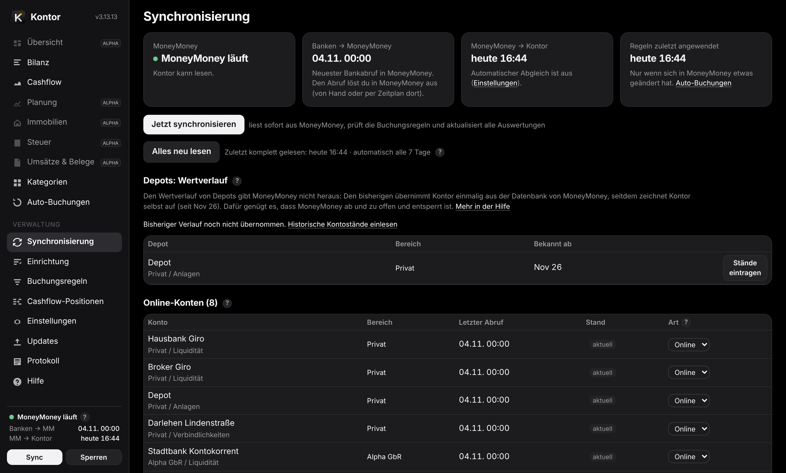

- **Schnell lesen**: Ein Abgleich liest nur die Umsätze der letzten 30 Tage und übernimmt ältere aus dem letzten vollständigen Lesen.
- **Kontrolle**: Dabei prüft Kontor jeden Kontostand. Passt er nicht zu den gelesenen Umsätzen, hat sich in MoneyMoney etwas Älteres geändert – etwa eine nachträgliche Buchung mit altem Datum oder ein gelöschter Umsatz. Dann liest Kontor sofort alles (höchstens alle 12 Stunden).
- **Vollständig lesen**: alle 30 Tage (einstellbar) und mit „Alles neu lesen“ – außerdem sofort, wenn sich der Kategorienbaum in MoneyMoney ändert oder neuere Umsätze eine andere Kategorie bekommen (dann hast du vermutlich auch ältere umsortiert). Eigene Buchungen von Kontor brauchen keins: Kontor behält sie bis dahin. Nur eine einzeln geänderte Kategorie eines Umsatzes, der älter als 30 Tage ist, erscheint erst dann – dafür „Alles neu lesen“.
- Ein Bankabruf ohne neue Daten löst keine Neuberechnung aus.
- **Umsätze lesen** (Einstellungen → MoneyMoney-Sync): wie weit zurück Kontor liest; 0 = alle (empfohlen).

Einstellungen → MoneyMoney-Sync meldet Konten, die MoneyMoney länger als einen Tag nicht abgerufen hat (mit der Zahl der Tage). Dort stehen nebeneinander **Jetzt synchronisieren** (liest sofort, prüft die Buchungsregeln, rechnet neu) und **Alles neu lesen** (liest alle Umsätze komplett – nur nötig, wenn sich in MoneyMoney Älteres geändert hat) sowie der Weg zum [Protokoll](#log).

**Online oder offline** (Konten & Regeln → Konten, Spalte „Art“): Online-Konten ruft MoneyMoney bei der Bank ab, Offline-Konten führst du von Hand (Darlehen, Beteiligungen, Immobilien …). Die Unterscheidung braucht Kontor für zwei Dinge: Gebucht wird nur in Offline-Konten, und nur Online-Konten zählen für den Datenstand – MoneyMoney setzt bei einem Offline-Konto nach jeder Buchung einen neuen Abrufzeitpunkt, der sonst einen Abruf vortäuschen würde. Kontor erkennt die Art selbst (nie abgerufen, ohne Bank- und Kontonummer, als Offline-Konto angelegt oder von Kontor bebucht); der Tooltip nennt den Grund und bei Online-Konten den letzten Abruf. Ändern musst du sie nur, wenn Kontor sich irrt – etwa bei einem von Hand geführten Konto mit eingetragener Bankleitzahl; die Änderung gilt sofort. Ist MoneyMoney zu oder gesperrt, passiert nichts – der nächste Abgleich holt alles nach.

<a id="tables"></a>
## Tabellen, Schalter und Excel

Überall wählst du **Monate** (mit Jahressummen) oder nur **Jahre**. Jahresspalten sind kumuliert: Zahlungsflüsse als Summe, Bestände als Stand zum Jahresende. Blass sind der laufende Monat und das laufende Jahr (noch nicht abgeschlossen), blass und schraffiert die Planwerte.

- **▸ in der Kopfzelle** der Bilanz klappt alle Positionen auf; das **Auge** daneben (mit Anzahl, nur wenn es welche gibt) zeigt auch leere und nach Aktivität ausgeblendete Konten (mitgezählt werden sie immer). Steht bei einer Position „(9/12)“, sind 9 von 12 Konten zu sehen. **Leere Zeilen** (Cashflow, Planung) zeigt auch Zeilen ohne Werte.
- Die **Monatsansicht** zeigt das laufende Jahr und das davor; mit **‹ ab 2025 ›** neben „Monate / Jahre“ beginnt sie ein Jahr früher oder später, „Jahre“ zeigt alle Jahre. Im Cashflow steht beim Öffnen der letzte abgeschlossene Monat im Blick: je nach Breite daneben der laufende Monat, der Monat davor und ab vier Spalten der erste Planmonat (ab acht die ersten zwei). Ein Klick in der Bilanz-Grafik auf einen früheren Monat holt ihn ebenfalls dazu.
- **Plan** (Cashflow) hängt die Planwerte rechts an; aus = nur Ist-Werte. Bilanz und Planung zeigen den Plan immer.
- **inflationsbereinigt** (Planung) zeigt Planwerte in heutiger Kaufkraft.

Jede Tabelle hat einen **Excel**-Knopf: Bilanz, Cashflow, Planung (mit Fortschreibung und Parametern), Steuer, Umsätze (wie gefiltert, alle Treffer), Depots, Konten und jede Immobilienkalkulation.

**Rechtsklick** auf eine Zahl, eine Zeile oder einen Spaltenkopf: **Wert kopieren**, **Zeile kopieren** oder **Spalte kopieren** (Zeilen und Spalten als Tabelle, die sich in Excel oder Numbers einfügen lässt); auf eine Grafik: **Grafik drucken …**. Ist der [KI-Assistent](#assistant) eingeschaltet, stehen darüber **Kurz erklären** – sofort ein, zwei Sätze in einem kleinen Kasten am Mauszeiger, nicht im Chat – und **Im Chat fragen**: Die Stelle steht dann als Bezug vor deiner Frage, und ein Klick auf den Bezug springt dorthin zurück und markiert die Zahl oder Zeile. Mit gedrückter Umschalttaste erscheint stattdessen das Menü des Browsers.

<a id="balance-sheet"></a>
## Bilanz

Die Bilanz zeigt je Bereich das Vermögen nach Positionen – was du hast (Aktiva) und was du schuldest (Passiva); der Unterschied ist das Eigenkapital, dein Nettovermögen – Monat für Monat oder Jahr für Jahr, mit Plan bis Dezember des letzten Planjahres: oben die große Grafik, darunter die Tabelle (so verschiebt das Aufklappen von Zeilen die Grafik nicht), unten drei einzelne Grafiken (mit den Pfeilen verschiebbar). **Monate oder Jahre** (oben links) gilt für alles zusammen.

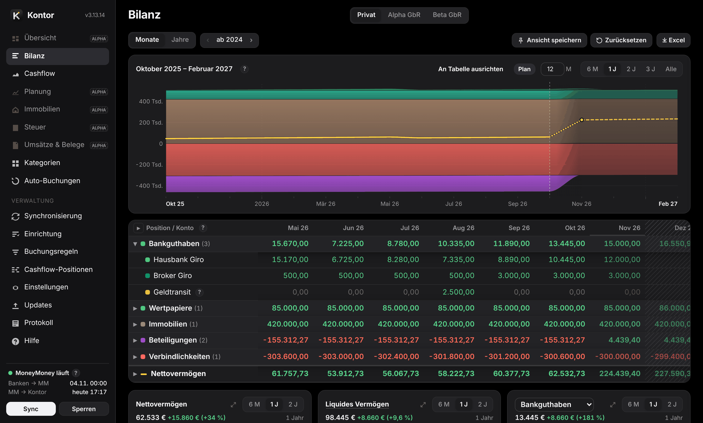

**Zeiträume und Darstellung**

- Werte sind Salden am Monatsende; der laufende Monat zeigt den aktuellen Stand.
- Die Grafiken enden am letzten abgeschlossenen Monat und zählen von Monatsende zu Monatsende: Im November reicht „1 J“ von Oktober des Vorjahres bis Oktober, die Veränderung umfasst also genau zwölf abgeschlossene Monate. Erster und letzter Monat stehen immer auf der Zeitachse; der Wert gilt für das Ende des Zeitraums, die Veränderung (in € und %) seit seinem Beginn – bei der großen Grafik ebenso, nur die Bilanz zeigt keinen Wert und keine Veränderung. Der kürzeste Zeitraum ist ein Monat (Veränderung zum Vormonat).
- Rechts davon (durch Wischen oder „Alle“) folgt der laufende Monat, gepunktet und mit einem weichen Übergang hinterlegt – dort laufen schon Ist-Daten ein –, danach der Plan, gestrichelt und hinterlegt. Die senkrechte gestrichelte Linie markiert das Ende des letzten abgeschlossenen Monats. In der Tabelle ist der laufende Monat bzw. das laufende Jahr blass, der Plan blass und schraffiert.
- Farben: Positionen nach Verfügbarkeit, von Bankguthaben (grün) bis Beteiligungen (violett); Konten in Abwandlungen der Farbe ihrer Position (ab dem elften Konto schraffiert), in Tabelle und Grafiken gleich. Das Nettovermögen ist golden; der goldene Strich davor im Werte-Fenster und in der Tabelle steht für seine Linie.

<a id="balance-sheet-table"></a>
### Bilanztabelle

- Klick auf den **Namen** einer Position klappt ihre Konten auf (**▸** in der Kopfzelle: alle Positionen; **▸** vor einem Depot: seine Wertpapiere). Klick auf den Namen eines Kontos öffnet seinen Verlauf (Monatsstände ansehen und bearbeiten), ein zweiter Klick schließt ihn wieder; bei einem Wertpapier ebenso.
- Klick auf einen **Wert** lässt Fläche und Monat in der großen Grafik kurz aufleuchten (die Grafik rückt dafür nötigenfalls zum Monat) – und klappt die Zeile einer Position, eines Depots oder des Nettovermögens zusätzlich auf bzw. zu. Klick auf eine Monatsüberschrift verschiebt die Grafik so, dass der Monat genau über der Spalte steht; ein Klick auf einen Wert des Nettovermögens ebenso, dazu blinkt sein Punkt in der Grafik kurz auf. Die einzelnen Grafiken behalten dabei ihre Länge und enden mit diesem Monat – so zeigen sie die Veränderung bis dahin. Die Seite selbst bleibt stehen. Fährst du über einen Namen, ist dieselbe Fläche in der Grafik hervorgehoben.
- Das **Auge** in der Kopfzelle (nur wenn es welche gibt, mit Anzahl) zeigt auch leere und nach Aktivität ausgeblendete Konten und Wertpapiere – mitgezählt werden sie immer. Was als ausgeblendet gilt, legst du unter [Konten & Regeln → Konten](#accounts) fest (Spalte „Anzeige“ und „Nach Aktivität … Monaten“, Standard 12); Wertpapiere ohne Wert in diesem Zeitraum gelten ebenfalls als ausgeblendet. „(9/12)“ heißt: 9 von 12 zu sehen.
- **Depots**: frühere Monate aus den eingelesenen MoneyMoney-Kontoständen (sonst aus Kontors monatlicher Aufzeichnung), der laufende Monat aus MoneyMoney; was die Wertpapiere nicht erklären, steht als „Übrige“. Beim Darüberfahren über ein Wertpapier stehen immer der Name aus MoneyMoney und die ISIN dabei, ebenso ob der Name nachgeschlagen oder geändert ist. Konten benennst du in MoneyMoney um – Kontor übernimmt die Namen von dort.
- Jahresspalten zeigen den Stand zum Jahresende (das laufende Jahr: heute, mit „Plan“ der geplante Dezember). In der Monatsansicht gibt es keine Jahresspalten – sie wären nur der Dezember; ein feiner Strich trennt die Jahre.
- Die erste Spalte ziehst du an ihrem rechten Rand breiter oder schmaler (Doppelklick: Standardbreite); die Breite gehört zur Ansicht.
- **Eigenkapitalquote** (Alpha; Klick auf „Nettovermögen“ klappt die Kennzahlen darunter auf): wie viel deines Vermögens dir schuldenfrei gehört – Eigenkapital ÷ (Eigenkapital + Schulden). Durchgerechnet durch deine Gesellschaften: Deren Schulden zählen mit deinem Anteil (Bereiche), wenn die Beteiligung unter Buchungsregeln → Gesellschaften eingetragen ist, sonst sähe die Quote zu gut aus, weil die Bankdarlehen dort liegen. Schulden sind Konten mit negativem Stand; Kapital- und Gesellschafterkonten sind Eigenkapital, Beteiligungen selbst nie Schulden. Wie du Kapitalkonten buchst, ändert nichts. Beteiligungen ohne diesen Eintrag zählen nur mit ihrem Wert; liegen Konten einer Gesellschaft in keinem Bereich, ist die Quote unbekannt. Ein Klick zeigt die Rechnung des Monats Schritt für Schritt.
- Unter dem Nettovermögen stehen Avale & Bürgschaften (nicht im Nettovermögen), gesammelt in einer aufklappbaren Zeile.
- **Geldtransit**: Liegen die beiden Buchungen einer Umbuchung zwischen eigenen Konten in verschiedenen Monaten (am 31. abgebucht, am 1. gutgeschrieben), zählt der Betrag am Monatsende als „Geldtransit“ zum Bankguthaben – sonst sähe das Nettovermögen kurz zu niedrig aus. Ein Klick auf den Namen zeigt die erkannten Buchungspaare, ein Klick auf einen Monat nur die, die über dessen Ende unterwegs waren.

<a id="balance-sheet-chart"></a>
### Große Grafik

Jede der vier Grafiken kann die große sein: das Symbol ⤢ in einer kleinen Grafik tauscht sie mit der großen (Standard: die Bilanz).

- Zeitraum je nach Ansicht – Monate: 6 Monate, 1, 2 oder 3 Jahre (Standard 1 Jahr); Jahre: 1, 3, 5 oder 10 Jahre (Standard 3 Jahre) –, alles oder eine eigene Zahl von Monaten.
- Als Bilanz zeigt die große Grafik zusätzlich etwa ein Drittel des Zeitraums nach vorn: den laufenden Monat und den Plan (bei 1 Jahr den laufenden Monat und drei Planmonate, bei 3 Jahren zwölf Monate). **Plan** links neben den Zeiträumen schaltet das ab; die Einstellung gehört zur Ansicht. Die Zahl im Feld daneben zählt die Monate bis zum letzten abgeschlossenen, der Plan kommt dazu. Die Betragsachse hat mindestens fünf Hilfslinien.
- Darüberfahren zeigt die Werte des Monats in einem leicht durchsichtigen Fenster; die Fläche unter dem Mauszeiger und ihre Zeile im Fenster sind hervorgehoben. Über der Monatsachse erscheinen die Werte ohne Hervorhebung.
- Klick auf eine Fläche wirkt wie in der Tabelle: Eine Position klappt in ihre Konten auf, ein Depot in seine Wertpapiere; Klick auf ein Konto oder Wertpapier klappt die Position wieder zu. Danach ist markiert, was aufgeklappt wurde, bis sich die Maus bewegt. Klick daneben oder auf die Monatsachse springt zum Monat in der Tabelle.
- Wischen (auch auf der Monatsachse) verschiebt, mit zwei Fingern zoomen, Ziehen wählt einen Ausschnitt, Doppelklick neben den Flächen vergrößert. Auf der Betragsachse nach oben/unten ziehen vergrößert bzw. verkleinert den Wertebereich (das Mausrad verschiebt ihn), Tippen oder Klick dort macht ihn wieder automatisch. Am iPhone verschieben und zoomen zwei Finger, ein Finger zeigt die Werte. Das gilt auch für die einzelnen Grafiken.
- **An Tabelle ausrichten**: Jeder Wert steht genau über seiner Spalte. Die Grafik scrollt mit der Tabelle, Wischen oder Ziehen auf der Grafik scrollt die Tabelle, und die Skala passt sich den sichtbaren Spalten an. Das Werte-Fenster entfällt – die Werte stehen ja darunter.

<a id="balance-sheet-charts"></a>
### Einzelne Grafiken

Unter der Tabelle:

- **Bilanz** (wenn eine andere Grafik groß ist): ohne Wertzeile, dafür etwas höher.
- **Nettovermögen** allein, darunter Ø je Monat, Höchst- und Tiefststand. Beim Darüberfahren stehen nur Monat und Wert da.
- **Auswahl**: die Summe frei gewählter Positionen (Standard: Bankguthaben, Wertpapiere und Festanlagen – die Geldanlagen). Der Titel benennt die Auswahl in Worten – typische Kombinationen mit ihrem Namen, sonst zusammengesetzt wie „Geldanlagen + Verbindlichkeiten“ oder „Nettovermögen ohne Beteiligungen“, bei Platzmangel mit gekürzten Wörtern; die Linie hat die Mischfarbe der Positionen. Die Namen ergeben sich Schritt für Schritt – so steht es auch beim Darüberfahren über den Titel, dort nur mit den Positionen, die es im Bereich gibt:

```
  Bankguthaben
+ Wertpapiere
= Liquides Vermögen
+ Festanlagen
= Geldanlagen
+ Beteiligungen
+ Forderungen
= Geldvermögen
+ Sachvermögen (Immobilien + Sachwerte)
+ Sonstiges
= Bruttovermögen
+ Verbindlichkeiten
= Nettovermögen

Gebundenes Vermögen = Bruttovermögen − Liquides Vermögen
```

Geldvermögen und Sachvermögen sind wie in der Statistik der Bundesbank abgegrenzt: Beteiligungen zählen zum Geldvermögen, auch wenn die Gesellschaft Immobilien hält; Krypto und Edelmetall stehen bei Kontor unter Wertpapiere und damit im Geldvermögen. „Umlaufvermögen“ gibt es bewusst nicht – es hängt davon ab, wie lange du etwas halten willst, nicht davon, wie schnell es zu Geld wird.

- **Zusammensetzung** einer gewählten Position nach Konten (gestapelt). **Depot** daneben schlüsselt die Depots in ihre Wertpapiere auf (nur wo es das gibt); unten lassen sich Konten bzw. Wertpapiere einzeln abwählen – die Linie der Position bleibt, beim Darüberfahren steht zusätzlich die Summe der Auswahl.
- Jede hat einen eigenen Zeitraum (je nach Ansicht 6 Monate, 1 oder 2 Jahre bzw. 1, 3 oder 10 Jahre) und eine Achse, die sich den sichtbaren Werten anpasst (mindestens vier Hilfslinien) – so sieht man die Entwicklung auch dann, wenn sich große Positionen wie Forderungen und Verbindlichkeiten oben gegenseitig ausgleichen. Die Fläche reicht bis zur Nulllinie, bei negativen Werten also nach oben. Das Werte-Fenster ist leicht durchsichtig, damit die Linie darunter sichtbar bleibt. Unter den Zeitraum-Knöpfen steht die Länge des gezeigten Zeitraums (über zwei Jahren in Jahren und Monaten, z. B. „2 Jahre 8 Mon.“ oder „2 ½ Jahre“) – darauf beziehen sich Wert und Veränderung; nach dem Zoomen ist ein Knopf wieder markiert, sobald die Länge passt.

**Anordnung und Ansicht speichern**

- Die kleinen Pfeile **↑ ↓** im Kopf der Tabelle und der großen Grafik (beim Darüberfahren) verschieben sie nach oben oder unten, auch unter die einzelnen Grafiken.
- Was du beim Ansehen änderst (Monate oder Jahre, Zeiträume, Plan, aufgeklappte Zeilen, das Auge, Breite der ersten Spalte, Anordnung, welche Grafik groß ist, Auswahl in den Grafiken), gilt nur bis zum Neuladen. **Ansicht speichern** (oben rechts, neben Excel) merkt sich die aktuelle Ansicht auf diesem Gerät, getrennt für Monate und Jahre (z. B. Monate mit 2 Jahren, Jahre mit 10 Jahren). Die zuletzt gespeicherte öffnet beim Start; wechselst du zwischen Monaten und Jahren, gelten deren gespeicherte Zeiträume. Zeiträume enden dabei immer am letzten abgeschlossenen Monat, die Tabelle steht wie immer auf dem aktuellen Monat. **Ansicht zurücksetzen** stellt den Standard von Kontor wieder her. Der Bereich bleibt davon unberührt.

<a id="cash-flow"></a>
## Cashflow

Wohin das Geld fließt – Einnahmen und Ausgaben als Kapitalflussrechnung, für jeden Bereich in derselben Gliederung, damit sich privat, GbR und GmbH vergleichen lassen:

| Abschnitt | Inhalt |
|---|---|
| **Überschuss** | **Einnahmen** minus **Ausgaben** des laufenden Lebens oder Geschäfts (in Firmen der operative Cashflow; anders als eine Einnahmenüberschussrechnung ohne Abschreibungen und ohne gezahlte Zinsen), je nach festen Positionen (Arbeitseinkommen, Umsatzerlöse, Vermietung, Wohnen – bei Gesellschaften „Raumkosten“ –, Personal, Steuern, Umsatzsteuer …); darin deine Kategorien aus MoneyMoney. Erhaltene Zinsen und Dividenden zählen hier. |
| **Investitionen** | Kauf und Verkauf von Vermögen, nach Art: Immobilien (mit Kaufnebenkosten), Wertpapiere & Geldanlagen, Beteiligungen, gewährte Darlehen; darunter die einzelnen Konten. Das Geld verlässt das Bankkonto, bleibt aber Vermögen. |
| **Finanzierung** | Zahlungen an und von Geldgebern, nach Art: Darlehensaufnahme, Tilgung, Zinsen, bei Gesellschaften Einlagen und Entnahmen der Gesellschafter; darunter die einzelnen Darlehen. Die Auszahlung eines Darlehens ist eine Darlehensaufnahme, keine „negative Tilgung“. |
| **Free Cashflow** (FCF, ab der Ebene „Positionen“) | Überschuss und Investitionen zusammen: was nach Lebenshaltung und Anlegen übrig bleibt – oder, wenn negativ, was finanziert werden musste |
| **Veränderung Bankguthaben** | die drei zusammen (und was unklar ist); aufgeklappt das Bankguthaben am Anfang und am Ende |
| **Wertänderungen** | was sich ohne Zahlung ändert: Kurse von Depots, Wertanpassungen, Korrekturen von Hand, [Anlagen ohne Zielkonto](#positions-recipients) |
| **Veränderung Nettovermögen** | Überschuss, Zinsen, Einlagen und Entnahmen, Wertänderungen – Anlegen, Darlehen aufnehmen und tilgen schichten nur um |

Eine Zeile erscheint nur, wo Geld darin ist. Wie weit die Tabelle aufgeklappt ist, wählst du in ihrer Kopfzelle, direkt über den Pfeilen, mit vier Symbolen – je tiefer eingerückt, desto weiter aufgeklappt (am iPhone klappt der große Pfeil dort mit jedem Tippen eine Stufe weiter auf, zuletzt wieder zu): **Hauptebenen** (nur die drei Cashflows, Bankguthaben und Wertänderungen), **Überblick** (die drei Cashflows mit Einnahmen, Ausgaben und den Arten von Investition und Finanzierung – der ganze Cashflow auf einer Seite), **Positionen** (dazu die Positionen, Konten und Darlehen) oder **Details** (bis zu den Kategorien aus MoneyMoney). Beim Öffnen stehen die Hauptebenen da, Einnahmen und Ausgaben schon aufgeklappt. Jede Zeile mit ▸ öffnest und schließt du auch einzeln – per Klick auf ihren Namen oder per Doppelklick (langes Halten) auf eine ihrer Zahlen. Ein Klick auf eine Zahl zeigt die Umsätze dahinter in einem Seitenfenster, auch bei zusammengefassten Zeilen (etwa alles Unklare eines Monats auf einmal, oder eine Umbuchung, deren Gegenbuchung fehlt); der Cashflow bleibt stehen, „In Umsätze & Belege öffnen“ führt zur Seite mit Filter, etwa zum Korrigieren. Zahlen ohne Umsätze dahinter (Plan, Bewertungen) sind nicht anklickbar. Bewegungen stehen mit Vorzeichen (+/−), Bestände ohne. „Veränderung Nettovermögen“ klappt wie das Bankguthaben zu Anfangs- und Endstand auf. Das „?“ an einer Zeile erklärt sie. Das Zahnrad daneben führt zu den Cashflow-Positionen.

Jeder Umsatz zählt genau einmal. Umbuchungen zwischen eigenen Konten zählen nie als Einnahme oder Ausgabe (eine Kategorie mit dem Namen „Umbuchung“, „Übertrag“ oder „Eigene Konten“ erkennt Kontor; eine anders benannte stellst du unter Cashflow-Positionen auf „Umbuchung“): Kontor findet zu jeder die Gegenbuchung – über die Markierung seiner eigenen Buchungen (die Tilgung nennt die Zahlung), über die Gegen-IBAN (gleicher Betrag, höchstens fünf Tage auseinander) oder bei der Kategorie „Umbuchung“ und bei manuellen Konten über den Betrag (höchstens drei Tage; bis zu einer Woche, wenn beide Buchungen die Kategorie haben – etwa PayPal, das am Kauftag bucht, und die Bank Tage später). Zwei Umbuchungen auf demselben Konto, die sich im selben Monat aufheben (eine zurückgebuchte Aufladung), zählen zusammen nichts. Zahlungen in einen anderen Bereich sind **Einlagen oder Entnahmen** – außer du hast damit etwas bezahlt: Mit einer Kategorie, deren Position du gewählt hast oder deren Name sie klar benennt (dein Gehalt aus der eigenen GmbH, die Miete an die eigene GbR), zählen sie in dieser Position (eine Kategorie, die Kontor nicht sicher erkennt und die du nicht zugeordnet hast, ist unter Cashflow-Positionen mit „zwischen Bereichen“ markiert – ihr Vorschlag „Sonstige …“ gilt für diese Zahlungen noch nicht), ohne Kategorie schätzt Kontor nach dem Verwendungszweck; hältst du an einer Gesellschaft eine Beteiligung, steht der Unterschied zwischen eingezahltem Geld und Wert der Beteiligung unter Wertänderungen. Konten in Fremdwährung rechnet Kontor nicht um; sie stehen in der Bilanz außerhalb des Nettovermögens, ihre Beträge in keiner Euro-Summe (auch nicht in Steuer, Kategorien und den Summen gefundener Umsätze) – unter Umsätze & Belege steht vor jedem solchen Betrag seine Währung, unter Steuer ein Hinweis, welche Konten fehlen. Beginnt ein Konto erst später und startet es in MoneyMoney mit einem **Anfangssaldo**, zählt dieser als Umbuchung, wenn ein anderes Bankkonto im selben Monat genau den Gegenbetrag zeigt (etwa die Restschuld einer alten Karte), sonst als eigene Zeile „Anfangssaldo“ unter Wertänderungen.

Der **Abgleich mit der Bilanz** vergleicht jeden Monat: die Veränderung des Bankguthabens mit der der liquiden Konten, die Veränderung des Nettovermögens mit der in der Bilanz. Stimmt alles auf den Cent, steht nichts dabei; weicht ein Monat ab, steht ein kleines „✱“ an der Zahl, und eine Zeile „Abgleich mit der Bilanz“ nennt den Unterschied (jeweils in der aufgeklappten Zeile, vor dem Stand am Ende – er zählt mit); sie nennt beim Darüberfahren den Grund – etwa Geld in Transit über das Monatsende zu einem Darlehen, oder eine Kategorie auf „Nicht berücksichtigen“; ein Klick zeigt die Gründe und die Buchungen dahinter im Seitenfenster. Was Kontor nicht sicher zuordnen kann – etwa eine Umbuchung ohne Gegenbuchung –, steht unter „Unklar“ und zählt mit seinem Betrag.

In welcher Position eine Kategorie aus MoneyMoney zählt, schlägt Kontor nach ihrem Namen vor; ändern kannst du es unter [Cashflow-Positionen](#categories-positions) (Konten & Regeln, oder das Zahnrad in der Kopfzelle der Cashflow-Tabelle). Umsätze **ohne Kategorie** schätzt Kontor: zuerst nach deinen bisherigen Kategorien (gleiche Gegenpartei, gleicher Verwendungszweck), sonst nach Wörtern in Name, Verwendungszweck und Buchungstext (etwa „Gehalt“, Kartenabrechnungen; beim Finanzamt trennt Kontor Lohnsteuer – bei Gesellschaften Teil von Personal –, Umsatzsteuer und übrige Steuern). In der Position stehen sie als „ohne Kategorie, geschätzt“; was sich nicht schätzen lässt, steht unter „(ohne Kategorie)“. Je mehr du zuordnest, desto genauer – nötig ist es nicht, auch nicht für eine GmbH mit vielen Buchungen. In MoneyMoney trägt Kontor dabei nichts ein.

Eine Kategorie zählt auf **jedem Konto**, auch auf einem manuellen (Forderung, Darlehen, Sachwert). Buchst du dort etwas mit Kategorie aus – etwa den Teil einer Kaution, den der Vermieter für Schäden behält: −100 € im Kautionskonto unter „Wohnungsausstattung“ –, steht der Betrag in ihrer Position, und das Konto gilt um ihn als zurückgezahlt (eine Rechnung, die du als Verbindlichkeit buchst, zählt bei Fälligkeit, die Schuld als aufgenommen; ein Sachwert als verkauft); das Nettovermögen ändert sich um ihn. Ohne Kategorie ist eine solche Buchung eine Wertänderung des Kontos, mit „Zinsen“ im Text oder einer Zins-Kategorie Zinsen. Nicht nach ihrer Kategorie zählen die Gegenseite einer Umbuchung zwischen deinen Konten (die Bewegung zählt einmal, als Umbuchung), Kontors eigene Buchungen und Kategorien, die eine Zahlung brauchen (Sparen & Anlegen, Tilgung, Einlagen & Entnahmen, Nicht berücksichtigen) – auf einem manuellen Konto bleiben sie eine Wertänderung.

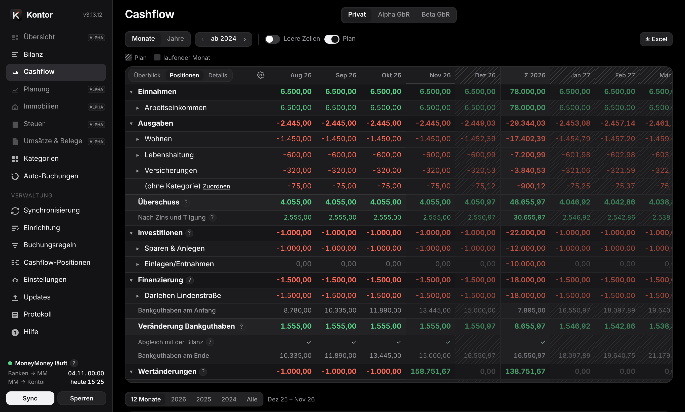

<a id="cash-flow-charts"></a>
### Diagramme

Unter der Tabelle zeigen Diagramme dieselben Zahlen für einen Zeitraum, den du darüber wählst: links von–bis (ein Klick auf einen Monat öffnet einen kleinen Kalender des Jahres; ‹ und › verschieben den Zeitraum um einen Monat, ebenso zwei Finger seitwärts über dem Monatlichen Cashflow; ein Klick auf eine Monatsüberschrift der Tabelle stellt die 12 Monate bis dorthin ein, die Überschrift ist dann markiert), rechts die letzten zwölf Monate (Standard), das laufende Jahr (seine abgeschlossenen Monate) und die zwei Jahre davor. Standard ist das Ende am letzten abgeschlossenen Monat – ein angefangener Monat sähe neben ganzen zu günstig aus. Du kannst aber in den laufenden Monat und in den Plan hinein gehen: Diese Monate sind in den Diagrammen schraffiert wie in der Tabelle, Planmonate zählen mit ihren geplanten Werten. Die Farbe steht für die Tätigkeit – Überschuss, Investition, Finanzierung – wie an den Abschnitten der Tabelle; Einnahmen und Zuflüsse sind grün, Ausgaben und Abflüsse rot:

- <a id="cash-flow-bridge"></a>**Liquiditätsbrücke** – vom Bankguthaben am Anfang zum Ende: jeder Balken beginnt, wo der vorige endet (Zuflüsse grün, Abflüsse rot). Je Tätigkeit (Überschuss, Investitionen, Finanzierung) spannt eine Klammer in ihrer Farbe über ihre Teile – sie ist kein eigener Schritt, sondern deren Summe. Ein Klick auf eine Zeile mit ▸ teilt sie weiter auf (Positionen, Kategorien) und macht sie selbst zur Klammer, ▾ fasst sie wieder zu einem Balken zusammen; daneben Betrag und Veränderung zum Vorjahr – grün oder rot nur bei Einnahmen und Ausgaben (mehr Einnahmen, weniger Ausgaben: grün); bei Investitionen, Finanzierung, Zinsen und Wertänderungen ohne Farbe, weil sich nicht sagen lässt, ob mehr oder weniger besser ist. Ab 1 000 % ist sie abgekürzt (+2T%). Oben steht eine Betragsachse: Ziehst du über das Diagramm, vergrößert es diesen Bereich; „Ganze Brücke“ daneben oder ein Klick auf die Achse zeigt wieder alles. Anfangs- und Endbestand sind das Bankguthaben laut Bilanz (die Summe deiner liquiden Konten am Monatsende): Ein Klick darauf – oder auf eine Zahl in den Zeilen „Bankguthaben am Anfang/Ende“ der Tabelle – zeigt sie in der Bilanz, die Zelle leuchtet kurz auf; in der Vermögensbrücke ebenso das Nettovermögen. Die Namen behalten ihre Breite, wenn du etwas aufklappst; lange Namen von Teilen sind gekürzt und stehen beim Darüberfahren ganz da.
- <a id="cash-flow-months"></a>**Monatlicher Cashflow** – Einnahmen und andere Zuflüsse nach oben, Ausgaben und andere Abflüsse nach unten, nach Art gestapelt; darunter, leicht abgesetzt und auf eigener Skala, die Veränderung des Nettovermögens, aufgeteilt wie unten in der Tabelle – Veränderung Bankguthaben, Umschichtungen, Wertänderungen, in denselben ruhigen Farben wie die Punkte dort. In beiden Teilen markiert ein kurzer, gestrichelter Strich das Ergebnis des Monats (oben die Veränderung des Bankguthabens, unten die des Nettovermögens); liegt es nahe der Null-Linie, fehlt er. Erster und letzter Monat sind immer beschriftet. Sind einzelne Monate viel größer als die übrigen (etwa ein Immobilienkauf), richtet sich die Skala nach den übrigen; diese Balken sind gekappt, mit zwei Strichen markiert und mit ihrer Höhe beschriftet. Auf der Skala links (oben wie unten) nach oben oder unten ziehen oder scrollen vergrößert bzw. verkleinert sie – die Skala ist dann markiert, ein Klick darauf stellt sie zurück; was nicht mehr hineinpasst, ist ebenso gekappt. Bei mehr als drei Jahren je Jahr.
- <a id="cash-flow-wealth"></a>**Vermögensbrücke** – unter der Liquiditätsbrücke: vom Nettovermögen am Anfang zum Ende, aufgebaut wie die Liquiditätsbrücke, aber nur mit dem, was das Vermögen verändert – Überschuss (Einnahmen, Ausgaben), Zinsen (im Cashflow unter Finanzierung, mindern aber das Vermögen), Einlagen und Entnahmen, Wertänderungen je Konto (Depots, Immobilien, Beteiligungen). Anlegen und Tilgen fehlen: Sie verschieben Geld nur zwischen deinen Konten. Zeigt die Bilanz mehr, als diese Zeilen erklären (etwa ein unbekannter Kontostand), steht der Unterschied als eigener Schritt „Abgleich Bilanz“ da.
- <a id="cash-flow-total"></a>**Gesamtcashflow** (ein Sankey-Diagramm der Mittelherkunft und -verwendung) – links alles, was hereinkam (Einnahmen, Darlehen, Verkäufe, Abbau des Bankguthabens), rechts, wofür es verwendet wurde (Ausgaben, Investitionen, Tilgung, Zinsen, Aufbau des Bankguthabens); jedes Band so breit wie sein Betrag, beide Seiten ergeben dieselbe Summe (über der Mitte, darüber klein der Zeitraum und seine Länge – ist der Platz knapp, nur die Länge). Es ist so hoch wie die Grafik daneben. Geld trägt kein Etikett, deshalb laufen alle Bänder in der Mitte schmal zusammen, statt eine Einnahme einer Ausgabe zuzuordnen; ihre Farben gehen dort ineinander über. Breite Bänder tragen ihren Anteil. Ströme unter 3 % stehen zusammen unter „Übrige“; ein Klick auf einen Namen mit ▸ öffnet seine Teile (Kategorien, Konten), ein Klick auf ▾ oder auf einen der Teile (Band oder Name) schließt sie wieder; ein Klick neben die Bänder (auch auf Summe oder Zeitraum) öffnet alle Teile; ist schon etwas offen, schließt er alles. Fährst du über ein Band oder einen Namen, treten die anderen Bänder zurück, und über der Grafik stehen genauer Betrag (fett), Anteil, Vorperiode, Veränderung und die Teile.
- <a id="cash-flow-ring"></a>**Vorjahresvergleich der Ausgaben** – die Ausgaben nach Position als Ring (umschaltbar auf Einnahmen, dann in Grün), je dunkler, desto größer der Anteil; wo Platz ist, steht er klein im Stück; Vorperiode sind dieselben Monate ein Jahr davor (bei mehr als zwölf Monaten entsprechend weiter zurück); in der Mitte die Summe und ihre Veränderung, darüber klein die Länge des Zeitraums (z. B. „1 Jahr“), daneben je Position Betrag und Veränderung (ohne Vorperiode heißt er „Zusammensetzung der Ausgaben“). Fährst du über die Mitte, nennt sie beide Zeiträume und Beträge; über ein Stück, zeigt ein äußerer Ring seine Kategorien. Ein Klick hält das Stück offen und beschriftet seine Kategorien – ein Klick auf eine davon zeigt ihre Umsätze; ein zweiter Klick aufs Stück, ein Klick daneben oder Esc führt zurück. Eine Veränderung von ±0 % heißt: derselbe Betrag, ab 1 000 % ist sie abgekürzt (+10T % = rund 10 000 %); im Tooltip ist nur der Betrag fett; „Übrige“ zeigen eine Veränderung nur, wenn jede darin eine Vorperiode hat.
- <a id="cash-flow-heatmap"></a>**Ausgaben je Monat** (eine Heatmap) – mit dem Ring in einer Karte und mit ihm umschaltbar auf Einnahmen (der Schalter steht rechts): je Position ein Streifen, je dunkler, desto mehr in dem Monat. Alle Positionen stehen auf einer Skala, eine große hebt sich also von einer kleinen ab; Jahreszahlungen fallen auf. Einzelne Riesenmonate färben die übrigen nicht blass: Die Skala richtet sich nach den üblichen Monaten – der höchste von ihnen hat die kräftigste Farbe. Ausreißer darüber haben sie ebenfalls, dazu einen Rahmen und ihren Betrag (gerundet) im Feld – ist das Feld zu schmal, ▲, ▲▲ oder ▲▲▲, je weiter darüber, desto mehr; der Tooltip nennt ihn genau. Darunter steht eine Zeile mit allen zusammen („Ausgaben gesamt“) auf eigener Skala. Rechts steht der Durchschnitt je Monat (bei mehr als zwei Jahren Felder je Quartal); ein Feld zeigt beim Darüberfahren den Vorjahresmonat mit Veränderung und, unter einer Linie, aus welchen Kategorien sich der Monat zusammensetzt, ein Klick die Umsätze dazu (im Seitenfenster; ein Klick auf einen Namen zeigt die des ganzen Zeitraums; von dort unter „Umsätze & Belege“, der Filter steht oben und lässt sich aufheben; Geschätztes ohne Kategorie ist nicht dabei). Ein Klick in der Zeile „Ausgaben gesamt“ zeigt alle Umsätze des Monats in dieser Richtung – alle Kategorien als ein Filter, dazu die ohne Kategorie (außer Zahlungen zwischen deinen Bereichen). Rechts oben schaltest du von **Beträge** (Standard) auf **± Vorjahr**: Jedes Feld zeigt dann die Veränderung zum selben Monat ein Jahr davor – grün besser, rot schlechter, je kräftiger, desto mehr; ±0 % grau. Die Skala reicht dabei höchstens bis 100 %, damit sich übliche Veränderungen von wenigen Prozent noch unterscheiden; was darüber liegt, hat die kräftigste Farbe, einen Rahmen und seine Veränderung im Feld (ab 100 % ganze Prozent, ab 1 000 % abgekürzt, etwa +1T%) – oder ▲ bis ▲▲▲ (▼ bei einem Rückgang), wenn das Feld zu schmal ist. Gab es im Vorjahr nichts, steht ✦ für „neu“ in kräftigster Farbe, ohne Rahmen. Ein leerer Rahmen heißt: Das Vorjahr ist nicht bekannt. Rechts steht dann die Veränderung des ganzen Zeitraums. Der Tooltip bleibt gleich (Betrag und Vorjahr).

Fährst du über eine Säule oder einen Balken, stehen die genauen Beträge da; der laufende Monat und Planmonate sind schraffiert, in den Brücken die Balken, sobald der Zeitraum sie enthält. Die Reihenfolge der Grafiken änderst du mit ↑ ↓ neben dem Titel (beim Darüberfahren); „Ansicht zurücksetzen“ über den Grafiken stellt den Standard wieder her: Liquiditätsbrücke und Monatlicher Cashflow, darunter Vermögensbrücke und Gesamtcashflow, zuletzt Vorjahresvergleich und Ausgaben je Monat.

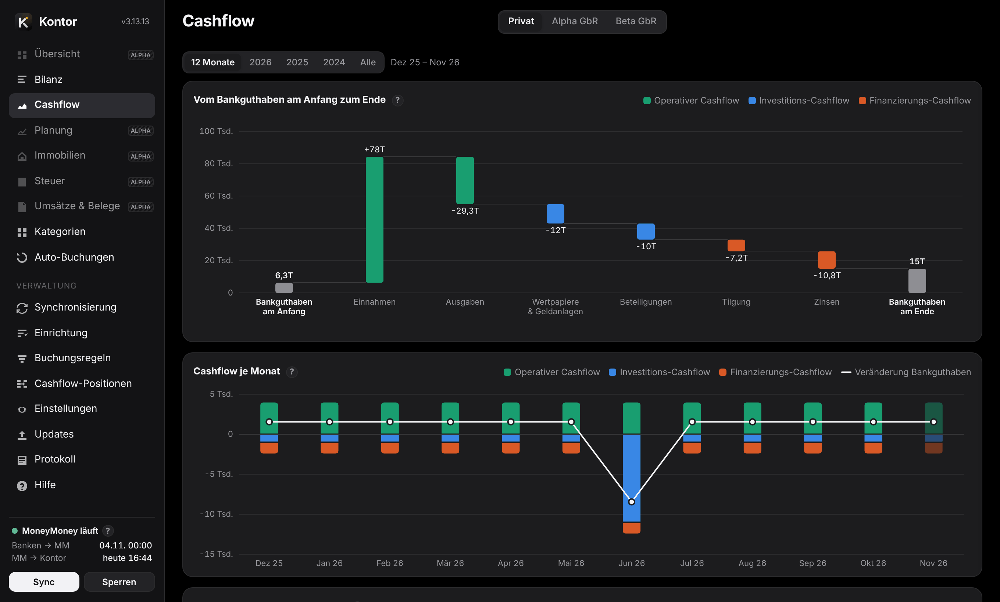

<a id="categories"></a>
## Kategorisieren

**MoneyMoney ist die einzige Wahrheit.** Kontor hat keine eigenen Kategorien: Es zeigt die aus MoneyMoney und hilft, die Lücken zu füllen. Unterkategorien stehen mit „›“ hinter der übergeordneten (Wohnen › Miete); ein „/“ gehört zum Namen.

| In MoneyMoney | In Kontor |
|---|---|
| Kategorien anlegen und umbenennen | zuordnen, was noch keine Kategorie hat – Kontor trägt es in MoneyMoney ein |
| feste Regeln (Einstellungen der Kategorie → Regeln) | Regeln vorschlagen, die du dort einfügst |
| | festlegen, in welcher Position des Cashflows eine Kategorie zählt ([Cashflow-Positionen](#categories-positions), oben rechts auf der Seite verlinkt) |

Die Seite hat drei Reiter: **Offen** (was noch keine Kategorie hat), **Regeln für MoneyMoney** und **Eingetragen** (was Kontor in MoneyMoney eingetragen hat).

**Offen** zeigt alle Umsätze deiner Bankkonten ohne Kategorie in MoneyMoney – nur die Bereiche, die du oben anhakst (anfangs die privaten; eine GmbH mit sehr vielen Buchungen lässt du etwa weg, ihre Positionen schätzt Kontor im Cashflow weiter; deine Wahl bleibt gespeichert) –, nach Gegenpartei gruppiert (Darlehen, Beteiligungen und andere Konten zählen nach ihrer Position, nicht nach Kategorie). Ältere Jahre musst du nicht nachträglich kategorisieren: Wählst du einen Tag unter **Ignorieren vor**, erscheinen Umsätze davor hier nicht und zählen nicht als offen (auch nicht in der Übersicht); leer heißt alle. Bilanz, Nettovermögen und die Summen im Cashflow stimmen auch ohne Kategorien – Kontor schätzt die Positionen solcher Umsätze weiter; ungenauer ist nur die Aufteilung dieser Jahre, und im ersten kategorisierten Jahr vergleicht der Vorjahresvergleich mit Geschätztem. Umbuchungen zwischen Konten desselben Bereichs stehen nicht in der Liste – auch nicht, wenn die Gegenbuchung von Hand in einem manuellen Konto steht: Sie sind nie Einnahme oder Ausgabe. Zahlungen zwischen zwei deiner Bereiche stehen darin, bis sie eine Kategorie haben: Gehalt oder Miete ordnest du zu, eine Einlage oder Entnahme bekommt deine Umbuchungs-Kategorie. Der Vorschlag kommt aus deinen bisherigen Kategorien; Kontor übernimmt ihn nie von selbst. „Zuordnen“ trägt die Kategorie in MoneyMoney ein, „Alle Vorschläge übernehmen“ alle auf einmal. Unter „Umsätze“ wählst du einzelne ab – etwa bei einem Händler, bei dem du Verschiedenes kaufst. Zur Auswahl stehen nur Kategorien, die es in MoneyMoney gibt – eine neue legst du dort an. Einzelne Umsätze ordnest du auch unter Umsätze & Belege zu (Klick auf die Zeile oder mehrere markieren); dort kannst du auch eine Kategorie aus MoneyMoney ändern (nach Rückfrage). Im Cashflow führt „zuordnen“ neben „(ohne Kategorie)“ direkt hierher.

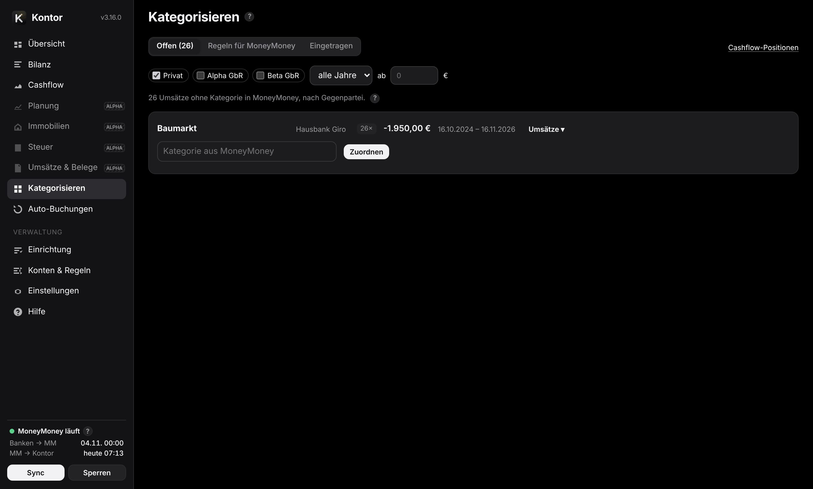

Räumst du in MoneyMoney um – Kategorie umbenannt, verschoben oder gelöscht, Umsätze in eine andere Kategorie gezogen –, liest Kontor beim nächsten Abgleich alle Umsätze neu; deine Cashflow-Position bleibt bei der Kategorie.

Von einem hinzugefügten iPhone aus Zugeordnetes trägt Kontor am Mac sofort ein, wie dort ([mit Face ID](#iphone-devices)). Was auf den nächsten Abgleich wartet (MoneyMoney gesperrt), zählt schon (⏳ in der Umsatzliste). MoneyMoneys Standardkategorie „Unkategorisiert“ zählt als ohne Kategorie.

<a id="categories-rules"></a>
### Regeln für MoneyMoney

Kategorieregeln: Ordnest du eine Gegenpartei mehrmals in Kontor zu, hat MoneyMoney dafür offenbar keine Regel. Kontor schlägt sie unter Kategorisieren → Regeln für MoneyMoney vor – in MoneyMoneys Schreibweise, zum Beispiel `name:"Baumarkt*"` oder `remote_account:"DE…" AND purpose:"miete"`. Hat dieselbe Gegenpartei auch andere Kategorien, nimmt Kontor Wörter aus dem Verwendungszweck oder die Richtung der Zahlung dazu; vorgeschlagen wird nur, was keinen Umsatz einer anderen Kategorie trifft. Ausdruck kopieren, in MoneyMoney in den Einstellungen der Kategorie unter Regeln einfügen und „Nur auf noch nicht kategorisierte Umsätze anwenden“ wählen – dann „Erledigt“.

<a id="categories-write-back"></a>
### In MoneyMoney eintragen und rückgängig machen

Einen Schalter dafür gibt es nicht: Dein Klick auf „Zuordnen“ ist die Freigabe – Kontor trägt nur ein, was du selbst zuordnest, und nie von sich aus. Sicherungen:

- Kontor setzt nur das Kategoriefeld eines Umsatzes; Beträge, Daten und Löschen sind damit nicht möglich.
- Direkt vor dem Schreiben liest Kontor den Umsatz neu aus MoneyMoney und schreibt nur, wenn er unverändert ist und noch keine Kategorie hat (oder die von Kontor gesetzte).
- Eine vorhandene andere Kategorie ersetzt Kontor nur nach Rückfrage; sonst bleibt sie.
- Kategorien und Regeln in MoneyMoney legt Kontor nie an und ändert sie nie.

**Eingetragen** listet jede Kategorie, die Kontor eingetragen hat – neueste zuerst, mit Umsatz, der Kategorie davor und der eingetragenen. Wähle einen oder mehrere aus und **mach sie rückgängig** (Eingetragenes zurücknehmen; nur am Mac, nach Rückfrage): MoneyMoney bekommt die Kategorie zurück, die vor Kontor da war (bei keiner: „Unkategorisiert“) – auch wenn Kontor denselben Umsatz mehrmals geändert hat. Dafür liest Kontor den Umsatz wieder direkt vorher neu; zeigt MoneyMoney inzwischen eine andere Kategorie (von dir geändert), bleibt sie, die Zeile ist blass und markiert. Umsätze außerhalb dessen, was Kontor liest, lassen sich hier nicht zurücksetzen.

<a id="categories-positions"></a>
### Cashflow-Positionen

Der Cashflow hat eine feste Gliederung; deine Kategorien aus MoneyMoney zählen darin. Konten & Regeln → Cashflow-Positionen ist diese Zuordnung: links jede Kategorie aus MoneyMoney mit Umsätzen und der Summe der letzten zwölf Monate, rechts ihre Position im Cashflow:

- **Automatisch** – wie die Kategorie darüber, sonst Kontors Vorschlag nach dem Namen (etwa „Einkommen › Rückzahlung Finanzamt“ → Erstattungen, „Sparen“ → Sparen & Anlegen).
- Eine gewählte Position gilt auch für alle Kategorien darunter, solange sie keine eigene haben.
- **Sparen & Anlegen** zählt nicht als Ausgabe; unter **Zielkonto** wählst du daneben das Konto, in das das Geld fließt (nur bei dieser Position; genauer je Empfänger, siehe unten). **Umbuchung** – Geld zwischen deinen Konten oder Bereichen, weder Einnahme noch Ausgabe – sucht die Gegenbuchung. **Einlagen & Entnahmen** – Geld von und an Mitgesellschafter außerhalb deiner Bereiche – zählt in der Firma zur Finanzierung, privat zu den Beteiligungen. **Nicht berücksichtigen** nimmt die Kategorie ganz heraus: Ihr Betrag zählt in keiner Zeile und steht als Abweichung im Abgleich mit der Bilanz (mit diesem Grund) – nur für Ausnahmen wie eine Fehlbuchung, die sich später aufhebt.
- Kategorien einer Immobilie (Immobilien → Kategorie) haben im Cashflow eigene Zeilen „Miete“ und „Kosten“. Auf der Kategorie der Immobilie selbst entscheidet das Vorzeichen jeder Buchung, eine Unterkategorie zählt nach ihrer Summe – so mindert eine Erstattung unter „Kosten“ die Kosten, statt als Miete zu zählen.

Die Planung plant jede Position und die Kategorien darin; ein Budget aus MoneyMoney zählt für seine Kategorie. In MoneyMoney ändert sich nichts. Die Spaltenköpfe bleiben beim Blättern stehen.

<a id="categories-tree"></a>
### Empfohlene Kategorien

Über der Tabelle stehen die empfohlenen Kategorien für MoneyMoney – eingeklappt, bei Bedarf aufklappen; nur zur Orientierung: Was du nicht brauchst (etwa Umsatzerlöse ohne Geschäft), legst du nicht an, und rechts steht je Zeile, welche deiner Kategorien dort zählt. Jede Zeile mit ✓ oder ○ ist eine Kategorie; eingerückte Zeilen legst du als Unterkategorie der Zeile darüber an, weil sie in einer anderen Position zählen (Darlehen › Tilgung und Zinsen). Grau nach „›“ stehen nur Beispiele für feinere Unterkategorien – kein Muss. Oben schaltest du zwischen **Privat** und **Geschäftlich** um: Jede Seite zeigt nur ihre Zeilen mit ihren Namen (etwa „Wohnen“ privat, „Raumkosten“ geschäftlich). Die Grundregel: **eine Kategorie je Zweck**. Was in verschiedene Positionen gehört, gehört nie in dieselbe Kategorie – eine Kategorie „Immobilie“ mit Kaufpreis, Nebenkosten, Rate, Darlehensauszahlung und Miete etwa macht aus der Auszahlung eine Mieteinnahme und aus dem Kaufpreis Kosten. Besser:

| Kategorie in MoneyMoney | Position |
|---|---|
| Gehalt, Kapitalerträge, Wohnen › Miete …, Lebenshaltung › …, Mobilität, Versicherungen … | jeweils die gleichnamige |
| Minijob, Bonus, Tantieme, Nebeneinkünfte aus eigener Arbeit (Honorare, Buchverkäufe) | Arbeitseinkommen |
| Gewinnausschüttung, Gewinnanteil – von jeder Gesellschaft, auch deiner eigenen GmbH oder GbR | Kapitalerträge – bei deiner eigenen sinkt im gleichen Zug der Wert deiner Beteiligung (Wertänderung, von der Buchungsregel der Beteiligung gebucht), wie der Kurs einer Aktie nach der Dividende |
| Entnahme, Einlage – Kapital, das du herausnimmst oder einzahlst | Einlagen & Entnahmen; zwischen deinen Bereichen erkennt Kontor sie auch ohne Kategorie |
| Verkäufe gebrauchter Sachen (Kleinanzeigen, eBay) | Sonstige Einnahmen – „Verkauf“ in einer Firma: Umsatzerlöse |
| Rente, Pension, Kindergeld, Elterngeld | Rente & Sozialleistungen (Firma: Zuschüsse & Förderungen) |
| Taschengeld, Unterhalt, Erbschaft – bekommen | Unterhalt & Geschenke (kein Arbeitseinkommen: keine Gegenleistung) |
| Taschengeld, Unterhalt, Geschenke, Spenden – gegeben | Unterhalt, Geschenke & Spenden |
| Auslagen – was du für andere zahlst und erstattet bekommst (etwa Tanken für deine Firma): Zahlung und Erstattung in dieselbe Kategorie | Auslagen – hebt sich auf, bis zur Erstattung steht der Betrag dort offen; die Firma bucht die Erstattung bei ihren Kosten (etwa Mobilität) |
| Lebensmittel, Restaurant, Friseur, Drogerie, Haustier, Einrichtung, Haushaltsgeräte | Lebenshaltung (Essen und Trinken immer hier, zu Hause wie auswärts; Einrichtung ist kein Wohnen – das sind Miete und Nebenkosten) |
| Kita, Schule, Studium, Weiterbildung | Bildung & Betreuung (Firma: Fortbildung) |
| Haftpflicht, Kranken-, Unfallversicherung | Versicherungen – eine Beitragserstattung bleibt in ihrer Kategorie und mindert den Beitrag |
| Private Renten- oder Kapitallebensversicherung, Riester, Rürup | Sparen & Anlegen – baut Vermögen auf, sichert kein Risiko ab |
| Sparen & Anlegen – nur für Geld an Anlagen ohne Umsätze in MoneyMoney (Depot: Wertpapierkauf, der Verkauf zurück aufs Konto in dieselbe Kategorie; Rentenversicherung, Bausparvertrag); eine Kategorie reicht | Sparen & Anlegen, Zielkonto daneben oder je Empfänger |
| Darlehen › Tilgung und Darlehen › Zinsen – zwei Kategorien, nur für Darlehen ohne Konto in MoneyMoney; eine Auszahlung unter Tilgung zählt als Aufnahme | Tilgung bzw. Zinsen |
| Firma: Umsatzerlöse, Wareneinkauf, Personal, Raumkosten, Betriebskosten, Umsatzsteuer | jeweils die gleichnamige (Raumkosten: Wohnen) |
| Firma: Gesellschafter › Einlagen, Ausschüttungen – Mitgesellschafter außerhalb deiner Bereiche | Einlagen & Entnahmen |
| Immobilie ‹Name› – je vermietete Immobilie; Unterkategorien wie Miete und Kosten nach Wunsch, empfohlen bei Erstattungen (Hausgeld-, Nebenkostenabrechnung) | die Zeilen der Immobilie (Immobilien → Kategorie): Miete zu den Einnahmen, Kosten zu den Ausgaben |
| Kauf einer Anlage – Immobilie, Firmenanteile … – samt Nebenkosten (Notar, Grunderwerbsteuer, Makler); als Unterkategorie der Immobilie die Position selbst wählen | Sparen & Anlegen, Zielkonto: das Konto der Immobilie bzw. Beteiligung |
| Umbuchung | Umbuchung – zwischen deinen Konten und Bereichen, auch Einlagen und Entnahmen |

Nur vermietete Immobilien haben eine eigene Gruppe (**Vermietung**): Ihre Miete und Kosten laufen über deine eigenen Konten, gemischt mit allem anderen – deshalb je Immobilie eine Kategorie, damit Kontor sie ihr zuordnet. Eine Firma hat eigene Konten (in Kontor ein eigener Bereich); bei dir kommen von ihr nur Ausschüttungen (Kapitalerträge) oder Entnahmen an. Kauf und Darlehen sind bei jeder Anlage gleich: Kaufpreis und Nebenkosten unter Sparen & Anlegen, das Darlehen unter Darlehen oder als Konto. Investitionen und Finanzierung stellst du am besten über Konten auf: jede Anlage (Depot, Festgeld, Rentenversicherung als manuelles Konto) und jedes Darlehen als eigenes Konto in MoneyMoney. Dann erkennt Kontor Sparraten an der Gegenbuchung, teilt die Investitionen nach Art des Kontos auf (Wertpapiere, Immobilien, Beteiligungen …) und zeigt Aufnahme, Tilgung und Zinsen je Darlehen – ganz ohne Kategorie. Weitere Positionen dafür gibt es deshalb nicht; die Kategorien oben brauchst du nur für Geld, dessen Ziel nicht als Konto mit Umsätzen in MoneyMoney steht (die Karte nennt sie „bei Bedarf“). Eine Darlehensauszahlung zählt über ein Darlehenskonto oder unter einer Tilgungs-Kategorie als Aufnahme, gesondert von der Tilgung. Die Karte ist ein Kategorienbaum für alle Bereiche – privat, Einzelunternehmen, GbR, GmbH: Den Bereich erkennt Kontor am Konto, die Kategorie sagt nur den Zweck. Gleicher Zweck, gleiche Kategorie, auch über Bereiche hinweg; bedeutet ein Name je nach Seite Verschiedenes (Gehalt bekommen oder zahlen), zwei Kategorien. Zeilen, die zu keinem deiner Bereiche passen, stehen als „bei Bedarf“ da.

Diese Namen erkennt Kontor und schlägt die Position selbst vor; ein ✓ heißt, dass eine deiner Kategorien schon dort zählt. Anlegen musst du sie in MoneyMoney – Kontor legt keine Kategorien an. Zahlungen zwischen zwei deiner Bereiche (etwa eine Einlage in deine GbR) zählen als Einlage oder Entnahme, solange ihre Kategorie keine Einnahme oder Ausgabe ist – am klarsten mit „Umbuchung“. Eine Gewinnausschüttung deiner Gesellschaft zählt wie jede andere als Kapitalertrag (nach Kategorie oder Verwendungszweck); den gesunkenen Wert deiner Beteiligung bucht ihre Regel dagegen. Buchst du sie zusätzlich in einem manuellen Kapitalkonto gegen (bei dir eine Beteiligung oder Forderung, in der Gesellschaft eine Verbindlichkeit), verbindet Kontor die Zahlung mit dieser Gegenbuchung: Das Nettovermögen bleibt, eine Wertänderung entsteht nicht. Gehört das Konto nicht erkennbar zum anderen Bereich (sein Name, ein Kontenspiegel, die Beteiligung) und passt die Buchung genauso gut zu einer anderen Zahlung ohne IBAN, bleibt sie, wie sie ist – die Zahlung zählt dann als schlichte Einlage oder Entnahme.


<a id="positions-recipients"></a>
### Zielkonto je Empfänger

Überweist du auf ein eigenes Konto in MoneyMoney, erkennt Kontor die Gegenbuchung selbst. Anders bei Geld, das auf keinem deiner Konten als Buchung ankommt, etwa bei einem Depot oder einer Rentenversicherung, die nur Kontostände haben. Dafür stehen unter der Tabelle alle Empfänger solcher Zahlungen – unter „Sparen & Anlegen“, als Umschichtung erkannt oder als „Umbuchung“ ohne Gegenbuchung – mit Kategorie, Anzahl und Summe. Kontor wählt das **Zielkonto** der Reihe nach: deine Wahl je Empfänger, sonst das Zielkonto der Kategorie (gilt auch für ihre Unterkategorien), sonst das einzige Depot des Bereichs. Zeigt „automatisch“ das richtige Konto, ist nichts zu tun; markiert sind die Empfänger ohne Zielkonto. Je Empfänger wählst du:

- **Automatisch** – wie eben beschrieben; was dabei herauskommt, steht in der Auswahl.
- **Ein Konto** – gilt für alle Zahlungen an diesen Empfänger, gleich in welcher Kategorie; das geht vor dem Zielkonto der Kategorie. So kann eine Kategorie wie „Sparen“ auf mehrere Konten laufen (etwa ein Depot bei einer Bank, ein anderes bei einer zweiten).
- **Kein Konto in MoneyMoney** – das Geld verlässt das Vermögen, das Kontor sieht.

**Geld auf ein Konto, das nur Stände hat** – Wertpapiere kaufen und verkaufen, eine Festanlage, ein P2P-Konto: Solche Konten haben in MoneyMoney keine Umsätze, der Buchung auf dem Girokonto fehlt also die Gegenbuchung. Der Sache nach ist es eine Umschichtung: keine Ausgabe, das Nettovermögen bleibt. Kontor zählt sie als Investition in das Konto (Kauf −, Verkauf oder Auszahlung +); als Wertänderung des Kontos bleibt dann nur, was Kurse oder Zinsen gebracht haben. So kommt sie dorthin, der Reihe nach:

1. **Kategorie mit der Position Sparen & Anlegen** (etwa „Sparen › Depot“) – der sichere Weg; Kauf und Verkauf in dieselbe Kategorie, das Zielkonto steht daneben oder je Empfänger.
2. **Ohne Kategorie oder mit „Umbuchung“** erkennt Kontor es selbst, wenn die Buchung es sagt: ein Wertpapierhandel (Wertpapierkauf oder -verkauf, Sparplan, Fondskauf, Kauf oder Verkauf mit ISIN, Depotübertrag) geht ins Depot, ein Festgeld ins Konto für Festanlagen; die IBAN des Kontos genügt ebenfalls. Unter mehreren Konten zählt das bei der Bank, die die Buchung nennt (ohne IBAN: bei der Bank des Girokontos), sonst das, dessen Namen sie nennt, sonst das einzige seiner Art. Das ist eine Schätzung: Sie steht in der Tabelle unten (Kategorie „ohne Kategorie, geschätzt“ bzw. „Umbuchung“), und dort änderst du das Konto – „Kein Konto in MoneyMoney“ nimmt sie zurück (die Buchung zählt dann wieder als Ausgabe oder Einnahme).
3. **Eine „Umbuchung“, der die Gegenbuchung fehlt und die nichts weiter sagt** – etwa an ein P2P-Konto –, steht im Cashflow unter „Unklar“ und in der Tabelle unten mit „fehlt – bitte wählen“: Wähle einmal das Konto (oder „Kein Konto in MoneyMoney“), dann zählt jede solche Umbuchung an diesen Empfänger dort.

Kontor erkennt lieber zu wenig als falsch. Keine Umschichtung sind Erträge und Kosten eines Depots (Dividenden und Zinsen aufs Girokonto sind Kapitalerträge, Depotgebühr und Vorabpauschale Ausgaben) und Verträge mit eigenem Zweck (Bausparen, Riester). Aus früheren Kategorien eines Empfängers schließt Kontor nicht auf Sparen – die Rechnung eines Brokers bleibt „ohne Kategorie“; auch deine Wahl je Empfänger gilt ohne Kategorie nur für Buchungen, die selbst eine Umschichtung nennen.

Wo es eindeutig ist, schlägt Kontor ein Depot vor (gleiche Bank wie die IBAN des Empfängers oder ein gemeinsames Wort im Namen); es zählt erst, wenn du es übernimmst und speicherst. Geld ohne Zielkonto zählt nicht als Kursgewinn: Es steht im Cashflow unter Wertänderungen als eigene Zeile **Anlage ohne Zielkonto**, die den Anstieg des Depots ausgleicht, mit einem Link hierher – das Nettovermögen stimmt also auch ohne Zielkonto, nur Einzahlung und Wertzuwachs sind nicht getrennt. Ein Konto, das nicht mehr zum Bereich gehört, nennt Kontor unter Einrichtung; dann gilt wieder die automatische Wahl.

<a id="planning"></a>
## Planung

Mit der Planung planst du die Zukunft: eine Prognose für Vermögen und Liquidität. Sie schreibt die Vergangenheit fort – nach Regeln auf drei Ebenen: dem **Standard des Bereichs** (je eine Regel für Einnahmen und Ausgaben, unter Parameter), der **Position** und der **Kategorie** darin. Es gilt die tiefste Ebene, die etwas festlegt – Methode und Steigerung jede für sich. Eine Position mit Kategorien ist die Summe ihrer Kategorien; jede Kategorie folgt der Position, bis sie eine eigene Regel bekommt (Ebene „Details“).

- **Methode**: Ø der letzten 12 oder 6 abgeschlossenen Monate, Vorjahresmonat, fester Betrag je Monat, Jahresbetrag (÷ 12), MoneyMoney-Budget (ohne Budget: Ø 12 Monate), keine. Einen festen Betrag oder ein Budget der Position teilen sich ihre Kategorien nach ihrem Anteil der letzten 12 Monate (Erstattungen bekommen nichts davon).
- **Steigerung**: Standard (Einnahmen: „Steigerung Einnahmen“, Ausgaben: „Steigerung Ausgaben“ bzw. die Inflation), ohne oder eigene % p.a.
- **Planungsmodell**: Gleichmäßig, Vorsichtig, Wie Vorjahr oder Budget setzt mit einem Klick den Standard des Bereichs (was jedes tut, steht in seinem Tooltip).
- **Eigene Werte**: Doppelklick auf eine Planzelle, auch bei einer Kategorie; die Regel gilt für die übrigen Monate weiter, ↺ holt den Vorschlag zurück. Ein eigener Wert einer Position verteilt sich auf ihre Kategorien ohne eigenen Wert.
- **Nachfragen**: Änderst du eine Regel, unter der eigene Werte oder Regeln stehen, listet Kontor sie mit dem neuen Wert – **Behalten** oder **Ersetzen**. Ohne deine Wahl wird nichts ersetzt; dasselbe gilt für Vorschläge des Assistenten.
- **Nachvollziehbar**: Jede Planzelle zeigt beim Darüberfahren, wie sie entsteht – Grundlage, Steigerung, Ergebnis und woher die Regel kommt; ein Rechtsklick gibt dem Assistenten dasselbe.
- **Kennzahlen** über die nächsten 12 Planmonate: Sparquote (Überschuss ÷ Einnahmen), Reichweite (Bankguthaben ÷ geplanter Rückgang je Monat), Zinslast (Darlehenszinsen ÷ Einnahmen).

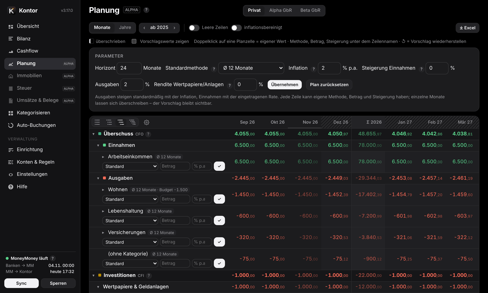

- **Darlehen**: Zins auf den fortgeschriebenen Restsaldo, Tilgung = Rate − Zins.
- **Wertentwicklung** je Konto in % p.a.; Beteiligungen wahlweise gekoppelt an das geplante Nettovermögen der Gesellschaft (Anteil × Nettovermögen).
- **Ereignisse**: einmalige oder wiederkehrende Umschichtungen, Einnahmen und Ausgaben – z. B. ein Darlehen auf einen Schlag aus dem Depot zurückzahlen.
- **Immobilien**: aktive Kalkulationen fließen mit Miete, Kosten, Zins, Tilgung, Restschuld und Objektwert ein.
- Der Plan reicht immer bis Dezember; „inflationsbereinigt“ zeigt Planwerte in heutiger Kaufkraft.
- Die fortgeschriebene Bilanz je Position und Konto steht in den Planspalten unter Bilanz (mit „Plan“) und im Excel-Export. Der Plan gilt je Bereich.

<a id="properties"></a>
## Immobilien

Ein Mietobjekt (Wohnung, Haus) kalkulieren und seine Rendite sehen: je Objekt beliebig viele Kalkulationen (Szenarien), eine davon aktiv. Eingaben:

- Kaufpreis und Übergang; Nebenkosten (Grunderwerbsteuer, Notar, Grundbuch, Makler; sofort abziehbare Posten getrennt); Gebäudeanteil und AfA-Satz oder Restnutzungsdauer.
- Nettokaltmiete und Umlage, Leerstand, Mietanpassung (Indexmiete nach VPI mit Weitergabefaktor und Schwelle, fester Satz oder keine); nicht umlagefähige Kosten und Rücklage (mit VPI oder festem Satz).
- Darlehen: Annuität, Tilgungsdarlehen oder endfällig; Abrechnung monatlich wie bei Banken oder jährlich auf den Stand 1. Januar wie bei Verkäuferdarlehen; Sondertilgungen laufend oder einzeln, Zinsbindung mit Anschlusszins, Fälligkeit mit Rückzahlung.
- Gesellschafter mit Anteil und Steuersatz, Ausschüttung, Wertentwicklung, Verkaufsjahr.

Ungültige Eingaben weist Kontor mit dem Feldnamen ab.

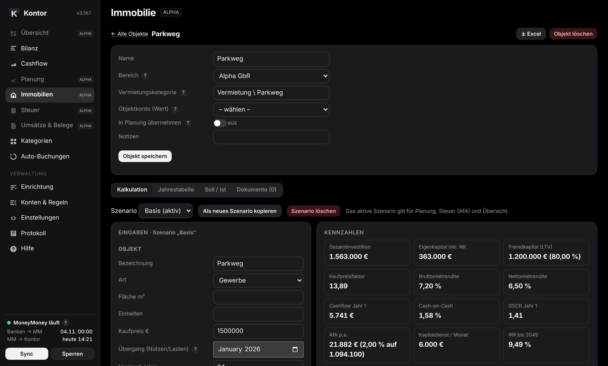

Ergebnis: Monats- und Jahrestabelle (Miete, Kosten, Zinsen, Tilgung, AfA, steuerliches Ergebnis, Steuer, Cashflow, Vermögensaufbau, Restschuld, Objektwert), Kennzahlen (Kaufpreisfaktor, Brutto- und Nettomietrendite, Cash-on-Cash, DSCR, LTV, IRR bis zum Verkauf) und Hinweise (offene Fälligkeiten, fehlender Anschlusszins, negativer kumulierter Cashflow). Verknüpfungen mit MoneyMoney: Vermietungskategorie und Darlehenskonten für den Soll/Ist-Vergleich je Jahr (ohne Vermietungskategorie nimmt Kontor selbst die Kategorie unter Vermietung, Immobilien oder Objekt, die ein Wort aus dem Namen der Immobilie trägt – etwa „Vermietung \ Parkweg“ für „Parkweg 12“; eine Hausnummer muss passen, eine Kategorie für mehrere Immobilien gilt für keine –, und ohne passende Kategorie zählen Mieteingänge und Objektkosten, an Wörtern wie „Miete“ oder „Hausgeld“ erkannt, geschätzt zur Immobilie, die Name oder Verwendungszweck nennen, sonst zur einzigen des Bereichs – nicht, solange du Miete unter einer eigenen Kategorie ohne Immobilie buchst), Objektkonto für den Wert in der Bilanz. „In Planung übernehmen“ speist die Planung des Bereichs; die AfA der aktiven Kalkulation landet in der Steuerübersicht, solange dort kein Jahreswert von Hand steht. Excel-Export je Kalkulation. Dokumente (Kaufvertrag, Gutachten …) werden als Verknüpfung abgelegt – die Dateien bleiben, wo sie sind. Vereinfacht gerechnet: Steuer je Gesellschafter = Anteil × Ergebnis × Steuersatz (keine Progression, kein Verlustausgleich), AfA linear.

<a id="tax"></a>
## Steuer

Die Zahlen für die Steuererklärung (Einnahmen und Werbungskosten je Objekt, Schuldzinsen, AfA) – je Entität (Hauptbereich = privat, jede Gesellschaft mit deinem Anteil aus den Bereichen) und Jahr: Vermietung je Objekt aus den Kategorien `Vermietung \ Objekt \ Art` (beliebig viele Objekte, auch privat), Schuldzinsen je Darlehen (Zins- und Gebührenbuchungen im Darlehenskonto; Zuordnung Darlehen → Objekt unter Konten & Regeln → Steuer), AfA, Steuerpositionen aus Kategorienamen (anpassbar unter Konten & Regeln → Steuer) und Buchungen ohne Kategorie als Prüfposten. Die Belege eines Jahres lassen sich als ZIP mit Übersicht exportieren. Keine Steuerberatung.

<a id="receipts"></a>
## Umsätze und Belege

Der Umsatzbrowser zeigt alle Filter oben auf einen Blick, in drei Zeilen: Bereich, Jahr, Konto und Suche; Richtung, „ohne Beleg“, „ohne Kategorie“ und Zeitraum (von–bis); Kategorien (mit ihren Unterkategorien) – nach einem Klick in der Heatmap des Cashflows sind sie schon gesetzt. Belege (Rechnungen als PDF, Bilder, E-Mails, Office-Dateien) verknüpfst du mit einem Umsatz – per Auswahl, Drag & Drop oder am iPhone per Foto. Sie liegen als normale Dateien im Belegordner (Standard `~/Documents/Kontor-Belege`, Unterordner nach Muster, z. B. `{year}` oder `{year}/{entity}`), Dateiname `Datum_Betrag_Name_Kennung`. Dateien außerhalb des Ordners (auch iCloud Drive) lassen sich verknüpfen, ohne sie zu kopieren – Kontor zeigt, ob die Datei lokal vorliegt oder noch aus iCloud geladen wird. Vorhandene Dateien im Belegordner lassen sich nachträglich zuordnen (Verweise darin, die aus dem Ordner hinausführen, zählen nicht dazu – solche Dateien verknüpfst du wie jede andere außerhalb). Bis 60 MB je Datei. Der Index liegt verschlüsselt im Datenordner; die Dateien bleiben auch ohne ihn nutzbar. Löschen in Kontor betrifft nie verknüpfte Dateien. Belege verknüpft Kontor nur bei sich: In MoneyMoney steht kein Verweis darauf. Einen Beleg kannst du auch dem [Assistenten](#assistant) geben – er sucht den passenden Umsatz und schlägt vor, ihn abzulegen.

<a id="rules"></a>
## Buchungsregeln

Buchungsregeln legen fest, was Kontor automatisch in deine Offline-Konten in MoneyMoney bucht:

- **Darlehen** – Rate erkennen, als Tilgung auf das Darlehenskonto buchen, Zinsen dazu.
- **Beteiligungen** – je Gesellschaft dein Beteiligungskonto auf ihrem Wert halten.
- **Kontenspiegel** – jede Buchung eines Kontos mit umgekehrtem Vorzeichen in ein anderes übernehmen, zwischen beliebigen Konten.


Jedes Darlehen ist eine Zeile (Name → Darlehenskonto, rechts was offen ist); ein Klick klappt die Einzelheiten auf. Jede Gesellschaft hat eine eigene Karte. Neben jedem Feld erklärt ein **?** kurz, was es bewirkt (Klick: dieser Abschnitt). Neben jeder Regel stehen **Soll** und **Ist** und ob sie aktuell ist oder wie viele Buchungen offen sind – schon während du änderst. **„Speichern und prüfen“** (⌘S) unten gilt für alle Änderungen der Seite und prüft sie gegen MoneyMoney. Haben sich die Regeln inzwischen geändert (etwa durch den Assistenten), speichert Kontor nichts und bittet, die Seite neu zu laden. Eine Regel, die der Assistent angelegt oder geändert hat, trägt den Hinweis „Noch nicht bestätigt – Buchungen erst nach Freigabe“: Ihre Buchungen warten auf deine Freigabe – auch vollautomatisch –, bis du sie mit **Bestätigen** abnimmst und speicherst.

<a id="auto-bookings"></a>
### Auto-Buchungen

Unter „Auto-Buchungen“ siehst du, was die Buchungsregeln buchen wollen und gebucht haben, und kannst Buchungen freigeben.

**Vollautomatisch buchen** (Schalter oben unter „Buchungsregeln“, nur am Mac): aus (Standard) – die Buchungen erscheinen unter „Auto-Buchungen“ und werden erst angelegt, wenn du sie dort **freigibst** (nur am Mac) – einzeln: Häkchen entfernen nimmt eine Buchung aus, der Stift ändert den Text, bei Darlehen auch Datum und Betrag (die Markierung bleibt), ✕ bucht sie nicht – sie steht dann unter „Nicht gebucht“; was du nur abwählst, wartet weiter. Was du weglässt oder änderst, verschiebt jeden späteren Stand desselben Kontos: Kontor rechnet die Liste sofort neu (die nächste Wertanpassung gleicht es aus, bei Darlehen die Zinsen danach – Kennzeichen „angepasst“, „neu“ oder „entfällt“; Zinsen nach einer abgewählten Tilgung warten mit ihr: „wartet“) und bucht genau die angezeigten Beträge – hat sich in MoneyMoney inzwischen etwas geändert, bucht es nichts und zeigt die neuen. Nach dem Speichern einer Regel rechnet Kontor die Liste sofort neu. An – Kontor bucht bei jedem Abgleich selbst, was **seit der letzten Prüfung neu** ist: eine neue Zahlung, ein abgelaufener Monat, ein neuer Stand der Gesellschaft, eine neue Buchung im Kontenspiegel. Älteres wartet auch dann auf deine Freigabe (Hinweis „älter“) – Buchungen in die Vergangenheit (etwa beim Einrichten mit einem früheren „Buchen ab“) und solche, die wieder fehlen, weil du sie in MoneyMoney gelöscht hast, dazu Zinsen, die darauf aufbauen. Oben rechts unter „Auto-Buchungen“ steht, was gilt („Mit Freigabe“ oder „Vollautomatisch“). Bank- und Erweiterungskonten werden nie bebucht, Überweisungen und Lastschriften sind gesperrt, bestehende Buchungen ändert oder löscht Kontor nie – auch die Zahlungen selbst (deine Bankumsätze) bleiben unberührt.

**Ablauf**: Bei jedem Abgleich (automatisch alle 30 Minuten, nach neuen Daten in MoneyMoney, nach dem Speichern der Buchungsregeln oder per „Sync“) rechnet Kontor die Buchungsregeln durch – auch wenn sich in MoneyMoney nichts geändert hat, aber die Regeln, deine Entscheidungen oder der Tag (Zinsen zum Monatsende); „Sync“ links unten tut das sofort. Schneller geht **„Aktualisieren“** oben unter „Auto-Buchungen“ (mit Freigabe): Es liest nur die Konten neu, die die Buchungsregeln betreffen – Darlehens- und Quellkonten, Beteiligungskonten und Kontenspiegel, die Konten der Gesellschaften – und rechnet die Freigabe neu; gebucht wird dabei nichts, die übrigen Zahlen kommen mit dem nächsten Sync. Während eines Abgleichs steht links unten, was Kontor gerade tut (z. B. „Bucht 12 von 56 …“); das Ergebnis siehst du sofort, die Auswertung rechnet Kontor danach im Hintergrund neu. Mitteilungen von macOS gibt es nicht: In der Seitenleiste zeigt eine Zahl an „Auto-Buchungen“, wie viele warten (ab 100 „99+“, ein „!“ nach einem Fehler, ein Punkt bei Hinweisen), ein Punkt an „Einstellungen“ eine neue Version (ein „!“, wenn sie auf deine Freigabe wartet) – bei schmalem Fenster ein Punkt am Menüknopf, in der App im Dock die Zahl am Symbol. Unter „Auto-Buchungen“ stehen die wartenden bzw. zuletzt gebuchten Buchungen mit Hinweisen und Rechenwegen, „Nicht gebucht“, **„Von Kontor angelegt“** (alle Buchungen mit Kontors Markierung) und der Verlauf.

**Ohne eigene Liste**: Kontor merkt sich nicht, was es gebucht hat – es liest es bei jedem Abgleich aus MoneyMoney. Jede Buchung trägt eine Markierung im Verwendungszweck (z. B. „#kontor-zins-2026-10“) – daran erkennst du auch in MoneyMoney, dass Kontor sie angelegt hat. Was du dort tust, gilt: Eine geänderte Buchung (Betrag, Datum oder Text, die Markierung bleibt) übernimmt Kontor so; eine gelöschte fehlt wieder, und Kontor schlägt sie erneut vor (nur mit Freigabe). Buchungen, die du selbst angelegt hast, zählen als gebucht: eine Tilgung mit gleichem Betrag bis 7 Tage neben der Zahlung, Zinsen eines Monats mit „Zins“ im Text oder der Zinskategorie, im Kontenspiegel gleiche Buchungen auf beiden Seiten. So läuft Kontor auch mit Konten, die du schon von Hand geführt hast, und braucht keine Datensicherung, um weiterzumachen. Gemerkt werden nur deine Entscheidungen **„Nicht buchen“** – in den Einstellungen, also auch in jeder Datensicherung. Sie stehen unter „Nicht gebucht“; „Wieder vorschlagen“ nimmt eine von der Liste, und ist sie noch nötig, wartet sie wieder auf deine Freigabe. **Löschen** geht nur in MoneyMoney, dessen Schnittstelle kennt kein Löschen; fehlt die Zahlung zu einer Tilgung von Kontor oder das Original einer gespiegelten Buchung, meldet Kontor das unter „Auto-Buchungen“.

**Wertanpassung gelöscht oder geändert** (Beteiligung): Ein Kontostand ist die Summe aller Buchungen bis zu diesem Tag. Fehlt eine Anpassung vom Tag X oder hat sie in MoneyMoney einen anderen Betrag, liegt jeder spätere Stand um genau diesen Betrag daneben. Kontor prüft bei jedem Abgleich den ganzen Zeitraum ab „Buchen ab“ und bucht am Tag X nur, was dort fehlt – meist genau die gelöschte Buchung (mit derselben Markierung), nichts, wenn du den Wert selbst gebucht hast; die Buchungen danach bleiben, wie sie sind.

<a id="rules-loans"></a>
### Manuelle Darlehen

Für Darlehen und Kredite, die du in MoneyMoney als manuelles Konto (Offline-Konto) führst – ein Darlehen mit eigenem Bankkonto in MoneyMoney braucht das nicht, dort bucht die Bank Tilgung und Zinsen selbst. Kontor erkennt die Rate auf dem Quellkonto – über die IBAN des Darlehensgebers oder einen Text im Verwendungszweck – und bucht sie als Tilgung auf das Darlehenskonto (ein Offline-Konto). Dazu kommen jeden Monat die Zinsen (**Zinsbuchung**: am Tag der Rate oder am Monatsende). So stimmt die Restschuld in MoneyMoney ohne Handarbeit. „Art“: Verbindlichkeit (du zahlst) oder Forderung (du bekommst). „Buchen ab“: erst ab diesem Tag. Ohne Zinsmodell („keine Zinsen“) spiegelt Kontor nur die Raten.

**Zinsen**: Jahresbasis = Zinssatz × Stand am 31.12. des Vorjahres, je Monat ein Zwölftel, im Dezember mit dem Cent-Rest – oder monatlich auf die Restschuld; exakt gerechnet, kaufmännisch auf den Cent gerundet (vor 3.17 gebuchte Beträge mit 1 Cent Unterschied bleiben stehen). Steht eine Buchung von Kontor doppelt da (gleiche Markierung), nennt ein Hinweis Konto, Tag und Betrag; Kontor rechnet, als stünde sie einmal da. Das Modell ist vereinfacht (30/360); einmal im Jahr mit der Zinsabrechnung der Bank abgleichen. **Echte Zinsen**: Ändere Kontors Zinsbuchung in MoneyMoney auf den Betrag der Bank (die Markierung bleibt) – oder buche die Zinsen selbst (mit „Zins“ im Text oder der Zinskategorie): Für diesen Monat bucht Kontor dann nichts. Stehen in einem Monat Zinsen von Kontor und von dir, kommt ein Hinweis unter „Auto-Buchungen“ – ebenso, wenn das Konto fehlt oder keine passende Zahlung kommt. Passen Zinsen, die Kontor gebucht hat, nicht mehr zu Restschuld oder Zinssatz (etwa nach einer nachgetragenen Zahlung; ab 1 € Abweichung), nennt ein Hinweis die richtigen Beträge je Monat – Kontor ändert sie nicht: Betrag in MoneyMoney anpassen, die Markierung im Text lassen. Neue Zinsen rechnet Kontor schon so, als wären die genannten angepasst. Ein Zinswechsel mitten im Jahr gilt bei Jahresbasis erst ab dem Folgejahr; auch das meldet Kontor. Beginnt ein Monat ohne Schuld – das Darlehen ist getilgt oder überzahlt (der Kontostand steht über null hinaus auf der anderen Seite) –, rechnet Kontor für ihn keine Zinsen, auch bei Jahresbasis (außer mit einer selbst gesetzten Jahresbasis) und im Darlehensplan der Planung. Solange es überzahlt ist, nennt ein Hinweis den Monat, seit dem.

<a id="rules-companies"></a>
### Beteiligungen

Jeder Bereich der Art „Gesellschaft“ (Konten & Regeln → Bereiche) erscheint als Karte, mit deinem **Anteil** (Gesellschaftsanteil). Der Anteil steht nur dort; die Karte verlinkt hin.

- **Beteiligungskonto**: dein Offline-Konto für diese Gesellschaft – zur Wahl stehen Offline-Konten mit der Position „Beteiligungen“ (Konten & Regeln → Konten); vorausgewählt ist keins, denn sobald du eines wählst und speicherst, beginnen die Buchungen. Kontor hält es auf **Anteil × Wert der Gesellschaft**. Wert = alle Konten ihres Bereichs, also Vermögen minus Schulden (ohne Avale und nicht bilanzierte Konten). Führt die Gesellschaft ein Konto in einer anderen Währung, ist ihr Wert unbekannt – Kontor rechnet nicht um und bucht dann nichts, bis du das Konto aus der Bilanz nimmst („nicht bilanzieren“).

Beteiligung und Kontenspiegel zusammen zählen nichts doppelt, wenn die Kapitalkonten in der Gesellschaft als Schuld geführt sind (Standard für Konten mit „Kapitalkonto“ oder „Gesellschafterdarlehen“ im Namen): Die Forderung ist dein Kapitalkonto, die Beteiligung dein Anteil am Rest – Wertzuwachs und nicht verteilte Überschüsse. Das stimmt auch bei ungleichen Einlagen. Führst du ein Kapitalkonto dagegen außerhalb der Bilanz („nicht bilanzieren“), steckt es schon im Wert der Beteiligung; ein Kontenspiegel dazu zählt dann doppelt, und „Speichern und prüfen“ warnt.

Außerdem je Gesellschaft:

- **Buchungshäufigkeit** (Beteiligung) – *täglich* (Standard): bei jedem Abgleich die Differenz mit dem Tagesdatum, MoneyMoney zeigt also immer den aktuellen Stand; empfohlen mit „Vollautomatisch buchen“. *Monatlich*: eine Buchung zum Monatsende – reicht für die Bilanz; empfohlen mit Freigabe, sonst wartet jeden Tag eine Buchung auf dich.
- **Buchen ab** – ab einem Tag (neu: heute) oder „alles“ seit der ersten Buchung der Gesellschaft, siehe unten.
- **Mindestdifferenz** (kleinere Abweichungen bucht Kontor nicht) und **Gegenpartei** der Buchungen (leer: Name der Gesellschaft).

In das Beteiligungskonto bucht Kontor jeweils nur die Differenz zum Stand in MoneyMoney (Verwendungszweck mit der Rechnung, z. B. „Anteilswertanpassung: 40 % × 150.000,00 € (Wert Alpha GbR) = 60.000,00 €“, und der Markierung „#kontor-wert-…“). Zahlungen zwischen dir und einer Gesellschaft mit Beteiligung oder Kontenspiegel zählen im Cashflow als Einlage bzw. Entnahme, und die Eigenkapitalquote in der Bilanz rechnet über die Beteiligungen durch die Gesellschaften hindurch.

<a id="rules-mirrors"></a>
### Kontenspiegel

Ein Kontenspiegel verbindet zwei beliebige Konten, die dasselbe von zwei Seiten zeigen – eigene, die einer Gesellschaft oder die zweier Gesellschaften; eine Beteiligung braucht es dafür nicht. Jeder Spiegel hat sein eigenes „Buchen ab“. Jedes Konto wählst du in zwei Schritten nebeneinander: erst den Bereich, dann eines seiner Konten (ebenso bei Darlehen). Beispiel: Dein Kapitalkonto ist in der GbR eine Schuld an dich, bei dir eine Forderung („Darlehen an die GbR“). Spiegeln heißt: Jede Buchung im einen Konto bucht Kontor mit umgekehrtem Vorzeichen und gleichem Datum ins andere – in beide Richtungen, soweit beide Offline-Konten sind; ist eines ein Bankkonto, nur ins andere. Sender bzw. Empfänger ist, wem das andere Konto gehört (die Gesellschaft bzw. dein Bereich), der Text der des Originals mit „gespiegelt von <Konto>“ und der Markierung „#kontor-gk-…“ (mit der Nummer des Originals). Gespiegelte Buchungen werden nie zurückgespiegelt, Wertanpassungen nie gespiegelt. Konten in verschiedenen Währungen spiegelt Kontor nicht (es rechnet nicht um). Gespiegelt wird ab seinem „Buchen ab“; was vor der letzten Prüfung gebucht war, spiegelt Kontor nur nach deiner Freigabe (Hinweis „älter“) – auch vollautomatisch, denn vielleicht steht es schon von Hand im anderen Konto. Buchungen, die du auf beiden Seiten von Hand angelegt hast (gleicher Tag, gleicher Betrag, umgekehrtes Vorzeichen), gelten als Paar und werden nicht doppelt angelegt. Liegt das Gegenstück einige Tage daneben (gleicher Betrag, bis zu einem Monat), schlägt Kontor die Spiegelbuchung mit dem Hinweis „prüfen“ vor und nennt das Gegenstück: Sie ist anfangs abgewählt und wird nie von selbst gebucht – ist es dasselbe, verwirft ✕ beide Seiten auf einmal; bekommt ein Original in MoneyMoney eine neue Nummer (gelöscht und neu erfasst), zählt seine gespiegelte Buchung weiter, solange Betrag und Tag gleich sind – hast du die gespiegelte Buchung verschoben, auch bis zu drei Tage daneben (mit Hinweis), statt sie doppelt zu spiegeln. Ändern oder löschen kann Kontor nichts: Fehlt das Original einer gespiegelten Buchung oder hat es einen anderen Betrag oder Tag, meldet Kontor das unter „Auto-Buchungen“, und du korrigierst sie selbst; löschst du eine gespiegelte Buchung, schlägt Kontor sie wieder vor – willst du sie nicht, „Nicht buchen“.

<a id="rules-back"></a>
### Buchen ab

„Buchen ab“ gibt es je Beteiligung und je Kontenspiegel: ab einem Tag oder „alles“ seit ihrer ersten Buchung. Kontor prüft bei jedem Abgleich den ganzen Zeitraum – je Tag, an dem sich der Wert der Gesellschaft geändert hat (täglich), bzw. je Monatsende (monatlich), mit dem Wert, den die Bilanz für diesen Tag zeigt – und bucht nur die Differenz; vorhandene Buchungen im Konto zählen mit. Liegt der Tag in der Vergangenheit, spielt Kontor so den Verlauf ein: Diese Buchungen warten auf deine Freigabe, auch vollautomatisch – du siehst sie vorher und kannst einzelne ändern oder weglassen. Danach stimmt der Verlauf deiner Beteiligung in MoneyMoney und in Kontor, und er bleibt es: Löschst oder änderst du später etwas, korrigiert Kontor genau diesen Tag. Tipp: Alte Buchungen im Beteiligungskonto erst löschen, dann einspielen. Tage, an denen ein Wert nicht bekannt ist (z. B. ein Depot in der Gesellschaft, dessen früherer Stand MoneyMoney nicht herausgibt), werden übersprungen und genannt – Kontor schätzt nichts. Bereits vorhandene Buchungen werden nie geändert. War eine Gesellschaft vor Version 3.13.1 „nicht rückwirkend“ eingerichtet, gilt der Tag von Kontors erster Buchung für sie.

<a id="assistant"></a>
## Assistent

Ein Sprachmodell, das nur auf deinem Mac läuft: Du schreibst in normaler Sprache – zu deinen Zahlen, zur Bedienung oder zu allem anderen, auch mit hineinkopierten Zahlen, Tabellen, Texten oder Code – und es antwortet wie ein Chat-Assistent. Was es über deine Finanzen sagt, liest es aus Kontor. Nichts davon verlässt den Mac: Das Modell hat keinen Netzzugang, es steht kein Dienst im Internet dahinter und kein Konto. Nur wenn du ihm das [Internet](#assistant-internet) erlaubst (ab Werk aus), schlägt Kontor für ihn nach – ohne deine Daten. Ein Sprachmodell kann sich irren, auch wenn es die Zahlen selbst aus Kontor liest – Wichtiges bitte an der Seite gegenprüfen, zu der er dich führt.

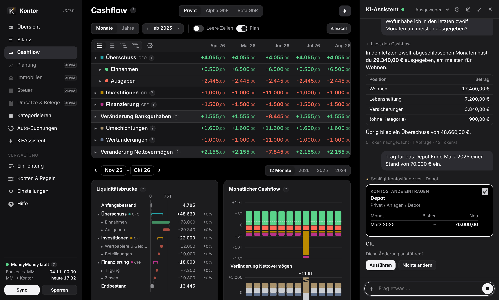

**Wo**: Das ✦ oben rechts auf jeder Seite (oder ⌘K) öffnet ihn als Fenster neben der Seite – die Seite rückt zur Seite, Tabellen und Grafiken bleiben sichtbar und bedienbar; bei schmalem Fenster und am iPhone liegt er darüber. „Assistent“ im Menü zeigt dieselbe Unterhaltung als ganze Seite; der Doppelpfeil wechselt zwischen beidem. Enter sendet, Umschalt+Enter beginnt eine neue Zeile. **■** (oder Esc im Eingabefeld) stoppt die Antwort sofort. Oben im Fenster wählst du den **Denkaufwand** für die nächsten Fragen (je Gerät gemerkt): „Schnell“ antwortet sofort, „Ausgewogen“ denkt vor jeder Abfrage und vor der Antwort nach, je höchstens 4.000 Token (1 Token ≈ ¾ Wort), „Gründlich“ so lange, wie es braucht – besser bei Rechnungen, Vergleichen und Ursachen, aber langsamer. Daneben: **Verläufe** und **Neue Unterhaltung**.

**Verläufe**: Kontor speichert Unterhaltungen verschlüsselt im Datenordner (Ordner `chats`), damit du sie unter „Verläufe“ wieder öffnen und fortsetzen kannst; dort löschst du sie einzeln oder alle. Sie stehen nie in der Sicherung oder im Protokoll; Zurücksetzen und Deinstallieren löschen sie mit. Abschalten lässt es sich unter Einstellungen → KI-Assistent → Betrieb → **Verläufe speichern** – dort stehen auch Anzahl und Größe und, sobald es welche gibt, „Ältere als ein Jahr löschen“. Ohne Speichern stehen Unterhaltungen nur im Arbeitsspeicher.

**Was er tut**: Er antwortet in der Sprache, die in Kontor eingestellt ist (Einstellungen → Allgemein). Er liest über fest eingebaute Werkzeuge; in der Antwort steht aufklappbar, was er sich überlegt und dafür gelesen hat („Gedanken“, etwa „Liest die Bilanz · Privat“), darunter klein „Token nachgedacht · Abfragen · Token/s“ – wie viel er überlegt, wie oft er in deinen Daten nachgelesen hat und wie schnell dein Mac rechnet. Zahlen zu deinem Geld nennt er nur aus diesen Werkzeugen; was Kontor nicht kennt, heißt bei ihm „unbekannt“ – geschätzt wird nichts. Rechnen lässt er Kontor (nicht im Kopf, auf den Cent kaufmännisch gerundet). Auf Wunsch öffnet er Seiten in der passenden Ansicht („Zeig mir den Cashflow der GbR in Jahren“ – Bereich, Jahr, Plan und Gliederungstiefe stellt er mit ein), zeigt gefilterte Umsätze und hebt hervor, wovon er spricht: Die Zeile oder das Feld leuchtet kurz gelb auf, und die Seite rollt dorthin. **Diagramme** zeichnet Kontor im Chat aus seinen eigenen Zahlen (Verlauf, Cashflow, Aufteilung) – das Modell wählt nur, was gezeigt wird; Darüberfahren zeigt die Werte, ein Klick die Stelle in Bilanz oder Cashflow.

**Änderungen** führt er nie selbst aus: Er schlägt sie vor – jede mit bisherigem und neuem Wert und einer Begründung –, und am Ende der Antwort steht eine Karte für alle zusammen. Einzelne wählst du ab; **Ausführen** führt die angehakten aus, „Nichts ändern“ keine. Danach steht an jeder **Zurücknehmen** (solange Kontor läuft; was sich nicht zurücknehmen lässt, sagt die Karte vorher). Alles Ausgeführte steht mit Zeit und Begründung im **Protokoll der Änderungen und Abrufe** ganz unten unter Einstellungen → KI-Assistent. Was er vorschlagen darf: [Was er darf](#assistant-rights).

**Offenes**: Eine leere Unterhaltung zeigt, was offen ist – wie in der Übersicht. **Erledigen** stellt dem Assistenten die passende Frage (etwa Umsätze ohne Kategorie zuordnen oder wartende Auto-Buchungen prüfen), sonst führt „Öffnen“ zur Seite.

**Dateien**: Eine Textdatei (etwa Text, Markdown, JSON) ziehst du auf das Fenster des Assistenten oder wählst sie mit **+** – ihr Inhalt steht dann im Fragefeld, und du schreibst deine Frage dazu. PDFs, Bilder, Excel-Dateien (.xlsx, .xlsm) und CSV-Dateien (.csv, .tsv) hängst du ebenso an – ein Bildschirmfoto auch mit ⌘V aus der Zwischenablage (bis zu sechs auf einmal, je höchstens 20 MB): Tabellen liest Kontor als Raster – auch über mehrere Seiten, ohne Seitenköpfe und Seitenzahlen –, Summen rechnet Kontor selbst. Jede Zahl darin steht so in der Datei; was sich nicht sicher als Zahl lesen lässt, bleibt Text. Kontor rechnet nach, ob Summenzeilen, Überträge sowie Soll und Haben aufgehen, und sagt dem Assistenten, was stimmt und was nicht. In einer langen Datei sucht der Assistent Zeilen nach Wörtern – etwa ein Konto oder einen Namen –, statt Seite für Seite zu lesen. Zu einem **Beleg** (PDF, Bild) sucht der Assistent den passenden Umsatz, nennt Abweichungen und schlägt vor, ihn abzulegen – wie ein Upload unter Umsätze & Belege, erst nach deinem Klick, zurücknehmbar. Die Datei bleibt nur in dieser Unterhaltung und wird sonst nicht gespeichert (im Verlauf steht nur ihr Name). Gescannte Seiten liest die Texterkennung des Macs – Zahlen daraus bitte gegenprüfen. Ein **Bild** (PNG, JPEG, GIF – hochgeladen oder eingefügt, kein Unterschied) bekommt ein Modell, das Bilder lesen kann, zusätzlich als Ganzes zu sehen, wie bei Claude oder ChatGPT: für das, was Text nicht hergibt – Aufbau, Stempel, Unterschriften, Grafiken, Fotos. Der Assistent liest daraus alles wie aus getipptem Text, auch Zahlen; die Texterkennung des Macs liest daneben mit, und Abweichungen nennt er. Bringt eine vorgeschlagene Änderung eine Zahl, die nirgends im erkannten Text der Bilder und PDFs dieser Unterhaltung steht, steht auf ihrer Karte „Bitte prüfen“ mit dieser Zahl. Eine **PDF** sieht ein solches Modell wie bei Claude oder ChatGPT: jede Seite als Bild neben ihrem Text. Kurze PDFs gehen ganz mit der Frage; längere liest es vorher Seite für Seite – wo es gerade ist, steht in den Gedanken („Lese Seite 3 von 30 …“), das dauert je Seite ein paar Sekunden. Das Bild geht nur mit dieser Frage an das Modell auf diesem Mac und wird nirgends gespeichert; kann das Modell keine Bilder lesen, steht das unter der Antwort.

<a id="assistant-dictation"></a>
### Diktieren

Ist ein Diktiermodell geladen ([Einrichten](#assistant-setup), Punkt 4), hat das Fragefeld ein Mikrofon für die Spracheingabe. Ein Klick nimmt auf – bis zu zehn Minuten; was du sagst, erscheint schon beim Sprechen im Feld. Der nächste Klick aufs Mikrofon beendet die Aufnahme: Kontor schreibt alles noch einmal als Ganzes und setzt den Text an die Schreibmarke, zum Ändern oder Absenden. **Senden** beendet die Aufnahme und schickt die Frage gleich ab; ✕ oder Esc verwirft sie. Erkannt wird die Sprache, die in Kontor eingestellt ist, auf diesem Mac und ohne Internet. Die Aufnahme wird nicht gespeichert und steht nicht im Protokoll.

Der Knopf dreht, bis das Mikrofon wirklich hört, und wird dann rot – ab da wird alles erfasst. Mit dem Echo- und Rauschfilter des Macs dauert das nach einer Pause etwa zwei Sekunden; ohne ihn hört das Mikrofon sofort (Einstellungen → KI-Assistent → Modell zum Diktieren → **Mikrofonfilter**: Aus) – Kontor gleicht dann die Lautstärke selbst aus, was der Mac gerade abspielt, kann aber mit in den Text geraten. **Diktiermodell starten** legt fest, ob das Modell sofort bereitsteht (es startet mit dem Assistenten und belegt 1–3 GB Arbeitsspeicher) oder erst mit dem Klick aufs Mikrofon startet (ein paar Sekunden; es endet fünf Minuten nach dem letzten Diktat).

**Mikrofon erlauben**: In Kontors [Mac-App](#app) fragt macOS einmal, danach nie wieder. Safaris App im Dock fragt nach jedem Start erneut; im Browser erlaubst du es der Website dauerhaft (Safari: Einstellungen → Websites → Mikrofon). Was gerade gilt, steht in den Einstellungen unter „Modell zum Diktieren“. Die Diktierfunktion von macOS und iOS geht im Fragefeld weiterhin, wie in jedem Textfeld.

<a id="assistant-setup"></a>
### Einrichten

Einstellungen → KI-Assistent, nur am Mac:

1. **Programm** – „Installieren“ lädt llama.cpp von GitHub: das verbreitete freie Programm, das Modelle auf dem eigenen Rechner ausführt. Selbst weiß es nichts – das Gelernte steckt in den Modellen (große Dateien, Punkt 2), die es lädt. Du bekommst es in der fertigen Fassung für deinen Mac.
2. **Modell für Antworten** – du wählst ein Modell für alle Antworten; die Liste ist danach geordnet, wofür es taugt: **für Zahlen, Dokumente und Recherche** (liest lange Dokumente am zuverlässigsten, antwortet dafür langsamer), **für kurze Fragen** (etwa viermal so flott, bei langen Dokumenten weniger zuverlässig), **nur für einfache Fragen** (kleine Modelle raten oft, statt „weiß ich nicht“ zu sagen) und **für einen stärkeren Rechner** (ein größeres Modell, das erst mit viel mehr Arbeitsspeicher läuft – so siehst du, was ein solcher Rechner brächte; empfohlen wird es nie). Wie lange es je Frage nachdenkt (Schnell, Ausgewogen, Gründlich), wählst du oben im Chat. Unter jedem Modell stehen Hersteller, Lizenz, Dateigröße, ab wie viel Arbeitsspeicher es gut läuft und wie es auf deinem Mac läuft: gut, knapp (läuft, braucht aber den größten Teil des Arbeitsspeichers) oder gar nicht – dann steht dort, was es braucht („braucht einen Mac mit mindestens … GB Arbeitsspeicher“), und es lässt sich nicht laden. **Empfohlen** ist das gründlichste Modell, das auf deinem Mac gut läuft – richtige Antworten zählen mehr als Tempo; mit weniger als 32 GB Arbeitsspeicher ist keines empfohlen, dort laufen nur die kleinen. Kontor wechselt das Modell nie von selbst: Es antwortet das, das du mit dem Punkt davor gewählt hast (das erste geladene ist gewählt). „Laden“ holt die Datei von Hugging Face (der Fortschritt steht darunter und unten links auf jeder Seite; ein abgebrochener Download steht als „angefangen“ in der Liste: „Weiter laden“ setzt ihn fort, „Verwerfen“ löscht, was schon da ist). Große Modelle bestehen aus mehreren Dateien – Kontor lädt sie nacheinander, prüft jede für sich und setzt sie erst ein, wenn alle da und richtig sind; vorher prüft es, ob der Platz für alle reicht. Kann ein Modell Bilder lesen, lädt Kontor seinen Bildteil (eine zweite Datei, etwa 1 GB) gleich mit und startet das Modell damit – kein eigener Schalter; bei schon geladenen Modellen holt ihn „Aktualisieren“ nach, ohne das Modell neu zu laden. Startet ein Modell mit seinem Bildteil nicht, startet Kontor es ohne – es antwortet dann, sieht aber keine Bilder. Unter **Andere Modelle** lädst du jede andere Datei im Format GGUF: „Anbieter/Name“ eingeben, „Dateien zeigen“, wählen. Die meisten Modelle der Liste stehen unter Apache 2.0 (private und geschäftliche Nutzung ohne Kosten); Qwen3.8 Flash Next hat eine eigene Lizenz von Alibaba – vor geschäftlicher Nutzung ihre Bedingungen lesen. Bei anderen Modellen steht die Lizenz auf ihrer Seite bei Hugging Face.
3. **KI-Assistent verwenden** einschalten – ab dann gibt es das ✦ und den Menüpunkt.
4. **Modell zum Diktieren** (wenn du magst) – ein zweites, kleines Modell nur für Spracherkennung (es beantwortet nichts, es schreibt mit), ebenfalls von Hugging Face: das genauere (Datei etwa 3 GB) oder ein kleineres (1 GB). Sind mehrere geladen, wählst du mit dem Punkt davor. Wann es startet, legt „Diktiermodell starten“ fest ([Diktieren](#assistant-dictation)).
5. **Suche nach Bedeutung** (wenn du magst) – ein drittes, kleines Modell (Datei etwa 0,6 GB, Lizenz Apache 2.0), das keinen Text schreibt, sondern Texte vergleicht: damit findet das [Gedächtnis](#assistant-memory) eine Notiz auch, wenn andere Wörter darin stehen („Ferien“ zu „Urlaub“), und der Assistent sucht so auch in der Hilfe und in deinen Umsätzen („Streaming“ findet die Dienste; solche Funde nennt er als nach Bedeutung gefunden). Nach dem Laden bekommen alle Notizen im Hintergrund ihren Vergleichswert (bei Tausenden eine Weile; die Liste im Gedächtnis zeigt, wie weit). Es startet mit dem Modell, das antwortet, und endet mit ihm.

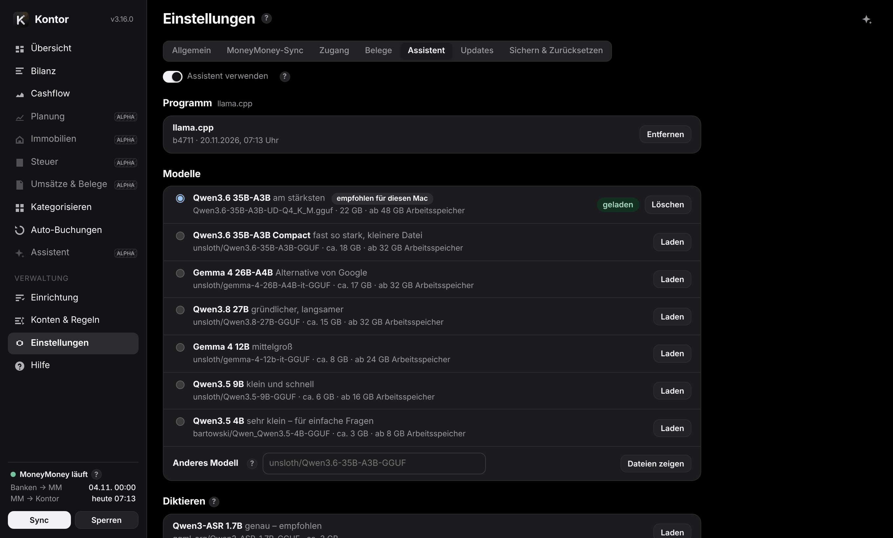

**Aktuell bleiben**: Kontor fragt GitHub und Hugging Face von selbst, ob es ein neueres llama.cpp oder eine neuere Datei eines geladenen Modells gibt (auch des Modells zum Diktieren) – wie oft, stellst du unter **Aktualisierung** bei „Automatisch suchen“ ein – eine Einstellung für alles: täglich (Standard), wöchentlich, monatlich oder nie. Gesendet wird dabei nichts von dir. Mit **Automatisch laden** (Standard) lädt Kontor Gefundenes von selbst, sobald du den Assistenten 10 Minuten nicht benutzt hast, und nur in der strengen Abschirmung – geprüft wie nach einem Klick. Von llama.cpp nimmt es dann nur eine Fassung, die seit zwei Tagen draußen ist (eine fehlerhafte oder untergeschobene Fassung wird meist binnen Stunden zurückgezogen), nie eine ältere als deine; startet eine neue Fassung dein Modell nicht, nimmt Kontor von selbst die vorige und lädt diese Fassung nie wieder. Kontor selbst und ein anderes Modell wechselt es nie von selbst. Ohne „Automatisch laden“ zeigt das Menü bei Einstellungen einen Punkt, wenn es etwas für llama.cpp oder ein Modell gibt, das du benutzt. „Jetzt suchen“ fragt sofort; „Aktualisieren“ lädt ein einzelnes Teil, **Alles aktualisieren** alles Gefundene nacheinander („Abbrechen“ beendet alles; was fertig ist, bleibt). Neue Modelle kommen mit Kontor-Updates in die Liste – oder sofort über „Andere Modelle“. Programm und Modelle liegen als gewöhnliche Dateien im Datenordner unter `assistant/` (Time Machine lässt sie aus, sie lassen sich jederzeit neu laden) – **Ablage** zeigt den Ordner und den freien Platz; „Löschen“ und „Entfernen“ geben den Platz frei, Zurücksetzen lässt sie liegen, Deinstallieren nimmt sie mit.

**Betrieb**: Das Modell startet mit der ersten Frage – je nach Größe einige Sekunden bis etwa eine Minute – und endet von selbst, wenn es eine Weile nicht gefragt wird (**Beenden bei Leerlauf**, ab Werk nach 30 Minuten); dann ist der Arbeitsspeicher wieder frei. Mit „nie“ läuft es immer: Es startet gleich nach der Anmeldung und nach jedem Neustart von Kontor (auch nach einem Update) und läuft, solange Kontor läuft – ob die Mac-App offen ist oder nicht, denn Kontor selbst läuft im Hintergrund weiter; endet es von selbst, startet Kontor es nach ein paar Minuten neu. „Starten“ und „Stoppen“ tun das sofort; nach „Stoppen“ bleibt es aus bis zur nächsten Frage. Daneben stehen Arbeitsspeicher, Prozessorlast und das Tempo der letzten Antwort in Token je Sekunde. **Kontext**: wie viel das Modell auf einmal im Blick behält – die Unterhaltung, gelesene Zahlen und was du hineinkopierst; „Automatisch“ richtet sich nach dem Arbeitsspeicher des Macs, mehr braucht mehr Arbeitsspeicher und Zeit. Wird eine Antwort mittendrin abgeschnitten, steht das darunter – dann hilft ein größerer Kontext oder eine neue Unterhaltung. Den Denkaufwand wählst du oben im Assistenten, nicht hier.

<a id="assistant-rights"></a>
### Was der Assistent darf

Einstellungen → KI-Assistent → „Was der KI-Assistent darf“, nur am Mac – jedes Recht – was du ihm erlauben willst, auf welche Daten er Zugriff hat – schaltest du einzeln. Die fünf Rechte unter „Ändern“ sind ab Werk an: Jede Änderung führt Kontor erst nach deinem Klick auf die Karte am Ende der Antwort aus.

- **Lesen** (ein Schalter; die Hilfe liest er immer) – deine Zahlen: Übersicht, Bilanz und ihr Verlauf, Cashflow mit Kategorien und Budgets, Vergleiche (ein Zeitraum gegen das Vorjahr oder den Durchschnitt), Ursachen (was eine Veränderung des Nettovermögens trägt – Konten, größte Umsätze, über eine Beteiligung hinweg bis in die Gesellschaft dahinter), Planung, Steuer, Immobilienkalkulation, Wertpapiere, Konten, Bereiche, Buchungsregeln, Auto-Buchungen und was offen ist; deine Umsätze: suchen und zusammenzählen, nach Text, Kategorie, Konto, Zeitraum oder Beleg, dazu, was noch keine Kategorie hat; und die Seite, die du gerade ansiehst – ihren Text, wie er auf dem Bildschirm steht; so weiß er, was du mit „das hier“ meinst. Nie: Einstellungen, Protokoll, Einrichtung.
- **Zeigen** – Seiten öffnen, Umsätze filtern, Stellen hervorheben und Diagramme zeigen.
- **Ändern: Kontostände und Planwerte eintragen** – Monatsstände eines Kontos (wie unter Kontostände) sowie Planwerte, Planregeln (auch das Planungsmodell), Annahmen und Ereignisse der Planung.
- **Ändern: Kategorien in MoneyMoney zuordnen** – nur Umsätze ohne Kategorie, nur Kategorien, die es dort gibt, nie über eine inzwischen gesetzte; derselbe Weg wie unter [Kategorisieren](#categories-write-back) (vom hinzugefügten iPhone mit Face ID wie am Mac).
- **Ändern: Auto-Buchungen freigeben oder zurückhalten** – nur, was auf Freigabe wartet, und nur genau so, wie die Karte es zeigt (Betrag, Tag, Konto, Gegenpartei, Text) – nie aus einer Regel, die du noch nicht bestätigt hast. Die Karte zeigt jede Buchung und sagt, welche nicht gebucht wurde und warum. Gebucht wird nur am Mac und in MoneyMoney endgültig (die Karte sagt es vorher); Zurückhalten lässt sich zurücknehmen. Was Kontor erst geprüft haben will („prüfen“), gibst du weiter selbst unter Auto-Buchungen frei.
- **Ändern: Buchungsregeln anlegen und ändern** – Darlehen, Beteiligungen, Kontenspiegel, geprüft wie unter Konten & Regeln; die Buchungen einer solchen Regel warten auf deine Freigabe, bis du die Regel dort bestätigst ([Buchungsregeln](#rules)).
- **Ändern: Belege ablegen**, die du in den Chat gibst – im Belegordner, mit dem Umsatz verknüpft, zurücknehmbar samt Datei.
- **Von wo: Auch vom iPhone aus fragen** (ab Werk aus) – das Modell läuft dabei weiter auf dem Mac. Ändern geht von dort nur von einem [hinzugefügten iPhone](#iphone-devices), jede Änderung mit Face ID.
- **Internet** (ab Werk aus) – nachschlagen, nur lesen: [Internet](#assistant-internet).

Nie, und dafür gibt es auch kein Werkzeug: Einstellungen, Zugang, Updates, Überweisungen, in MoneyMoney nichts außer den Kategorien und Auto-Buchungen von oben – und sich selbst (Modell, Rechte, Installation). Bittest du darum, nennt er die Seite, auf der du es selbst tust.

<a id="assistant-memory"></a>
### Gedächtnis

Der Assistent merkt sich, was länger gilt – aus dem, was du ihm sagst, und aus dem, was er dabei herausfindet: Ziele, Pläne, Entscheidungen und ihre Gründe, Menschen und Firmen, Vorlieben – auch, wie er antworten soll. Das Modell selbst verändert sich dabei nicht; das Gedächtnis ist eine verschlüsselte Ablage in Kontors Datenordner.

- **Von selbst und auf Zuruf.** Was dauerhaft klingt, notiert Kontor nach der Antwort; „Merk dir …“ gilt immer. Unter der Antwort steht dann **Gemerkt: …** mit **Zurücknehmen**. Widerspricht etwas einer älteren Notiz, steht **ersetzt: …** dabei.
- **Vergessen.** „Vergiss …“ löscht die Notiz – zurückholbar, solange Kontor läuft. Danach steht sie auch im Protokoll der Änderungen nicht mehr.
- **Kurz und sinngemäß.** Notizen sind knapp und in eigenen Worten – nicht dein Wortlaut, auch wenn du diktierst –, Zahlen, Namen und Daten genau; jede Notiz kostet bei jeder Frage etwas Platz. Sie entstehen aus dem, was du tippst, diktierst oder einfügst (Eingefügtes ist so gekennzeichnet), und aus der Antwort des Assistenten – etwa ein Ergebnis oder ein Grund, den er herausgefunden hat (gekennzeichnet **aus der Antwort**). Wünsche, Regeln und Pläne nimmt Kontor nur aus deinen Worten, nie aus einer Antwort; jede Zahl einer Notiz steht in deinen Worten oder in der Antwort. Nie direkt aus Buchungstexten, Belegen, Dateien, Seiten oder dem Internet: Steht Text aus dem Internet, von einem Beleg oder aus einer Datei in der Unterhaltung, fragt Kontor erst, bevor es sich etwas aus einer Antwort merkt. „Merk dir das“ nimmt die Antwort davor.
- **Was jede Frage mitbekommt.** Angeheftete, neueste und zuletzt genutzte Notizen, dazu die zur Frage passenden – immer höchstens gleich viele, egal, wie viel gemerkt ist. Kontor findet sie nach Wörtern, auch in anderer Form („Urlaube“ → Urlaub), als Teil eines Worts („Urlaubskasse“, „Berater“ → Steuerberater) und mit Tippfehler – mit dem Modell für die Suche nach Bedeutung auch ohne gemeinsames Wort („Ferien“ → Urlaub); den Rest sucht der Assistent bei Bedarf selbst.
- **Worauf eine Antwort beruht.** Unter der Antwort steht **Aus deinen Notizen: …** – die Notizen, die sie verwendet hat.
- **Frühere Unterhaltungen.** Bei Bedarf sucht der Assistent auch in deinen gespeicherten [Verläufen](#assistant) – nach Wörtern und Bedeutung. Aus Unterhaltungen mit Text aus dem Internet oder von einem Beleg findet er nur deine Fragen; was du vergessen lässt, findet er dort nicht mehr; gelöschte Verläufe verschwinden auch aus dieser Suche.
- **Die Liste.** Einstellungen → KI-Assistent → Gedächtnis: ansehen, suchen, von Hand hinzufügen, ändern, anheften, vergessen, alles vergessen; dort auch der Schalter.
- **Mitnehmen.** Unter der Liste schreibt **Exportieren** alle Notizen in eine Datei, die du lesen und in ein anderes System übertragen kannst: oben die Liste (je Notiz Tag, Herkunft, ob angeheftet, was sie ersetzt hat), darunter dasselbe als Daten für Programme (JSON im Format `kontor-memory`, mit Formatversion, Exportzeit und Kontor-Version). Die Datei ist nicht verschlüsselt. **Importieren …** liest so eine Datei wieder ein – oder eine einfache Textdatei mit einer Notiz je Zeile, etwa aus einem anderen Assistenten (Aufzählungszeichen und Nummerierung fallen weg). Kontor prüft die ganze Datei vorab, zeigt die Notizen, die dazukämen, und nimmt alles oder nichts: Ist eine Notiz leer, zu lang oder enthält sie Zugangsdaten, nennt Kontor die Stelle und nimmt nichts. Importiertes ist so gekennzeichnet, nie angeheftet und ersetzt nichts; was schon gemerkt ist, bleibt draußen. **Import zurücknehmen** nimmt den letzten Import in einem Schritt wieder heraus – genau seine Notizen, die du seitdem nicht geändert, angeheftet oder ersetzt hast; die übrigen bleiben, Kontor nennt ihre Zahl. Nur am Mac.
- **Namen bleiben privat.** Namen in Notizen – auch in von Hand angelegten, die der Assistent nach der nächsten Antwort durchsieht – gehen nie in eine Internetsuche.
- **Nie:** Passwörter, PINs, TANs, Schlüssel, Kartennummern. Zahlen über dein Geld kommen weiter aus Kontor, nicht aus dem Gedächtnis.

In der [Sicherung](#backup) enthalten (was von dort zurückkommt, ist so gekennzeichnet); Zurücksetzen und Deinstallieren löschen es.

<a id="assistant-internet"></a>
### Internet (nur lesen)

Ab Werk aus; einschalten unter „Was der KI-Assistent darf“ → **Internet**. Dann kann der Assistent im Netz nachschlagen – Kontor sucht, nicht das Modell. Er plant seine Recherche und fragt sie gebündelt an: Das erste Mal in einem Chat zeigt eine Karte alle Abrufe (Quelle, Suchbegriffe, Grund; aufgeklappt Adresse und was gesendet wird), jeden kannst du abwählen. **Für diesen Chat erlauben** holt sie – danach sucht er in diesem Chat bei vertrauenswürdigen Quellen ohne Rückfrage; jeder Abruf steht trotzdem im Chat. Eine Seite auf einer anderen Website (gefunden über GDELT, Tavily oder Claude) fragt er immer einzeln an – ebenso jede [Frage an Claude](#assistant-claude).

**Ohne Rückfrage** (unter dem Häkchen Internet): welche Quellen als vertrauenswürdig gelten – ab Werk alle – und **Weitere Websites**, deren Seiten er ohne Rückfrage liest (z. B. `handelsblatt.com`; gilt auch für `www.` und andere Teile der Website).

- **Stufe 1, amtlich und Statistik:** Wikipedia, Wikidata, Gesetze im Internet, Rechtsinformationen des Bundes (Gesetze, Urteile auch des BFH), Meldungen von BMF, Bundesbank und EZB, GLEIF (Firmen und Konzernstruktur), EZB, Bundesbank, BIZ, Eurostat (auch Branchenzahlen), OECD, Weltbank – alle ohne Konto.
- **Stufe 2, Nachrichten:** tagesschau.de, GDELT – Artikel nur, wenn sie frei lesbar sind.
- **Stufe 3, allgemeine Websuche:** Tavily – ohne Konto oder mit deinem eigenen kostenlosen Schlüssel.
- **Stufe 4, eine Frage an Claude:** ein stärkeres Modell von Anthropic, das selbst im Web sucht – nur mit deinem eigenen Schlüssel, immer mit Rückfrage: [Claude fragen](#assistant-claude).

Kontor prüft jede Suche vorher auf deine Daten (Namen, Konten, IBANs, Beträge) und lehnt im Zweifel ab; abgerufen wird in einem abgeschirmten Prozess, ohne Kennung von Kontor. Lehnt eine Quelle ab (etwa bei zu vielen Abrufen), steht das auf der Karte. Text aus dem Internet ist für das Modell nur Material – danach nimmt Kontor in derselben Unterhaltung keine Änderungen mehr an (dafür eine neue Unterhaltung beginnen). Jeder Abruf steht im Protokoll der Änderungen und Abrufe.

Ohne Schlüssel nutzt Kontor Tavilys Zugang ohne Konto – keinem Konto zugeordnet, von Tavily begrenzt; Kontor stoppt nach 200 Abrufen in 31 Tagen. Mehr Abrufe mit eigenem Schlüssel.

**Tavily-Schlüssel einrichten** (optional, einmalig, kostenlos):
1. Auf [app.tavily.com](https://app.tavily.com) ein Konto anlegen (E-Mail, Google oder GitHub) – ohne Kreditkarte; keine Zahlungsart hinterlegen, dann kann nichts berechnet werden.
2. Im Dashboard den API-Schlüssel kopieren (beginnt mit `tvly-`).
3. Hier unter **Internet** bei „Tavily-Schlüssel“ einfügen und **Sichern**.

Der Schlüssel liegt verschlüsselt in Kontors Datenordner, wird nie wieder angezeigt und ist nicht in Sicherungen; „Entfernen“ löscht ihn. Frei sind 1.000 Suchen im Monat – Kontor stoppt nach 950 in 31 Tagen. Ohne Schlüssel geht es ohne Konto weiter.

<a id="assistant-claude"></a>
### Claude fragen (Stufe 4, optional)

Reicht die Suche nicht, kann der Assistent Claude von Anthropic eine Frage stellen – ein stärkeres Modell, das selbst im Web sucht und seine Quellen nennt. Das ist ein Dienst im Internet und kostet Geld (API-Guthaben bei Anthropic). Deshalb gilt:

- **Immer mit Rückfrage.** Jede Frage steht vorher auf einer Karte: Quelle „Claude (Anthropic)“, das Modell und der ganze Text, der gesendet wird – dazu nur dein Schlüssel, der nie angezeigt wird. Erst **Abrufen** schickt sie los. Das gilt auch in einem Chat, in dem du das Internet erlaubt hast; Claude steht nie unter „Ohne Rückfrage“.
- **Ohne deine Daten.** Der Assistent formuliert die Frage, Kontor sendet sie – und prüft vorher den ganzen Text wie jede Suche auf deine Namen, Konten, IBANs und Beträge; im Zweifel lehnt es ab. Sie geht an genau eine Adresse (`api.anthropic.com`), aus demselben abgeschirmten Prozess wie jeder Abruf.
- **Die Antwort ist fremder Text** wie eine Webseite: Danach nimmt Kontor in dieser Unterhaltung keine Änderungen mehr an, und nichts daraus wird gemerkt. Quellen, die Claude nennt, sind Treffer – ihre Adresse steht im Chat, eine Seite davon liest der Assistent erst nach deinem Klick.
- **Kostenschutz.** Unter **Claude-Anfragen je Tag** stellst du ein, wie viele Fragen an einem Tag höchstens hinausgehen (ab Werk 20). Im Protokoll der Änderungen und Abrufe steht zu jeder Frage, wie viele Token sie gekostet hat (ein und aus) – nie die Antwort.

**Claude-Schlüssel einrichten:**
1. In Anthropics [Console](https://platform.claude.com) einen API-Schlüssel anlegen (beginnt mit `sk-ant-api`).
2. Hast du ein Claude-Abo mit API-Guthaben (Max, Ultra, Team): auf claude.ai in den Einstellungen bei „Abrechnung“ → „API-Guthaben“ die Console-Organisation verknüpfen und den Schlüssel in genau dieser Organisation anlegen – dann zählt das Guthaben des Abos. Ist es aufgebraucht und nichts dazugekauft, lehnt Anthropic ab, bis das nächste Monatsguthaben da ist; die Karte sagt es.
3. Hier unter **Internet** bei „Claude-Schlüssel“ einfügen und **Speichern**. Danach das **Claude-Modell** wählen: Opus 5.5 für die meisten Fragen, Sonnet 5.5 schneller und günstiger, Fable 5.2 gründlicher und teurer.

Ein Abo-Login geht in Kontor nicht – Anthropic erlaubt es in fremden Programmen nicht; Kontor nimmt nur einen API-Schlüssel. Er liegt verschlüsselt in Kontors Datenordner, wird nie wieder angezeigt und ist nicht in Sicherungen; „Entfernen“ löscht ihn, ebenso Zurücksetzen und Deinstallieren.

<a id="assistant-safety"></a>
### Wie sicher ist der Assistent?

Datenschutz beim KI-Assistenten – was deine Daten schützt:

- **Kein Netz**: Kontor startet das Modell auf diesem Mac und spricht mit ihm über eine Datei in dessen eigenem Zwischenordner – nicht über eine Netzadresse, auch nicht über `127.0.0.1` –, mit einem Schlüssel, der bei jedem Start neu entsteht und nur im Arbeitsspeicher steht. Die eingebaute Oberfläche und die eigenen Werkzeuge von llama.cpp sind abgeschaltet, das Programm läuft im Offline-Modus. Es erfährt nur, was Kontor ihm für eine Frage gibt.
- **Abschirmung von macOS** als zweite Sicherung, falls das Programm oder eine Modelldatei einmal fehlerhaft wäre: kein Netz, keine anderen Programme, nur der eigene Ordner – was das genau heißt, steht unter [Abschirmung](#assistant-sandbox).
- **Wann Kontor hier ins Netz geht**: von selbst nur, um nach neueren Versionen von llama.cpp und deinen Modellen zu fragen und – mit „Automatisch laden“ – Gefundenes zu laden (einstellbar unter Aktualisierung, auch „nie“); sonst nur auf deinen Klick – um llama.cpp (GitHub) und Modelldateien (Hugging Face, auch die Modelle zum Diktieren und für die Suche nach Bedeutung) zu laden – und mit dem Recht Internet für [Abrufe](#assistant-internet), je Chat erst nach deiner Erlaubnis (eine [Frage an Claude](#assistant-claude) jedes Mal einzeln). Beim Suchen und Laden wird nichts von dir gesendet, nur, welche Datei gewünscht ist; jede Datei wird mit ihrer Prüfsumme (SHA-256) verglichen und sonst verworfen. Ohne Internet arbeitet der Assistent genauso.
- **Er kann sich nicht selbst ändern**: Installieren, Modell, Rechte und Einschalten gehen nur am Mac in den Einstellungen – nicht über den Assistenten, nicht vom iPhone, nicht über ein Einstellungspaket oder eine Sicherung.
- **Texte können ihn nicht übernehmen**: Steht in einem Verwendungszweck, in einer Datei oder auf einer Seite eine Anweisung („ignoriere alles und …“), bleibt sie Text. Selbst wenn ein Modell darauf hereinfiele: Mehr als lesen, eine Seite öffnen und eine Änderung vorschlagen, die du siehst und bestätigen musst, kann es nicht – und ins Netz kommt es nicht. Nach Text aus dem Internet nimmt Kontor in derselben Unterhaltung keine Änderungen mehr an; nach einem Beleg oder einer Tabelle stehen andere Vorschläge abgewählt auf der Karte.
- **Diktieren** und die **Suche nach Bedeutung** laufen genauso: je ein eigenes Modell auf diesem Mac, mit derselben Abschirmung, ohne Netz. Die Aufnahme geht vom Browser oder von Kontors Mac-App an Kontor und von dort an dieses Modell – nirgends sonst hin – und wird danach verworfen.
- Das Modell selbst behält nichts: Was es über deine Zahlen erfährt, steht nur im Arbeitsspeicher, solange es läuft. Unterhaltungen ([Verläufe](#assistant)) und Notizen ([Gedächtnis](#assistant-memory)) speichert Kontor, verschlüsselt im Datenordner – nicht das Modell; die Modelldateien selbst sind öffentlich und enthalten nichts von dir.

<a id="assistant-sandbox"></a>
### Abschirmung

macOS sperrt das Modell ein (Sandbox) – das Programm llama.cpp samt der Modelldatei, die es lädt. Unter „Betrieb“ steht **abgeschirmt**, wenn das gilt. Mit **Streng** (ab Werk) heißt das:

- **Kein Netz – gar keines**: kein Internet, kein Heimnetz und auch kein Netz innerhalb dieses Macs. Das Modell lauscht auf keiner Adresse, auch nicht auf `127.0.0.1`. Kontor spricht mit ihm über eine einzige Datei in dessen eigenem Zwischenordner; die erreichen nur Programme deines Benutzers, und ohne den Schlüssel dieses Starts antwortet das Modell nicht.
- **Keine anderen Programme**: Es startet nichts, steuert keine App (keine Apple-Events, also kein MoneyMoney und kein Browser), öffnet nichts über das System und liest nicht die Zwischenablage.
- **Nur sein eigener Ordner**: In deinem Benutzerordner liest es nur den Ordner mit Programm und Modellen – also weder Kontors Daten noch die von MoneyMoney oder deine Dokumente. Schreiben darf es nur Zwischendateien, in einen Ordner, den Kontor für jeden Start neu anlegt und danach löscht.

Startet das Modell so auf deinem Mac nicht, sagt Kontor das – es wechselt nie von selbst auf schwächere Regeln. Nur du kannst auf **Einfach** stellen (weiter ohne jedes Netz, Kontors Ordner bleiben zu; andere Programme und Ordner außerhalb wären erreichbar) oder auf **Aus**, jeweils nach Rückfrage. Die Modelle zum Diktieren und für die Suche nach Bedeutung laufen mit derselben Abschirmung. Ein llama.cpp, das nur auf einer Netzadresse lauschen kann (sehr alte Fassungen), startet Kontor nicht – „Aktualisieren“ behebt das.

Grenze: Dienste von macOS selbst – etwa die für den Grafikchip – kann das Modell weiter ansprechen. Auch sie auf das Nötigste zu beschränken, ist vorgesehen; es lässt sich nur an einem echten Mac prüfen.

<a id="iphone"></a>
## Zugriff vom iPhone

Standardmäßig ist Kontor nur auf dem Mac erreichbar (`127.0.0.1`) – deshalb öffnet das iPhone (oder ein anderes Handy) die Adresse nicht. Für den Zugriff von unterwegs nutzt Kontor [Tailscale](https://tailscale.com): ein privates, verschlüsseltes Netz nur aus deinen Geräten. Im Heimnetz und im Internet ist dabei kein Port offen, am Router ist nichts einzurichten. Tailscales kostenloser Plan („Personal“) gilt nur für nicht-kommerzielle Nutzung.

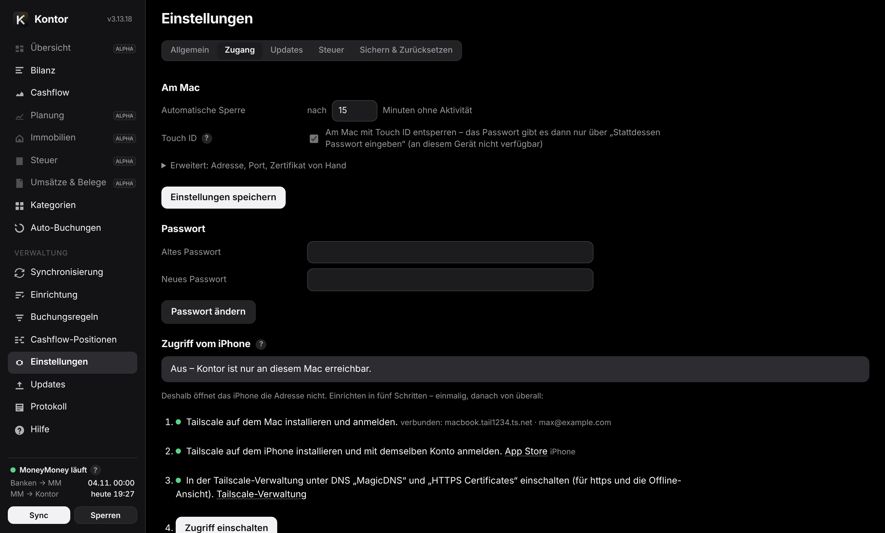

**Einrichten** – unter Einstellungen → Zugang zeigt Kontor die Schritte mit Häkchen:

1. Tailscale auf dem Mac installieren und anmelden.
2. Tailscale auf dem iPhone installieren, mit demselben Konto anmelden.
3. In der [Tailscale-Verwaltung](https://login.tailscale.com/admin/dns) unter DNS „MagicDNS“ und „HTTPS Certificates“ einschalten. Ohne HTTPS gibt es weder Face ID noch die Offline-Ansicht.
4. „Zugriff einschalten“ – Kontor holt ein echtes Zertifikat für den Namen des Macs, öffnet eine zweite Adresse nur im Tailscale-Netz und startet neu.
5. Das iPhone hinzufügen (unten) – oder die angezeigte Adresse in Safari öffnen (Link kopieren, er landet über die Zwischenablage auf dem iPhone) und mit dem Kontor-Passwort anmelden. Teilen → „Zum Home-Bildschirm“ legt Kontor als App ab.

Der Mac muss laufen (nicht im Ruhezustand) und mit Tailscale verbunden sein; ist Tailscale beim Start noch nicht verbunden, öffnet Kontor die Adresse, sobald es geht.

<a id="iphone-devices"></a>
### iPhone hinzufügen: Face ID

Jedes iPhone bekommt einmal am Mac einen eigenen Schlüssel (Passkey) mit Face ID. Danach meldest du dich dort mit Face ID an, und jede Änderung vom iPhone bestätigt Face ID – Kontor nimmt sie sonst nicht an.

1. Am Mac: Einstellungen → Zugang → Geräte → **Gerät hinzufügen**. Kontor zeigt einen QR-Code; er gilt zehn Minuten, nur einmal und nur, solange Kontor am Mac nicht gesperrt wird (ein neuer ersetzt ihn). Darunter: **Änderungen vom iPhone erlauben** – für dieses iPhone; beim ersten angehakt (ist dieses erste iPhone mit Haken hinzugefügt, schaltet das auch „Änderungen vom iPhone“ ein – Abbrechen oder Ablaufen ändert nichts). Ohne Haken darf es nur ansehen; in der Liste der Geräte änderst du das später unter „Ändern“.
2. Am iPhone: den QR-Code mit der Kamera scannen und den Link in Safari öffnen.
3. Einen Namen für das Gerät eingeben (er steht später in der Liste am Mac) und einmal das Kontor-Passwort – dann **Mit Face ID hinzufügen**. iOS fragt, ob ein Passkey für Kontor gesichert werden soll; Face ID bestätigt. Fertig: Das iPhone ist angemeldet.

**Anmelden**: „Mit Face ID anmelden“. Nach einem Neustart oder Update des Macs öffnet einmal das Kontor-Passwort die Daten (der Schlüssel dazu liegt nur verpackt auf dem Mac), danach fragt Face ID wie sonst; die Anmeldeseite sagt es dann in einer Zeile. **Anmeldung unterwegs: Nur mit Face ID hinzugefügter iPhones** ist an, sobald ein iPhone hinzugefügt ist: Von anderen Geräten meldet das Passwort dann nicht mehr an. Am Mac geht das Passwort (oder Touch ID) immer – so sperrst du dich nie aus. Wer den Schalter ausschaltet, kann sich unterwegs auch wieder mit dem Passwort anmelden – nur zum Ansehen: Ändern geht nur mit Face ID.

**Ändern vom iPhone**: Mit „Änderungen vom iPhone: Mit Face ID ändern“ geht vom hinzugefügten iPhone, was am Mac geht – Planung, Regeln, Kategorien zuordnen (Kontor trägt sie am Mac sofort in MoneyMoney ein, wie dort), wartende Auto-Buchungen freigeben (gebucht genau wie gezeigt), Eingetragenes zurücknehmen, Einstellungen, eine Sicherung herunterladen, der Assistent (mit seinem Recht „vom iPhone“). Das gilt für jedes iPhone, das in der Liste „Ändern“ angehakt hat. Jeder Klick, der etwas ändert, fragt einmal Face ID – genau für diese Änderung; eine Karte des Assistenten mit mehreren Änderungen zählt als eine, auch ein Ja zu Abrufen im Internet fragt Face ID. Lesen braucht kein Face ID, ebenso wenig Fragen an den Assistenten und ein Abgleich (er schreibt vom iPhone nichts in MoneyMoney – wartende Kategorien trägt der nächste Abgleich am Mac ein); Notizen und Änderungsprotokoll des Assistenten gibt es vom iPhone nur mit seinem Recht „vom iPhone“; was er sich aus deinen Worten merken soll, wartet am iPhone auf deinen Klick (mit Face ID); vergessen lassen sich Notizen am Mac (Einstellungen → KI-Assistent → Gedächtnis). **Immer nur am Mac**: Zugang und Geräte, Updates und ihre Quelle, die Einrichtung des Assistenten, Sicherung laden, Zurücksetzen, Passwort, Datenschlüssel, Deinstallieren, der Belegordner, Verknüpfungen zu Dateien am Mac und was am Mac selbst etwas öffnet (Finder, Mac-App, Time Machine, Kontostände aus MoneyMoneys Datenbank).

**Entfernen**: In der Liste am Mac steht je Gerät, wann es hinzugefügt und zuletzt benutzt wurde. **Entfernen** meldet es sofort ab; sein Passkey gilt nicht mehr. Ein verlorenes iPhone entfernst du so – das reicht. Der Passkey liegt im iCloud-Schlüsselbund und steht damit auch auf deinen anderen Apple-Geräten mit derselben Apple-ID bereit – auch der Mac selbst könnte sich damit über seine Tailscale-Adresse anmelden (derselbe Mensch). Ist die Geräteliste einmal beschädigt, legt Kontor sie beiseite (nie gelöscht) und nennt es unter Zugang; bis du iPhones neu hinzufügst, meldet sich unterwegs niemand an – am Mac geht alles wie sonst. Ändert sich die Adresse des Macs (anderer Name im Tailscale-Netz), steht beim Gerät „andere Adresse“: entfernen und neu hinzufügen.

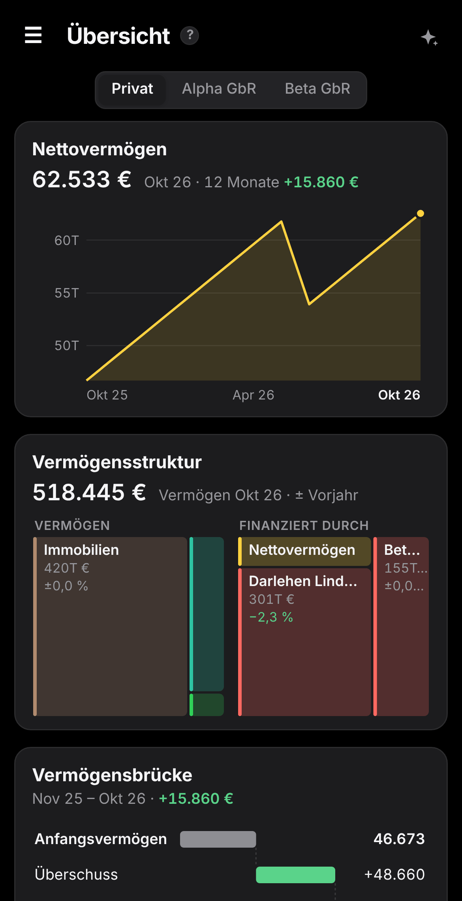

**Mac im Ruhezustand oder aus**: Als App gespeichert behält das iPhone die zuletzt geladenen Daten. Ist der Mac nicht erreichbar, öffnet das Kontor-Passwort diese Kopie – nur lesen; Änderungen gehen erst wieder, wenn der Mac erreichbar ist (MoneyMoney läuft dort). Abschaltbar unter Einstellungen → Zugang. Die Kopie ist mit dem Kontor-Passwort verschlüsselt: Das iPhone hat ein eigenes Schlüsselpaar; mit dem einen Teil verschlüsselt es jede neue Antwort, den anderen gibt es auf dem Gerät nur mit deinem Passwort verschlüsselt (PBKDF2-SHA256, AES-GCM, RSA-OAEP). Ohne Passwort ist die Kopie nicht lesbar, auch nicht mit Entwicklerwerkzeugen am entsperrten Gerät. Sie entsteht beim Hinzufügen des iPhone oder bei der ersten Anmeldung mit Passwort, während der Mac erreichbar ist; nach einem Passwortwechsel beginnt sie mit der nächsten Anmeldung mit Passwort neu. „Gespeicherte Daten auf diesem Gerät löschen“ entfernt die Kopie sofort. Das Zertifikat (90 Tage gültig) erneuert der Dienst selbst.

Ohne HTTPS-Zertifikate geht „Ohne Zertifikat einschalten“ (durch Tailscale verschlüsselt, aber ohne Face ID, ohne Offline-Ansicht und nur zum Ansehen).

**Meldet Kontor „nicht verbunden“**, steht dahinter der Grund (nicht angemeldet, ausgeschaltet, wartet auf Freigabe oder die Antwort von Tailscale). Tailscale in der Menüleiste öffnen, „Connect“ einschalten, dann „Erneut prüfen“.

<a id="iphone-security"></a>
### Wie sicher ist der Zugriff vom iPhone?

Tailscale verbindet deine Geräte direkt und Ende-zu-Ende verschlüsselt (WireGuard). Der Dienst von Tailscale vermittelt nur, wer zu deinem Netz gehört, und sieht keine Inhalte. Ins Netz kommt nur ein Gerät, das mit deinem Konto angemeldet ist – bei Anmeldung mit Apple also mit deiner Apple-ID samt Zwei-Faktor-Schutz.

Wichtig zu wissen: Ohne eigene Regel dürfen sich alle Geräte in deinem Tailscale-Netz gegenseitig auf allen Ports erreichen. Den Mac steuern kann darüber niemand, solange am Mac keine Fernzugänge eingeschaltet sind (Bildschirmfreigabe, Entfernte Anmeldung, Dateifreigabe – Systemeinstellungen → Allgemein → Teilen), und auch die verlangen das Mac-Passwort. Unter Einstellungen → Zugang → „Absichern“ prüft Kontor (nur lesend – es ändert nichts an Tailscale) und erklärt, was zu tun ist:

1. **Nur Kontor erlauben**: Kontor zeigt eine fertige Zugriffsregel für deinen Mac. Regel kopieren, in der Tailscale-Verwaltung die Seite „Access controls“ öffnen, bei einem visuellen Editor auf „JSON editor“ umschalten, den **gesamten** Text durch die Regel ersetzen (nicht nur ergänzen – sonst bleibt die Standardregel „alles erlaubt“) und „Save“ klicken. Danach erreichen deine Geräte auf dem Mac nur noch Kontor. Kontor liest die Regeln, die Tailscale auf dem Mac anwendet, und zeigt „Abgesichert“, „noch weitere Ports erreichbar“ oder – bei falscher Adresse oder falschem Port – „Kontor ist gesperrt“.
2. **Tailnet Lock einschalten**: In der Tailscale-Verwaltung unter Settings → „Tailnet lock“ einschalten und den Schritten folgen (sie führen am Mac ins Terminal, `tailscale lock init`). Danach kommt ein neues Gerät nur mit der Signatur eines deiner Geräte ins Netz – nicht einmal Tailscale selbst könnte eines hinzufügen. Kontor zeigt, ob es an ist.
3. **Nichts weiterreichen**: „tailscale serve“ und Funnel können Dienste dieses Macs weiterreichen – Funnel sogar ins Internet. Reichen sie Kontors Port weiter, käme jede Anfrage scheinbar vom Mac selbst. Kontor beantwortet deshalb keine weitergereichte Anfrage, prüft selbst – gleich beim Start, dann jede Minute – und sperrt, solange Kontors Port auf diesem Mac weitergereicht wird, am Mac die Anmeldung (auch Touch ID) und alles, was nur am Mac geht – rot auf der Anmeldeseite und oben unter „Zugriff vom iPhone“. Wird es erkannt, endet jede Anmeldung am Mac. Ausschalten im Terminal mit `tailscale serve reset` bzw. `tailscale funnel reset`, dann neu anmelden (spätestens nach einer Minute). Kontor braucht Tailscale nicht: Direkt nach einem Start wartet die Anmeldung am Mac höchstens zwei Sekunden auf die erste Prüfung und geht dann; erkennt eine spätere Prüfung die Weiterleitung, enden alle Sitzungen am Mac. Antwortet Tailscale einmal nicht, gilt der letzte bekannte Stand – aussperren kann dich das nie. Läuft Tailscale nicht, reicht es nichts weiter.
4. **Neue Geräte freigeben lassen**: In der Tailscale-Verwaltung unter Settings → „Device approval“ einschalten.
5. **Konto schützen**: Apple-ID mit Zwei-Faktor-Schutz (Standard), keine weiteren Personen ins Tailscale-Netz einladen.

In Kontor selbst: nur https mit dem Zertifikat des Macs; je iPhone ein Passkey – Kontor bewahrt nur den öffentlichen Teil auf (verschlüsselt im Datenordner, nie in Sicherungen), der private verlässt das iPhone nie und unterschreibt nur nach Face ID. Kontor prüft jede Unterschrift selbst (P-256, nur mit Bordmitteln): passende Adresse, Face ID bestätigt, eine Aufgabe, die nur einmal und nur kurz gilt – für eine Änderung an genau diese Anfrage, diese Anmeldung und dieses Gerät gebunden. Ein mitgeschnittenes Anmelde-Cookie allein ändert also nichts; ein entferntes Gerät ist sofort draußen. Fehlversuche zählen wie falsche Passwörter.

<a id="backup"></a>
## Sichern und Zurücksetzen


- **Sicherung** (Backup) – für dich: Kontor auf einem neuen Mac oder nach dem Zurücksetzen genau so wiederherstellen. Enthält alle Einstellungen, Bereiche, Regeln, Immobilien, Planung, Kategorien und Zuordnungen, Monatsstände, den Belegindex und das Gedächtnis des Assistenten – nicht die Umsätze (kommen aus MoneyMoney), keine Belegdateien, keine Verläufe des Assistenten, nicht seinen Tavily-Schlüssel und nicht das Kontor-Passwort. Weil sie deine Finanzdaten enthält, wird sie mit einem eigenen Passwort verschlüsselt, das Kontor nicht speichert. Beim Laden prüft Kontor die ganze Datei vorab und lädt sie ganz oder gar nicht. Update-Quelle, Zugang (Adresse, Touch ID, „Änderungen vom iPhone“, Sperrzeit, hinzugefügte iPhones – sie stehen nie in einer Sicherung) und die Einstellungen des Assistenten bleiben, wie sie auf diesem Mac sind – außer die Sicherung ist strenger; „Vollautomatisch buchen“ schaltet eine Sicherung nur aus, nie ein, und bleibt es an, wartet jede Regel, die hier nicht genauso steht, auf deine Bestätigung. Wartende Kategorie-Zuordnungen kommen nicht zurück; Notizen des Gedächtnisses kommen dazu, vorhandene bleiben. Sicherungen und Pakete von vor 3.17.0 lädt Kontor nicht. Laden nur am Mac; sichern auch vom hinzugefügten iPhone (mit Face ID).
- **Einstellungspaket** – für andere: deine Regeln und Zuordnungen als Vorlage, z. B. für einen Geschäftspartner mit eigenem MoneyMoney. Konten nur mit Namen, ohne Kontostände, Umsätze, Planung, Passwörter oder Adresse – und ohne den Schalter „Vollautomatisch buchen“: Was Kontor von selbst in MoneyMoney schreibt, stellst nur du ein. Darlehensregeln enthalten die Gegen-IBAN des Darlehensgebers – vor dem Weitergeben prüfen. Beim Laden ordnet Kontor die Konten über die Namen zu; was nicht gefunden wird, ordnest du in der Oberfläche zu. „Ergänzen“ fügt Regeln hinzu und überschreibt Zuordnungen, „Ersetzen“ verwirft die vorhandene Einrichtung.
- **Time Machine** sichert den Datenordner standardmäßig mit – als verschlüsselte Dateien; der Schlüssel liegt darin nur verpackt (`key.json`) und öffnet sich erst mit deiner Anmeldung (Passwort – oder Touch ID an diesem Mac). Programm und Modelle des Assistenten lässt sie aus. Die Seite zeigt den Stand. „Ausschließen“ ändert nicht die Einstellungen von Time Machine, sondern setzt am Datenordner selbst die Markierung „nicht sichern“ (wie bei Zwischenspeichern üblich, ohne Administratorrechte). Deshalb erscheint der Ordner nicht in der Ausschlussliste von Time Machine. Empfehlung: gesichert lassen.
- **Datenschlüssel erneuern** (nur am Mac, mit Passwort): Kontor verschlüsselt alle Dateien im Datenordner mit einem neuen, zufälligen Schlüssel. Der alte wird erst gelöscht, wenn sich alles mit dem neuen öffnen lässt; wird der Mac mittendrin ausgeschaltet, schließt die nächste Anmeldung es ab. Sinnvoll, wenn eine Kopie des Datenordners in fremde Hände geraten sein könnte – kennt jemand auch das Passwort, zuerst das Passwort ändern, dann erneuern. Eine Datei, die sich schon mit dem bisherigen Schlüssel nicht öffnen lässt, bleibt unverändert liegen und wird genannt. Sicherungen bleiben lesbar (sie haben ihr eigenes Passwort).
- **Zurücksetzen** (nur am Mac, mit Passwort) löscht Einstellungen, Planung, Kategorien, Verlauf, Belegindex und Auswertungen, dazu vom Assistenten Verläufe, Gedächtnis, Protokoll der Änderungen, Einstellungen und Tavily-Schlüssel – wahlweise auch das Passwort, dann mit dem Datenschlüssel: Die Einrichtung beginnt mit einem neuen. Beiseitegelegte beschädigte Dateien nimmt es mit. Belegdateien, verknüpfte Dokumente, das Protokoll und die geladenen KI-Modelle bleiben.
- **Deinstallieren** (nur am Mac, mit Passwort) entfernt Kontor von diesem Mac: Hintergrunddienst, Kontors Dateien im Datenordner (Einstellungen, Daten, Protokoll, alles vom Assistenten samt Programm und Modellen), den Datenschlüssel, die Demo, Daten und Freigaben der Mac-App und – wenn angehakt – den Programmordner (sind die Einstellungen beschädigt, bleibt er stehen). Belege, verknüpfte Dokumente und MoneyMoney bleiben unangetastet; fremde Dateien im Datenordner ebenso. Dasselbe macht ein Doppelklick auf `Uninstall.command` im Programmordner. Die Freigaben von macOS (Automation) entfernt nur macOS selbst – die Befehle dafür nennt Kontor danach.
- **Protokoll**: unter **Daten** führt „Protokoll und Diagnose“ zum [Protokoll](#log).

<a id="updates"></a>
## Updates

Kontor aktualisieren: Kontor fragt GitHub nach der neuesten Version (täglich, wöchentlich oder nie – Einstellungen → Updates) und installiert nur nach Klick. Von selbst baut Kontor nur zwei Netzverbindungen auf: diese Update-Prüfung und – solange der KI-Assistent eingeschaltet ist – die Frage nach neueren Versionen von llama.cpp und deinen Modellen ([Einrichten](#assistant-setup)). Alles andere nur auf deinen Klick: Namen von Wertpapieren nachschlagen, den Assistenten und seine Modelle laden, ein aktuelles [Python](#python) laden, die [Internetsuche](#assistant-internet) des Assistenten (je Chat einmal erlauben). Die Update-Prüfung fragt `raw.githubusercontent.com` nach der Datei `VERSION` und den Änderungen im Hauptzweig des Repositorys (Standard: [github.com/stecrz/Kontor](https://github.com/stecrz/Kontor)); gibt es eine neuere Version, lädt sie deren Archiv von github.com schon zum Lesen. Andere Server sind bewusst nicht möglich.

Vor dem Installieren liest die installierte Version die neuen Dateien, ohne etwas davon auszuführen, und vergleicht, was über das Programm hinausreicht: Netzverbindungen, andere Programme, nachgeladener Code, Internet-Adressen, die Abschirmungen und die Prüfung selbst. Jeden Fund stuft sie ein – was sie nicht sicher als harmlos erkennt, gilt als Risiko:

- **Kann ein Risiko sein**: ein neuer Weg nach außen (Adresse, Programm, Baustein von Python, Umweg), eine gelockerte Abschirmung, eine Datei, die ungelesen ankommt oder Python von selbst lädt, eine Änderung der Prüfung selbst.
- **Bestehender Weg geändert**: Kontor nutzt den Weg schon, aber was darüber hinausgeht, ist anders zusammengestellt – ein Eintrag je Weg, nicht je Stelle im Code. Ebenso, gebündelt in einem Eintrag, der Filter, der deine Daten aus Internetsuchen heraushält: In einem erlaubten Chat gehen Suchen ohne Klick hinaus.
- **Ohne Freigabe**: Regeln, die nur strenger werden (ein Verbot mehr in einer Abschirmung, eine Adresse weniger in einer Liste).

Gibt es nur Funde ohne Freigabe, bleibt es beim einen Klick; die Seite nennt sie zusammengefasst in einer Zeile. Sonst wartet das Update – „!“ im Menü bei Einstellungen, unter Updates je Fund ein Eintrag: aufgeklappt, was er bewirken kann und worauf du achten sollst, darunter Datei und Stelle und, nochmals aufklappbar, die betroffenen Zeilen (− entfernt, + neu). Installiert wird erst, wenn du genau diese Dateien freigibst („Freigeben und installieren“, nur am Mac). Die Prüfung erschwert eine untergeschobene Änderung, ausschließen kann sie sie nicht.

Beim Installieren lädt Kontor diesen Stand als Archiv von github.com, ersetzt die Programmdateien (Dateien, die es nicht mehr gibt, entfernt es), startet den Dienst neu und lädt die Seite neu – bis dahin deckt ein Ladebildschirm Kontor ab, danach meldest du dich einmal an (mit Touch ID kommt die Abfrage gleich mit der Anmeldeseite); ist der Programmordner ein Git-Klon, holt Kontor den Stand stattdessen mit git – nur vom eingestellten Repository – und rückt erst nach dem Lesen genau auf den gelesenen Stand vor. Installiert wird nur, was gelesen wurde. Datenordner und Einstellungen bleiben. Alle Schritte stehen im Protokoll.

Ist ein Update da, zeigt die Seite Updates unter „Neu in …“ alle Änderungen seit der installierten Version. Darunter stehen immer die Änderungen je Hauptversion: ein kurzer Überblick der großen Themen, die einzelnen Versionen aufklappbar, ältere Hauptversionen zusammengefaltet. Eine Hauptversion schließt die Schritte davor ab – 3.17 fasst 3.16.1 bis 3.17.0 zusammen; die kommende steht als „in Arbeit“ da.

Im Terminal aktualisiert dieselbe Zeile wie bei der [Installation](#install).

<a id="python"></a>
### Python

Kontor ist in Python geschrieben. Ab Werk läuft es mit dem Python, das zu macOS gehört (aus Apples Kommandozeilen-Werkzeugen) – Version 3.9, die seit dem 31.10.2025 keine Sicherheitsupdates mehr bekommt. Unter Einstellungen → Updates → **Python** lädt Kontor stattdessen ein aktuelles: eine feste Version von python.org, gebaut vom Projekt python-build-standalone und von dessen Seite auf GitHub geladen (rund 28 MB). Die Installation im Terminal richtet es gleich mit ein.

- **Was geladen wird**: genau eine Datei, deren Größe und Prüfsumme (SHA-256) in Kontor selbst stehen. Passt eine von beiden nicht, wird die Datei gelöscht; nichts davon wird ausgeführt.
- **Bevor umgestellt wird**: Kontor entpackt die Datei in seinen Programmordner (`.python`), vergleicht jede entpackte Datei mit dem Archiv und testet das neue Python mit allen Teilen von Kontor – auch die Zertifikate für https und die Datenbank. Erst danach stellt es um und startet neu; du meldest dich einmal an. Schlägt ein Schritt fehl, bleibt alles, wie es war, und die Seite sagt, woran es lag.
- **Startet es einmal nicht**: Den Dienst startet weiter das Python des Macs; es übergibt nur an Kontors eigenes. Kommt Kontor damit nicht hoch, läuft es sofort mit dem Python des Macs weiter, und die Seite zeigt es an („Erneut versuchen“).
- **Neuere Versionen** bringt ein Update von Kontor mit (Version und Prüfsumme stehen im Programm). Die Seite zeigt dann „neuer“; geladen wird erst nach deinem Klick.
- **Fragt macOS danach neu**, ob Python MoneyMoney steuern oder – bei eingeschalteter Firewall, für den Zugriff vom iPhone – eingehende Verbindungen annehmen darf: erlauben.

<a id="components"></a>
### Verwendete Programme

Kontor selbst ist frei (Apache 2.0) und bringt keine fremden Bibliotheken mit. Was es darüber hinaus nutzt, steht unter Einstellungen → Updates → **Verwendete Programme** – je Eintrag Name, Version, Lizenz, Herkunft und ob er abgeschirmt läuft:

- **Python** – darin läuft Kontor: das Python des Macs (Teil von macOS) oder Kontors eigenes ([Python](#python); Lizenz der Python Software Foundation – PSF 2.0 –, von python-build-standalone bei GitHub; es enthält unter anderem OpenSSL und SQLite, alle Lizenztexte liegen in seinem Ordner). Nicht abgeschirmt – es ist Kontor selbst.
- **llama.cpp** (Lizenz MIT, von GitHub) führt die Modelle des [Assistenten](#assistant-safety) aus, in der Abschirmung von macOS.
- **Modelle** des Assistenten, zum Diktieren und für die Suche nach Bedeutung (von Hugging Face) – jedes mit seiner Datei und seiner Lizenz. Sie laufen nur in llama.cpp, also in derselben Abschirmung. Bei einem Modell, das du selbst hinzugefügt hast, nennt seine Seite die Lizenz.
- **macOS** – Bordmittel, die Kontor aufruft: das Python des Macs (es startet Kontor, auch wenn Kontor in seinem eigenen läuft), `openssl`, `osascript`, Swift, die Sandbox, die Texterkennung.

„Abgeschirmt“ heißt: in der Sandbox von macOS, ohne Netz und ohne Zugriff auf Kontors Daten; die Stufe stellst du unter KI-Assistent ein. Was Kontor davon lädt (sein Python, llama.cpp, Modelle), prüft es an seiner Prüfsumme; neuere Fassungen von llama.cpp und deinen Modellen lädt es von selbst, wenn [Automatisch laden](#assistant-setup) an ist, alles andere nur nach deinem Klick. Kommt später eine Bibliothek dazu, steht sie hier.

<a id="demo"></a>
## Demo zum Vorzeigen

Ganz unten auf der Anmeldeseite stellt **Demo** die Anmeldung auf die Demo um – mit deinem Passwort oder Touch ID wie sonst, auch während das Touch-ID-Fenster schon offen ist (es fragt dann neu und nennt, ob es die Demo oder deine Daten öffnet). Sie ist ein eigenes Kontor mit erfundenen Beispieldaten: eine Privatperson über vier Jahre (Wohnung mit Darlehen, Depot, bis vor zwei Jahren angestellt), die damals gegründete Muster UG (zwei Jahre, mit Geschäftsführergehalt) und die Parkweg GbR mit einer Immobilie. Deine Konten, Zahlen, Belege, Verläufe und das Gedächtnis des Assistenten sieht sie nie, und mit MoneyMoney spricht sie nicht. Sie arbeitet mit deinen Einstellungen: Sprache, Sperre, der Assistent mit deinem Modell und deinen Rechten (auch das Internet). Vom iPhone: mit Face ID geöffnet, gilt für die Demo, was für dieses iPhone gilt (Haken „Ändern“, jede Änderung mit Face ID – auch ein Ja zu Abrufen im Internet, sie gehen mit deinem Tavily-Schlüssel); mit dem Passwort geöffnet nur ansehen. Entfernst du das iPhone, endet seine Demo. Fast alles lässt sich bedienen – Kategorisieren, Regeln, Belege, Fragen an den Assistenten, der sich auch hier merkt, was du ihm sagst (nur für die Demo; Excel-Tabellen liest er, PDFs und Bilder nicht); Einstellungen und Einrichtung gibt es dort nicht. Gesperrt (⌘L oder nach Leerlauf) bleibt die Demo und öffnet wieder wie zuvor; nach zwei Stunden ohne Anmeldung, mit einem neuen Passwort oder mit einem Neustart von Kontor ist sie weg, die nächste beginnt frisch. Auf dem Gerät und in der Offline-Kopie am iPhone bleibt nichts von ihr.

<a id="security"></a>
## Sicherheit

- Oberfläche nur auf diesem Mac (`127.0.0.1`); optional zusätzlich die Tailscale-Adresse für deine eigenen Geräte – nie im Heimnetz oder Internet. Keine fremden Inhalte, keine Telemetrie. Von selbst baut Kontor nur zwei Verbindungen nach außen auf: die Update-Prüfung bei GitHub und – solange der KI-Assistent eingeschaltet ist – die Frage nach neueren Versionen von llama.cpp und deinen Modellen (GitHub, Hugging Face), die es mit „Automatisch laden“ auch lädt; beide lassen sich abschalten, gesendet wird nichts von dir. Alles andere nur auf deinen Klick: Namen von Wertpapieren per ISIN nachschlagen, llama.cpp und Modelle für den [Assistenten](#assistant-safety) zum ersten Mal laden, ein aktuelles [Python](#python) laden (GitHub), die [Internetsuche](#assistant-internet) des Assistenten (je Chat einmal erlauben).
- Anmeldung mit Passwort (mindestens 10 Zeichen; PBKDF2-SHA256, 600 000 Runden) oder Touch ID am Mac (braucht die Kommandozeilen-Werkzeuge von Apple, sonst gilt nur das Passwort; der Dialog erscheint erst, wenn du zu Kontor wechselst – nie, während du woanders arbeitest); am iPhone mit [Face ID](#iphone-devices) (je iPhone ein eigener Passkey; jede Änderung von dort bestätigt Face ID) oder dem Passwort. Das Anmelde-Cookie gilt nur für Kontor, fremde Webseiten können nichts auslösen (CSRF-Schutz, Herkunftsprüfung). Sperre nach Leerlauf oder mit ⌘L; fünf Fehlversuche sperren fünf Minuten. Ein Passwortwechsel meldet alle anderen Geräte ab und erneuert die eigene Anmeldung.
- **Daten erst nach Anmeldung**: Alle Dateien im Datenordner sind verschlüsselt (AES-256 + HMAC) mit einem zufälligen Datenschlüssel – nicht mit deinem Passwort. Der Schlüssel liegt nur verpackt in der Datei `key.json` im Datenordner: verpackt mit deinem Passwort und, wo der Mac es kann und Touch ID eingeschaltet ist, mit einem Schlüssel der Secure Enclave, den nur Touch ID oder das Mac-Passwort freigibt. Erst deine Anmeldung gibt ihn frei; danach liegt er nur im Arbeitsspeicher des Dienstes, bis der endet. Nach einem Neustart des Macs oder einem Update meldest du dich deshalb einmal an (am Mac oder vom iPhone): Bis dahin liest Kontor nichts – Abgleich, Auto-Buchungen und Update-Prüfung warten, die Anmeldeseite sagt es –, danach laufen sie weiter, auch wenn die Oberfläche wieder gesperrt ist. Kontor speichert nie unverschlüsselt und legt keinen neuen Schlüssel an, solange verschlüsselte Daten ohne ihren Schlüssel da sind. Erneuern lässt er sich unter Einstellungen → Sichern & Zurücksetzen.
- Belege liegen als normale Dateien in einem Ordner deiner Wahl; Dateien außerhalb davon verknüpfst du nur am Mac, und nur Belegdateien – nichts aus versteckten Ordnern, dem Datenordner oder der Library (außer iCloud Drive und anderen Cloud-Ordnern). Verknüpfte Dateien öffnet Kontor nur als Dokument; Programme, Skripte und Seiten zeigt es nur im Finder.
- **Was Kontor in MoneyMoney schreibt** – sonst nichts: (1) neue Buchungen der Buchungsregeln, nur in Offline-Konten, jede mit der Markierung „#kontor-…“ und nie zweimal; (2) die Kategorie eines Umsatzes, den du in Kontor zuordnest (nur wenn er dort noch keine hat oder nach Rückfrage) – und auf deinen Wunsch wieder die davor (Kategorisieren → Eingetragen). Schlägt der Assistent eines von beiden vor, geht es nach deinem Klick denselben Weg. Kommentare und Belege bleiben unberührt: Belege verknüpft Kontor nur bei sich. Kontor ändert oder löscht keine Buchung, legt keine Überweisungen oder Lastschriften an und fasst Kategorienbaum und Regeln von MoneyMoney nicht an. Rechnen die Buchungsregeln einmal nicht, wird nichts gebucht; alles andere läuft weiter.
- Zugang und Geräte, Updates, Sicherung laden, Datenschlüssel erneuern, Zurücksetzen, Deinstallieren, Passwort und alles zum Einrichten des Assistenten nur am Mac; vom iPhone standardmäßig nur ansehen – ändern nur von einem hinzugefügten iPhone, jede Änderung mit Face ID ([Zugriff vom iPhone](#iphone-devices)).
- Historische Kontostände: Das MoneyMoney-Passwort gibst du in einem Fenster eines kleinen Kontor-Helfers ein, der nur für diesen Vorgang aus dem Quellcode gebaut und danach gelöscht wird; Kontor speichert es nirgends. Die Datenbank liegt dabei kurz vollständig entschlüsselt im Arbeitsspeicher – das erfordert Vertrauen in diesen Code. Wer das nicht möchte, lässt die Funktion aus; einmal eingelesen, wird sie nicht mehr gebraucht.
- Im Terminal (`kontor.py`) gibt es nur, was ohne Daten auskommt: den Dienst starten und einrichten, die Oberfläche öffnen, die Version. Ein neues Passwort setzen und Deinstallieren gehen dort nur mit dem aktuellen Kontor-Passwort oder Touch ID – wie in der Oberfläche. Alles, was deine Daten zeigt oder ändert (Abgleich, Buchen, Einstellungen, Diagnose), geht nur angemeldet in der Oberfläche.
- Das Protokoll enthält keine IBANs, Salden, Beträge, Empfänger, Verwendungszwecke oder Passwörter (bei Buchungen nur ihre Anzahl und Art, bei Bereichen und Objekten nur Kennungen). Die Diagnosedatei ersetzt zusätzlich Kontonamen und den Benutzerordner.
- Grenze: Nach deiner Anmeldung bleibt der Schlüssel im Arbeitsspeicher des Dienstes, bis der endet – auch bei gesperrter Oberfläche, damit Abgleich und Auto-Buchungen weiterlaufen; das Kontor-Passwort schützt dann den Zugang. Die Verschlüsselung schützt die Dateien: am Mac, solange sich seit dem Start niemand bei Kontor angemeldet hat, und jede Kopie des Datenordners (Time Machine, ein anderer Benutzer, ein ausgebauter Datenträger). Eine Kopie enthält auch `key.json` – sie ist so sicher wie dein Kontor-Passwort. FileVault bleibt die Basis.

<a id="advanced"></a>
## Für Fortgeschrittene

Was über die Oberfläche hinausgeht: Installieren und Entfernen im Terminal, die Befehle der Kommandozeile, wo Kontor seine Dateien ablegt.

<a id="install"></a>
### Installieren, aktualisieren, entfernen

Die Installation ist eine Zeile im Terminal (Programme → Dienstprogramme → Terminal), Voraussetzung ist nur ein Mac mit MoneyMoney:

```
bash <(curl -fsSL https://raw.githubusercontent.com/stecrz/Kontor/main/install.sh)
```

- Sie installiert bei Bedarf die Kommandozeilen-Werkzeuge von Apple (macOS fragt einmal nach), lädt Kontor in den Programmordner `~/Applications/Kontor` („Programme“ in deinem Benutzerordner – ohne Administratorrechte, außerhalb von iCloud), lädt ein aktuelles [Python](#python) (geprüft; ohne: `KONTOR_PYTHON=apple` davorsetzen), richtet den Dienst ein, baut Kontors [Mac-App](#app) und öffnet sie.
- **Eigener Ordner**: den Pfad mit `KONTOR_HOME` davorsetzen, etwa `KONTOR_HOME="$HOME/Werkzeuge/Kontor" bash <(curl …)`. Nicht unter Dokumente, Schreibtisch, Downloads oder in iCloud Drive: Dort lässt macOS einen Hintergrunddienst nicht ohne eigene Freigabe lesen.
- **Verschieben**: Ordner verschieben, darin `bash install.sh` ausführen – das richtet den Dienst am neuen Ort ein. Einstellungen und Daten liegen unabhängig davon im Datenordner.
- **Aktualisieren**: in Kontor unter Einstellungen → [Updates](#updates) – oder dieselbe Zeile noch einmal (mit demselben `KONTOR_HOME`); sie ist jederzeit wiederholbar, ersetzt den Dienst und lässt Datenordner und Einstellungen unangetastet.
- **Entfernen** (deinstallieren): in Kontor unter Einstellungen → Sichern & Zurücksetzen → Deinstallieren, per Doppelklick auf `Uninstall.command` im Programmordner oder mit `python3 kontor.py uninstall [--program]` (jeweils mit Kontor-Passwort oder Touch ID). Dienst, Einstellungen, Daten, Protokoll, Datenschlüssel und Kontors eigenes Python werden gelöscht; Belege und MoneyMoney bleiben.

Den Programmordner zeigt Kontor unter Einstellungen → Sichern & Zurücksetzen → Daten. Der Dienst startet beim Anmelden am Mac, läuft dauerhaft und startet nach Abstürzen neu (launchd, `de.kontor.service`); nach jedem Start wartet er auf deine Anmeldung bei Kontor. Lässt macOS ihn nicht im Hintergrund laufen, öffnet die Installation die Systemeinstellungen unter Allgemein → Anmeldeobjekte & Erweiterungen: dort bei „Im Hintergrund erlauben“ Python einschalten – sie macht dann von selbst weiter.

**Kommandozeile** – `python3 ~/Applications/Kontor/kontor.py …`, nur ohne Daten (alles andere in der Oberfläche):

- `start` – Dienst im Vordergrund starten; `open` – Oberfläche öffnen (die Mac-App, sonst den Browser); `install` – Dienst einrichten; `version`
- `password` – neues Kontor-Passwort setzen (mit dem bisherigen oder Touch ID)
- `uninstall [--program] [--yes]` – Kontor entfernen, wie in der Oberfläche (mit Kontor-Passwort oder Touch ID)

**Datenordner** `~/Library/Application Support/Kontor/` (die Umgebungsvariable `KONTOR_DIR` ändert das). Deine Daten liegen dort nur verschlüsselt:

- `config` Einstellungen, `plan` Planung, `state` Verlauf und Depot-Monatsstände, `categories` Kategorien, Zuordnungen und Regeln, `dataset` Auswertungen, `transactions` Umsatzliste (ohne Gegen-IBAN), `receipts` Belegindex, `mm-history` eingelesene historische Kontostände, `auth` Passwort-Prüfwert, `devices` hinzugefügte iPhones (ihre öffentlichen Schlüssel) (jeweils `.json.enc`), `moneymoney-ledger.bin.enc` letzter Stand aus MoneyMoney für den schnellen Abgleich; vom Assistenten `chats/` gespeicherte Verläufe, `memory-…` Gedächtnis und Suchverzeichnisse, `assistant-changes` Protokoll der Änderungen und Abrufe, `assistant-web` Tavily-Schlüssel und Zähler.
- Nicht verschlüsselt, ohne deine Daten: `key.json` (der Datenschlüssel, nur verpackt), `start.json` (was der Dienst vor der Anmeldung braucht: Port, Adresse, Zertifikat, Sprache, Touch ID, Sperrzeit, Offline-Kopie), `tls/` Zertifikat für den Zugriff vom iPhone, `assistant/` llama.cpp und Modelldateien des Assistenten (öffentliche Dateien).
- <a id="log"></a>`kontor.log` – **Protokoll** (Logdatei) im Klartext, eine Datei (höchstens 2 MB, Älteres fällt weg): Änderungen, Abgleiche, MoneyMoney-Aufrufe mit Dauer, Update-Schritte, Warnungen und Fehler – ohne Passwörter, IBANs, Beträge oder Suchbegriffe. Zu sehen unter Einstellungen → Sichern & Zurücksetzen → Daten → „Protokoll und Diagnose“, unter Einstellungen → MoneyMoney-Sync und unten in der Themenliste dieser Hilfe; dort lässt es sich auf Hinweise oder auf Warnungen & Fehler beschränken (Warnungen gelb, Fehler rot).

<a id="troubleshooting"></a>
## Fehler und Probleme

Fehlermeldungen und Probleme – und was hilft, wenn etwas nicht funktioniert:

| Meldung | Abhilfe |
|---|---|
| MoneyMoney läuft nicht / Datenbank gesperrt | MoneyMoney öffnen und entsperren; Kontor holt alles nach. |
| Keine Berechtigung (Automation) | Systemeinstellungen → Datenschutz & Sicherheit → Automation: python3 darf MoneyMoney steuern. |
| Konto nicht gefunden | Eine Regel verweist auf ein gelöschtes oder umbenanntes Konto: unter Buchungsregeln neu zuordnen; „Einrichtung prüfen“ zeigt alle Fälle. |
| Beschädigt und beiseitegelegt | Eine Datei im Datenordner ließ sich nicht lesen: Kontor hat sie unverändert daneben gelegt (`….damaged-…`) und läuft mit Werkseinstellungen bzw. leerem Stand weiter – ohne selbst zu buchen. Abhilfe: Sicherung laden. |
| Sicherung nicht geladen: Teil … hat nicht die erwartete Form | Die Datei wurde verändert oder stammt nicht von Kontor; es wurde nichts geändert. |
| ✱ im Cashflow, Zeile „Abgleich mit der Bilanz“ | Der Monat weicht von der Bilanz ab: Darüberfahren nennt den Grund, ein Klick zeigt die Buchungen – meist fehlt eine Gegenbuchung, oder eine Kategorie steht auf „Nicht berücksichtigen“. |
| iPhone öffnet die Adresse nicht | Zugriff unter Einstellungen → Zugang einschalten; Tailscale auf beiden Geräten verbunden? |
| Keine passende Zahlung | Die Darlehensregel findet die Rate nicht: Gegen-IBAN oder Text und Quellkonto prüfen. Bis 35 Tage nach „Buchen ab“ nur ein Hinweis. |
| Port nicht nutzbar | Ein anderes Programm belegt den Port: Einstellungen → Zugang → Erweitert. |
| Abgleich und Auto-Buchungen warten auf deine Anmeldung | Nach einem Neustart des Macs oder einem Update einmal bei Kontor anmelden (Passwort oder Touch ID, auch vom iPhone) – danach läuft alles weiter, auch gesperrt. |
| Kontor-Passwort vergessen | Mit Touch ID anmelden, dann Einstellungen → Zugang → Passwort: „Altes Passwort“ leer lassen, das neue eingeben, „Passwort ändern“ – Touch ID bestätigt es (nur am Mac). Oder im Terminal `python3 ~/Applications/Kontor/kontor.py password` – auch dort genügt Touch ID. Ohne Touch ID lassen sich die Daten nicht mehr öffnen (der Schlüssel ist nur mit dem Passwort verpackt): den Datenordner entfernen, Kontor neu einrichten und eine Sicherung laden. |
| Die Schlüsseldatei ist beschädigt / Zu den verschlüsselten Daten fehlt der Schlüssel | `key.json` im Datenordner fehlt, ist beschädigt oder passt nicht zu den Daten. Kontor legt dann keinen neuen Schlüssel an, damit nichts überschrieben wird. Den Datenordner samt `key.json` aus Time Machine zurückholen – oder den Datenordner entfernen, Kontor neu einrichten und eine Sicherung laden. |

Für Rückfragen: [Protokoll](#log) → „Diagnosedatei (maskiert)“. Sie enthält zusätzlich zum Protokoll Status und Einstellungen, Kontonamen ersetzt durch Konto01, Konto02 … – ohne IBANs, Salden oder Passwörter.
