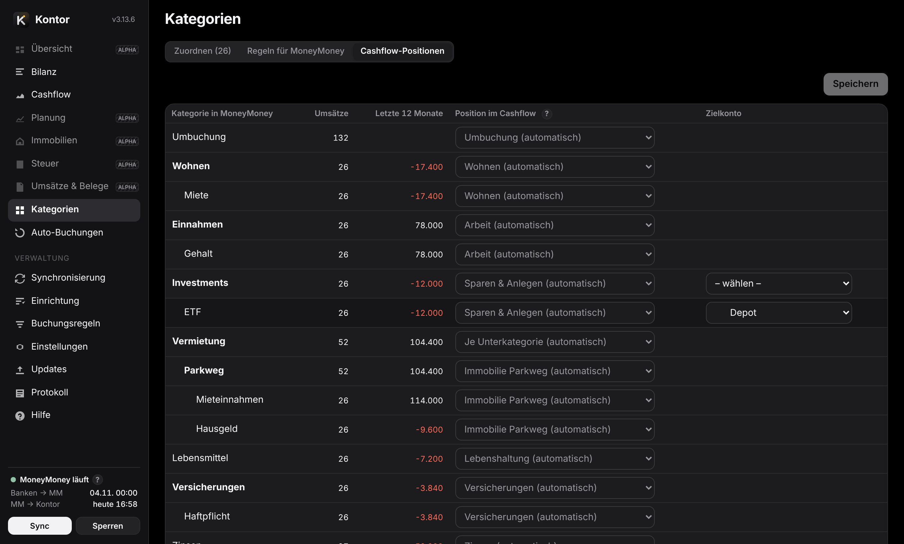
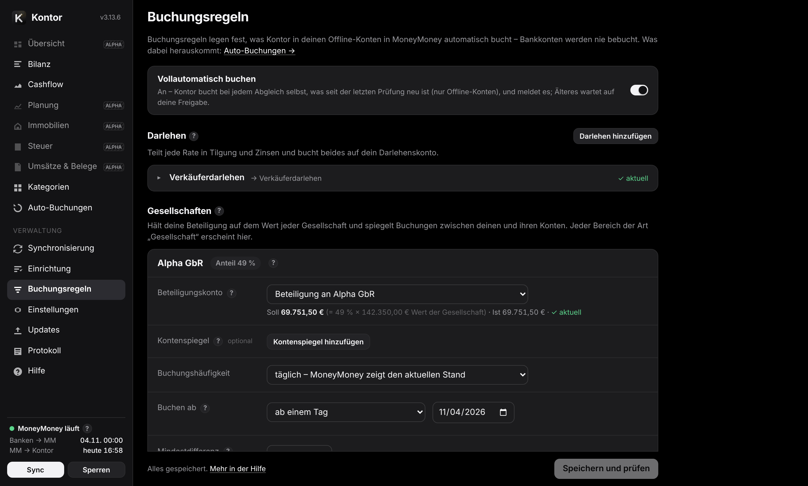

# Kontor – Hilfe

Kontor macht aus deinen Daten in [MoneyMoney](https://moneymoney.app) eine Bilanz, einen Cashflow, eine Planung und eine Steuerübersicht – für dich privat und für jede Gesellschaft getrennt. Es läuft als kleiner Dienst auf deinem Mac, die Oberfläche öffnest du im Browser unter `http://127.0.0.1:8765/` – oder als eigene App im Dock (Safari: Ablage → Zum Dock hinzufügen). **⌘L** sperrt. Diese Hilfe steht auch in Kontor selbst (Menü „Hilfe“, durchsuchbar).


<a id="overview"></a>
## Was MoneyMoney macht und was Kontor macht

| MoneyMoney | Kontor |
|---|---|
| Holt Umsätze und Salden von Banken, Depots und Zahlungsdiensten. | Liest diese Daten über die Skript-Schnittstelle von MoneyMoney. Zugangsdaten zu Banken sieht Kontor nie. |
| Kategorisiert Umsätze, von Hand oder per Regel – die einzige Stelle für Kategorien. | Nutzt diese Kategorien. Was noch keine hat, ordnest du in Kontor zu; Kontor trägt es in MoneyMoney ein und schlägt Regeln vor. |
| Führt Offline-Konten: private Darlehen, Beteiligungen, Immobilien, Kapitalkonten. | Bucht nach deinen Regeln nur in solche Offline-Konten: Darlehensraten spiegeln und Zinsen berechnen, Beteiligungen und Kontenspiegel deiner Gesellschaften. |
| Hat keine Bilanz, keine Planung, keine Steuerübersicht. | Bilanz je Bereich, Cashflow mit Prüfzeilen, rollierende Planung, Immobilienkalkulation, Steuer-Jahresübersicht, Belege, Excel-Export. |

Kontor ändert in MoneyMoney nie Buchungen, den Kategorienbaum oder Regeln und löst keine Überweisungen aus.

**Alpha**: Seiten, die im Menü blass und mit „Alpha“ markiert sind (derzeit Übersicht, Planung, Immobilien, Steuer und Umsätze & Belege), sind nutzbar, aber noch nicht vollständig geprüft – Zahlen dort bitte gegenprüfen. Ebenso die Eigenkapitalquote in der Bilanz. Geprüft sind Bilanz, Cashflow, Kategorien, Auto-Buchungen, Buchungsregeln, Synchronisierung, Einrichtung, Einstellungen, Updates, Protokoll und Hilfe.

<a id="setup"></a>
## Einrichtung

Die „?“ neben Feldern erklären kurz; ein Klick darauf (am iPhone: zweites Tippen) öffnet den passenden Abschnitt dieser Hilfe.

Unter **Einrichtung** stehen alle Bausteine in einer sinnvollen Reihenfolge. Jeder zeigt, ob er schon eingerichtet ist; die ersten vier bauen aufeinander auf, der Rest ist optional und jederzeit nachholbar. „Einrichtung prüfen“ (unten) liest MoneyMoney und meldet, ob alle Konten und Kategorien, auf die sich deine Einrichtung bezieht, dort noch existieren – etwa nachdem du in MoneyMoney etwas umbenannt hast.


1. **MoneyMoney** – MoneyMoney läuft und ist entsperrt; macOS fragt beim ersten Mal, ob Kontor MoneyMoney steuern darf (Automation). Erlauben.
2. **Bereiche** – welche Konten zusammengehören.
3. **Konten** – Bereich, Position und Verlauf jedes Kontos bestätigen.
4. **Historische Kontostände** – den bisherigen Verlauf einmalig aus MoneyMoney übernehmen.
5. **Kategorien** (auswählen) und **Zuordnung** (Umsätze zuordnen).
6. **Buchungsregeln**, **Immobilien**, **Planung**, **Steuer**, **Belege**, **iPhone-Zugriff**, **Abgleich und Freigabe**.

Danach erstellt „Auswertung erstellen“ die erste Auswertung. Die Sprache (Deutsch oder Englisch) wählst du auf der Anmeldeseite, in der Einrichtung oder unter Einstellungen → Allgemein. Dort stellst du auch das Erscheinungsbild ein: dunkel (Standard), hell oder wie das System – je Gerät.

<a id="areas"></a>
### Bereiche

Ein Bereich ist eine Menge von Konten mit eigener Bilanz, eigenem Cashflow, eigener Planung, Steuerübersicht, Umsätzen und Belegen – zum Beispiel „Privat“ und je eine Gesellschaft. Vorschlag: jede Kontengruppe auf oberster Ebene in MoneyMoney. Du kannst Konten und Gruppen aber beliebig zuordnen, zusammenlegen oder weglassen. Ein Bereich ist der Hauptbereich (privat); er ist beim Öffnen vorausgewählt. Gesellschaften bekommen Art und deinen Anteil – mit dem Anteil rechnet Kontor deine Beteiligung und die Steuer. Art und Hauptbereich sind aus den Namen vorbelegt; bitte prüfen. Mit ▲ ▼ legst du die Reihenfolge fest, in der die Bereiche oben in der Leiste stehen. Bereiche lassen sich umbenennen, löschen, zusammenlegen oder aus einzelnen Konten und Gruppen zusammenstellen; Konten, die keinem Bereich angehören, zählen nirgends.

<a id="accounts"></a>
### Konten und Positionen

Jedes Konto bekommt einen Bereich, eine Position in der Bilanz und eine Verlaufsquelle. Kontor schlägt alles vor; gestrichelt heißt „Vorschlag gewählt“, durchgezogen „eigene Wahl“. Nach dem Speichern bleibt es fest: Umbenennen oder Verschieben in MoneyMoney ändert nichts mehr. Neue Konten erscheinen als „neu“, bis du sie bestätigst. Konten erscheinen überall in der Reihenfolge von MoneyMoney.


**Positionen** (Zeilen der Bilanz, sortiert nach Verfügbarkeit):

| Position | Was dazugehört |
|---|---|
| Bankguthaben | Giro, Tagesgeld, Kreditkarte – sofort verfügbar |
| Wertpapiere | Depots mit Aktien, Fonds, ETF/ETC, Derivaten, dazu Krypto und Edelmetall – in Tagen verkäuflich, mit Kursrisiko |
| Festanlagen | Festgeld, P2P-Kredite, Bausparvertrag, Lebens- und Rentenversicherung – vor Ende nur mit Wartezeit oder Abschlag zu Geld; zählen nicht als verfügbar |
| Immobilien, Beteiligungen, Sachwerte | langfristig gebunden; zu Beteiligungen gehören auch Guthaben auf Kapital- und Gesellschafterkonten (auch Gesellschafterdarlehen) |
| Forderungen | Darlehen an andere, Kautionen |
| Verbindlichkeiten | Darlehen, Kreditkartenschulden, Schulden auf Kapitalkonten |
| außerhalb des Nettovermögens | Eigenkapital (Kapitalkonten, nur ausdrücklich gewählt), Avale & Bürgschaften, „nicht bilanzieren“ |

**So schlägt Kontor vor** (in dieser Reihenfolge): Depot → Kontoname (z. B. „Immobilie“, „Darlehen“, „Kapitalkonto“, „Aval“, „Bauspar“) → eindeutiger Kontotyp (Giro, Kreditkarte, Darlehen) → Name der Gruppe in MoneyMoney → übriger Kontotyp. Faustregel zwischen Wertpapieren und Festanlagen: In wenigen Tagen ohne Abschlag zu Geld? Dann Wertpapiere, sonst Festanlagen. Darlehen und Kautionen zählen mit Guthaben als Forderung, mit Schuld als Verbindlichkeit. Kapital- und Gesellschafterkonten (auch Gesellschafterdarlehen) zählen mit Guthaben zu den Beteiligungen – es ist Risikokapital, das Verluste mitträgt und erst beim Ausscheiden zurückfließt –, mit Schuld als Verbindlichkeit: In der Gesellschaft ist das eine Schuld an den Gesellschafter. Der Wert einer Beteiligung ist dann dein Anteil am Rest; zusammen mit dem Kapitalkonto ergibt das deinen ganzen Anteil, auch bei ungleichen Einlagen.

**Anzeige**: „nach Aktivität“ blendet Konten aus, die seit N Monaten weder Bestand noch Umsatz haben; „immer anzeigen“ oder „ausblenden“ legt es fest. Ausgeblendete Konten zählen in allen Summen mit.

<a id="history"></a>
### Verlauf eines Kontos

Woher die Monatsstände eines Kontos kommen:

- **Umsätze** (Standard für Bankkonten): Stand am Monatsende = heutiger Saldo minus alle späteren gebuchten Umsätze – so rechnet auch MoneyMoney. Vorgemerkte Umsätze zählen nicht. Vor dem ersten Umsatz gibt es keinen Stand.
- **Kontostände**: eingetragene oder übernommene Stände sind Anker; die Monate dazwischen rechnet Kontor mit den Buchungen. Abweichungen erscheinen im Cashflow als „Korrektur Kontostand“.
- **Depots**: haben keine Buchungen. Kontor nimmt die aus MoneyMoney übernommenen Stände und zeichnet danach jeden Monat selbst auf.

Kontor schätzt nichts. Ein Klick auf ein Konto in der Bilanz öffnet sein Verlauf-Fenster mit Grafik, Monatsständen und Prüfhinweisen; dort lassen sich Stände eintragen oder aus einer Datei übernehmen. Bei Depots stehen oben die Positionen (Menge, Wert, Gewinn/Verlust).

Das Fenster prüft auch die Rückrechnung: Anfangssaldo vor der ersten Buchung in MoneyMoney, vorgemerkte Umsätze, negative Stände bei Konten, die nicht ins Minus können. Bei Depots ohne übernommenen Verlauf steht „vor … unbekannt“.

**Stände aus einer Datei** (Einrichtung → Konten oder Verlauf-Fenster): CSV oder Excel (.xlsx), als Liste (Datum, Konto, Saldo) oder als Tabelle mit Stichtagen in der Kopfzeile oder in der ersten Spalte. Importierte Konten stehen danach auf „Kontostände“.


<a id="balances"></a>
### Historische Kontostände

MoneyMoney gibt den Verlauf der Kontostände über seine Schnittstelle nicht heraus – vor allem bei Depots fehlt sonst die Vergangenheit. Einmalig liest Kontor ihn deshalb aus der Datenbankdatei von MoneyMoney: MoneyMoney beenden, „Im Finder zeigen“, die Datei `MoneyMoney.sqlite` ins Fenster ziehen und das MoneyMoney-Passwort in einem macOS-Fenster eingeben. Kontor bekommt nur einen daraus berechneten Schlüssel, entschlüsselt nur im Arbeitsspeicher, prüft die Werte am aktuellen Saldo und speichert nur Monatsend-Stände, verschlüsselt. In MoneyMoney wird nichts verändert. Erneutes Einlesen ersetzt den bisherigen Stand.

**Namen der Wertpapiere** (optional): Nach dem Einlesen erscheint darunter ein weiterer Schritt. Kennt MoneyMoney ein Wertpapier nur mit seiner ISIN, kannst du seinen Namen nachschlagen lassen. Auf Klick schlägt Kontor die Namen einmalig bei OpenFIGI nach, einem frei zugänglichen Verzeichnis für Wertpapiere. Gesendet werden nur diese ISINs (vorher aufklappbar zu sehen) – keine Beträge, Mengen, Konten oder Namen. Es ist neben der Update-Prüfung die einzige Verbindung ins Internet und geschieht nie von selbst. Außerdem listet der Schritt alle Wertpapiere mit ISIN und ihrem Namen (aus MoneyMoney, sonst nachgeschlagen); dort kannst du Namen ändern oder fehlende eintragen. Geänderte und nachgeschlagene Namen werden getrennt abgelegt – in MoneyMoney ändert sich nichts – und lassen sich wieder entfernen.

Erneutes Einlesen ersetzt alle bisher eingelesenen Stände – ein Zurücksetzen vorher ist nicht nötig. Wertpapiere, zu denen MoneyMoney weder Namen noch ISIN mehr gespeichert hat (oft lange verkaufte), heißen „Unbenannt 1, 2, …“ und lassen sich nicht nachschlagen.

**Danach zeichnet Kontor selbst auf**: Bankkonten rechnet Kontor ohnehin exakt aus den Umsätzen zurück. Für Depots merkt sich Kontor bei jedem Lesen den aktuellen Wert. Der Dienst läuft ab der Anmeldung am Mac im Hintergrund, auch ohne geöffnetes Kontor-Fenster, und liest innerhalb von etwa 20 Sekunden, sobald MoneyMoney offen und entsperrt ist – ein kurzer Blick in MoneyMoney genügt. Jeder Stand zählt für den Monat, in dem MoneyMoney ihn bei der Bank abgerufen hat. Hat MoneyMoney abgerufen, während Kontor nicht lief, oder fehlt ein Monat, weist die Seite „Synchronisierung“ darauf hin.

<a id="sync"></a>
## Synchronisierung

Der Datenstand hat zwei Stufen: **Banken → MoneyMoney** (MoneyMoney ruft bei den Banken ab) und **MoneyMoney → Kontor** (Kontor liest aus MoneyMoney). Beide Zeitpunkte stehen unten links. „Sync“ liest sofort; automatisch liest Kontor alle 30 Minuten (einstellbar) und sobald MoneyMoney neue Daten hat – jeweils nur, wenn MoneyMoney läuft und entsperrt ist (Kontor startet es nicht selbst).


- **Schnell lesen**: Ein Abgleich liest nur die Umsätze der letzten 30 Tage und übernimmt ältere aus dem letzten vollständigen Lesen.
- **Kontrolle**: Dabei prüft Kontor jeden Kontostand. Passt er nicht zu den gelesenen Umsätzen, hat sich in MoneyMoney etwas Älteres geändert – etwa eine nachträgliche Buchung mit altem Datum oder ein gelöschter Umsatz. Dann liest Kontor sofort alles (höchstens alle 12 Stunden).
- **Vollständig lesen**: alle 7 Tage (einstellbar) und mit „Alles neu lesen“. Eigene Buchungen von Kontor brauchen keins: Kontor behält sie bis dahin. Nur geänderte Kategorien älterer Umsätze (z. B. eine Regel in MoneyMoney auf alle Umsätze angewendet) erscheinen erst dann – dafür „Alles neu lesen“.
- Ein Bankabruf ohne neue Daten löst keine Neuberechnung aus.
- **Umsätze lesen** (Einstellungen → Allgemein): wie weit zurück Kontor liest; 0 = alle (empfohlen).

Die Seite „Synchronisierung“ zeigt je Konto den letzten Abruf und meldet Konten, die zurückliegen. Offline-Konten (von Hand geführt: nie abgerufen, ohne Bank- und Kontonummer, als Offline-Konto angelegt oder von Kontor bebucht) stehen getrennt als „Offline-Konto“; falsch eingeordnet, je Konto unter „Art“ auf „Online“ oder „Offline“ ändern. Nur in Offline-Konten bucht Kontor – auch in eines mit eingetragener Bankleitzahl, wenn es dort auf „Offline“ steht. Ist MoneyMoney zu oder gesperrt, passiert nichts – der nächste Abgleich holt alles nach.

<a id="tables"></a>
## Tabellen, Schalter und Excel

Überall wählst du **Monate** (mit Jahressummen) oder nur **Jahre**. Jahresspalten sind kumuliert: Zahlungsflüsse als Summe, Bestände als Stand zum Jahresende. Blass sind der laufende Monat und das laufende Jahr (noch nicht abgeschlossen), blass und schraffiert die Planwerte.

- **▸ in der Kopfzelle** der Bilanz klappt alle Positionen auf; das **Auge** daneben (mit Anzahl, nur wenn es welche gibt) zeigt auch leere und nach Aktivität ausgeblendete Konten (mitgezählt werden sie immer). Steht bei einer Position „(9/12)“, sind 9 von 12 Konten zu sehen. **Leere Zeilen** (Cashflow, Planung) zeigt auch Zeilen ohne Werte.
- **Plan** (Cashflow) hängt die Planwerte rechts an; aus = nur Ist-Werte. Bilanz und Planung zeigen den Plan immer.
- **inflationsbereinigt** (Planung) zeigt Planwerte in heutiger Kaufkraft.
- Die Übersicht vergleicht zusätzlich mit dem gleichen Zeitraum des Vorjahrs.

Jede Tabelle hat einen **Excel**-Knopf: Bilanz, Cashflow, Planung (mit Fortschreibung und Parametern), Steuer, Umsätze, Depots, Belege, Konten und jede Immobilienkalkulation.

<a id="balance-sheet"></a>
## Bilanz

Die Bilanz zeigt je Bereich das Vermögen nach Positionen, Monat für Monat oder Jahr für Jahr, mit Plan bis Dezember des letzten Planjahres: oben die große Grafik, darunter die Tabelle, unten drei einzelne Grafiken. **Monate oder Jahre** (oben links) gilt für alles zusammen.


**Zeiträume und Darstellung**

- Werte sind Salden am Monatsende; der laufende Monat zeigt den aktuellen Stand.
- Die Grafiken enden am letzten abgeschlossenen Monat und zählen von Monatsende zu Monatsende: Im November reicht „1 J“ von Oktober des Vorjahres bis Oktober, die Veränderung umfasst also genau zwölf abgeschlossene Monate. Erster und letzter Monat stehen immer auf der Zeitachse; der Wert gilt für das Ende des Zeitraums, die Veränderung (in € und %) seit seinem Beginn – bei der großen Grafik ebenso, nur die Bilanz zeigt keinen Wert und keine Veränderung. Der kürzeste Zeitraum ist ein Monat (Veränderung zum Vormonat).
- Rechts davon (durch Wischen oder „Alle“) folgt der laufende Monat, gepunktet und mit einem weichen Übergang hinterlegt – dort laufen schon Ist-Daten ein –, danach der Plan, gestrichelt und hinterlegt. Die senkrechte gestrichelte Linie markiert das Ende des letzten abgeschlossenen Monats. In der Tabelle ist der laufende Monat bzw. das laufende Jahr blass, der Plan blass und schraffiert.
- Farben: Positionen nach Verfügbarkeit, von Bankguthaben (grün) bis Beteiligungen (violett); Konten in Abwandlungen der Farbe ihrer Position (ab dem elften Konto schraffiert), in Tabelle und Grafiken gleich. Das Nettovermögen ist golden; der goldene Strich davor im Werte-Fenster und in der Tabelle steht für seine Linie.

**Tabelle**

- Klick auf den **Namen** einer Position klappt ihre Konten auf (**▸** in der Kopfzelle: alle Positionen; **▸** vor einem Depot: seine Wertpapiere). Klick auf den Namen eines Kontos öffnet seinen Verlauf (Monatsstände ansehen und bearbeiten), ein zweiter Klick schließt ihn wieder; bei einem Wertpapier ebenso.
- Klick auf einen **Wert** lässt Fläche und Monat in der großen Grafik kurz aufleuchten (die Grafik rückt dafür nötigenfalls zum Monat). Klick auf eine Monatsüberschrift verschiebt die Grafik so, dass der Monat genau über der Spalte steht; ein Klick auf einen Wert des Nettovermögens ebenso, dazu blinkt sein Punkt in der Grafik kurz auf. Die einzelnen Grafiken behalten dabei ihre Länge und enden mit diesem Monat – so zeigen sie die Veränderung bis dahin. Die Seite selbst bleibt stehen. Fährst du über einen Namen, ist dieselbe Fläche in der Grafik hervorgehoben.
- Das **Auge** in der Kopfzelle (nur wenn es welche gibt, mit Anzahl) zeigt auch leere und nach Aktivität ausgeblendete Konten und Wertpapiere – mitgezählt werden sie immer. Was als ausgeblendet gilt, legst du unter [Einrichtung → Konten](#accounts) fest (Spalte „Anzeige“ und „Nach Aktivität … Monaten“, Standard 12); Wertpapiere ohne Wert in diesem Zeitraum gelten ebenfalls als ausgeblendet. „(9/12)“ heißt: 9 von 12 zu sehen.
- **Depots**: frühere Monate aus den eingelesenen MoneyMoney-Kontoständen (sonst aus Kontors monatlicher Aufzeichnung), der laufende Monat aus MoneyMoney; was die Wertpapiere nicht erklären, steht als „Übrige“. Beim Darüberfahren über ein Wertpapier stehen immer der Name aus MoneyMoney und die ISIN dabei, ebenso ob der Name nachgeschlagen oder geändert ist. Konten benennst du in MoneyMoney um – Kontor übernimmt die Namen von dort.
- Jahresspalten zeigen den Stand zum Jahresende (das laufende Jahr: heute). In der Monatsansicht gibt es keine Jahresspalten – sie wären nur der Dezember; ein feiner Strich trennt die Jahre.
- Die erste Spalte ziehst du an ihrem rechten Rand breiter oder schmaler (Doppelklick: Standardbreite); die Breite gehört zur Ansicht.
- **Eigenkapitalquote** (Alpha; Klick auf „Nettovermögen“ klappt die Kennzahlen darunter auf): wie viel deines Vermögens dir schuldenfrei gehört – Eigenkapital ÷ (Eigenkapital + Schulden). Durchgerechnet durch deine Gesellschaften: Deren Schulden zählen mit deinem Anteil (Bereiche), wenn die Beteiligung unter Buchungsregeln → Gesellschaften eingetragen ist, sonst sähe die Quote zu gut aus, weil die Bankdarlehen dort liegen. Schulden sind Konten mit negativem Stand; Kapital- und Gesellschafterkonten sind Eigenkapital, Beteiligungen selbst nie Schulden. Wie du Kapitalkonten buchst, ändert nichts. Beteiligungen ohne diesen Eintrag zählen nur mit ihrem Wert; liegen Konten einer Gesellschaft in keinem Bereich, ist die Quote unbekannt. Ein Klick zeigt die Rechnung des Monats Schritt für Schritt.
- Unter dem Nettovermögen stehen Avale & Bürgschaften und Kapitalkonten als Eigenkapital (nicht im Nettovermögen), je gesammelt in einer aufklappbaren Zeile.
- **Geldtransit**: Liegen die beiden Buchungen einer Umbuchung zwischen eigenen Konten in verschiedenen Monaten (am 31. abgebucht, am 1. gutgeschrieben), zählt der Betrag am Monatsende als „Geldtransit“ zum Bankguthaben – sonst sähe das Nettovermögen kurz zu niedrig aus. Ein Klick zeigt die erkannten Buchungspaare.

**Große Grafik** – jede der vier Grafiken kann die große sein: das Symbol ⤢ in einer kleinen Grafik tauscht sie mit der großen (Standard: die Bilanz).

- Zeitraum je nach Ansicht – Monate: 6 Monate, 1, 2 oder 3 Jahre (Standard 1 Jahr); Jahre: 1, 3, 5 oder 10 Jahre (Standard 3 Jahre) –, alles oder eine eigene Zahl von Monaten.
- Als Bilanz zeigt die große Grafik zusätzlich etwa ein Drittel des Zeitraums nach vorn: den laufenden Monat und den Plan (bei 1 Jahr den laufenden Monat und drei Planmonate, bei 3 Jahren zwölf Monate). **Plan** links neben den Zeiträumen schaltet das ab; die Einstellung gehört zur Ansicht. Die Zahl im Feld daneben zählt die Monate bis zum letzten abgeschlossenen, der Plan kommt dazu. Die Betragsachse hat mindestens fünf Hilfslinien.
- Darüberfahren zeigt die Werte des Monats in einem leicht durchsichtigen Fenster; die Fläche unter dem Mauszeiger und ihre Zeile im Fenster sind hervorgehoben. Über der Monatsachse erscheinen die Werte ohne Hervorhebung.
- Klick auf eine Fläche wirkt wie in der Tabelle: Eine Position klappt in ihre Konten auf, ein Depot in seine Wertpapiere; Klick auf ein Konto oder Wertpapier klappt die Position wieder zu. Danach ist markiert, was aufgeklappt wurde, bis sich die Maus bewegt. Klick daneben oder auf die Monatsachse springt zum Monat in der Tabelle.
- Wischen (auch auf der Monatsachse) verschiebt, mit zwei Fingern zoomen, Ziehen wählt einen Ausschnitt, Doppelklick neben den Flächen vergrößert. Auf der Betragsachse nach oben/unten ziehen vergrößert bzw. verkleinert den Wertebereich (das Mausrad verschiebt ihn), Tippen oder Klick dort macht ihn wieder automatisch. Am iPhone verschieben und zoomen zwei Finger, ein Finger zeigt die Werte. Das gilt auch für die einzelnen Grafiken.
- **An Tabelle ausrichten**: Jeder Wert steht genau über seiner Spalte. Die Grafik scrollt mit der Tabelle, Wischen oder Ziehen auf der Grafik scrollt die Tabelle, und die Skala passt sich den sichtbaren Spalten an. Das Werte-Fenster entfällt – die Werte stehen ja darunter.

**Einzelne Grafiken** (unter der Tabelle)

- **Bilanz** (wenn eine andere Grafik groß ist): ohne Wertzeile, dafür etwas höher.
- **Nettovermögen** allein, darunter Ø je Monat, Höchst- und Tiefststand. Beim Darüberfahren stehen nur Monat und Wert da.
- **Auswahl**: die Summe frei gewählter Positionen (Standard: Bankguthaben, Wertpapiere und Festanlagen – die Geldanlagen). Der Titel benennt die Auswahl in Worten – typische Kombinationen mit ihrem Namen, sonst zusammengesetzt wie „Geldanlagen + Verbindlichkeiten“ oder „Nettovermögen ohne Beteiligungen“, bei Platzmangel mit gekürzten Wörtern; die Linie hat die Mischfarbe der Positionen. Die Namen ergeben sich Schritt für Schritt – so steht es auch beim Darüberfahren über den Titel, dort nur mit den Positionen, die es im Bereich gibt:

```
  Bankguthaben
+ Wertpapiere
= Liquides Vermögen
+ Festanlagen
= Geldanlagen
+ Beteiligungen
+ Forderungen
= Geldvermögen
+ Sachvermögen (Immobilien + Sachwerte)
+ Sonstiges
= Bruttovermögen (Bilanzsumme)
+ Verbindlichkeiten
= Nettovermögen

Gebundenes Vermögen = Bruttovermögen − Liquides Vermögen
```

Geldvermögen und Sachvermögen sind wie in der Statistik der Bundesbank abgegrenzt: Beteiligungen zählen zum Geldvermögen, auch wenn die Gesellschaft Immobilien hält; Krypto und Edelmetall stehen bei Kontor unter Wertpapiere und damit im Geldvermögen. „Umlaufvermögen“ gibt es bewusst nicht – es hängt davon ab, wie lange du etwas halten willst, nicht davon, wie schnell es zu Geld wird.

- **Zusammensetzung** einer gewählten Position nach Konten (gestapelt). **Depot** daneben schlüsselt die Depots in ihre Wertpapiere auf (nur wo es das gibt); unten lassen sich Konten bzw. Wertpapiere einzeln abwählen – die Linie der Position bleibt, beim Darüberfahren steht zusätzlich die Summe der Auswahl.
- Jede hat einen eigenen Zeitraum (je nach Ansicht 6 Monate, 1 oder 2 Jahre bzw. 1, 3 oder 10 Jahre) und eine Achse, die sich den sichtbaren Werten anpasst (mindestens vier Hilfslinien) – so sieht man die Entwicklung auch dann, wenn sich große Positionen wie Forderungen und Verbindlichkeiten oben gegenseitig ausgleichen. Die Fläche reicht bis zur Nulllinie, bei negativen Werten also nach oben. Das Werte-Fenster ist leicht durchsichtig, damit die Linie darunter sichtbar bleibt. Unter den Zeitraum-Knöpfen steht die Länge des gezeigten Zeitraums (über zwei Jahren in Jahren und Monaten, z. B. „2 Jahre 8 Mon.“ oder „2 ½ Jahre“) – darauf beziehen sich Wert und Veränderung; nach dem Zoomen ist ein Knopf wieder markiert, sobald die Länge passt.

**Anordnung und Ansicht speichern**

- Die kleinen Pfeile **↑ ↓** im Kopf der Tabelle und der großen Grafik (beim Darüberfahren) verschieben sie nach oben oder unten, auch unter die einzelnen Grafiken.
- Was du beim Ansehen änderst (Monate oder Jahre, Zeiträume, Plan, aufgeklappte Zeilen, das Auge, Breite der ersten Spalte, Anordnung, welche Grafik groß ist, Auswahl in den Grafiken), gilt nur bis zum Neuladen. **Ansicht speichern** (oben rechts, neben Excel) merkt sich die aktuelle Ansicht auf diesem Gerät, getrennt für Monate und Jahre (z. B. Monate mit 2 Jahren, Jahre mit 10 Jahren). Die zuletzt gespeicherte öffnet beim Start; wechselst du zwischen Monaten und Jahren, gelten deren gespeicherte Zeiträume. Zeiträume enden dabei immer am letzten abgeschlossenen Monat, die Tabelle steht wie immer auf dem aktuellen Monat. **Zurücksetzen** stellt den Standard von Kontor wieder her. Der Bereich bleibt davon unberührt.

<a id="cash-flow"></a>
## Cashflow

Wohin das Geld fließt: Einnahmen und Ausgaben nach festen **Positionen** (Arbeit, Umsatzerlöse, Vermietung, Wohnen, Personal, Steuern …), Investitionen (Sparen & Anlegen, Einlagen in Beteiligungen), Finanzierung (Tilgung und Zinsen je Darlehen), Bewertung (Wertänderungen von Depots) und „Unklar“. Die Gliederung ist für jeden Bereich gleich – privat, GbR oder GmbH; eine Position erscheint nur, wo Geld darin ist. ▸ vor einer Position zeigt die Kategorien darin.


Jeder Umsatz zählt genau einmal. Umbuchungen zwischen eigenen Konten zählen nie als Einnahme oder Ausgabe: Kontor findet zu jeder die Gegenbuchung – über die Markierung seiner eigenen Buchungen (die Tilgung nennt die Zahlung), über die Gegen-IBAN (gleicher Betrag, höchstens fünf Tage auseinander) oder bei der Kategorie „Umbuchung“ und bei manuellen Konten über den Betrag (höchstens drei Tage). Zahlungen in einen anderen Bereich sind **Einlagen oder Entnahmen**; hältst du an einer Gesellschaft eine Beteiligung, steht der Unterschied zwischen eingezahltem Geld und Wert der Beteiligung unter Bewertung. Konten in Fremdwährung rechnet Kontor nicht um; sie stehen in der Bilanz außerhalb des Nettovermögens.

Zwei **Prüfzeilen** vergleichen jeden Monat mit der Bilanz: der Zahlungsfluss mit der Veränderung der liquiden Konten, die Zeilen ohne „Umschichtung“ mit der Veränderung des Nettovermögens. ✓ heißt: stimmt auf den Cent. Eine Abweichung nennt beim Darüberfahren ihren Grund – etwa Geld, das über das Monatsende zu einem Darlehen unterwegs ist, oder eine Kategorie auf „Nicht berücksichtigen“. Was Kontor nicht sicher zuordnen kann – etwa eine Umbuchung ohne Gegenbuchung –, steht unter „Unklar“ und zählt mit seinem Betrag.

In welcher Position eine Kategorie aus MoneyMoney zählt, schlägt Kontor nach ihrem Namen vor; ändern kannst du es unter [Kategorien → Cashflow-Positionen](#categories-positions). Umsätze **ohne Kategorie** schätzt Kontor: zuerst nach deinen bisherigen Kategorien (gleiche Gegenpartei, gleicher Verwendungszweck), sonst nach Wörtern in Name, Verwendungszweck und Buchungstext (etwa „Finanzamt“, „Gehalt“, Kartenabrechnungen). In der Position stehen sie als „ohne Kategorie, geschätzt“; was sich nicht schätzen lässt, steht unter „(ohne Kategorie)“. Je mehr du zuordnest, desto genauer – nötig ist es nicht, auch nicht für eine GmbH mit vielen Buchungen. In MoneyMoney trägt Kontor dabei nichts ein.

<a id="categories"></a>
## Kategorien

**MoneyMoney ist die einzige Wahrheit.** Kontor hat keine eigenen Kategorien: Es zeigt die aus MoneyMoney und hilft, die Lücken zu füllen.

| In MoneyMoney | In Kontor |
|---|---|
| Kategorien anlegen und umbenennen | zuordnen, was noch keine Kategorie hat – Kontor trägt es in MoneyMoney ein |
| feste Regeln (Einstellungen der Kategorie → Regeln) | Regeln vorschlagen, die du dort einfügst |
| | festlegen, in welcher Position des Cashflows eine Kategorie zählt |

**Zuordnen** zeigt alle Umsätze deiner Bankkonten ohne Kategorie in MoneyMoney, nach Gegenpartei gruppiert (Darlehen, Beteiligungen und andere Konten zählen nach ihrer Position, nicht nach Kategorie). Der Vorschlag kommt aus deinen bisherigen Kategorien; Kontor übernimmt ihn nie von selbst. „Zuordnen“ trägt die Kategorie in MoneyMoney ein, „Alle Vorschläge übernehmen“ alle auf einmal. Unter „Umsätze“ wählst du einzelne ab – etwa bei einem Händler, bei dem du Verschiedenes kaufst. Zur Auswahl stehen nur Kategorien, die es in MoneyMoney gibt – eine neue legst du dort an. Einzelne Umsätze ordnest du auch unter Umsätze & Belege zu (Klick auf die Zeile oder mehrere markieren); dort kannst du auch eine Kategorie aus MoneyMoney ändern (nach Rückfrage). Im Cashflow führt „zuordnen“ neben „(ohne Kategorie)“ direkt hierher.


Vom iPhone aus Zugeordnetes merkt sich Kontor und trägt es beim nächsten Abgleich am Mac ein; bis dahin zählt es schon (⏳ in der Umsatzliste). MoneyMoneys Standardkategorie „Unkategorisiert“ zählt als ohne Kategorie.

<a id="categories-rules"></a>
### Regeln für MoneyMoney

Ordnest du eine Gegenpartei mehrmals in Kontor zu, hat MoneyMoney dafür offenbar keine Regel. Kontor schlägt sie unter Kategorien → Regeln für MoneyMoney vor – in MoneyMoneys Schreibweise, zum Beispiel `name:"Baumarkt*"` oder `remote_account:"DE…" AND purpose:"miete"`. Hat dieselbe Gegenpartei auch andere Kategorien, nimmt Kontor Wörter aus dem Verwendungszweck oder die Richtung der Zahlung dazu; vorgeschlagen wird nur, was keinen Umsatz einer anderen Kategorie trifft. Ausdruck kopieren, in MoneyMoney in den Einstellungen der Kategorie unter Regeln einfügen und „Nur auf noch nicht kategorisierte Umsätze anwenden“ wählen – dann „Erledigt“.

<a id="categories-write-back"></a>
### In MoneyMoney eintragen

Einmal einschalten (unter Kategorien oder Einstellungen → Allgemein, nur am Mac). Sicherungen:

- Kontor setzt nur das Kategoriefeld eines Umsatzes; Beträge, Daten und Löschen sind damit nicht möglich.
- Direkt vor dem Schreiben liest Kontor den Umsatz neu aus MoneyMoney und schreibt nur, wenn er unverändert ist und noch keine Kategorie hat (oder die von Kontor gesetzte).
- Eine vorhandene andere Kategorie ersetzt Kontor nur nach Rückfrage; sonst bleibt sie.
- Kategorien und Regeln in MoneyMoney legt Kontor nie an und ändert sie nie.

<a id="categories-positions"></a>
### Cashflow-Positionen

Der Cashflow hat eine feste Gliederung; deine Kategorien aus MoneyMoney zählen darin. Unter Kategorien → Cashflow-Positionen steht jede Kategorie mit Umsätzen, der Summe der letzten zwölf Monate und ihrer Position:

- **Automatisch** – wie die Kategorie darüber, sonst Kontors Vorschlag nach dem Namen (etwa „Einkommen / Rückzahlung Finanzamt“ → Erstattungen, „Sparen“ → Sparen & Anlegen).
- Eine gewählte Position gilt auch für alle Kategorien darunter, solange sie keine eigene haben.
- **Sparen & Anlegen** zählt nicht als Ausgabe; daneben wählst du das Konto, in das das Geld fließt. **Umbuchung** (zwischen eigenen Konten) sucht die Gegenbuchung, **Nicht berücksichtigen** nimmt die Kategorie heraus (die Prüfzeile nennt sie).
- Kategorien einer Immobilie (Immobilien → Kategorie) haben im Cashflow eigene Zeilen „Miete“ und „Kosten“.

Die Planung arbeitet auf den Positionen; ein Budget aus MoneyMoney zählt für die Position seiner Kategorie. In MoneyMoney ändert sich nichts.



<a id="planning"></a>
## Planung

Die Planung schreibt die Vergangenheit fort: je Zeile eine Methode (Ø 12 oder 6 Monate, Vorjahresmonat, fester Betrag, Jahresbetrag/12, MoneyMoney-Budget, keine), ein Betrag und eine Steigerung in % p.a. Ausgaben folgen standardmäßig der Inflation, Einnahmen der eingestellten Rate. Einzelne Monate überschreibst du per Doppelklick; der Vorschlag bleibt sichtbar und lässt sich wiederherstellen.


- **Darlehen**: Zins auf den fortgeschriebenen Restsaldo, Tilgung = Rate − Zins.
- **Wertentwicklung** je Konto in % p.a.; Beteiligungen wahlweise gekoppelt an das geplante Nettovermögen der Gesellschaft (Anteil × Nettovermögen).
- **Ereignisse**: einmalige oder wiederkehrende Umschichtungen, Einnahmen und Ausgaben – z. B. ein Darlehen auf einen Schlag aus dem Depot zurückzahlen.
- **Immobilien**: aktive Kalkulationen fließen mit Miete, Kosten, Zins, Tilgung, Restschuld und Objektwert ein.
- Der Plan reicht immer bis Dezember; „inflationsbereinigt“ zeigt Planwerte in heutiger Kaufkraft.
- Darunter: Fortschreibung der Bilanz je Position und Konto und Kennzahlen (Sparquote, Reichweite der Liquidität, Zinslast). Der Plan gilt je Bereich.

<a id="properties"></a>
## Immobilien

Je Objekt beliebig viele Kalkulationen (Szenarien), eine davon aktiv. Eingaben:

- Kaufpreis und Übergang; Nebenkosten (Grunderwerbsteuer, Notar, Grundbuch, Makler; sofort abziehbare Posten getrennt); Gebäudeanteil und AfA-Satz oder Restnutzungsdauer.
- Nettokaltmiete und Umlage, Leerstand, Mietanpassung (Indexmiete nach VPI mit Weitergabefaktor und Schwelle, fester Satz oder keine); nicht umlagefähige Kosten und Rücklage (mit VPI oder festem Satz).
- Darlehen: Annuität, Tilgungsdarlehen oder endfällig; Abrechnung monatlich wie bei Banken oder jährlich auf den Stand 1. Januar wie bei Verkäuferdarlehen; Sondertilgungen laufend oder einzeln, Zinsbindung mit Anschlusszins, Fälligkeit mit Rückzahlung.
- Gesellschafter mit Anteil und Steuersatz, Ausschüttung, Wertentwicklung, Verkaufsjahr.

Ungültige Eingaben weist Kontor mit dem Feldnamen ab.


Ergebnis: Monats- und Jahrestabelle (Miete, Kosten, Zinsen, Tilgung, AfA, steuerliches Ergebnis, Steuer, Cashflow, Vermögensaufbau, Restschuld, Objektwert), Kennzahlen (Kaufpreisfaktor, Brutto- und Nettomietrendite, Cash-on-Cash, DSCR, LTV, IRR bis zum Verkauf) und Hinweise (offene Fälligkeiten, fehlender Anschlusszins, negativer kumulierter Cashflow). Verknüpfungen mit MoneyMoney: Vermietungskategorie und Darlehenskonten für den Soll/Ist-Vergleich je Jahr, Objektkonto für den Wert in der Bilanz. „In Planung übernehmen“ speist die Planung des Bereichs; die AfA der aktiven Kalkulation landet in der Steuerübersicht, solange dort kein Jahreswert von Hand steht. Excel-Export je Kalkulation. Dokumente (Kaufvertrag, Gutachten …) werden als Verknüpfung abgelegt – die Dateien bleiben, wo sie sind. Vereinfacht gerechnet: Steuer je Gesellschafter = Anteil × Ergebnis × Steuersatz (keine Progression, kein Verlustausgleich), AfA linear.

<a id="tax"></a>
## Steuer

Je Entität (Hauptbereich = privat, jede Gesellschaft mit deinem Anteil aus den Bereichen) und Jahr: Vermietung je Objekt aus den Kategorien `Vermietung \ Objekt \ Art` (beliebig viele Objekte, auch privat), Schuldzinsen je Darlehen (Zuordnung Darlehen → Objekt unter Einstellungen → Steuer), AfA, Steuerpositionen aus Kategorienamen (anpassbar unter Einstellungen → Steuer) und Buchungen ohne Kategorie als Prüfposten. Die Belege eines Jahres lassen sich als ZIP mit Übersicht exportieren. Keine Steuerberatung.

<a id="receipts"></a>
## Umsätze und Belege

Der Umsatzbrowser filtert nach Bereich, Jahr, Konto, Text, „ohne Beleg“ und „ohne Kategorie“. Belege (PDF, Bilder, E-Mails, Office-Dateien) fügst du per Auswahl, Drag & Drop oder am iPhone per Foto hinzu. Sie liegen als normale Dateien im Belegordner (Standard `~/Documents/Kontor-Belege`, Unterordner z. B. `{jahr}`), Dateiname `Datum_Betrag_Name_Kennung`. Dateien außerhalb des Ordners (auch iCloud Drive) lassen sich verknüpfen, ohne sie zu kopieren – Kontor zeigt, ob die Datei lokal vorliegt oder noch aus iCloud geladen wird. Vorhandene Dateien im Belegordner lassen sich nachträglich zuordnen. Bis 60 MB je Datei. Der Index liegt verschlüsselt im Datenordner; die Dateien bleiben auch ohne ihn nutzbar. Löschen in Kontor betrifft nie verknüpfte Dateien.

<a id="rules"></a>
## Buchungsregeln

Buchungsregeln legen fest, was Kontor automatisch in deine Offline-Konten in MoneyMoney bucht:

- **Darlehen** – Rate erkennen, als Tilgung auf das Darlehenskonto buchen, Zinsen dazu.
- **Gesellschaften** – je Gesellschaft deine Beteiligung auf ihrem Wert halten und Buchungen zwischen deinen und ihren Konten spiegeln (Kontenspiegel).



Jedes Darlehen ist eine Zeile (Name → Darlehenskonto, rechts was offen ist); ein Klick klappt die Einzelheiten auf. Jede Gesellschaft hat eine eigene Karte. Neben jedem Feld erklärt ein **?** kurz, was es bewirkt (Klick: dieser Abschnitt). Neben jeder Regel stehen **Soll**, **Ist** und die **Differenz**, die Kontor buchen würde – schon während du änderst. **„Speichern und prüfen“** (⌘S) unten gilt für alle Änderungen der Seite und prüft sie gegen MoneyMoney.

<a id="auto-bookings"></a>
### Auto-Buchungen

Unter „Auto-Buchungen“ siehst du, was die Buchungsregeln buchen wollen und gebucht haben.

**Vollautomatisch buchen** (Schalter oben unter „Buchungsregeln“, nur am Mac): aus (Standard) – die Buchungen erscheinen unter „Auto-Buchungen“ und werden erst angelegt, wenn du sie dort **freigibst** (nur am Mac) – einzeln: Häkchen entfernen nimmt eine Buchung aus, der Stift ändert den Text, bei Darlehen auch Datum und Betrag (die Markierung bleibt), ✕ bucht sie nicht – sie steht dann unter „Nicht gebucht“; was du nur abwählst, wartet weiter. Was du weglässt oder änderst, verschiebt jeden späteren Stand desselben Kontos: Kontor rechnet die Liste sofort neu (die nächste Wertanpassung gleicht es aus, bei Darlehen die Zinsen danach) und bucht genau die angezeigten Beträge – hat sich in MoneyMoney inzwischen etwas geändert, bucht es nichts und zeigt die neuen. An – Kontor bucht bei jedem Abgleich selbst, was **seit der letzten Prüfung neu** ist: eine neue Zahlung, ein abgelaufener Monat, ein neuer Stand der Gesellschaft, eine neue Buchung im Kontenspiegel. Älteres wartet auch dann auf deine Freigabe (Hinweis „älter“) – Buchungen in die Vergangenheit (etwa beim Einrichten mit einem früheren „Buchen ab“) und solche, die wieder fehlen, weil du sie in MoneyMoney gelöscht hast, dazu Zinsen, die darauf aufbauen. Oben rechts unter „Auto-Buchungen“ steht, was gilt („Mit Freigabe“ oder „Vollautomatisch“). Bank- und Erweiterungskonten werden nie bebucht, Überweisungen und Lastschriften sind gesperrt, bestehende Buchungen ändert oder löscht Kontor nie – auch die Zahlungen selbst (deine Bankumsätze) bleiben unberührt.

**Ablauf**: Bei jedem Abgleich (automatisch alle 30 Minuten, nach neuen Daten in MoneyMoney, nach dem Speichern der Buchungsregeln oder per „Sync“) rechnet Kontor die Buchungsregeln durch – auch wenn sich in MoneyMoney nichts geändert hat, aber die Regeln, deine Entscheidungen oder der Tag (Zinsen zum Monatsende); „Sync“ links unten tut das sofort. Schneller geht **„Aktualisieren“** oben unter „Auto-Buchungen“ (mit Freigabe): Es liest nur die Konten neu, die die Buchungsregeln betreffen – Darlehens- und Quellkonten, Beteiligungskonten und Kontenspiegel, die Konten der Gesellschaften – und rechnet die Freigabe neu; gebucht wird dabei nichts, die übrigen Zahlen kommen mit dem nächsten Sync. Während eines Abgleichs steht links unten, was Kontor gerade tut (z. B. „Bucht 12 von 56 …“); das Ergebnis siehst du sofort, die Auswertung rechnet Kontor danach im Hintergrund neu. Mitteilungen von macOS gibt es nicht: In der Seitenleiste zeigt eine Zahl an „Auto-Buchungen“, wie viele warten (ab 100 „99+“, ein „!“ nach einem Fehler, ein Punkt bei Hinweisen), ein Punkt an „Updates“ eine neue Version – bei schmalem Fenster ein Punkt am Menüknopf, in der Web-App im Dock die Zahl am Symbol. Unter „Auto-Buchungen“ stehen die wartenden bzw. zuletzt gebuchten Buchungen mit Hinweisen und Rechenwegen, „Nicht gebucht“, **„Von Kontor angelegt“** (alle Buchungen mit Kontors Markierung) und der Verlauf.

**Ohne eigene Liste**: Kontor merkt sich nicht, was es gebucht hat – es liest es bei jedem Abgleich aus MoneyMoney. Jede Buchung trägt eine Markierung im Verwendungszweck (z. B. „#kontor-zins-2026-10“; bis Version 3.12 „#mm-…“) – daran erkennst du auch in MoneyMoney, dass Kontor sie angelegt hat. Was du dort tust, gilt: Eine geänderte Buchung (Betrag, Datum oder Text, die Markierung bleibt) übernimmt Kontor so; eine gelöschte fehlt wieder, und Kontor schlägt sie erneut vor (nur mit Freigabe). Buchungen, die du selbst angelegt hast, zählen als gebucht: eine Tilgung mit gleichem Betrag bis 7 Tage neben der Zahlung, Zinsen eines Monats mit „Zins“ im Text oder der Zinskategorie, im Kontenspiegel gleiche Buchungen auf beiden Seiten. So läuft Kontor auch mit Konten, die du schon von Hand geführt hast, und braucht keine Datensicherung, um weiterzumachen. Gemerkt werden nur deine Entscheidungen **„Nicht buchen“** – in den Einstellungen, also auch in jeder Datensicherung. Sie stehen unter „Nicht gebucht“; „Wieder vorschlagen“ nimmt eine von der Liste, und ist sie noch nötig, wartet sie wieder auf deine Freigabe. **Löschen** geht nur in MoneyMoney, dessen Schnittstelle kennt kein Löschen; fehlt die Zahlung zu einer Tilgung von Kontor oder das Original einer gespiegelten Buchung, meldet Kontor das unter „Auto-Buchungen“.

**Wertanpassung gelöscht oder geändert** (Beteiligung): Ein Kontostand ist die Summe aller Buchungen bis zu diesem Tag. Fehlt eine Anpassung vom Tag X oder hat sie in MoneyMoney einen anderen Betrag, liegt jeder spätere Stand um genau diesen Betrag daneben. Kontor prüft bei jedem Abgleich den ganzen Zeitraum ab „Buchen ab“ und bucht am Tag X nur, was dort fehlt – meist genau die gelöschte Buchung (mit derselben Markierung), nichts, wenn du den Wert selbst gebucht hast; die Buchungen danach bleiben, wie sie sind.

<a id="rules-loans"></a>
### Darlehen

Kontor erkennt die Rate auf dem Quellkonto – über die IBAN des Darlehensgebers oder einen Text im Verwendungszweck – und bucht sie als Tilgung auf das Darlehenskonto (ein Offline-Konto). Dazu kommen jeden Monat die Zinsen. So stimmt die Restschuld in MoneyMoney ohne Handarbeit. „Art“: Verbindlichkeit (du zahlst) oder Forderung (du bekommst). „Buchen ab“: erst ab diesem Tag. Ohne Zinsmodell („keine Zinsen“) spiegelt Kontor nur die Raten.

**Zinsen**: Jahresbasis = Zinssatz × Stand am 31.12. des Vorjahres, je Monat ein Zwölftel, im Dezember mit dem Cent-Rest – oder monatlich auf die Restschuld. Das Modell ist vereinfacht (30/360); einmal im Jahr mit der Zinsabrechnung der Bank abgleichen. **Echte Zinsen**: Ändere Kontors Zinsbuchung in MoneyMoney auf den Betrag der Bank (die Markierung bleibt) – oder buche die Zinsen selbst (mit „Zins“ im Text oder der Zinskategorie): Für diesen Monat bucht Kontor dann nichts. Stehen in einem Monat Zinsen von Kontor und von dir, kommt ein Hinweis unter „Auto-Buchungen“ – ebenso, wenn das Konto fehlt oder keine passende Zahlung kommt.

<a id="rules-companies"></a>
### Gesellschaften

Jeder Bereich der Art „Gesellschaft“ (Einrichtung → Bereiche) erscheint als Karte, mit deinem **Anteil**. Der Anteil steht nur dort; die Karte verlinkt hin.

- **Beteiligungskonto**: dein Offline-Konto für diese Gesellschaft – zur Wahl stehen Offline-Konten mit der Position „Beteiligungen“ (Einrichtung → Konten); vorausgewählt ist keins, denn sobald du eines wählst und speicherst, beginnen die Buchungen. Kontor hält es auf **Anteil × Wert der Gesellschaft**. Wert = alle Konten ihres Bereichs, also Vermögen minus Schulden (ohne Konten mit der Position „Kapitalkonten (Eigenkapital)“, Avale und nicht bilanzierte Konten).
- **Kontenspiegel** (optional): ein Spiegel zwischen deinem Konto und einem Konto der Gesellschaft. Beispiel: Dein Kapitalkonto ist in der GbR eine Schuld an dich, bei dir eine Forderung („Darlehen an die GbR“). Jede Buchung im einen Konto bucht Kontor mit umgekehrtem Vorzeichen und gleichem Datum ins andere – in beide Richtungen, soweit beide Offline-Konten sind; ist eines ein Bankkonto, nur ins andere. Sender bzw. Empfänger ist, wem das andere Konto gehört (die Gesellschaft bzw. dein Bereich), der Text der des Originals mit „gespiegelt von <Konto>“ und der Markierung „#kontor-gk-…“ (mit der Nummer des Originals). Gespiegelte Buchungen werden nie zurückgespiegelt, Wertanpassungen nie gespiegelt. Gespiegelt wird ab „Buchen ab“ der Gesellschaft; was vor der letzten Prüfung gebucht war, spiegelt Kontor nur nach deiner Freigabe (Hinweis „älter“) – auch vollautomatisch, denn vielleicht steht es schon von Hand im anderen Konto. Buchungen, die du auf beiden Seiten von Hand angelegt hast (gleicher Tag, gleicher Betrag, umgekehrtes Vorzeichen), gelten als Paar und werden nicht doppelt angelegt; bekommt ein Original in MoneyMoney eine neue Nummer (gelöscht und neu erfasst), zählt seine gespiegelte Buchung weiter, solange Tag und Betrag gleich sind. Ändern oder löschen kann Kontor nichts: Fehlt das Original einer gespiegelten Buchung oder hat es einen anderen Betrag oder Tag, meldet Kontor das unter „Auto-Buchungen“, und du korrigierst sie selbst; löschst du eine gespiegelte Buchung, schlägt Kontor sie wieder vor – willst du sie nicht, „Nicht buchen“.

Beides zusammen zählt nichts doppelt, wenn die Kapitalkonten in der Gesellschaft als Schuld geführt sind (Standard für Konten mit „Kapitalkonto“ oder „Gesellschafterdarlehen“ im Namen): Die Forderung ist dein Kapitalkonto, die Beteiligung dein Anteil am Rest – Wertzuwachs und nicht verteilte Überschüsse. Das stimmt auch bei ungleichen Einlagen. Führst du ein Kapitalkonto dagegen als Eigenkapital der Gesellschaft, steckt es schon im Wert der Beteiligung; ein Kontenspiegel dazu zählt dann doppelt, und „Speichern und prüfen“ warnt.

Außerdem je Gesellschaft:

- **Buchungshäufigkeit** (Beteiligung) – *täglich* (Standard): bei jedem Abgleich die Differenz mit dem Tagesdatum, MoneyMoney zeigt also immer den aktuellen Stand; empfohlen mit „Vollautomatisch buchen“. *Monatlich*: eine Buchung zum Monatsende – reicht für die Bilanz; empfohlen mit Freigabe, sonst wartet jeden Tag eine Buchung auf dich.
- **Buchen ab** – ab einem Tag (neu: heute) oder „alles“ seit der ersten Buchung der Gesellschaft, siehe unten.
- **Mindestdifferenz** (kleinere Abweichungen bucht Kontor nicht) und **Gegenpartei** der Buchungen (leer: Name der Gesellschaft).

In das Beteiligungskonto bucht Kontor jeweils nur die Differenz zum Stand in MoneyMoney (Verwendungszweck mit der Rechnung, z. B. „Wertanpassung: 49 % × 151.150,00 € (Wert Alpha GbR) = 74.063,50 €“, und der Markierung „#kontor-wert-…“). Zahlungen zwischen dir und einer Gesellschaft mit Beteiligung oder Kontenspiegel zählen im Cashflow als Einlage bzw. Entnahme, und die Eigenkapitalquote in der Bilanz rechnet über die Beteiligungen durch die Gesellschaften hindurch.

<a id="rules-back"></a>
### Buchen ab

„Buchen ab“ gilt für die Beteiligung und die Kontenspiegel einer Gesellschaft: ab einem Tag oder „alles“ seit ihrer ersten Buchung. Kontor prüft bei jedem Abgleich den ganzen Zeitraum – je Tag, an dem sich der Wert der Gesellschaft geändert hat (täglich), bzw. je Monatsende (monatlich), mit dem Wert, den die Bilanz für diesen Tag zeigt – und bucht nur die Differenz; vorhandene Buchungen im Konto zählen mit. Liegt der Tag in der Vergangenheit, spielt Kontor so den Verlauf ein: Diese Buchungen warten auf deine Freigabe, auch vollautomatisch – du siehst sie vorher und kannst einzelne ändern oder weglassen. Danach stimmt der Verlauf deiner Beteiligung in MoneyMoney und in Kontor, und er bleibt es: Löschst oder änderst du später etwas, korrigiert Kontor genau diesen Tag. Tipp: Alte Buchungen im Beteiligungskonto erst löschen, dann einspielen. Tage, an denen ein Wert nicht bekannt ist (z. B. ein Depot in der Gesellschaft, dessen früherer Stand MoneyMoney nicht herausgibt), werden übersprungen und genannt – Kontor schätzt nichts. Bereits vorhandene Buchungen werden nie geändert. War eine Gesellschaft vor Version 3.13.1 „nicht rückwirkend“ eingerichtet, gilt der Tag von Kontors erster Buchung für sie.

<a id="iphone"></a>
## Zugriff vom iPhone

Standardmäßig ist Kontor nur auf dem Mac erreichbar (`127.0.0.1`) – deshalb öffnet das iPhone die Adresse nicht. Für den Zugriff von unterwegs nutzt Kontor [Tailscale](https://tailscale.com): ein privates, verschlüsseltes Netz nur aus deinen Geräten. Im Heimnetz und im Internet ist dabei kein Port offen, am Router ist nichts einzurichten.


Unter Einstellungen → Zugang zeigt Kontor die Schritte mit Häkchen:

1. Tailscale auf dem Mac installieren und anmelden.
2. Tailscale auf dem iPhone installieren, mit demselben Konto anmelden.
3. In der Tailscale-Verwaltung unter DNS „MagicDNS“ und „HTTPS Certificates“ einschalten.
4. „Zugriff einschalten“ – Kontor holt ein echtes Zertifikat für den Namen des Macs, öffnet eine zweite Adresse nur im Tailscale-Netz und startet neu.
5. Am iPhone die angezeigte Adresse in Safari öffnen (Link kopieren – er landet über die Zwischenablage auf dem iPhone), anmelden, Teilen → „Zum Home-Bildschirm“.

**Wer, wo, was**: Erreichbar ist Kontor nur für Geräte in deinem Tailscale-Netz und nur mit dem Kontor-Passwort; von überall mit Internet; Standard **nur ansehen** – vom iPhone lässt sich nichts ändern. Wahlweise „ansehen und bearbeiten“ (Planung, Zuordnungen in Kontor, Einstellungen). In MoneyMoney schreiben, Touch ID, Sicherung, Zurücksetzen, Belegordner, Verknüpfungen zu Dateien und die Zugangseinstellungen gibt es nur am Mac; ein Abgleich von unterwegs ist immer ein Probelauf (gebucht wird am Mac). Der Mac muss laufen (nicht im Ruhezustand) und mit Tailscale verbunden sein; ist Tailscale beim Start noch nicht verbunden, öffnet Kontor die Adresse, sobald es geht. Im Terminal: `python3 ~/Kontor/kontor.py tls` (bzw. `tls --off`).


**Offline-Ansicht**: Als App gespeichert behält das iPhone die zuletzt geladenen Daten. Ist der Mac nicht erreichbar, öffnet das Kontor-Passwort diese Kopie – nur lesen. Abschaltbar unter Einstellungen → Zugang. Die Kopie ist mit dem Kontor-Passwort verschlüsselt: Das iPhone hat ein eigenes Schlüsselpaar; mit dem einen Teil verschlüsselt es jede neue Antwort, den anderen gibt es auf dem Gerät nur mit deinem Passwort verschlüsselt (PBKDF2-SHA256, AES-GCM, RSA-OAEP). Ohne Passwort ist die Kopie nicht lesbar, auch nicht mit Entwicklerwerkzeugen am entsperrten Gerät. Sie entsteht bei der ersten Anmeldung mit Passwort, während der Mac erreichbar ist; nach einem Passwortwechsel beginnt sie mit der nächsten Anmeldung neu. „Gespeicherte Daten auf diesem Gerät löschen“ entfernt die Kopie sofort. Das Zertifikat (90 Tage gültig) erneuert der Dienst selbst.

Ohne HTTPS-Zertifikate geht „Ohne Zertifikat einschalten“ (durch Tailscale verschlüsselt, aber ohne Offline-Ansicht).

**Meldet Kontor „nicht verbunden“**, steht dahinter der Grund (nicht angemeldet, ausgeschaltet, wartet auf Freigabe oder die Antwort von Tailscale). Tailscale in der Menüleiste öffnen, „Connect“ einschalten, dann „Erneut prüfen“.

<a id="iphone-security"></a>
### Wie sicher ist Tailscale?

Tailscale verbindet deine Geräte direkt und Ende-zu-Ende verschlüsselt (WireGuard). Der Dienst von Tailscale vermittelt nur, wer zu deinem Netz gehört, und sieht keine Inhalte. Ins Netz kommt nur ein Gerät, das mit deinem Konto angemeldet ist – bei Anmeldung mit Apple also mit deiner Apple-ID samt Zwei-Faktor-Schutz.

Wichtig zu wissen: Ohne eigene Regel dürfen sich alle Geräte in deinem Tailscale-Netz gegenseitig auf allen Ports erreichen. Den Mac steuern kann darüber niemand, solange am Mac keine Fernzugänge eingeschaltet sind (Bildschirmfreigabe, Entfernte Anmeldung, Dateifreigabe – Systemeinstellungen → Allgemein → Teilen), und auch die verlangen das Mac-Passwort. Ganz dicht machst du es so:

1. **Nur Kontor erlauben**: Unter Einstellungen → Zugang → „Absichern“ zeigt Kontor eine fertige Zugriffsregel für deinen Mac. Regel kopieren, in der Tailscale-Verwaltung die Seite „Access controls“ öffnen, bei einem visuellen Editor auf „JSON editor“ umschalten, den **gesamten** Text durch die Regel ersetzen (nicht nur ergänzen – sonst bleibt die Standardregel „alles erlaubt“) und „Save“ klicken. Danach erreichen deine Geräte auf dem Mac nur noch Kontor. Kontor prüft das selbst: Es liest die Regeln, die Tailscale auf dem Mac anwendet, und zeigt „Abgesichert“, „noch weitere Ports erreichbar“ oder – bei falscher Adresse oder falschem Port – „Kontor ist gesperrt“.
2. **Neue Geräte freigeben lassen**: In der Tailscale-Verwaltung unter Settings → „Device approval“ einschalten. Ein neues Gerät kommt dann erst nach deiner Freigabe ins Netz – selbst wenn jemand an deine Anmeldung käme.
3. **Konto schützen**: Apple-ID mit Zwei-Faktor-Schutz (Standard), keine weiteren Personen ins Tailscale-Netz einladen.

Kontor selbst verlangt zusätzlich das Kontor-Passwort und lässt vom iPhone standardmäßig nur Ansehen zu.

<a id="backup"></a>
## Sichern und Zurücksetzen


- **Sicherung** – für dich: Kontor auf einem neuen Mac oder nach dem Zurücksetzen genau so wiederherstellen. Enthält alle Einstellungen, Bereiche, Regeln, Immobilien, Planung, Kategorien und Zuordnungen, Monatsstände und den Belegindex – nicht die Umsätze (kommen aus MoneyMoney), keine Belegdateien, nicht das Kontor-Passwort. Weil sie deine Finanzdaten enthält, wird sie mit einem eigenen Passwort verschlüsselt, das Kontor nicht speichert. Nur am Mac.
- **Einstellungspaket** – für andere: deine Regeln und Zuordnungen als Vorlage, z. B. für einen Geschäftspartner mit eigenem MoneyMoney. Konten nur mit Namen, ohne Kontostände, Umsätze, Planung, Passwörter oder Adresse. Darlehensregeln enthalten die Gegen-IBAN des Darlehensgebers – vor dem Weitergeben prüfen. Beim Laden ordnet Kontor die Konten über die Namen zu; was nicht gefunden wird, ordnest du in der Oberfläche zu. „Ergänzen“ fügt Regeln hinzu und überschreibt Zuordnungen, „Ersetzen“ verwirft die vorhandene Einrichtung. Eine Vorlage liegt im Ordner `templates/`.
- **Time Machine** sichert den Datenordner standardmäßig mit – als verschlüsselte Dateien, der Schlüssel liegt im Schlüsselbund, nicht im Ordner. Die Seite zeigt den Stand. „Ausschließen“ ändert nicht die Einstellungen von Time Machine, sondern setzt am Datenordner selbst die Markierung „nicht sichern“ (wie bei Zwischenspeichern üblich, ohne Administratorrechte). Deshalb erscheint der Ordner nicht in der Ausschlussliste von Time Machine. Empfehlung: gesichert lassen.
- **Zurücksetzen** (nur am Mac, mit Passwort) löscht Einstellungen, Planung, Kategorien, Verlauf und Auswertungen, wahlweise auch das Passwort. Belegdateien, Schlüssel und Protokoll bleiben.

<a id="updates"></a>
## Updates

Kontor fragt GitHub nach der neuesten Version (täglich, wöchentlich oder nie – Einstellungen → Updates) und installiert nur nach Klick. Die Update-Prüfung ist die einzige Netzverbindung von Kontor: Sie fragt `raw.githubusercontent.com` nach der Datei `VERSION` im Hauptzweig des Repositorys (Standard: [github.com/stecrz/Kontor](https://github.com/stecrz/Kontor)). Andere Server sind bewusst nicht möglich.

Beim Installieren lädt Kontor diesen Stand als Archiv von github.com, ersetzt den Programmordner (die alten Dateien bleiben daneben als `.alt`), startet den Dienst neu und lädt die Seite neu; ist der Programmordner ein Git-Klon, läuft stattdessen `git pull`. Datenordner und Einstellungen bleiben. Alle Schritte stehen im Protokoll. Die Seite Updates zeigt die Änderungen der neuesten Version, darunter aufklappbar die früheren.

Im Terminal aktualisiert dieselbe Zeile wie bei der [Installation](https://github.com/stecrz/Kontor#installation).

<a id="security"></a>
## Sicherheit

- Oberfläche nur auf diesem Mac (`127.0.0.1`); optional zusätzlich die Tailscale-Adresse für deine eigenen Geräte – nie im Heimnetz oder Internet. Keine fremden Inhalte, keine Telemetrie. Einzige Verbindung nach außen ist die Update-Prüfung bei GitHub.
- Anmeldung mit Passwort (PBKDF2-SHA256, 600 000 Runden) oder Touch ID am Mac (braucht die Kommandozeilen-Werkzeuge von Apple, sonst gilt nur das Passwort; der Dialog erscheint erst, wenn du zu Kontor wechselst – nie, während du woanders arbeitest). Das Anmelde-Cookie gilt nur für Kontor, fremde Webseiten können nichts auslösen (CSRF-Schutz, Herkunftsprüfung). Sperre nach Leerlauf oder mit ⌘L; fünf Fehlversuche sperren fünf Minuten. Ein Passwortwechsel meldet alle anderen Geräte ab und erneuert die eigene Anmeldung.
- Alle Dateien im Datenordner sind verschlüsselt (AES-256 + HMAC), der Schlüssel liegt im macOS-Schlüsselbund. Funktioniert die Verschlüsselung oder der Schlüsselbund nicht, startet Kontor nicht – es speichert nie unverschlüsselt und legt keinen neuen Schlüssel als Datei neben die Daten. Belege liegen als normale Dateien in einem Ordner deiner Wahl; Dateien außerhalb davon verknüpfst du nur am Mac, und nur Belegdateien – nichts aus versteckten Ordnern, dem Datenordner oder der Library (außer iCloud Drive und anderen Cloud-Ordnern).
- **Was Kontor in MoneyMoney schreibt** – sonst nichts: (1) neue Buchungen der Buchungsregeln, nur in Offline-Konten, jede mit der Markierung „#kontor-…“ und nie zweimal; (2) eingeschaltet die Kategorie eines Umsatzes, den du in Kontor zuordnest (nur wenn er dort noch keine hat oder nach Rückfrage); (3) mit der Einstellung „Verweis in MoneyMoney“ den Belegpfad, angehängt an den Kommentar des Umsatzes (was dort steht, bleibt). Kontor ändert oder löscht keine Buchung, legt keine Überweisungen oder Lastschriften an und fasst Kategorienbaum und Regeln von MoneyMoney nicht an. Rechnen die Buchungsregeln einmal nicht, wird nichts gebucht; alles andere läuft weiter.
- Buchen, Updates, Einschalten des Kategorie-Eintragens, Sicherung, Zurücksetzen und Zugangseinstellungen nur am Mac; vom iPhone standardmäßig nur ansehen. Vom iPhone aus Zugeordnetes trägt Kontor erst beim nächsten Abgleich am Mac ein.
- Historische Kontostände: Das MoneyMoney-Passwort gibst du in einem Fenster eines kleinen Kontor-Helfers ein, der nur für diesen Vorgang aus dem Quellcode gebaut und danach gelöscht wird; Kontor speichert es nirgends. Die Datenbank liegt dabei kurz vollständig entschlüsselt im Arbeitsspeicher – das erfordert Vertrauen in diesen Code. Wer das nicht möchte, lässt die Funktion aus; einmal eingelesen, wird sie nicht mehr gebraucht.
- Das Protokoll enthält keine IBANs, Salden, Beträge, Empfänger, Verwendungszwecke oder Passwörter (bei Buchungen nur ihre Anzahl und Art, bei Bereichen und Objekten nur Kennungen); Protokolle älterer Versionen hat Kontor einmalig gelöscht. Die Diagnosedatei ersetzt zusätzlich Kontonamen und den Benutzerordner.
- Grenze: Der Schlüssel liegt im Login-Schlüsselbund, damit der Dienst nach der Anmeldung ohne Eingabe läuft. Wer deinen entsperrten Mac bedient, kommt an ihn heran – das Kontor-Passwort schützt dann den Zugang, nicht die Dateien. FileVault bleibt die Basis.

<a id="advanced"></a>
## Für Fortgeschrittene

**Installieren, aktualisieren, entfernen**: Die Installation steht in der [README](https://github.com/stecrz/Kontor#installation). `bash install.sh` im Programmordner ist jederzeit wiederholbar: Es ersetzt den Dienst und lässt Datenordner und Einstellungen unangetastet. Entfernen: `python3 kontor.py uninstall` oder `Uninstall.command` (fragt, ob Daten und Schlüssel gelöscht werden sollen). Der Dienst startet beim Anmelden, läuft dauerhaft und startet nach Abstürzen neu (launchd, `de.kontor.service`).

**Kommandozeile** – `python3 ~/Kontor/kontor.py …`:

- `start` – Dienst im Vordergrund starten; `open` – Oberfläche öffnen; `status` – Zustand; `version`
- `run [--dry-run|--live] [--force]` – einen Abgleich ausführen (nur vorschlagen oder buchen)
- `accounts` – Kontenbaum mit Kennungen, Typ und Position; `check` – Einrichtung gegen MoneyMoney prüfen
- `password` – Kontor-Passwort zurücksetzen
- `package-export [DATEI] [--without-uuid] [--with-plan]`, `package-import DATEI [--replace] [--anyway]` – Einstellungspaket
- `diagnostics [DATEI]` – Diagnosedatei schreiben; `update [--install]` – Updates suchen bzw. installieren
- `install` / `uninstall` – Dienst einrichten bzw. entfernen; `tls [--off]` – Zugriff über Tailscale ein- bzw. ausschalten

**Datenordner** `~/Library/Application Support/Kontor/` (die Umgebungsvariable `KONTOR_DIR` ändert das). Alles verschlüsselt außer dem Protokoll:

- `config` Einstellungen, `plan` Planung, `state` Verlauf und Depot-Monatsstände, `categories` Kategorien, Zuordnungen und Regeln, `dataset` Auswertungen, `transactions` Umsatzliste (ohne Gegen-IBAN), `receipts` Belegindex, `mm-history` eingelesene historische Kontostände, `auth` Passwort-Prüfwert (jeweils `.json.enc`), `moneymoney-ledger.bin.enc` letzter Stand aus MoneyMoney für den schnellen Abgleich, `tls/` Zertifikat für den Zugriff vom iPhone.
- `kontor.log` – Protokoll im Klartext (rotiert bei 5 MB, fünf Dateien): Anfragen, MoneyMoney-Aufrufe mit Dauer, Update-Schritte und Fehler, ohne Passwörter, IBANs oder Beträge.

<a id="troubleshooting"></a>
## Wenn etwas nicht klappt

| Meldung | Abhilfe |
|---|---|
| MoneyMoney läuft nicht / Datenbank gesperrt | MoneyMoney öffnen und entsperren; Kontor holt alles nach. |
| Keine Berechtigung (Automation) | Systemeinstellungen → Datenschutz & Sicherheit → Automation: python3 darf MoneyMoney steuern. |
| Konto nicht gefunden | Eine Regel verweist auf ein gelöschtes oder umbenanntes Konto: unter Buchungsregeln neu zuordnen; „Einrichtung prüfen“ zeigt alle Fälle. |
| Prüfzeile im Cashflow ≠ 0 | Es fehlt eine Kategorie oder eine Gegenbuchung. |
| iPhone öffnet die Adresse nicht | Zugriff unter Einstellungen → Zugang einschalten; Tailscale auf beiden Geräten verbunden? |
| Keine passende Zahlung | Die Darlehensregel findet die Rate nicht: Gegen-IBAN oder Text und Quellkonto prüfen. Bis 35 Tage nach „Automatik ab“ nur ein Hinweis. |
| Port nicht nutzbar | Ein anderes Programm belegt den Port: Einstellungen → Zugang → Erweitert. |
| Datenschlüssel liegt als Datei | Der Schlüsselbund war nicht nutzbar (z. B. Start ohne Anmeldung): Kontor funktioniert, der Schlüssel liegt dann aber mit Rechten 0600 im Datenordner. Sobald der Schlüsselbund wieder geht, zieht Kontor ihn dorthin um und löscht die Datei. Ohne Schlüsselbund und ohne vorhandene Datei startet Kontor nicht. |

Für Rückfragen: Protokoll → „Diagnosedatei (maskiert)“. Sie enthält zusätzlich zum Protokoll Status und Einstellungen, Kontonamen ersetzt durch Konto01, Konto02 … – ohne IBANs, Salden oder Passwörter.
