# Kontor – Hilfe

Kontor macht aus deinen Daten in [MoneyMoney](https://moneymoney.app) eine Bilanz, einen Cashflow, eine Planung und eine Steuerübersicht – für dich privat und für jede Gesellschaft getrennt. Es läuft als kleiner Dienst auf deinem Mac, die Oberfläche öffnest du im Browser unter `http://127.0.0.1:8765/`. Diese Hilfe steht auch in Kontor selbst (Menü „Hilfe“, durchsuchbar).

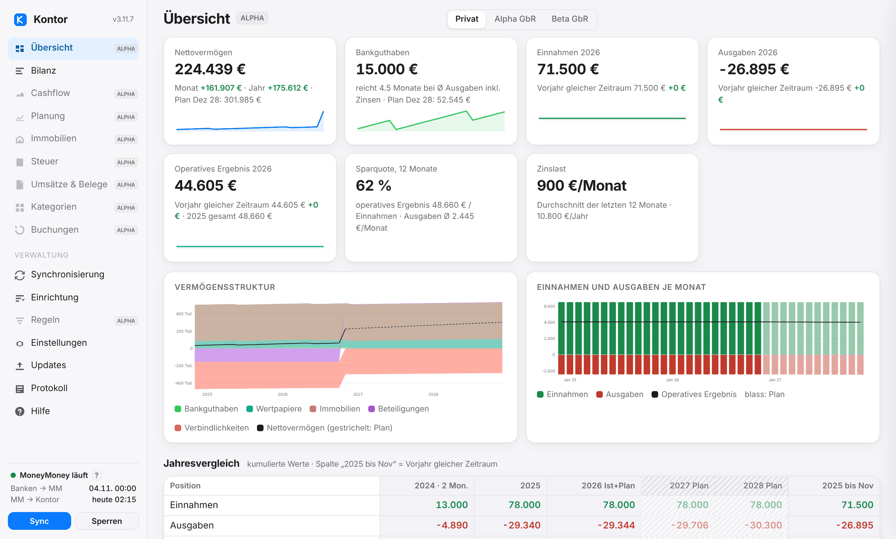

## Was MoneyMoney macht und was Kontor macht

| MoneyMoney | Kontor |
|---|---|
| Holt Umsätze und Salden von Banken, Depots und Zahlungsdiensten. | Liest diese Daten über die Skript-Schnittstelle von MoneyMoney. Zugangsdaten zu Banken sieht Kontor nie. |
| Kategorisiert Umsätze, von Hand oder per Regel. | Nutzt diese Kategorien. Umsätze ohne Kategorie ordnest du in Kontor zu; auf Wunsch schreibt Kontor die Zuordnung nach MoneyMoney zurück. |
| Führt Offline-Konten: private Darlehen, Beteiligungen, Immobilien, Kapitalkonten. | Bucht nach deinen Regeln nur in solche Offline-Konten: Darlehensraten spiegeln und Zinsen berechnen, Beteiligungswerte, Saldo-Spiegel. |
| Hat keine Bilanz, keine Planung, keine Steuerübersicht. | Bilanz je Bereich, Cashflow mit Prüfzeile, rollierende Planung, Immobilienkalkulation, Steuer-Jahresübersicht, Belege, Excel-Export. |

Kontor ändert in MoneyMoney nie Buchungen, den Kategorienbaum oder Regeln und löst keine Überweisungen aus.

**Alpha**: Seiten, die im Menü blass und mit „Alpha“ markiert sind (derzeit Übersicht, Cashflow, Planung, Immobilien, Steuer, Umsätze & Belege, Kategorien, Buchungen und Regeln), sind nutzbar, aber noch nicht vollständig geprüft – Zahlen dort bitte gegenprüfen. Geprüft sind Bilanz, Synchronisierung, Einrichtung, Einstellungen, Updates, Protokoll und Hilfe.

## Einrichtung

Die „?“ neben Feldern erklären kurz; ein Klick darauf (am iPhone: zweites Tippen) öffnet den passenden Abschnitt dieser Hilfe.

Unter **Einrichtung** stehen alle Bausteine in einer sinnvollen Reihenfolge. Jeder zeigt, ob er schon eingerichtet ist; die ersten vier bauen aufeinander auf, der Rest ist optional und jederzeit nachholbar. „Einrichtung prüfen“ (unten) liest MoneyMoney und meldet, ob alle Konten und Kategorien, auf die sich deine Einrichtung bezieht, dort noch existieren – etwa nachdem du in MoneyMoney etwas umbenannt hast.

1. **MoneyMoney verbinden** – MoneyMoney läuft und ist entsperrt; macOS fragt beim ersten Mal, ob Kontor MoneyMoney steuern darf (Automation). Erlauben.
2. **Bereiche festlegen** – welche Konten zusammengehören.
3. **Konten bestätigen** – Bereich, Position und Verlauf jedes Kontos.
4. **Historische Kontostände einlesen** – den bisherigen Verlauf einmalig aus MoneyMoney übernehmen.
5. **Kategorien auswählen** und **Kategorien zuordnen**.
6. **Gegenbuchungen einrichten**, **Immobilien erfassen**, **Planung anpassen**, **Steuerübersicht einrichten**, **Belegordner wählen**, **iPhone-Zugriff einrichten**, **Abgleich und Testmodus einstellen**.

Danach erstellt „Auswertung erstellen“ die erste Auswertung. Die Sprache (Deutsch oder Englisch) wählst du auf der Anmeldeseite, in der Einrichtung oder unter Einstellungen → Allgemein.

### Bereiche

Ein Bereich ist eine Menge von Konten mit eigener Bilanz, eigenem Cashflow, eigener Planung, Steuerübersicht, Umsätzen und Belegen – zum Beispiel „Privat“ und je eine Gesellschaft. Vorschlag: jede Kontengruppe auf oberster Ebene in MoneyMoney. Du kannst Konten und Gruppen aber beliebig zuordnen, zusammenlegen oder weglassen. Ein Bereich ist der Hauptbereich (privat); er ist beim Öffnen vorausgewählt. Gesellschaften bekommen Art und deinen Anteil – mit dem Anteil rechnet Kontor deine Beteiligung und die Steuer. Art und Hauptbereich sind aus den Namen vorbelegt; bitte prüfen. Mit ▲ ▼ legst du die Reihenfolge fest, in der die Bereiche oben in der Leiste stehen. Bereiche lassen sich umbenennen, löschen, zusammenlegen oder aus einzelnen Konten und Gruppen zusammenstellen; Konten, die keinem Bereich angehören, zählen nirgends.

### Konten und Positionen

Jedes Konto bekommt einen Bereich, eine Position in der Bilanz und eine Verlaufsquelle. Kontor schlägt alles vor; gestrichelt heißt „Vorschlag gewählt“, durchgezogen „eigene Wahl“. Nach dem Speichern bleibt es fest: Umbenennen oder Verschieben in MoneyMoney ändert nichts mehr. Neue Konten erscheinen als „neu“, bis du sie bestätigst. Konten erscheinen überall in der Reihenfolge von MoneyMoney.

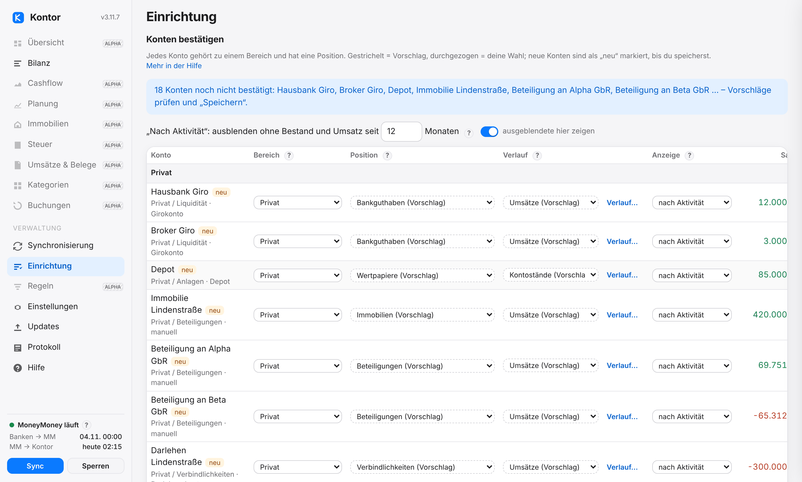

**Positionen** (Zeilen der Bilanz, sortiert nach Verfügbarkeit):

| Position | Was dazugehört |
|---|---|
| Bankguthaben | Giro, Tagesgeld, Kreditkarte – sofort verfügbar |
| Wertpapiere | Depots mit Aktien, Fonds, ETF/ETC, Derivaten, dazu Krypto und Edelmetall – in Tagen verkäuflich, mit Kursrisiko |
| Festanlagen | Festgeld, P2P-Kredite, Bausparvertrag, Lebens- und Rentenversicherung – vor Ende nur mit Wartezeit oder Abschlag zu Geld; zählen nicht als verfügbar |
| Immobilien, Beteiligungen, Sachwerte | langfristig gebunden |
| Forderungen | Darlehen an andere, Kautionen, Guthaben auf Kapitalkonten |
| Verbindlichkeiten | Darlehen, Kreditkartenschulden, Schulden auf Kapitalkonten |
| außerhalb des Nettovermögens | Eigenkapital (Kapitalkonten, nur ausdrücklich gewählt), Avale & Bürgschaften, „nicht bilanzieren“ |

**So schlägt Kontor vor** (in dieser Reihenfolge): Depot → Kontoname (z. B. „Immobilie“, „Darlehen“, „Kapitalkonto“, „Aval“, „Bauspar“) → eindeutiger Kontotyp (Giro, Kreditkarte, Darlehen) → Name der Gruppe in MoneyMoney → übriger Kontotyp. Faustregel zwischen Wertpapieren und Festanlagen: In wenigen Tagen ohne Abschlag zu Geld? Dann Wertpapiere, sonst Festanlagen. Darlehen, Kautionen sowie Kapital- und Gesellschafterkonten zählen mit Guthaben als Forderung, mit Schuld als Verbindlichkeit – in der Gesellschaft ist das eine Schuld an den Gesellschafter, privat eine Forderung. Der Wert einer Beteiligung ist dann dein Anteil am Rest; das stimmt auch bei ungleichen Einlagen.

**Anzeige**: „nach Aktivität“ blendet Konten aus, die seit N Monaten weder Bestand noch Umsatz haben; „immer anzeigen“ oder „ausblenden“ legt es fest. Ausgeblendete Konten zählen in allen Summen mit.

### Verlauf eines Kontos

Woher die Monatsstände eines Kontos kommen:

- **Umsätze** (Standard für Bankkonten): Stand am Monatsende = heutiger Saldo minus alle späteren gebuchten Umsätze – so rechnet auch MoneyMoney. Vorgemerkte Umsätze zählen nicht. Vor dem ersten Umsatz gibt es keinen Stand.
- **Kontostände**: eingetragene oder übernommene Stände sind Anker; die Monate dazwischen rechnet Kontor mit den Buchungen. Abweichungen erscheinen im Cashflow als „Korrektur Kontostand“.
- **Depots**: haben keine Buchungen. Kontor nimmt die aus MoneyMoney übernommenen Stände und zeichnet danach jeden Monat selbst auf.

Kontor schätzt nichts. Ein Klick auf ein Konto in der Bilanz öffnet sein Verlauf-Fenster mit Grafik, Monatsständen und Prüfhinweisen; dort lassen sich Stände eintragen oder aus einer Datei übernehmen. Bei Depots stehen oben die Positionen (Menge, Wert, Gewinn/Verlust).

Das Fenster prüft auch die Rückrechnung: Anfangssaldo vor der ersten Buchung in MoneyMoney, vorgemerkte Umsätze, negative Stände bei Konten, die nicht ins Minus können. Bei Depots ohne übernommenen Verlauf steht „vor … unbekannt“.

**Stände aus einer Datei** (Einrichtung → Konten oder Verlauf-Fenster): CSV oder Excel (.xlsx), als Liste (Datum, Konto, Saldo) oder als Tabelle mit Stichtagen in der Kopfzeile oder in der ersten Spalte. Importierte Konten stehen danach auf „Kontostände“.

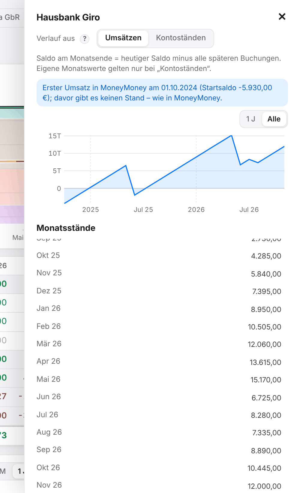

### Historische Kontostände einlesen

MoneyMoney gibt den Verlauf der Kontostände über seine Schnittstelle nicht heraus – vor allem bei Depots fehlt sonst die Vergangenheit. Einmalig liest Kontor ihn deshalb aus der Datenbankdatei von MoneyMoney: MoneyMoney beenden, „Im Finder zeigen“, die Datei `MoneyMoney.sqlite` ins Fenster ziehen und das MoneyMoney-Passwort in einem macOS-Fenster eingeben. Kontor bekommt nur einen daraus berechneten Schlüssel, entschlüsselt nur im Arbeitsspeicher, prüft die Werte am aktuellen Saldo und speichert nur Monatsend-Stände, verschlüsselt. In MoneyMoney wird nichts verändert. Erneutes Einlesen ersetzt den bisherigen Stand.

**Namen der Wertpapiere** (optional): Nach dem Einlesen erscheint darunter ein weiterer Schritt. Kennt MoneyMoney ein Wertpapier nur mit seiner ISIN, kannst du seinen Namen nachschlagen lassen. Auf Klick schlägt Kontor die Namen einmalig bei OpenFIGI nach, einem frei zugänglichen Verzeichnis für Wertpapiere. Gesendet werden nur diese ISINs (vorher aufklappbar zu sehen) – keine Beträge, Mengen, Konten oder Namen. Es ist neben der Update-Prüfung die einzige Verbindung ins Internet und geschieht nie von selbst. Außerdem listet der Schritt alle Wertpapiere mit ISIN und ihrem Namen (aus MoneyMoney, sonst nachgeschlagen); dort kannst du Namen ändern oder fehlende eintragen. Geänderte und nachgeschlagene Namen werden getrennt abgelegt – in MoneyMoney ändert sich nichts – und lassen sich wieder entfernen.

Erneutes Einlesen ersetzt alle bisher eingelesenen Stände – ein Zurücksetzen vorher ist nicht nötig. Wertpapiere, zu denen MoneyMoney weder Namen noch ISIN mehr gespeichert hat (oft lange verkaufte), heißen „Unbenannt 1, 2, …“ und lassen sich nicht nachschlagen.

**Danach zeichnet Kontor selbst auf**: Bankkonten rechnet Kontor ohnehin exakt aus den Umsätzen zurück. Für Depots merkt sich Kontor bei jedem Lesen den aktuellen Wert. Der Dienst läuft ab der Anmeldung am Mac im Hintergrund, auch ohne geöffnetes Kontor-Fenster, und liest innerhalb von etwa 20 Sekunden, sobald MoneyMoney offen und entsperrt ist – ein kurzer Blick in MoneyMoney genügt. Jeder Stand zählt für den Monat, in dem MoneyMoney ihn bei der Bank abgerufen hat. Hat MoneyMoney abgerufen, während Kontor nicht lief, oder fehlt ein Monat, weist die Seite „Synchronisierung“ darauf hin.

## Synchronisierung

Der Datenstand hat zwei Stufen: **Banken → MoneyMoney** (MoneyMoney ruft bei den Banken ab) und **MoneyMoney → Kontor** (Kontor liest aus MoneyMoney). Beide Zeitpunkte stehen unten links. „Sync“ liest sofort; automatisch liest Kontor alle 30 Minuten (einstellbar) und sobald MoneyMoney neue Daten hat – jeweils nur, wenn MoneyMoney läuft und entsperrt ist (Kontor startet es nicht selbst).

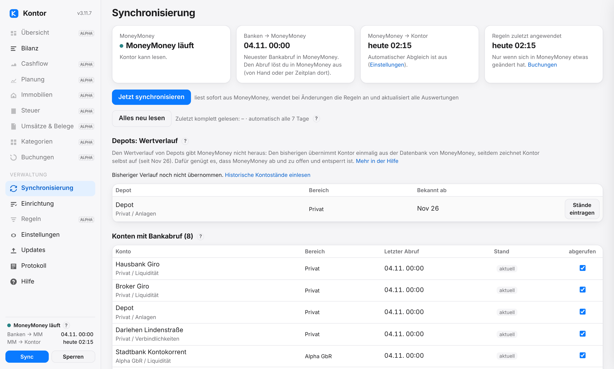

- **Schnell lesen**: Ein Abgleich liest nur die Umsätze der letzten 30 Tage und übernimmt ältere aus dem letzten vollständigen Lesen.
- **Kontrolle**: Dabei prüft Kontor jeden Kontostand. Passt er nicht zu den gelesenen Umsätzen, hat sich in MoneyMoney etwas Älteres geändert – etwa eine nachträgliche Buchung mit altem Datum oder ein gelöschter Umsatz. Dann liest Kontor sofort alles (höchstens alle 12 Stunden).
- **Vollständig lesen**: alle 7 Tage (einstellbar), nach eigenen Buchungen von Kontor und mit „Alles neu lesen“. Nur geänderte Kategorien älterer Umsätze (z. B. eine Regel in MoneyMoney auf alle Umsätze angewendet) erscheinen erst dann – dafür „Alles neu lesen“.
- Ein Bankabruf ohne neue Daten löst keine Neuberechnung aus.
- **Umsätze lesen** (Einstellungen → Allgemein): wie weit zurück Kontor liest; 0 = alle (empfohlen).

Die Seite „Synchronisierung“ zeigt je Konto den letzten Abruf und meldet Konten, die zurückliegen. Konten ohne Bankabruf (Offline-Konten: ohne Bank- oder Kontonummer, Ziel einer Regel oder von Kontor bebucht) stehen getrennt; je Konto änderbar. Ist MoneyMoney zu oder gesperrt, passiert nichts – der nächste Abgleich holt alles nach. Bei Buchungen, Vorschlägen und Fehlern meldet sich Kontor mit einer macOS-Mitteilung (abschaltbar unter Einstellungen → Allgemein).

## Tabellen, Schalter und Excel

Überall wählst du **Monate** (mit Jahressummen) oder nur **Jahre**. Jahresspalten sind kumuliert: Zahlungsflüsse als Summe, Bestände als Stand zum Jahresende. Blass sind der laufende Monat und das laufende Jahr (noch nicht abgeschlossen), blass und schraffiert die Planwerte.

- **▸ in der Kopfzelle** der Bilanz klappt alle Positionen auf; das **Auge** daneben (mit Anzahl, nur wenn es welche gibt) zeigt auch leere und nach Aktivität ausgeblendete Konten (mitgezählt werden sie immer). Steht bei einer Position „(9/12)“, sind 9 von 12 Konten zu sehen. **Leere Zeilen** (Cashflow, Planung) zeigt auch Zeilen ohne Werte.
- **Plan** (Cashflow) hängt die Planwerte rechts an; aus = nur Ist-Werte. Bilanz und Planung zeigen den Plan immer.
- **inflationsbereinigt** (Planung) zeigt Planwerte in heutiger Kaufkraft.
- Die Übersicht vergleicht zusätzlich mit dem gleichen Zeitraum des Vorjahrs.

Jede Tabelle hat einen **Excel**-Knopf: Bilanz, Cashflow, Planung (mit Fortschreibung und Parametern), Steuer, Umsätze, Depots, Belege, Konten und jede Immobilienkalkulation.

## Bilanz

Die Bilanz zeigt je Bereich das Vermögen nach Positionen, Monat für Monat oder Jahr für Jahr, mit Plan bis Dezember des letzten Planjahres. Oben steht die große Grafik, darunter die Tabelle, ganz unten drei einzelne Grafiken. **Monate oder Jahre** (oben links) gilt für alles zusammen.

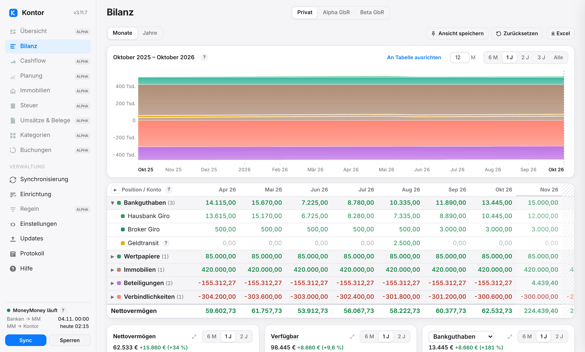

**Tabelle**

- Salden am Monatsende; der laufende Monat zeigt den aktuellen Stand. **Blass**: laufender Monat bzw. laufendes Jahr (noch nicht abgeschlossen); **blass und schraffiert**: Plan.
- Klick auf den Namen einer Position klappt ihre Konten auf. Klick auf den Namen eines Kontos öffnet seinen Verlauf (Monatsstände ansehen und bearbeiten; die Grafik dort lässt sich wie die anderen verschieben und zoomen, 1 J / Alle). Klick auf ein Wertpapier zeigt seinen Verlauf. Beim Darüberfahren stehen immer der Name aus MoneyMoney und die ISIN dabei, ebenso ob der Name nachgeschlagen oder geändert ist. Konten benennst du in MoneyMoney um – Kontor übernimmt die Namen von dort. Depots klappen über das **▸** davor in ihre Wertpapiere auf: frühere Monate aus den eingelesenen MoneyMoney-Kontoständen (sonst aus Kontors monatlicher Aufzeichnung), der laufende Monat aus MoneyMoney; was die Wertpapiere nicht erklären, steht als „Übrige“. Der Knopf **▸** in der Kopfzelle klappt alle Positionen auf und wieder zu. Ein aufgeklapptes Depot zeigt seine Wertpapiere auch in der großen Grafik.
- Das **Auge** in der Kopfzelle (nur wenn es welche gibt, mit Anzahl) zeigt auch leere und nach Aktivität ausgeblendete Konten und Wertpapiere – mitgezählt werden sie immer. Was als ausgeblendet gilt, legst du unter [Einrichtung → Konten](#accounts) fest (Spalte „Anzeige“ und „Nach Aktivität … Monaten“, Standard 12); Wertpapiere ohne Wert in diesem Zeitraum gelten ebenfalls als ausgeblendet. „(9/12)“ bei einer Position heißt: 9 von 12 Konten zu sehen.
- Jahresspalten zeigen den Stand zum Jahresende (das laufende Jahr: heute). In der Monatsansicht gibt es keine Jahresspalten – sie wären nur der Dezember; ein feiner Strich trennt die Jahre.
- Die Farben der Positionen folgen der Verfügbarkeit, von Bankguthaben (grün) bis Beteiligungen (violett). Konten tragen Abwandlungen der Farbe ihrer Position (benachbarter Farbton, andere Helligkeit; ab dem elften Konto schraffiert) – als Punkt vor dem Konto und genauso in den Grafiken.
- Die kleinen Pfeile **↑ ↓** im Tabellenkopf und im Kopf der großen Grafik (beim Darüberfahren) verschieben Tabelle bzw. große Grafik nach oben oder unten – auch unter die einzelnen Grafiken; „Ansicht speichern“ merkt sich auch das.
- Unter dem Nettovermögen stehen Avale & Bürgschaften und Kapitalkonten als Eigenkapital (nicht im Nettovermögen), je gesammelt in einer aufklappbaren Zeile.
- **Geldtransit**: Liegen die beiden Buchungen einer Umbuchung zwischen eigenen Konten in verschiedenen Monaten (am 31. abgebucht, am 1. gutgeschrieben), zählt der Betrag am Monatsende als „Geldtransit“ zum Bankguthaben – sonst sähe das Nettovermögen kurz zu niedrig aus. Ein Klick zeigt die erkannten Buchungspaare.

**Große Grafik** – jede der vier Grafiken kann die große sein: das Symbol ⤢ in einer kleinen Grafik tauscht sie mit der großen, die bisherige große erscheint an ihrem Platz – so lässt sich die Reihenfolge beliebig ändern (Standard: die Bilanz oben).

- Zusammensetzung des Vermögens in den Farben der Positionen, golden das Nettovermögen (gepunktet: laufender Monat, gestrichelt: Plan); aufgeklappte Positionen zeigen ihre Konten.
- Zeitraum je nach Ansicht – Monate: 6 Monate, 1, 2 oder 3 Jahre (Standard 2 Jahre); Jahre: 1, 3, 5 oder 10 Jahre (Standard 5 Jahre) –, alles oder eine eigene Zahl von Monaten.
- Beim Darüberfahren zeigt ein Fenster die Werte des Monats; die Fläche unter dem Mauszeiger wird hervorgehoben, ebenso ihre Zeile im Fenster (auch in den einzelnen Grafiken). Über der Monatsachse erscheinen die Werte ohne Hervorhebung. Fährst du über den Namen einer Zeile der Tabelle, wird dieselbe Fläche in der Grafik hervorgehoben. Klick auf einen Wert der Tabelle zeigt kurz Monat und Fläche in der großen Grafik (sie springt dafür nötigenfalls zum Monat); Klick auf den Namen klappt eine Position auf bzw. öffnet den Verlauf eines Kontos.
- Klick auf eine Fläche wirkt wie in der Tabelle: Eine Position klappt in ihre Konten auf, ein Depot in seine Wertpapiere; Klick auf ein Konto oder Wertpapier klappt die Position wieder zu. Klick daneben oder auf die Monatsachse springt zum Monat in der Tabelle.
- Waagerecht wischen verschiebt (auch auf der Monatsachse), mit zwei Fingern zoomen, Ziehen wählt einen Ausschnitt, Doppelklick vergrößert. Umgekehrt verschiebt ein Klick auf eine Spaltenüberschrift die Grafik so, dass der Monat ungefähr über der Spalte steht. Auf der Monatsachse seitlich ziehen verschiebt; auf der Betragsachse nach oben/unten ziehen vergrößert bzw. verkleinert den Wertebereich (das Mausrad verschiebt ihn), Tippen oder Klick dort macht ihn wieder automatisch. Am iPhone verschieben und zoomen zwei Finger, ein Finger zeigt die Werte. Das gilt auch für die einzelnen Grafiken.
- **An Tabelle ausrichten**: Jeder Wert steht genau über seiner Spalte. Die Grafik scrollt mit der Tabelle, Wischen oder Ziehen auf der Grafik scrollt die Tabelle, und die Skala passt sich den sichtbaren Spalten an. Das Werte-Fenster entfällt – die Werte stehen ja darunter.

**Ansicht speichern**: Was du beim Ansehen änderst (Monate oder Jahre, Zeiträume, aufgeklappte Zeilen, das Auge, welche Grafik groß ist, Auswahl in den Grafiken), gilt nur bis zum Neuladen. **Ansicht speichern** (oben rechts, neben Excel) merkt sich die aktuelle Ansicht auf diesem Gerät, getrennt für Monate und Jahre (z. B. Monate mit 2 Jahren, Jahre mit 10 Jahren). Die zuletzt gespeicherte öffnet beim Start; wechselst du zwischen Monaten und Jahren, gelten deren gespeicherte Zeiträume. Zeiträume enden dabei immer am letzten abgeschlossenen Monat („1 J“ ist immer das letzte Jahr), die Tabelle steht wie immer auf dem aktuellen Monat. **Zurücksetzen** stellt den Standard von Kontor wieder her. Der Bereich bleibt davon unberührt.

**Einzelne Grafiken** (unter der Tabelle)

- Das Nettovermögen allein (darunter Ø je Monat, Höchst- und Tiefststand), die Summe frei gewählter Positionen (Standard: Bankguthaben, Wertpapiere und Festanlagen; der Titel benennt die Auswahl in Worten: typische Kombinationen als „Verfügbar“, „Finanzvermögen“, „Gebunden“, „Bruttovermögen“ oder „Sachvermögen“, sonst zusammengesetzt wie „Finanzvermögen + Verbindlichkeiten“ oder „Nettovermögen ohne Beteiligungen“, bei Platzmangel mit gekürzten Wörtern; Darüberfahren über den Titel nennt alle Positionen und was die Namen bedeuten, z. B. Finanzvermögen = Bankguthaben + Wertpapiere + Festanlagen; die Linie hat ihre Mischfarbe) und die Zusammensetzung einer gewählten Position nach Konten (gestapelt). Dort schlüsselt **Depot** neben der Auswahl die Depots in ihre Wertpapiere auf (nur wo es das gibt); unten lassen sich Konten bzw. Wertpapiere einzeln abwählen – die Linie der Position bleibt, beim Darüberfahren steht zusätzlich die Summe der Auswahl.
- Jede hat einen eigenen Zeitraum (je nach Ansicht 6 Monate, 1 oder 2 Jahre bzw. 1, 3 oder 10 Jahre bis heute; Ziehen vergrößert, Doppelklick zoomt, nach rechts wischen zeigt den Plan) und eine Achse, die sich den sichtbaren Werten anpasst – so sieht man die Entwicklung auch dann, wenn sich große Positionen wie Forderungen und Verbindlichkeiten oben gegenseitig ausgleichen. Die Fläche reicht bis zur Nulllinie, bei negativen Werten also nach oben.
- Erster und letzter Monat sind auf der Zeitachse immer beschriftet (auch in der großen Grafik): Der Wert gilt für das Ende des Zeitraums, die Veränderung (in € und %) seit seinem Beginn. Zeiträume enden am letzten abgeschlossenen Monat und zählen von Monatsende zu Monatsende: Im November reicht „1 J“ von Oktober des Vorjahres bis Oktober, die Veränderung umfasst also genau zwölf abgeschlossene Monate. Der laufende Monat (rechts davon, durch Wischen oder „Alle“) ist gepunktet und leicht hinterlegt – dort laufen schon Ist-Daten ein –, der Plan gestrichelt und stärker hinterlegt; die senkrechte gestrichelte Linie markiert das Ende des letzten abgeschlossenen Monats, „heute“ den laufenden. Der kürzeste Zeitraum ist ein Monat (Veränderung zum Vormonat).

## Cashflow

Wohin das Geld fließt: Einnahmen und Ausgaben nach Kategorien, Investitionen (Umschichtungen in Depots und Anlagen, Einlagen in Beteiligungen), Finanzierung (Tilgung und Zinsen je Darlehen), Bewertung (Wertänderungen von Depots) und „Unklar“.

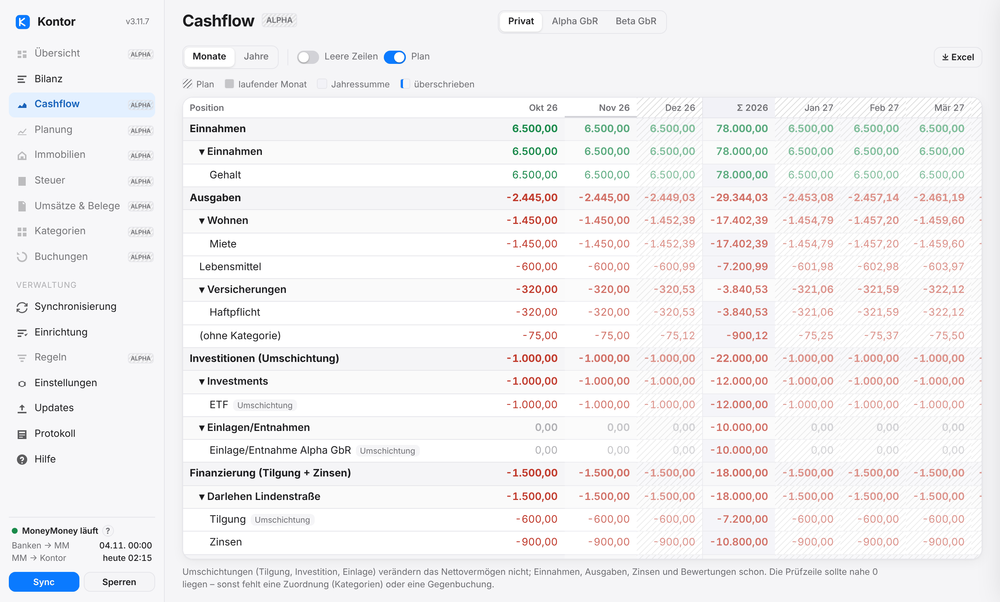

Umbuchungen zwischen eigenen Konten erkennt Kontor an der Gegen-IBAN, an der Kategorie „Umbuchung“ und an Gegenbuchungen mit gleichem Betrag innerhalb von drei Tagen; sie zählen nicht als Einnahme oder Ausgabe. Die **Prüfzeile** „unerklärte Vermögensänderung“ sollte nahe 0 liegen – sonst fehlt eine Kategorie oder eine Gegenbuchung. Welche Kategorien als eigene Zeile erscheinen, legst du unter [Kategorien → Auswahl](#categories-selection) fest; welche Oberkategorie zu welchem Abschnitt gehört, unter Kategorien → Cashflow-Zuordnung.

## Kategorien

**MoneyMoney ist maßgeblich**: Hat ein Umsatz dort eine Kategorie, gilt sie auch in Kontor. Umsätze ohne Kategorie ordnest du in Kontor zu – unter Kategorien → Zuordnen, gruppiert nach Gegenpartei, mit Vorschlägen aus gelernten Regeln. „Regel für diesen Namen“ erledigt die Gegenpartei dauerhaft.

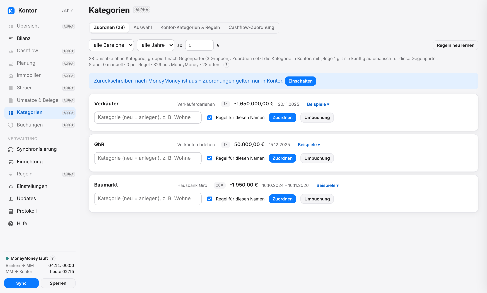

Die Seite Kategorien hat vier Reiter:

- **Zuordnen** – Umsätze ohne Kategorie, nach Gegenpartei gruppiert; die Zahl im Reiter zeigt, wie viele offen sind.
- **Auswahl** – welche Kategorien aus MoneyMoney Kontor als Zeile nutzt ([mehr](#categories-selection)).
- **Kontor-Kategorien & Regeln** – Kategorien, die es nur in Kontor gibt (Baum aus MoneyMoney übernommen, ergänzbar), deine eigenen Regeln (Name, Zweck, Gegen-IBAN, Richtung) und die gelernten. Gelernt wird aus der Gegenpartei (IBAN oder Name, ggf. mit Zweckanfang), wenn mindestens 90 % ihrer bisherigen Umsätze dieselbe Kategorie haben. Eigene Regeln gehen vor; spezifischere gewinnen (IBAN vor Name + Zweck vor Name).
- **Cashflow-Zuordnung** – welche Oberkategorie zu welchem Abschnitt des Cashflows gehört (Einnahmen, Ausgaben, Investition, Finanzierung). Ohne Zuordnung entscheidet das Vorzeichen.

**Was gilt**: die Kategorie aus MoneyMoney – außer du übersteuerst sie ausdrücklich („Nur in Kontor“). Ohne sie: manuelle Zuordnung vor eigener Regel vor gelernter Regel. Regeln wirken standardmäßig nur auf Umsätze ohne MoneyMoney-Kategorie; „Regeln auch auf MoneyMoney-kategorisierte Umsätze anwenden“ ändert das – nur in Kontor, MoneyMoney bleibt unverändert.

Kategorien braucht es nur für die Aufteilung (Cashflow-Zeilen, Planung je Zeile, Steuer). Bilanz, Nettovermögen, Immobilien, Darlehen und Einnahmen/Ausgaben insgesamt funktionieren auch ohne. Wenig Pflege: Zahlungen zwischen dir und deinen Gesellschaften erkennt Kontor ohnehin als Einlage oder Entnahme; fein kategorisieren musst du vor allem dort, wo du Cashflow und Steuer genau brauchst.

### Nach MoneyMoney zurückschreiben

Mit „Kategorien zurückschreiben“ (Einstellungen → Allgemein oder „Einschalten“ unter Kategorien; nur am Mac) setzt Kontor deine Zuordnungen auch in MoneyMoney – so kategorisierst du nur an einer Stelle. Sicherungen:

- Kontor setzt nur das Kategoriefeld eines Umsatzes; Beträge, Daten und Löschen sind damit nicht möglich.
- Direkt vor dem Schreiben liest Kontor den Umsatz neu aus MoneyMoney und schreibt nur, wenn er unverändert ist und noch keine Kategorie hat (oder die von Kontor gesetzte).
- Eine vorhandene andere Kategorie – etwa von einem Geschäftspartner gepflegt – ersetzt Kontor nur nach Rückfrage: „In MoneyMoney ersetzen“ oder „Nur in Kontor“ (MoneyMoney bleibt, Kontor übersteuert).
- Kategorien anlegen kann Kontor in MoneyMoney nicht (lässt MoneyMoney nicht zu). Fehlt eine, wartet die Zuordnung; nach dem Anlegen in MoneyMoney trägt Kontor sie beim nächsten Abgleich nach.

### Auswahl: welche Kategorien Kontor nutzt

Unter Kategorien → Auswahl legst du je Kategorie aus MoneyMoney fest:

- **Eigene Zeile** – erscheint im Cashflow und in der Planung als eigene Zeile.
- **Zur Oberkategorie** – zählt samt Unterkategorien zur Oberkategorie (nur Cashflow und Planung; die Steuer nutzt weiter die genaue Kategorie).
- **Nicht verwenden** – in Kontor wie ohne Kategorie; die Umsätze erscheinen unter „Zuordnen“.

„Nur oberste Ebene als Zeile“ räumt den Cashflow mit einem Klick auf. In MoneyMoney ändert sich dadurch nichts.

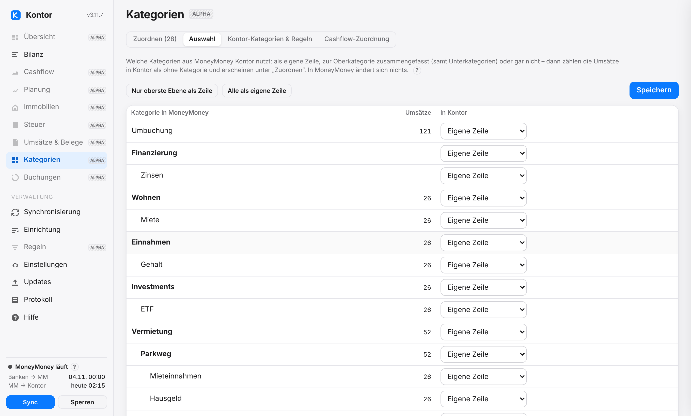

## Planung

Die Planung schreibt die Vergangenheit fort: je Zeile eine Methode (Ø 12 oder 6 Monate, Vorjahresmonat, fester Betrag, Jahresbetrag/12, MoneyMoney-Budget, keine), ein Betrag und eine Steigerung in % p.a. Ausgaben folgen standardmäßig der Inflation, Einnahmen der eingestellten Rate. Einzelne Monate überschreibst du per Doppelklick; der Vorschlag bleibt sichtbar und lässt sich wiederherstellen.

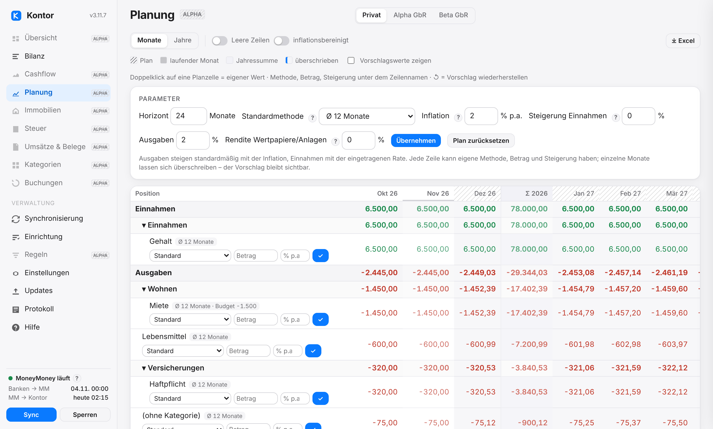

- **Darlehen**: Zins auf den fortgeschriebenen Restsaldo, Tilgung = Rate − Zins.
- **Wertentwicklung** je Konto in % p.a.; Beteiligungen wahlweise gekoppelt an das geplante Nettovermögen der Gesellschaft (Anteil × Nettovermögen).
- **Ereignisse**: einmalige oder wiederkehrende Umschichtungen, Einnahmen und Ausgaben – z. B. ein Darlehen auf einen Schlag aus dem Depot zurückzahlen.
- **Immobilien**: aktive Kalkulationen fließen mit Miete, Kosten, Zins, Tilgung, Restschuld und Objektwert ein.
- Der Plan reicht immer bis Dezember; „inflationsbereinigt“ zeigt Planwerte in heutiger Kaufkraft.
- Darunter: Fortschreibung der Bilanz je Position und Konto und Kennzahlen (Sparquote, Reichweite der Liquidität, Zinslast). Der Plan gilt je Bereich.

## Immobilien

Je Objekt beliebig viele Kalkulationen (Szenarien), eine davon aktiv. Eingaben:

- Kaufpreis und Übergang; Nebenkosten (Grunderwerbsteuer, Notar, Grundbuch, Makler; sofort abziehbare Posten getrennt); Gebäudeanteil und AfA-Satz oder Restnutzungsdauer.
- Nettokaltmiete und Umlage, Leerstand, Mietanpassung (Indexmiete nach VPI mit Weitergabefaktor und Schwelle, fester Satz oder keine); nicht umlagefähige Kosten und Rücklage (mit VPI oder festem Satz).
- Darlehen: Annuität, Tilgungsdarlehen oder endfällig; Abrechnung monatlich wie bei Banken oder jährlich auf den Stand 1. Januar wie bei Verkäuferdarlehen; Sondertilgungen laufend oder einzeln, Zinsbindung mit Anschlusszins, Fälligkeit mit Rückzahlung.
- Gesellschafter mit Anteil und Steuersatz, Ausschüttung, Wertentwicklung, Verkaufsjahr.

Ungültige Eingaben weist Kontor mit dem Feldnamen ab.

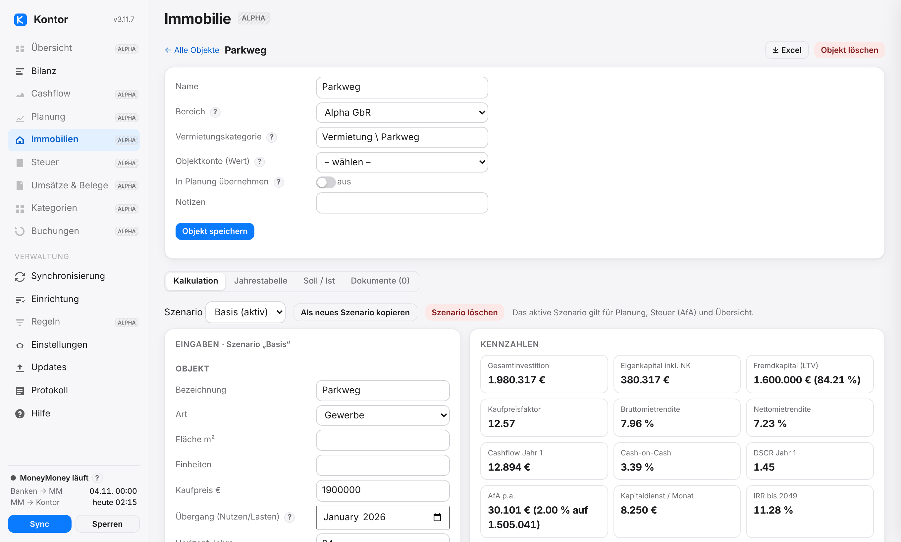

Ergebnis: Monats- und Jahrestabelle (Miete, Kosten, Zinsen, Tilgung, AfA, steuerliches Ergebnis, Steuer, Cashflow, Vermögensaufbau, Restschuld, Objektwert), Kennzahlen (Kaufpreisfaktor, Brutto- und Nettomietrendite, Cash-on-Cash, DSCR, LTV, IRR bis zum Verkauf) und Hinweise (offene Fälligkeiten, fehlender Anschlusszins, negativer kumulierter Cashflow). Verknüpfungen mit MoneyMoney: Vermietungskategorie und Darlehenskonten für den Soll/Ist-Vergleich je Jahr, Objektkonto für den Wert in der Bilanz. „In Planung übernehmen“ speist die Planung des Bereichs; die AfA der aktiven Kalkulation landet in der Steuerübersicht, solange dort kein Jahreswert von Hand steht. Excel-Export je Kalkulation. Dokumente (Kaufvertrag, Gutachten …) werden als Verknüpfung abgelegt – die Dateien bleiben, wo sie sind. Vereinfacht gerechnet: Steuer je Gesellschafter = Anteil × Ergebnis × Steuersatz (keine Progression, kein Verlustausgleich), AfA linear.

## Steuer

Je Entität (Hauptbereich = privat, jede Gesellschaft mit deinem Anteil aus der Beteiligungsregel) und Jahr: Vermietung je Objekt aus den Kategorien `Vermietung \ Objekt \ Art` (beliebig viele Objekte, auch privat), Schuldzinsen je Darlehen (Zuordnung Darlehen → Objekt unter Einstellungen → Steuer), AfA, Steuerpositionen aus Kategorienamen (anpassbar unter Einstellungen → Steuer) und Buchungen ohne Kategorie als Prüfposten. Die Belege eines Jahres lassen sich als ZIP mit Übersicht exportieren. Keine Steuerberatung.

## Umsätze und Belege

Der Umsatzbrowser filtert nach Bereich, Jahr, Konto, Text, „ohne Beleg“ und „ohne Kategorie“. Belege (PDF, Bilder, E-Mails, Office-Dateien) fügst du per Auswahl, Drag & Drop oder am iPhone per Foto hinzu. Sie liegen als normale Dateien im Belegordner (Standard `~/Documents/Kontor-Belege`, Unterordner z. B. `{jahr}`), Dateiname `Datum_Betrag_Name_Kennung`. Dateien außerhalb des Ordners (auch iCloud Drive) lassen sich verknüpfen, ohne sie zu kopieren – Kontor zeigt, ob die Datei lokal vorliegt oder noch aus iCloud geladen wird. Vorhandene Dateien im Belegordner lassen sich nachträglich zuordnen. Bis 60 MB je Datei. Der Index liegt verschlüsselt im Datenordner; die Dateien bleiben auch ohne ihn nutzbar. Löschen in Kontor betrifft nie verknüpfte Dateien.

## Regeln (Gegenbuchungen)

Regeln buchen in Offline-Konten in MoneyMoney:

- **Darlehen**: Rate erkennen (Gegen-IBAN oder Text), auf dem Darlehenskonto spiegeln, Zinsen berechnen (Jahresbasis oder Restschuld monatlich).
- **Beteiligungen**: Zielkonto = Anteil × Nettowert einer Kontengruppe.
- **Saldo-Spiegel**: Zielkonto = Faktor × Quellkonto (z. B. Kapitalkonto).

Standard ist der **Testmodus**: Vorschläge erscheinen unter „Buchungen“, gebucht wird erst nach „Jetzt buchen“ oder wenn du den Testmodus ausschaltest. Jede Buchung trägt eine Markierung im Verwendungszweck (die Schnittstelle von MoneyMoney kennt beim Anlegen kein Kommentarfeld) und wird nie doppelt angelegt; bestehende Buchungen ändert oder löscht Kontor nie. Bank- und Erweiterungskonten werden nie bebucht, Überweisungen und Lastschriften sind gesperrt.

**Zinsen**: Jahresbasis = Zinssatz × Stand am 31.12. des Vorjahres, je Monat ein Zwölftel, im Dezember mit dem Cent-Rest – oder monatlich auf die Restschuld. Das Modell ist vereinfacht (30/360); einmal im Jahr mit der Zinsabrechnung der Bank abgleichen. Bei Problemen (Konto gelöscht, keine passende Zahlung, Zinsbuchung schon von Hand vorhanden) gibt es einen Hinweis und eine Mitteilung.

## Zugriff vom iPhone

Standardmäßig ist Kontor nur auf dem Mac erreichbar (`127.0.0.1`) – deshalb öffnet das iPhone die Adresse nicht. Für den Zugriff von unterwegs nutzt Kontor [Tailscale](https://tailscale.com): ein privates, verschlüsseltes Netz nur aus deinen Geräten. Im Heimnetz und im Internet ist dabei kein Port offen, am Router ist nichts einzurichten.

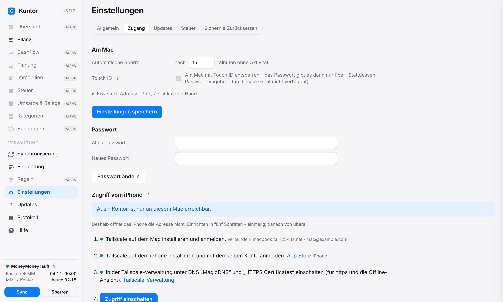

Unter Einstellungen → Zugang zeigt Kontor die Schritte mit Häkchen:

1. Tailscale auf dem Mac installieren und anmelden.
2. Tailscale auf dem iPhone installieren, mit demselben Konto anmelden.
3. In der Tailscale-Verwaltung unter DNS „MagicDNS“ und „HTTPS Certificates“ einschalten.
4. „Zugriff einschalten“ – Kontor holt ein echtes Zertifikat für den Namen des Macs, öffnet eine zweite Adresse nur im Tailscale-Netz und startet neu.
5. Am iPhone die angezeigte Adresse in Safari öffnen (Link kopieren – er landet über die Zwischenablage auf dem iPhone), anmelden, Teilen → „Zum Home-Bildschirm“.

**Wer, wo, was**: Erreichbar ist Kontor nur für Geräte in deinem Tailscale-Netz und nur mit dem Kontor-Passwort; von überall mit Internet; Standard **nur ansehen** – vom iPhone lässt sich nichts ändern. Wahlweise „ansehen und bearbeiten“ (Planung, Zuordnungen in Kontor, Einstellungen). In MoneyMoney schreiben, Touch ID, Sicherung, Zurücksetzen und die Zugangseinstellungen gibt es nur am Mac. Der Mac muss laufen (nicht im Ruhezustand) und mit Tailscale verbunden sein; ist Tailscale beim Start noch nicht verbunden, öffnet Kontor die Adresse, sobald es geht. Im Terminal: `python3 ~/Kontor/kontor.py tls` (bzw. `tls --off`).

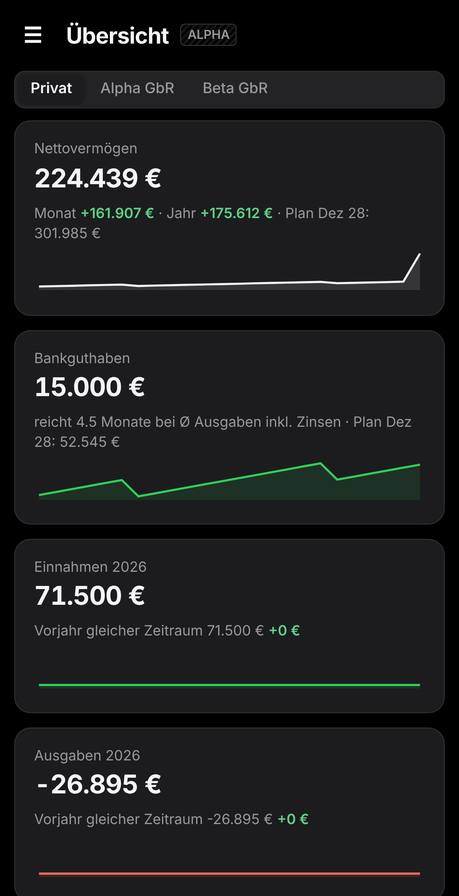

**Offline-Ansicht**: Als App gespeichert behält das iPhone die zuletzt geladenen Daten. Ist der Mac nicht erreichbar, öffnet das Kontor-Passwort diese Kopie – nur lesen. Abschaltbar unter Einstellungen → Zugang. Das Passwort prüft das iPhone dabei gegen einen eigenen Prüfwert (PBKDF2-SHA256, eigener Salt); die Kopie ist durch die iPhone-Verschlüsselung geschützt, aber nicht zusätzlich mit dem Passwort verschlüsselt – wer das entsperrte Gerät mit Entwicklerwerkzeugen untersucht, käme an die Daten. „Gespeicherte Daten auf diesem Gerät löschen“ entfernt die Kopie sofort. Das Zertifikat (90 Tage gültig) erneuert der Dienst selbst.

Ohne HTTPS-Zertifikate geht „Ohne Zertifikat einschalten“ (durch Tailscale verschlüsselt, aber ohne Offline-Ansicht).

**Meldet Kontor „nicht verbunden“**, steht dahinter der Grund (nicht angemeldet, ausgeschaltet, wartet auf Freigabe oder die Antwort von Tailscale). Tailscale in der Menüleiste öffnen, „Connect“ einschalten, dann „Erneut prüfen“.

### Wie sicher ist Tailscale?

Tailscale verbindet deine Geräte direkt und Ende-zu-Ende verschlüsselt (WireGuard). Der Dienst von Tailscale vermittelt nur, wer zu deinem Netz gehört, und sieht keine Inhalte. Ins Netz kommt nur ein Gerät, das mit deinem Konto angemeldet ist – bei Anmeldung mit Apple also mit deiner Apple-ID samt Zwei-Faktor-Schutz.

Wichtig zu wissen: Ohne eigene Regel dürfen sich alle Geräte in deinem Tailscale-Netz gegenseitig auf allen Ports erreichen. Den Mac steuern kann darüber niemand, solange am Mac keine Fernzugänge eingeschaltet sind (Bildschirmfreigabe, Entfernte Anmeldung, Dateifreigabe – Systemeinstellungen → Allgemein → Teilen), und auch die verlangen das Mac-Passwort. Ganz dicht machst du es so:

1. **Nur Kontor erlauben**: Unter Einstellungen → Zugang → „Absichern“ zeigt Kontor eine fertige Zugriffsregel für deinen Mac. Regel kopieren, in der Tailscale-Verwaltung die Seite „Access controls“ öffnen, bei einem visuellen Editor auf „JSON editor“ umschalten, den **gesamten** Text durch die Regel ersetzen (nicht nur ergänzen – sonst bleibt die Standardregel „alles erlaubt“) und „Save“ klicken. Danach erreichen deine Geräte auf dem Mac nur noch Kontor. Kontor prüft das selbst: Es liest die Regeln, die Tailscale auf dem Mac anwendet, und zeigt „Abgesichert“, „noch weitere Ports erreichbar“ oder – bei falscher Adresse oder falschem Port – „Kontor ist gesperrt“.
2. **Neue Geräte freigeben lassen**: In der Tailscale-Verwaltung unter Settings → „Device approval“ einschalten. Ein neues Gerät kommt dann erst nach deiner Freigabe ins Netz – selbst wenn jemand an deine Anmeldung käme.
3. **Konto schützen**: Apple-ID mit Zwei-Faktor-Schutz (Standard), keine weiteren Personen ins Tailscale-Netz einladen.

Kontor selbst verlangt zusätzlich das Kontor-Passwort und lässt vom iPhone standardmäßig nur Ansehen zu.

## Sichern und Zurücksetzen

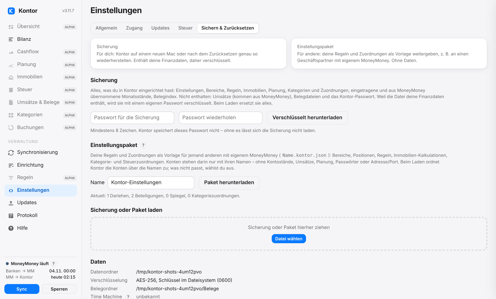

- **Sicherung** – für dich: Kontor auf einem neuen Mac oder nach dem Zurücksetzen genau so wiederherstellen. Enthält alle Einstellungen, Bereiche, Regeln, Immobilien, Planung, Kategorien und Zuordnungen, Monatsstände und den Belegindex – nicht die Umsätze (kommen aus MoneyMoney), keine Belegdateien, nicht das Kontor-Passwort. Weil sie deine Finanzdaten enthält, wird sie mit einem eigenen Passwort verschlüsselt, das Kontor nicht speichert. Nur am Mac.
- **Einstellungspaket** – für andere: deine Regeln und Zuordnungen als Vorlage, z. B. für einen Geschäftspartner mit eigenem MoneyMoney. Konten nur mit Namen, ohne Kontostände, Umsätze, Planung, Passwörter oder Adresse. Darlehensregeln enthalten die Gegen-IBAN des Darlehensgebers – vor dem Weitergeben prüfen. Beim Laden ordnet Kontor die Konten über die Namen zu; was nicht gefunden wird, ordnest du in der Oberfläche zu. „Ergänzen“ fügt Regeln hinzu und überschreibt Zuordnungen, „Ersetzen“ verwirft die vorhandene Einrichtung. Eine Vorlage liegt im Ordner `templates/`.
- **Time Machine** sichert den Datenordner standardmäßig mit – als verschlüsselte Dateien, der Schlüssel liegt im Schlüsselbund, nicht im Ordner. Die Seite zeigt den Stand. „Ausschließen“ ändert nicht die Einstellungen von Time Machine, sondern setzt am Datenordner selbst die Markierung „nicht sichern“ (wie bei Zwischenspeichern üblich, ohne Administratorrechte). Deshalb erscheint der Ordner nicht in der Ausschlussliste von Time Machine. Empfehlung: gesichert lassen.
- **Zurücksetzen** (nur am Mac, mit Passwort) löscht Einstellungen, Planung, Kategorien, Verlauf und Auswertungen, wahlweise auch das Passwort. Belegdateien, Schlüssel und Protokoll bleiben.

## Updates

Kontor fragt GitHub nach der neuesten Version (täglich, wöchentlich oder nie – Einstellungen → Updates) und installiert nur nach Klick. Die Update-Prüfung ist die einzige Netzverbindung von Kontor: Sie fragt `raw.githubusercontent.com` nach der Datei `VERSION` im Hauptzweig des Repositorys (Standard: [github.com/stecrz/Kontor](https://github.com/stecrz/Kontor)). Andere Server sind bewusst nicht möglich.

Beim Installieren lädt Kontor diesen Stand als Archiv von github.com, ersetzt den Programmordner (die alten Dateien bleiben daneben als `.alt`), startet den Dienst neu und lädt die Seite neu; ist der Programmordner ein Git-Klon, läuft stattdessen `git pull`. Datenordner und Einstellungen bleiben. Alle Schritte stehen im Protokoll. Die Seite Updates zeigt die Änderungen der neuesten Version, darunter aufklappbar die früheren.

Im Terminal aktualisiert dieselbe Zeile wie bei der [Installation](https://github.com/stecrz/Kontor#installation).

## Sicherheit

- Oberfläche nur auf diesem Mac (`127.0.0.1`); optional zusätzlich die Tailscale-Adresse für deine eigenen Geräte – nie im Heimnetz oder Internet. Keine fremden Inhalte, keine Telemetrie. Einzige Verbindung nach außen ist die Update-Prüfung bei GitHub.
- Anmeldung mit Passwort (PBKDF2-SHA256, 600 000 Runden) oder Touch ID am Mac (braucht die Kommandozeilen-Werkzeuge von Apple, sonst gilt nur das Passwort). Das Anmelde-Cookie gilt nur für Kontor, fremde Webseiten können nichts auslösen (CSRF-Schutz, Herkunftsprüfung). Sperre nach Leerlauf; fünf Fehlversuche sperren fünf Minuten.
- Alle Dateien im Datenordner sind verschlüsselt (AES-256 + HMAC), der Schlüssel liegt im macOS-Schlüsselbund. Belege liegen als normale Dateien in einem Ordner deiner Wahl.
- Buchen, Updates, Zurückschreiben von Kategorien, Sicherung, Zurücksetzen und Zugangseinstellungen nur am Mac; vom iPhone standardmäßig nur ansehen.
- Historische Kontostände: Kontor entschlüsselt die Datenbank von MoneyMoney nur im Arbeitsspeicher; das MoneyMoney-Passwort gibst du in einem macOS-Fenster ein, Kontor speichert es nirgends.
- Das Protokoll enthält keine IBANs, Salden oder Passwörter; die Diagnosedatei ersetzt zusätzlich Kontonamen und den Benutzerordner.
- Grenze: Der Schlüssel liegt im Login-Schlüsselbund, damit der Dienst nach der Anmeldung ohne Eingabe läuft. Wer deinen entsperrten Mac bedient, kommt an ihn heran – das Kontor-Passwort schützt dann den Zugang, nicht die Dateien. FileVault bleibt die Basis.

## Für Fortgeschrittene

**Installieren, aktualisieren, entfernen**: Die Installation steht in der [README](https://github.com/stecrz/Kontor#installation). `bash install.sh` im Programmordner ist jederzeit wiederholbar: Es ersetzt den Dienst und lässt Datenordner und Einstellungen unangetastet. Entfernen: `python3 kontor.py uninstall` oder `Uninstall.command` (fragt, ob Daten und Schlüssel gelöscht werden sollen). Der Dienst startet beim Anmelden, läuft dauerhaft und startet nach Abstürzen neu (launchd, `de.kontor.service`).

**Kommandozeile** – `python3 ~/Kontor/kontor.py …`:

- `start` – Dienst im Vordergrund starten; `open` – Oberfläche öffnen; `status` – Zustand; `version`
- `run [--dry-run|--live] [--force]` – einen Abgleich ausführen (Testmodus oder buchen)
- `accounts` – Kontenbaum mit Kennungen, Typ und Position; `check` – Einrichtung gegen MoneyMoney prüfen
- `password` – Kontor-Passwort zurücksetzen
- `package-export [DATEI] [--without-uuid] [--with-plan]`, `package-import DATEI [--replace] [--anyway]` – Einstellungspaket
- `diagnostics [DATEI]` – Diagnosedatei schreiben; `update [--install]` – Updates suchen bzw. installieren
- `install` / `uninstall` – Dienst einrichten bzw. entfernen; `tls [--off]` – Zugriff über Tailscale ein- bzw. ausschalten

**Datenordner** `~/Library/Application Support/Kontor/` (die Umgebungsvariable `KONTOR_DIR` ändert das). Alles verschlüsselt außer dem Protokoll:

- `config` Einstellungen, `plan` Planung, `state` Verlauf und Depot-Monatsstände, `categories` Kategorien, Zuordnungen und Regeln, `dataset` Auswertungen, `transactions` Umsatzliste (ohne Gegen-IBAN), `receipts` Belegindex, `mm-history` eingelesene historische Kontostände, `auth` Passwort-Prüfwert (jeweils `.json.enc`), `moneymoney-ledger.bin.enc` letzter Stand aus MoneyMoney für den schnellen Abgleich, `tls/` Zertifikat für den Zugriff vom iPhone.
- `kontor.log` – Protokoll im Klartext (rotiert bei 5 MB, fünf Dateien): Anfragen, MoneyMoney-Aufrufe mit Dauer, Update-Schritte und Fehler, ohne Passwörter, IBANs oder Beträge.

## Wenn etwas nicht klappt

| Meldung | Abhilfe |
|---|---|
| MoneyMoney läuft nicht / Datenbank gesperrt | MoneyMoney öffnen und entsperren; Kontor holt alles nach. |
| Keine Berechtigung (Automation) | Systemeinstellungen → Datenschutz & Sicherheit → Automation: python3 darf MoneyMoney steuern. |
| Konto nicht gefunden | Eine Regel verweist auf ein gelöschtes oder umbenanntes Konto: unter Regeln neu zuordnen; „Einrichtung prüfen“ zeigt alle Fälle. |
| Prüfzeile im Cashflow ≠ 0 | Es fehlt eine Kategorie oder eine Gegenbuchung. |
| iPhone öffnet die Adresse nicht | Zugriff unter Einstellungen → Zugang einschalten; Tailscale auf beiden Geräten verbunden? |
| Keine passende Zahlung | Die Darlehensregel findet die Rate nicht: Gegen-IBAN oder Text und Quellkonto prüfen. Bis 35 Tage nach „Automatik ab“ nur ein Hinweis. |
| Port nicht nutzbar | Ein anderes Programm belegt den Port: Einstellungen → Zugang → Erweitert. |
| Datenschlüssel liegt als Datei | Der Schlüsselbund war nicht nutzbar (z. B. Start ohne Anmeldung): Kontor funktioniert, der Schlüssel liegt dann aber mit Rechten 0600 im Datenordner. |

Für Rückfragen: Protokoll → „Diagnosedatei (maskiert)“. Sie enthält zusätzlich zum Protokoll Status und Einstellungen, Kontonamen ersetzt durch Konto01, Konto02 … – ohne IBANs, Salden oder Passwörter.
