# Kontor – Help

Kontor turns your data in [MoneyMoney](https://moneymoney.app) into a balance sheet, a cash flow, a plan and a tax overview – for you privately and for each company separately. It runs as a small service on your Mac; you open the interface in your browser at `http://127.0.0.1:8765/` – or as an app of its own in the Dock (Safari: File → Add to Dock). **⌘L** locks. This help is also available in Kontor itself (menu “Help”, searchable).

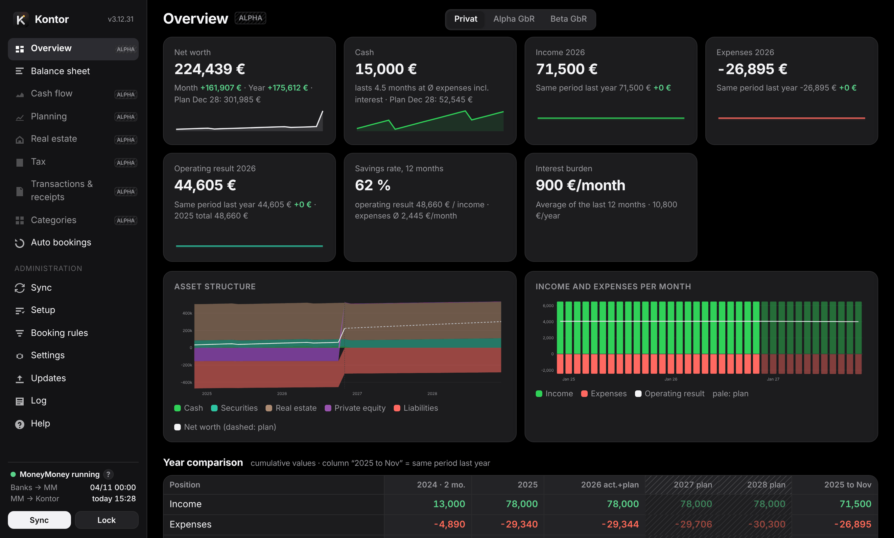

<a id="overview"></a>
## What MoneyMoney does and what Kontor does

| MoneyMoney | Kontor |
|---|---|
| Fetches transactions and balances from banks, portfolios and payment services. | Reads this data through MoneyMoney's scripting interface. Kontor never sees bank credentials. |
| Categorises transactions, manually or by rule. | Uses these categories. You assign transactions without a category in Kontor; optionally Kontor writes the assignment back to MoneyMoney. |
| Keeps offline accounts: private loans, equity investments, real estate, capital accounts. | Books only into such offline accounts according to your rules: mirror loan instalments and calculate interest, participations and counter accounts of your companies. |
| Has no balance sheet, no planning, no tax overview. | Balance sheet per area, cash flow with check row, rolling plan, real estate calculation, annual tax overview, receipts, Excel export. |

Kontor never changes bookings, the category tree or rules in MoneyMoney and never initiates transfers.

**Alpha**: pages shown faded and marked “Alpha” in the menu (currently Overview, Cash flow, Planning, Properties, Tax, Transactions & receipts, Categories, Auto bookings and Booking rules) are usable but not fully tested yet – please double-check the figures there. So is the equity ratio in the balance sheet. Tested are Balance sheet, Sync, Setup, Settings, Updates, Log and Help.

<a id="setup"></a>
## Setup

The “?” next to fields explain briefly; a click on one (on the iPhone: a second tap) opens the matching section of this help.

**Setup** lists all building blocks in a sensible order. Each shows whether it is done; the first four build on each other, the rest is optional and can be done any time. “Check setup” (at the bottom) reads MoneyMoney and reports whether all accounts and categories your setup refers to still exist there – for example after renaming something in MoneyMoney.

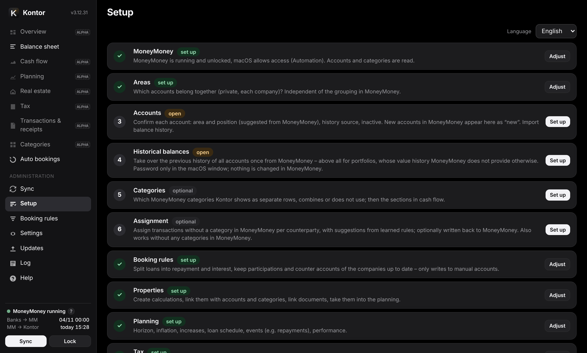

1. **MoneyMoney** – MoneyMoney is running and unlocked; the first time, macOS asks whether Kontor may control MoneyMoney (Automation). Allow it.
2. **Areas** – which accounts belong together.
3. **Accounts** – confirm area, position and history of each account.
4. **Historical balances** – take over the past history from MoneyMoney once.
5. **Categories** (choose) and **Assignment** (assign transactions).
6. **Booking rules**, **Properties**, **Planning**, **Tax**, **Receipts**, **iPhone access**, **Sync and approval**.

After that, “Create report” builds the first report. Choose the language (German or English) on the login page, in the setup or under Settings → General. The appearance is set there too: dark (default), light or like the system – per device.

<a id="areas"></a>
### Areas

An area is a set of accounts with its own balance sheet, cash flow, plan, tax overview, transactions and receipts – for example “Private” and one per company. Suggestion: each top-level account group in MoneyMoney. You can assign, merge or leave out accounts and groups freely. One area is the main area (private); it is preselected on opening. Companies get a type and your share – Kontor uses the share for your stake and for tax. Type and main area are prefilled from the names; please check. Use ▲ ▼ to set the order in which the areas appear in the bar at the top. Areas can be renamed, deleted, merged or assembled from individual accounts and groups; accounts that belong to no area count nowhere.

<a id="accounts"></a>
### Accounts and positions

Each account gets an area, a position in the balance sheet and a history source. Kontor suggests everything; dashed means “suggestion chosen”, solid means “your own choice”. Once saved it stays fixed: renaming or moving in MoneyMoney changes nothing. New accounts appear as “new” until you confirm them. Accounts appear everywhere in MoneyMoney's order.

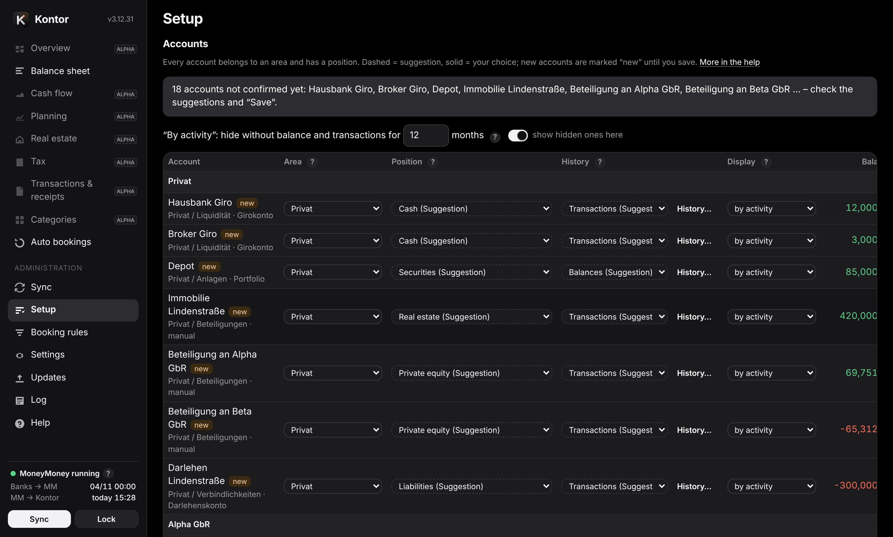

**Positions** (balance sheet rows, ordered by availability):

| Position | What belongs there |
|---|---|
| Cash | Current account, overnight money, credit card – available immediately |
| Securities | Portfolios with stocks, funds, ETF/ETC, derivatives, plus crypto and precious metals – sellable within days, with price risk |
| Term investments | Fixed-term deposits, P2P loans, building savings, life and pension insurance – before the end only with a waiting time or a discount; not counted as available |
| Real estate, equity investments, tangible assets | tied up long-term; equity investments include credit balances on capital and shareholder accounts (shareholder loans too) |
| Receivables | Loans to others, deposits |
| Liabilities | Loans, credit card debt, debts on capital accounts |
| outside net worth | Equity (capital accounts, only when explicitly chosen), guarantees & sureties, “not on the balance sheet” |

**How Kontor suggests** (in this order): portfolio → account name (e.g. “Immobilie”, “Darlehen”, “Kapitalkonto”, “Aval”, “Bauspar”) → unambiguous account type (current account, credit card, loan) → name of the group in MoneyMoney → remaining account type. Rule of thumb between securities and term investments: cash within a few days without a discount? Then securities, otherwise term investments. Loans and deposits count as receivables when in credit and as liabilities when in debt. Capital and shareholder accounts (shareholder loans too) count as equity investments when in credit – it is risk capital that bears losses and only comes back when you leave – and as liabilities when in debt: in the company that is a debt to the shareholder. The value of a stake is then your share of the rest; together with the capital account that is your whole share, even with unequal contributions.

**Display**: “by activity” hides accounts without balance or transactions for N months; “always show” or “hide” fixes it. Hidden accounts still count in all totals.

<a id="history"></a>
### History of an account

Where an account's month-end balances come from:

- **Transactions** (default for bank accounts): month-end balance = today's balance minus all later booked transactions – the way MoneyMoney calculates it too. Pending transactions do not count. Before the first transaction there is no balance.
- **Balances**: entered or imported balances are anchors; Kontor calculates the months in between from the bookings. Differences appear in the cash flow as “balance correction”.
- **Portfolios**: have no bookings. Kontor uses the balances imported from MoneyMoney and records each month itself afterwards.

Kontor estimates nothing. Clicking an account in the balance sheet opens its history panel with chart, month-end balances and checks; there you can enter balances or import them from a file. For portfolios, the holdings (quantity, value, gain/loss) are shown at the top.

The panel also checks the backward calculation: opening balance before the first booking in MoneyMoney, pending transactions, negative balances on accounts that cannot go below zero. Portfolios without imported history show “before … unknown”.

**Balances from a file** (Setup → Accounts or the history panel): CSV or Excel (.xlsx), as a list (date, account, balance) or as a table with reference dates in the header row or the first column. Imported accounts are then set to “Balances”.

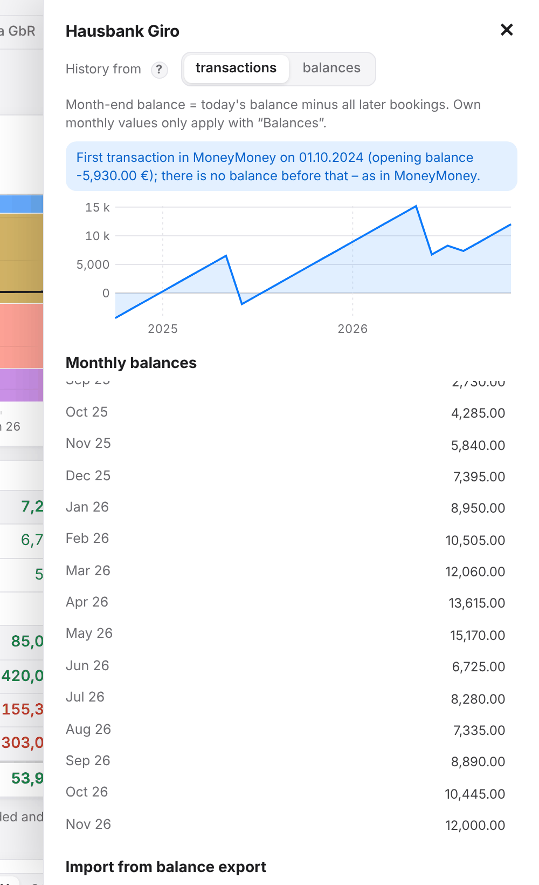

<a id="balances"></a>
### Historical balances

MoneyMoney does not provide the history of balances through its interface – especially for portfolios the past would be missing. So Kontor reads it once from MoneyMoney's database file: quit MoneyMoney, “Show in Finder”, drag the file `MoneyMoney.sqlite` into the window and enter the MoneyMoney password in a macOS window. Kontor only receives a key derived from it, decrypts only in memory, checks the values against the current balance and stores only month-end balances, encrypted. Nothing is changed in MoneyMoney. Importing again replaces the previous data.

**Names of the securities** (optional): after the import, another step appears below. If MoneyMoney knows a security only by its ISIN, you can have its name looked up. On a click, Kontor looks up the names once at OpenFIGI, a freely accessible directory of securities. Only these ISINs are sent (you can expand the list beforehand) – no amounts, quantities, accounts or names. Besides the update check it is the only connection to the internet and never happens on its own. The step also lists all securities with an ISIN and their names (from MoneyMoney, otherwise looked up); there you can change names or fill in missing ones. Changed and looked-up names are stored separately – nothing changes in MoneyMoney – and can be removed again.

Importing again replaces all balances imported so far – no reset is needed beforehand. Securities for which MoneyMoney no longer keeps a name or an ISIN (often ones sold long ago) are called “Unnamed 1, 2, …” and cannot be looked up.

**After that Kontor records itself**: bank accounts are calculated exactly backwards from the transactions anyway. For portfolios Kontor notes the current value on every read. The service runs in the background from login, even without an open Kontor window, and reads within about 20 seconds as soon as MoneyMoney is open and unlocked – a quick look at MoneyMoney is enough. Each value counts for the month in which MoneyMoney retrieved it from the bank. If MoneyMoney retrieved data while Kontor was not running, or a month is missing, the “Synchronisation” page points it out.

<a id="sync"></a>
## Sync

The data has two stages: **banks → MoneyMoney** (MoneyMoney fetches from the banks) and **MoneyMoney → Kontor** (Kontor reads from MoneyMoney). Both times are shown at the bottom left. “Sync” reads immediately; automatically Kontor reads every 30 minutes (adjustable) and as soon as MoneyMoney has new data – only while MoneyMoney is running and unlocked (Kontor does not start it itself).

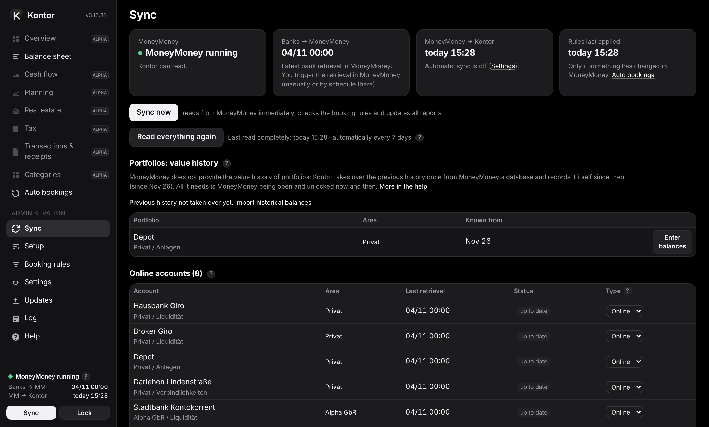

- **Quick read**: a sync only reads the transactions of the last 30 days and takes older ones from the last complete read.
- **Check**: Kontor checks every balance. If it does not match the transactions read, something older changed in MoneyMoney – e.g. a late booking with an old date or a deleted transaction. Then Kontor reads everything at once (at most every 12 hours).
- **Complete read**: every 7 days (adjustable) and with “Read everything again”. Kontor's own bookings need none: Kontor keeps them until then. Only changed categories of older transactions (e.g. a rule in MoneyMoney applied to all transactions) appear just then – use “Read everything again” for that.
- A bank refresh without new data does not trigger a recalculation.
- **Read transactions** (Settings → General): how far back Kontor reads; 0 = all (recommended).

The Sync page shows the last refresh per account and reports accounts that lag behind. Offline accounts (kept by hand: never refreshed, without bank and account number, created as offline account or booked by Kontor) are listed separately as “Offline account”; if sorted wrongly, change it per account under “Type” to “Online” or “Offline”. Kontor books only into offline accounts – also into one with a bank code typed in, once it is set to “Offline” there. If MoneyMoney is closed or locked, nothing happens – the next sync catches up.

<a id="tables"></a>
## Tables, switches and Excel

Everywhere you choose **months** (with annual totals) or **years** only. Year columns are cumulative: flows as a sum, balances as the year-end value. The current month and the current year (not yet complete) are faded, plan values faded and hatched.

- **▸ in the header cell** of the balance sheet expands all positions; the **eye** next to it (with a count, only when there are any) also shows empty accounts and those hidden by activity (they are always counted). “(9/12)” at a position means 9 of 12 accounts are shown. **Empty rows** (cash flow, planning) also shows rows without values.
- **Plan** (cash flow) appends the plan values on the right; off = actual values only. Balance sheet and planning always show the plan.
- **inflation-adjusted** (planning) shows plan values in today's purchasing power.
- The overview also compares with the same period of the previous year.

Every table has an **Excel** button: balance sheet, cash flow, planning (with projection and parameters), tax, transactions, portfolios, receipts, accounts and every property calculation.

<a id="balance-sheet"></a>
## Balance sheet

The balance sheet shows the assets of an area by position, month by month or year by year, with a plan up to December of the last plan year: the main chart at the top, the table below it and three single charts at the bottom. **Months or years** (top left) applies to all of them.

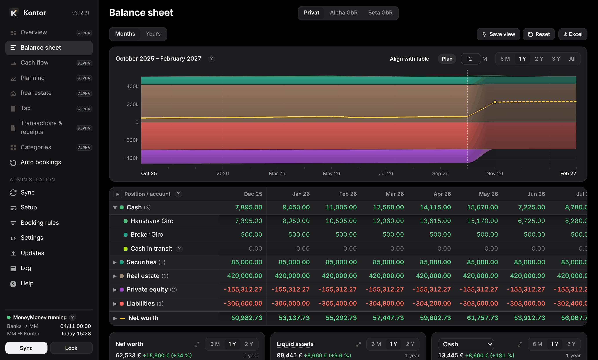

**Ranges and display**

- Values are balances at month end; the current month shows the current balance.
- The charts end with the last completed month and count from month end to month end: in November, “1 Y” runs from October of the previous year to October, so the change covers exactly twelve completed months. The first and the last month are always labelled on the time axis; the value applies to the end of the range, the change (in € and %) since its start – in the main chart too, only the balance sheet shows no value and no change. The shortest range is one month (change to the previous month).
- To the right (by swiping or with “All”) follows the running month, dotted and with a soft shade leading over – actual data is already coming in –, then the plan, dashed and shaded. The dashed vertical line marks the end of the last completed month. In the table the running month or year is faded, the plan faded and hatched.
- Colours: positions by availability, from cash (green) to equity investments (violet); accounts in variations of their position's colour (hatched from the eleventh account), the same in the table and the charts. Net worth is golden; the golden dash in front of it in the value tip and in the table stands for its line.

**Table**

- Click the **name** of a position to expand its accounts (**▸** in the header cell: all positions; **▸** in front of a portfolio: its securities). Click the name of an account to open its history (view and edit month-end balances); a second click closes it again; the same for a security.
- Click a **value** to make its area and month light up briefly in the main chart (the chart moves to the month if needed). Clicking a month heading moves the chart so that the month sits exactly above the column; so does a click on a net worth value, and its dot in the chart blinks briefly. The single charts keep their length and end with that month – so they show the change up to it. The page itself stays put. Hovering over a name marks the same area in the chart.
- The **eye** in the header cell (only when there are any, with a count) also shows empty accounts and securities and those hidden by activity – they are always counted. What counts as hidden is set under [Setup → Accounts](#accounts) (column “Display” and “By activity … months”, default 12); securities without a value in that period count as hidden too. “(9/12)” means 9 of 12 are shown.
- **Portfolios**: past months from the balances read from MoneyMoney (otherwise from Kontor's monthly record), the current month from MoneyMoney; what the securities do not explain is shown as “Other”. Hovering over a security always shows MoneyMoney's name and the ISIN, and whether the name was looked up or changed. Rename accounts in MoneyMoney – Kontor takes the names from there.
- Year columns show the balance at year end (the running year: today). The month view has no year columns – they would only repeat December; a thin line separates the years.
- Drag the right edge of the first column to make it wider or narrower (double-click: default width); the width is part of the view.
- **Equity ratio** (alpha; a click on “Net worth” opens the key figures below it): how much of your assets you own free of debt – equity ÷ (equity + debts). Looking through your companies: their debts count with your share (areas) if the participation is entered under Booking rules → Companies, otherwise the ratio would look too good, because the bank loans sit there. Debts are accounts with a negative balance; capital and shareholder accounts are equity, participations themselves never debts. How you book capital accounts changes nothing. Participations without this entry count with their value only; if accounts of a company are in no area, the ratio is unknown. A click shows the month's calculation step by step.
- Below net worth, guarantees and capital accounts as equity (not in net worth) are each collected in one expandable row.
- **Cash in transit**: If the two bookings of a transfer between your own accounts fall into different months (debited on the 31st, credited on the 1st), the amount counts as “cash in transit” to cash at the month end – otherwise net worth would briefly look too low. A click shows the detected booking pairs.

**Main chart** – any of the four charts can be the large one: the ⤢ symbol in a small chart swaps it with the large one (default: the balance sheet).

- Range depending on the view – months: 6 months, 1, 2 or 3 years (default 1 year); years: 1, 3, 5 or 10 years (default 3 years) –, all or a number of months of your own.
- As the balance sheet, the main chart also shows about a third of the range ahead: the running month and the plan (with 1 year the running month and three plan months, with 3 years twelve months). **Plan** left of the ranges turns this off; the setting is part of the view. The number in the field next to it counts the months up to the last completed one, the plan comes on top. The amount axis has at least five grid lines.
- Hovering shows the month's values in a slightly see-through tip; the area under the pointer and its row in the tip stand out. Over the month axis the values appear without marking an area.
- A click on an area works as in the table: a position opens into its accounts, a portfolio into its securities; a click on an account or a security closes the position again. Afterwards, what opened is marked until the mouse moves. A click beside it or on the month axis jumps to the month in the table.
- Swipe (on the month axis too) to pan, pinch to zoom, drag to select a range, double-click beside the areas to enlarge. Drag up/down on the amount axis to zoom the value range in/out (the wheel moves it), a tap or click there makes it automatic again. On the iPhone two fingers pan and zoom, one finger shows the values. The same applies to the single charts.
- **Align with table**: every value sits right above its column. The chart scrolls with the table, swiping or dragging on the chart scrolls the table, and the scale follows the visible columns. The value tip is dropped – the values are right below.

**Single charts** (below the table)

- **Balance sheet** (when another chart is the large one): without the value line, a little taller instead.
- **Net worth** alone, with the average per month, the high and the low below. Hovering shows just the month and the value.
- **Selection**: the sum of freely chosen positions (default: cash, securities and term investments – savings & investments). The title names the selection in words – typical combinations by their name, otherwise combined like “Savings & investments + Liabilities” or “Net worth excluding Private equity”, with shortened words when space is short; the line has the positions' mixed colour. The names build up step by step – hovering over the title shows the same, there only with the positions the area has:

```
  Cash
+ Securities
= Liquid assets
+ Term investments
= Savings & investments
+ Private equity
+ Receivables
= Financial assets
+ Real assets (Real estate + Tangible assets)
+ Other
= Gross assets (total assets)
+ Liabilities
= Net worth

Tied-up assets = Gross assets − Liquid assets
```

Financial and real assets are split as in the Bundesbank's statistics: participations count as financial assets, even if the company holds real estate; crypto and precious metals sit under securities in Kontor and so in financial assets. There is deliberately no “current assets” – that depends on how long you mean to hold something, not on how fast it turns into money.

- **Composition** of a chosen position by account (stacked). **Holdings** next to it breaks portfolios down into their securities (only where available); below, accounts or securities can be deselected one by one – the line of the position stays, and hovering also shows the sum of the selection.
- Each has its own range (depending on the view 6 months, 1 or 2 years or 1, 3 or 10 years) and an axis that adapts to the visible values (at least four grid lines) – so you can see the development even when large positions such as receivables and liabilities cancel each other out in the chart above. The area reaches to the zero line, so upwards for negative values. The value tip is slightly see-through so the line beneath stays visible. Below the range buttons stands the length of the range shown (beyond two years in years and months, e.g. “2 years 8 mo.” or “2½ years”) – the value and the change refer to it; after zooming, a button is marked again as soon as the length matches.

**Layout and saving the view**

- The small arrows **↑ ↓** in the header of the table and of the main chart (on hover) move them up or down, also below the single charts.
- What you change while viewing (months or years, ranges, plan, expanded rows, the eye, width of the first column, layout, which chart is large, selections in the charts) lasts only until the page is reloaded. **Save view** (top right, next to Excel) keeps the current view on this device, separately for months and years (e.g. months with 2 years, years with 10 years). The one saved last opens at the start; switching between months and years takes their saved ranges. Ranges always end with the last completed month, and the table shows the current month as always. **Reset** restores Kontor's default. The area is not affected.

<a id="cash-flow"></a>
## Cash flow

Where the money goes: income and expenses by category, investments (moves into portfolios and investments, contributions to companies), financing (repayment and interest per loan), valuation (value changes of portfolios) and “unclear”.

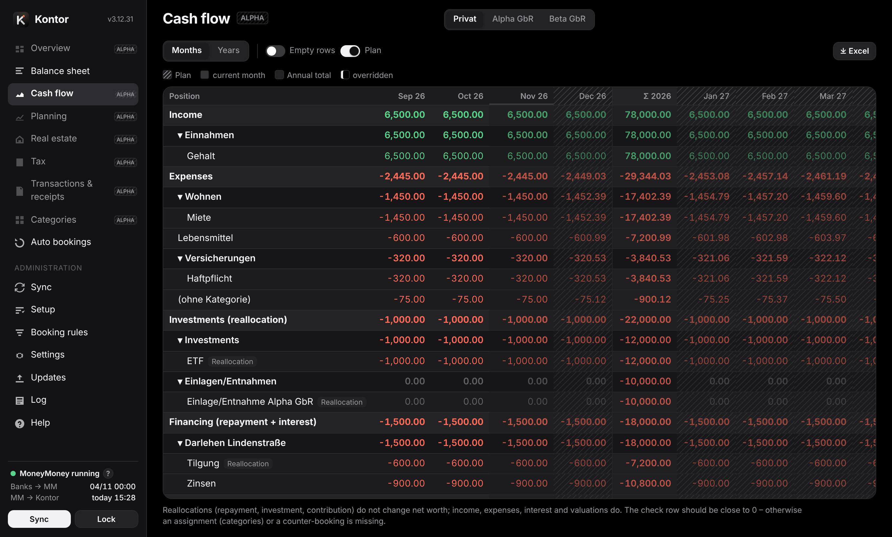

Kontor recognises transfers between own accounts by the counterparty IBAN, the category “Umbuchung” and matching bookings of the same amount within three days; they do not count as income or expense. The **check row** “unexplained change in net worth” should be close to 0 – otherwise a category or a counter-booking is missing. Which categories appear as separate rows is set under [Categories → Selection](#categories-selection); which parent category belongs to which section under Categories → Cash flow mapping.

<a id="categories"></a>
## Categories

**MoneyMoney is authoritative**: if a transaction has a category there, it applies in Kontor too. You assign transactions without a category in Kontor – under Categories → Assign, grouped by counterparty, with suggestions from learned rules. “Rule for this name” handles the counterparty permanently.

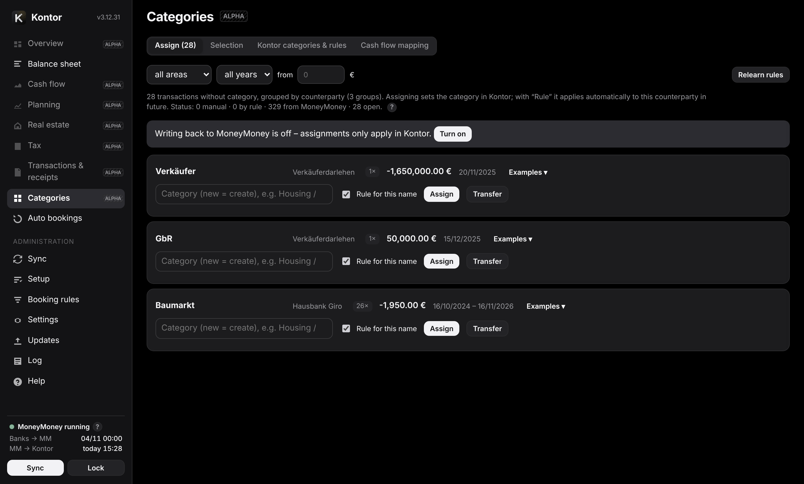

The Categories page has four tabs:

- **Assign** – transactions without a category, grouped by counterparty; the number in the tab shows how many are open.
- **Selection** – which MoneyMoney categories Kontor uses as rows ([more](#categories-selection)).
- **Kontor categories & rules** – categories that exist only in Kontor (tree taken from MoneyMoney, extendable), your own rules (name, purpose, counter-IBAN, direction) and the learned ones. Rules are learned from the counterparty (IBAN or name, possibly with the start of the purpose) if at least 90 % of its previous transactions have the same category. Your own rules come first; more specific ones win (IBAN before name + purpose before name).
- **Cash flow mapping** – which top-level category belongs to which cash flow section (income, expenses, investment, financing). Without a mapping the sign decides.

**What applies**: the category from MoneyMoney – unless you explicitly override it (“Only in Kontor”). Without one: manual assignment before own rule before learned rule. By default rules only act on transactions without a MoneyMoney category; “Also apply rules to transactions categorised in MoneyMoney” changes that – only in Kontor, MoneyMoney stays unchanged.

Categories are only needed for the breakdown (cash flow rows, planning per row, tax). Balance sheet, net worth, real estate, loans and total income/expenses work without them. Little upkeep: payments between you and your companies are recognised as contributions or withdrawals anyway; categorise in detail mainly where you need cash flow and tax precisely.

<a id="categories-write-back"></a>
### Writing back to MoneyMoney

With “Write categories back” (Settings → General or “Turn on” under Categories; only on the Mac) Kontor also sets your assignments in MoneyMoney – so you categorise in one place only. Safeguards:

- Kontor only sets the category field of a transaction; amounts, dates and deleting are not possible with it.
- Right before writing, Kontor reads the transaction again from MoneyMoney and only writes if it is unchanged and has no category yet (or the one Kontor set).
- Kontor only replaces another existing category – for example one maintained by a business partner – after asking: “Replace in MoneyMoney” or “Only in Kontor” (MoneyMoney stays, Kontor overrides).
- Kontor cannot create categories in MoneyMoney (MoneyMoney does not allow it). If one is missing, the assignment waits; after you create it in MoneyMoney, Kontor fills it in at the next sync.

<a id="categories-selection"></a>
### Selection: which categories Kontor uses

Under Categories → Selection you decide for each MoneyMoney category:

- **Separate row** – appears as its own row in cash flow and planning.
- **Into parent** – counts towards the parent category including subcategories (cash flow and planning only; tax still uses the exact category).
- **Not used** – in Kontor as if uncategorised; the transactions appear under “Assign”.

“Top level only as rows” tidies up the cash flow in one click. Nothing changes in MoneyMoney.

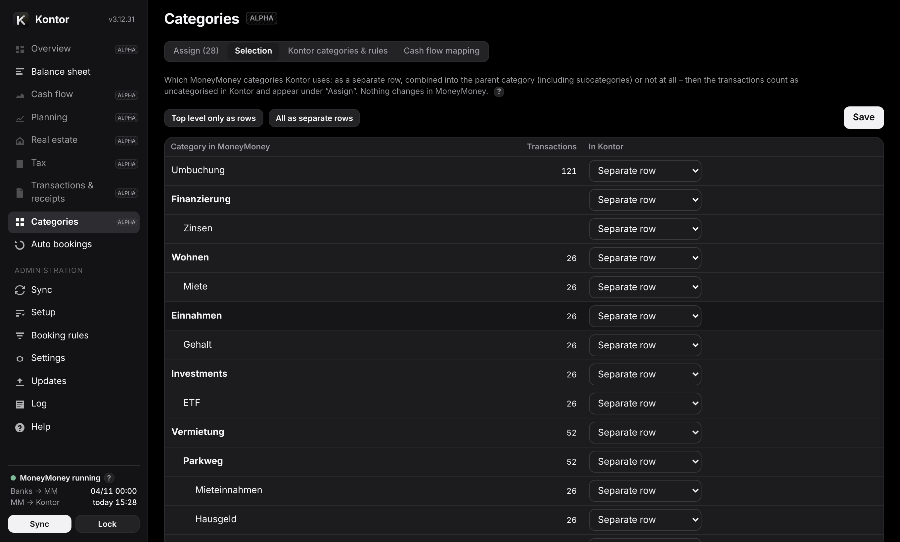

<a id="planning"></a>
## Planning

Planning continues the past: per row a method (Ø 12 or 6 months, same month last year, fixed amount, annual amount/12, MoneyMoney budget, none), an amount and an increase in % p.a. Expenses follow inflation by default, income the set rate. Double-click to override single months; the suggestion stays visible and can be restored.

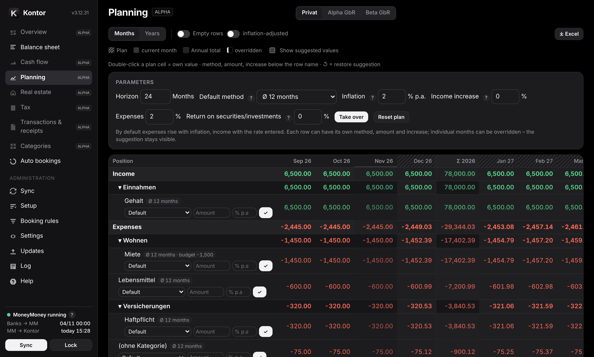

- **Loans**: interest on the projected remaining balance, repayment = instalment − interest.
- **Value development** per account in % p.a.; equity investments optionally linked to the planned net worth of the company (share × net worth).
- **Events**: one-off or recurring moves, income and expenses – e.g. repaying a loan in one go from the portfolio.
- **Real estate**: active calculations contribute rent, costs, interest, repayment, remaining debt and property value.
- The plan always runs to December; “inflation-adjusted” shows plan values in today's purchasing power.
- Below: projection of the balance sheet per position and account, and key figures (savings rate, liquidity reach, interest burden). The plan applies per area.

<a id="properties"></a>
## Real estate

Any number of calculations (scenarios) per property, one of them active. Inputs:

- Purchase price and transfer date; incidental costs (real estate transfer tax, notary, land register, broker; immediately deductible items separate); building share and depreciation rate or remaining useful life.
- Net cold rent and service charges, vacancy, rent adjustment (index rent by CPI with pass-through factor and threshold, fixed rate or none); non-recoverable costs and reserve (with CPI or fixed rate).
- Loans: annuity, amortising or bullet; settled monthly like banks or annually on the 1 January balance like vendor loans; special repayments recurring or single, fixed-rate period with follow-up rate, maturity with repayment.
- Partners with share and tax rate, distribution, value development, sale year.

Kontor rejects invalid inputs with the field name.

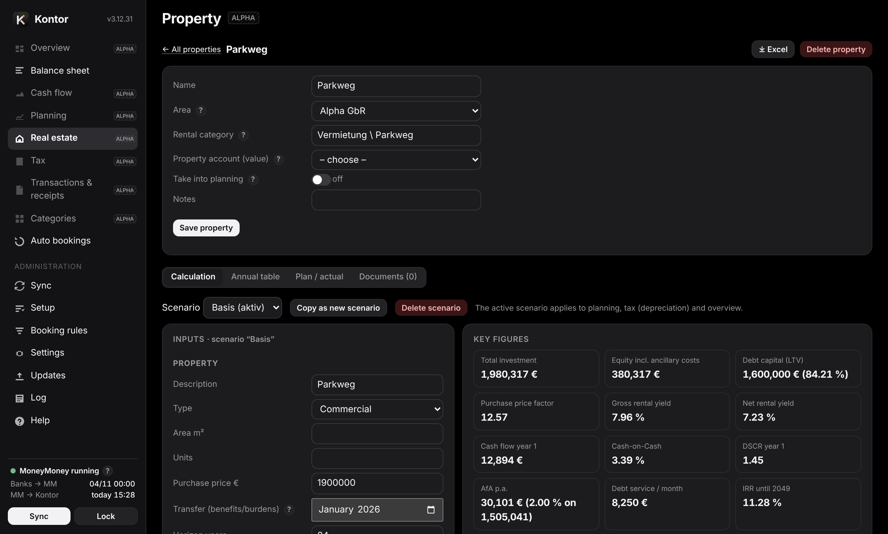

Result: monthly and annual table (rent, costs, interest, repayment, depreciation, taxable result, tax, cash flow, wealth build-up, remaining debt, property value), key figures (price multiple, gross and net rental yield, cash-on-cash, DSCR, LTV, IRR until sale) and notes (open maturities, missing follow-up rate, negative cumulative cash flow). Links to MoneyMoney: rental category and loan accounts for the plan/actual comparison per year, property account for the value in the balance sheet. “Use in planning” feeds the plan of the area; the depreciation of the active calculation goes into the tax overview as long as no annual value has been entered there by hand. Excel export per calculation. Documents (purchase contract, appraisal …) are stored as links – the files stay where they are. Simplified: tax per partner = share × result × tax rate (no progression, no loss offset), straight-line depreciation.

<a id="tax"></a>
## Tax

Per entity (main area = private, each company with your share from the areas) and year: rental income per property from the categories `Vermietung \ Object \ Type` (any number of properties, private ones too), loan interest per loan (mapping loan → property under Settings → Tax), depreciation, tax items from category names (adjustable under Settings → Tax) and bookings without category as items to check. A year's receipts can be exported as a ZIP with an overview. No tax advice.

<a id="receipts"></a>
## Transactions and receipts

The transaction browser filters by area, year, account, text, “without receipt” and “without category”. Add receipts (PDF, images, e-mails, Office files) by choosing a file, drag & drop or a photo on the iPhone. They are stored as normal files in the receipts folder (default `~/Documents/Kontor-Belege`, subfolders e.g. `{jahr}`), file name `Date_Amount_Name_ID`. Files outside the folder (also iCloud Drive) can be linked without copying them – Kontor shows whether the file is local or still downloading from iCloud. Existing files in the receipts folder can be assigned later. Up to 60 MB per file. The index is stored encrypted in the data folder; the files remain usable without it. Deleting in Kontor never affects linked files.

<a id="rules"></a>
## Booking rules

Booking rules set what Kontor books automatically into your offline accounts in MoneyMoney:

- **Loans** – recognise the instalment, book it as repayment to the loan account, add the interest.
- **Companies** – keep your participation and your counter accounts in line with each company.

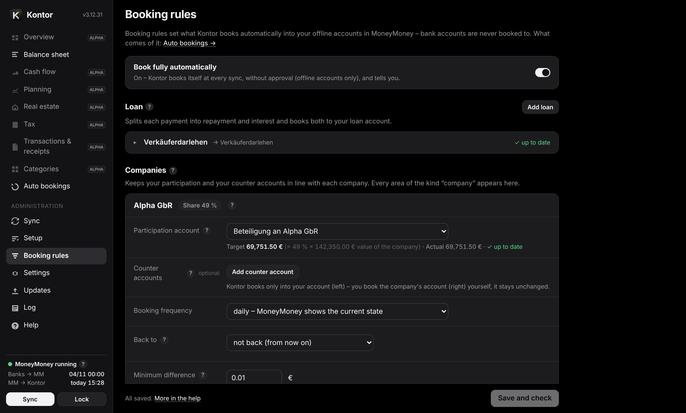

Each loan is one row (name → loan account, on the right what is open); a click opens the details. Each company has its own card. Next to every field a **?** briefly explains what it does (click: this section). Next to every rule you see the **target**, the **actual** balance and the **difference** Kontor would book – already while you edit. **“Save and check”** (⌘S) at the bottom applies to all changes on the page and checks them against MoneyMoney.

**Book fully automatically** (switch at the top of “Booking rules”, on the Mac only): off (default) – the bookings appear under “Auto bookings” and are created once you **approve** them there (on the Mac only) – one by one: untick to leave a booking out, the pencil changes date, amount or text (the mark stays), ✕ does not book it – it then shows under “Not booked”, what you only untick keeps waiting. What you leave out or change moves every later balance of the same account: Kontor recalculates the list at once (the next value adjustment makes up for it, for loans the interest after it) and books exactly the amounts shown – if something changed in MoneyMoney meanwhile, it books nothing and shows the new ones; on – Kontor creates them itself at every sync. The top right of “Auto bookings” shows which applies (“With approval” or “Fully automatic”). Bank and extension accounts are never booked to, transfers and direct debits are blocked, Kontor never changes or deletes existing bookings.

**How it runs**: at every sync (automatically every 30 minutes, after new data in MoneyMoney or with “Sync”) Kontor works through the booking rules – also when nothing changed in MoneyMoney but the rules, your decisions or the day (interest at month end); “Sync” at the bottom left does it at once. Quicker is **“Refresh”** at the top of “Auto bookings” (with approval): it reads only the accounts the booking rules concern – loan and source accounts, participation and counter accounts, the companies' accounts – and recalculates the approval list; nothing is booked, the other figures come with the next sync. There are no macOS notifications: in the sidebar a number on “Auto bookings” shows how many are waiting (from 100 “99+”, a “!” after an error), a dot on “Updates” a new version – in a narrow window a dot on the menu button, in the web app in the Dock the number on its icon. Under “Auto bookings” you find the waiting or last booked bookings with notes and calculations, **“Created by Kontor”** (only Kontor's own bookings with their state in MoneyMoney) and the history.

**Never twice**: every booking carries a mark in the purpose (e.g. “#mm-zins-2026-10”; MoneyMoney's interface has no comment field when creating). On top, Kontor keeps its own encrypted list of all bookings it created. If the mark changes in MoneyMoney, Kontor recognises the booking by account, date and amount (each booking in MoneyMoney counts once, so two equal ones as two); if it is gone (deleted), Kontor does **not** create it again on its own. **“Not booked”** collects both: bookings you did not book and loan bookings deleted in MoneyMoney afterwards; “Book again” puts them up for approval again with date, amount and text as before, where you can still change them (with “Book fully automatically” it books them at once, on the Mac only). **Deleting** only works in MoneyMoney, its interface has no delete.

**Value adjustment deleted or changed** (participation, counter accounts): a balance is the sum of all bookings up to that day. If an adjustment of day X is missing or has another amount in MoneyMoney, every later balance is off by exactly that amount – so the bookings after it stay as they are. Kontor checks day X once more and books there only what is still missing: usually exactly the deleted booking (with the same mark), nothing if you booked the value yourself. With approval it waits for you, otherwise Kontor books it at once; so it does not show under “Not booked”. “Book again” on a value adjustment likewise books the amount missing on its day now.

<a id="rules-loans"></a>
### Loans

Kontor recognises the instalment on the source account – by the lender's IBAN or a text in the purpose – and books it as repayment to the loan account (an offline account). The interest comes on top every month. So the remaining debt in MoneyMoney is right without manual work. “Type”: liability (you pay) or receivable (you receive). “Book from”: only from this day. Without an interest model (“no interest”) Kontor only mirrors the instalments.

**Interest**: annual basis = interest rate × balance on 31 Dec of the previous year, one twelfth per month, the cent remainder in December – or monthly on the outstanding balance. The model is simplified (30/360); reconcile once a year with the bank's interest statement. If there are problems (account deleted, no matching payment, interest booking already entered by hand) you get a note under “Auto bookings”.

<a id="rules-companies"></a>
### Companies

Every area of the kind “company” (Setup → Areas) appears as a card, with your **share**. The share is set there only; the card links to it.

- **Participation account**: your offline account for this company – you can choose offline accounts with the position “Participations” (Setup → Accounts); none is chosen in advance, because the bookings start as soon as you choose one and save. Kontor keeps it at **share × value of the company**. Value = all accounts of its area, i.e. assets minus debts (without accounts with the position “Capital accounts (equity)”, guarantees and off-balance accounts).
- **Counter accounts** (optional): your offline account as the counterpart of one of the company's accounts – same amount, opposite sign. Example: your capital account is a debt to you in the partnership and a receivable for you (“loan to the partnership”). The direction is fixed: you book contributions and withdrawals only once in the company, Kontor keeps your account in line – it never books into the company's account. If you keep no such account or book it yourself, you need no counter accounts.

Both together count nothing twice if the capital accounts are kept as debts in the company (the default for accounts with “Kapitalkonto” or “Gesellschafterdarlehen” in their name): the receivable is your capital account, the participation your share of the rest – increases in value and undistributed surpluses. This also holds for unequal contributions. If you keep a capital account as the company's equity instead, it is already part of the participation's value; a counter account for it then counts twice, and “Save and check” warns.

Also per company:

- **Booking frequency** – *daily* (default): the difference at every sync with the day's date, so MoneyMoney always shows the current state; recommended with “Book fully automatically”. *Monthly*: one booking at month end – enough for the balance sheet; recommended with approval, otherwise a booking waits for you every day.
- **Back to** – default “not back (from now on)”, see below.
- **Minimum difference** (Kontor does not book smaller differences) and **counterparty** of the bookings (empty: name of the company).

Kontor always books only the difference to the balance in MoneyMoney (purpose with the mark “#mm-wert-…” or “#mm-spiegel-…”). Payments between you and a company with a participation or counter account count as contributions or withdrawals in the cash flow, and the equity ratio in the balance sheet looks through the companies via the participations.

<a id="rules-back"></a>
### Booking back

With “Back to” Kontor brings in the past **once** – from a day or “everything” since the company's first booking: one adjustment on every day on which the company's value changed (daily) or at every month end (monthly) – with the value the balance sheet shows for that day, and again only the difference; existing bookings in the account are checked too. So the history of your participation and your counter accounts is right in MoneyMoney and in Kontor. Once the bookings are created, “done” shows next to it and Kontor only checks the current state from then on. “Check again” (or another month) checks the whole history once more and corrects it with additional bookings. Tip: delete old bookings in the participation account first, then bring the history in. Months in which a value is not known (e.g. a portfolio in the company whose earlier balance MoneyMoney does not provide) are skipped and named – Kontor estimates nothing. Existing bookings are never changed; without “Book fully automatically” the bookings back also wait for your approval.

<a id="iphone"></a>
## Access from iPhone

By default Kontor is only reachable on the Mac (`127.0.0.1`) – that is why the iPhone cannot open the address. For remote access Kontor uses [Tailscale](https://tailscale.com): a private, encrypted network of only your devices. No port is open in your home network or the internet, nothing needs to be set up on the router.

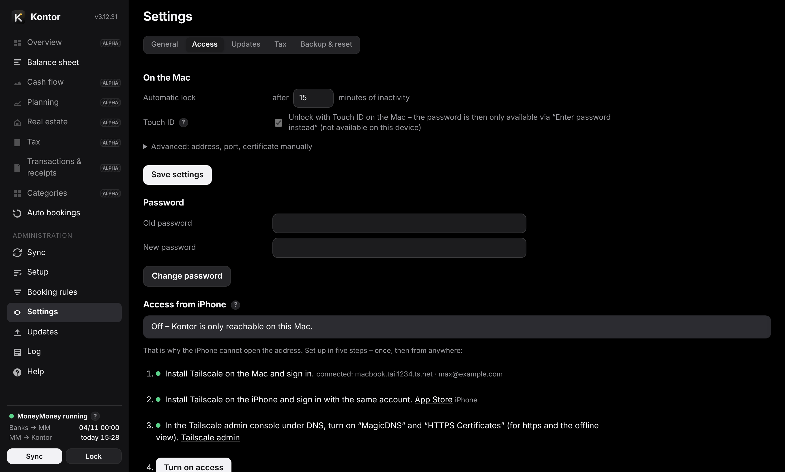

Under Settings → Access, Kontor shows the steps with checkmarks:

1. Install Tailscale on the Mac and sign in.
2. Install Tailscale on the iPhone and sign in with the same account.
3. In the Tailscale admin console under DNS, turn on “MagicDNS” and “HTTPS Certificates”.
4. “Turn on access” – Kontor gets a real certificate for the Mac's name, opens a second address only in the Tailscale network and restarts.
5. On the iPhone, open the shown address in Safari (copy the link – it reaches the iPhone via the clipboard), sign in, Share → “Add to Home Screen”.

**Who, where, what**: Kontor is only reachable for devices in your Tailscale network and only with the Kontor password; from anywhere with internet; default **view only** – nothing can be changed from the iPhone. Optionally “view and edit” (planning, assignments in Kontor, settings). Writing to MoneyMoney, Touch ID, backup, reset, the receipts folder, links to files and the access settings are only available on the Mac; a sync from elsewhere is always a dry run (booking happens on the Mac). The Mac has to be running (not asleep) and connected to Tailscale; if Tailscale is not yet connected at start, Kontor opens the address as soon as it can. In Terminal: `python3 ~/Kontor/kontor.py tls` (or `tls --off`).

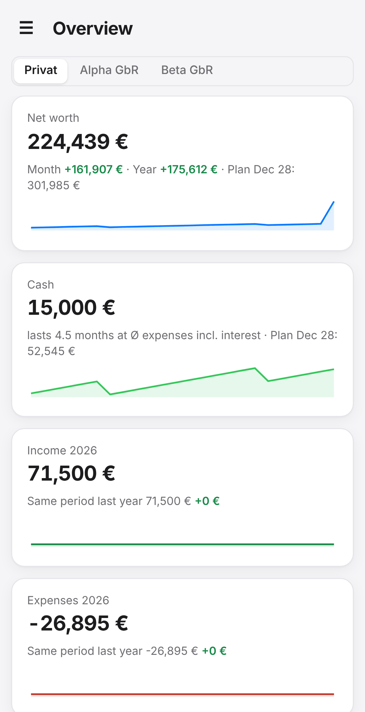

**Offline view**: saved as an app, the iPhone keeps the last loaded data. If the Mac cannot be reached, the Kontor password opens this copy – read only. Can be turned off under Settings → Access. The copy is encrypted with the Kontor password: the iPhone has its own key pair; one part encrypts every new answer, the other lies on the device only encrypted with your password (PBKDF2-SHA256, AES-GCM, RSA-OAEP). Without the password the copy cannot be read, not even with developer tools on the unlocked device. It comes into being at the first sign-in with the password while the Mac is reachable; after a password change it starts afresh with the next sign-in. “Delete stored data on this device” removes the copy immediately. The service renews the certificate (valid for 90 days) itself.

Without HTTPS certificates, “Turn on without certificate” works (encrypted by Tailscale, but without offline view).

**If Kontor reports “not connected”**, the reason is shown next to it (not signed in, switched off, waiting for approval, or Tailscale's own answer). Open Tailscale in the menu bar, turn on “Connect”, then “Check again”.

<a id="iphone-security"></a>
### How secure is Tailscale?

Tailscale connects your devices directly and end-to-end encrypted (WireGuard). Tailscale's service only coordinates who belongs to your network and sees no content. Only a device signed in with your account gets in – when signing in with Apple, that means your Apple ID with two-factor protection.

Good to know: without a rule of your own, all devices in your Tailscale network may reach each other on every port. Nobody can control the Mac through it as long as no remote access is turned on (Screen Sharing, Remote Login, File Sharing – System Settings → General → Sharing), and those also require the Mac password. To lock it down completely:

1. **Allow only Kontor**: under Settings → Access → “Harden”, Kontor shows a ready-made access rule for your Mac. Copy the rule, open the “Access controls” page in the Tailscale admin console, switch to “JSON editor” if a visual editor appears, replace the **whole** text with the rule (don't just add it – otherwise the default rule “allow everything” stays) and click “Save”. Afterwards your devices reach only Kontor on the Mac. Kontor checks this itself: it reads the rules Tailscale applies on the Mac and shows “Hardened”, “more ports still reachable” or – with a wrong address or port – “Kontor is blocked”.
2. **Approve new devices**: in the Tailscale admin console under Settings, turn on “Device approval”. A new device then only joins after your approval – even if someone got hold of your sign-in.
3. **Protect the account**: Apple ID with two-factor protection (default), don't invite other people into the Tailscale network.

Kontor itself also requires the Kontor password and, by default, only allows viewing from the iPhone.

<a id="backup"></a>
## Backup and reset

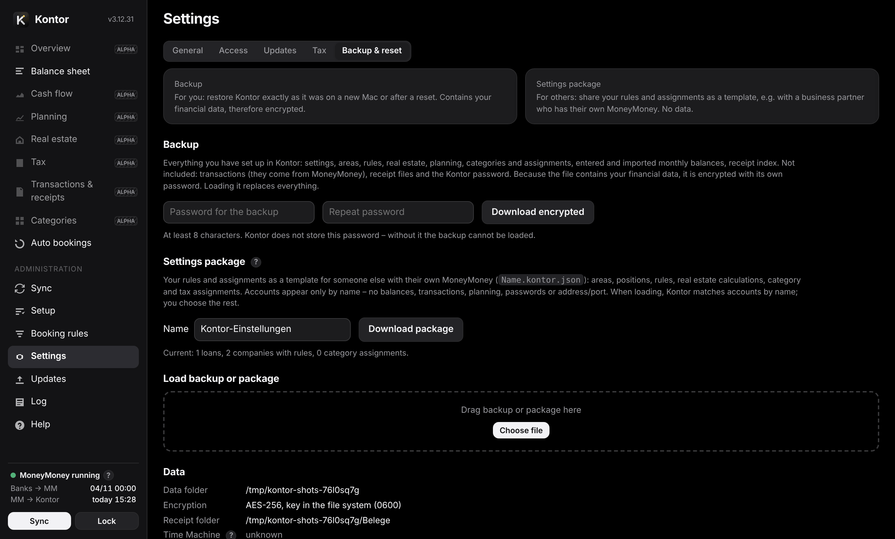

- **Backup** – for you: restore Kontor exactly as it was on a new Mac or after a reset. Contains all settings, areas, rules, real estate, planning, categories and assignments, month-end balances and the receipt index – not the transactions (they come from MoneyMoney), no receipt files, not the Kontor password. Because it contains your financial data, it is encrypted with its own password, which Kontor does not store. Only on the Mac.
- **Settings package** – for others: your rules and assignments as a template, e.g. for a business partner with their own MoneyMoney. Accounts by name only, without balances, transactions, planning, passwords or address. Loan rules contain the lender's counterparty IBAN – check before sharing. When loading, Kontor matches accounts by name; anything not found you assign in the interface. “Add” adds rules and overwrites assignments, “Replace” discards the existing setup. A template is in the `templates/` folder.
- **Time Machine** backs up the data folder by default – as encrypted files, the key is in the keychain, not in the folder. The page shows the status. “Exclude” does not change Time Machine's settings but sets the “do not back up” mark on the data folder itself (common for caches, no admin rights needed). That is why the folder does not appear in Time Machine's exclusion list. Recommendation: keep it backed up.
- **Reset** (only on the Mac, with password) deletes settings, planning, categories, history and evaluations, optionally also the password. Receipt files, key and log remain.

<a id="updates"></a>
## Updates

Kontor asks GitHub for the latest version (daily, weekly or never – Settings → Updates) and installs only when you click. The update check is Kontor's only network connection: it asks `raw.githubusercontent.com` for the file `VERSION` on the main branch of the repository (default: [github.com/stecrz/Kontor](https://github.com/stecrz/Kontor)). Other servers are deliberately not possible.

When installing, Kontor downloads that version as an archive from github.com, replaces the program folder (the old files stay next to it as `.alt`), restarts the service and reloads the page; if the program folder is a git clone, `git pull` runs instead. Data folder and settings remain. All steps are in the log. The Updates page shows the changes of the newest version, earlier ones folded below.

In Terminal, the same line as for the [installation](https://github.com/stecrz/Kontor#installation) updates.

<a id="security"></a>
## Security

- Interface only on this Mac (`127.0.0.1`); optionally also the Tailscale address for your own devices – never on the home network or the internet. No third-party content, no telemetry. The only outside connection is the update check at GitHub.
- Sign-in with password (PBKDF2-SHA256, 600,000 rounds) or Touch ID on the Mac (needs Apple's command line tools, otherwise only the password; the dialog only appears once you switch to Kontor – never while you work elsewhere). The sign-in cookie only applies to Kontor, other websites cannot trigger anything (CSRF protection, origin check). Lock after idle time or with ⌘L; five failed attempts lock for five minutes. A password change signs out all other devices and renews your own sign-in.
- All files in the data folder are encrypted (AES-256 + HMAC), the key is in the macOS keychain. If encryption or the keychain does not work, Kontor does not start – it never stores unencrypted and puts no new key into a file next to the data. Receipts are normal files in a folder of your choice; files outside it are linked only at the Mac, and only receipt files – nothing from hidden folders, the data folder or the Library (except iCloud Drive and other cloud folders).
- Booking, updates, writing categories back, backup, reset and access settings only on the Mac; from the iPhone view only by default.
- Historical balances: you enter the MoneyMoney password in a window of a small Kontor helper that is built from the source only for this and deleted afterwards; Kontor stores it nowhere. Meanwhile the database lies fully decrypted in memory for a moment – this takes trust in that code. If you do not want that, leave the feature out; once read, it is not needed again.
- The log contains no IBANs, balances, amounts, payees, purposes or passwords (for bookings only how many and of which kind, for areas and properties only identifiers); logs of earlier versions were deleted once. The diagnostics file also replaces account names and the user folder.
- Limit: the key is in the login keychain so the service runs after login without input. Whoever operates your unlocked Mac can get to it – the Kontor password then protects access, not the files. FileVault remains the basis.

<a id="advanced"></a>
## Advanced

**Install, update, remove**: installation is described in the [README](https://github.com/stecrz/Kontor#installation). `bash install.sh` in the program folder can be repeated at any time: it replaces the service and leaves data folder and settings untouched. Remove: `python3 kontor.py uninstall` or `Uninstall.command` (asks whether data and key should be deleted). The service starts at login, runs permanently and restarts after crashes (launchd, `de.kontor.service`).

**Command line** – `python3 ~/Kontor/kontor.py …`:

- `start` – run the service in the foreground; `open` – open the interface; `status` – state; `version`
- `run [--dry-run|--live] [--force]` – run a sync (suggest only or book)
- `accounts` – account tree with IDs, type and position; `check` – check the setup against MoneyMoney
- `password` – reset the Kontor password
- `package-export [FILE] [--without-uuid] [--with-plan]`, `package-import FILE [--replace] [--anyway]` – settings package
- `diagnostics [FILE]` – write a diagnostics file; `update [--install]` – check for or install updates
- `install` / `uninstall` – set up or remove the service; `tls [--off]` – turn access via Tailscale on or off

**Data folder** `~/Library/Application Support/Kontor/` (the environment variable `KONTOR_DIR` changes it). Everything encrypted except the log:

- `config` settings, `plan` planning, `state` history and portfolio month-end values, `categories` categories, assignments and rules, `dataset` reports, `transactions` transaction list (without counterparty IBAN), `receipts` receipt index, `mm-history` imported historical balances, `auth` password verifier (each `.json.enc`), `moneymoney-ledger.bin.enc` last state from MoneyMoney for the quick sync, `tls/` certificate for access from the iPhone.
- `kontor.log` – plain-text log (rotates at 5 MB, five files): requests, MoneyMoney calls with duration, update steps and errors, without passwords, IBANs or amounts.

<a id="troubleshooting"></a>
## When something goes wrong

| Message | Remedy |
|---|---|
| MoneyMoney not running / database locked | Open and unlock MoneyMoney; Kontor catches up. |
| No permission (Automation) | System Settings → Privacy & Security → Automation: allow python3 to control MoneyMoney. |
| Account not found | A rule refers to a deleted or renamed account: reassign it under Booking rules; “Check setup” shows all cases. |
| Cash flow check row ≠ 0 | A category or a counter-booking is missing. |
| iPhone cannot open the address | Turn on access under Settings → Access; Tailscale connected on both devices? |
| No matching payment | The loan rule does not find the instalment: check counterparty IBAN or text and source account. Only a note for up to 35 days after “automatic from”. |
| Port not usable | Another program uses the port: Settings → Access → Advanced. |
| Data key stored as a file | The keychain was not usable (e.g. started without login): Kontor works, but the key is then stored with permissions 0600 in the data folder. As soon as the keychain works again, Kontor moves it there and deletes the file. Without a keychain and without an existing file Kontor does not start. |

For support questions: Log → “Diagnostics file (masked)”. In addition to the log it contains status and settings, account names replaced by Konto01, Konto02 … – without IBANs, balances or passwords.
