# Kontor – Help

Kontor is your digital CFO: the overview of your private wealth and the companies behind it. It turns your data in [MoneyMoney](https://moneymoney.app) into a balance sheet, a cash flow, a plan and a tax overview – for you privately and for each company separately – and books into your offline accounts by your rules. An [AI assistant](#assistant) that runs on your Mac only answers questions about it, remembers what you tell it and proposes changes – carried out only after your click. Everything stays on your Mac.

Kontor runs as a small service on your Mac; you open the interface as its own [Mac app](#app) from the Dock or in your browser at `http://127.0.0.1:8765/`. After the Mac restarts or after an update you sign in once – only that opens your data ([Security](#security)). This help is also available in Kontor itself (menu “Help”, searchable).

<a id="overview"></a>
## Overview

The most important charts at a glance – no tables and no plan values, from the closed months, on the Mac in three columns on one screen:

- **Net worth**: the last twelve closed months, beside it the figure and the change.
- **Asset structure**: the last closed month – on the left the assets as tiles, on the right what stands against them: net worth and debts on the same scale; in each tile its amount and the change against a year before (only where the balance a year before is known). No balance sheet total: for a company what is on no account is missing (stock, open invoices, provisions).
- **Monthly cash flow**: the last twelve closed months – income and other inflows up, expenses and outflows down; the dashed stroke shows the change in cash.
- **Net worth bridge**: where the change in net worth over these twelve months came from.
- **Wealth building**: per building block – participations, property (net of its loans, where they are linked under Properties), cash & investments, other debts – its value and its change over twelve months, split into money in/out (contributions, purchases, saving, repayment) and change in value. Where no balance of an account is known at the start, it says “unknown”.

A click on a chart opens its place in the balance sheet or the cash flow. At the bottom right, **Open** lists what there is to do (e.g. transactions without a category, accounts without a confirmed assignment, an available update) – a click on a point opens the page where it can be done. If nothing is open, the box is not there and wealth building takes its place.

**Help on every page**: the **?** beside the page title says in one sentence what the page does; a click on it opens its section of this help. The **?** at tables and charts lead to their own paragraph.

**Printing**: ⌘P prints the page as it is shown – with all charts, without menu, switches and buttons, scaled to A4 landscape so nothing is cut off (wide tables: the part in view). At the top stands what is printed (page, area, for the cash flow the period), Kontor's version, when it was printed and how recent the data from MoneyMoney are. As a PDF: “Save as PDF” in the print dialog. A single chart: right-click it → “Print chart …” (holding shift shows the browser's menu instead).

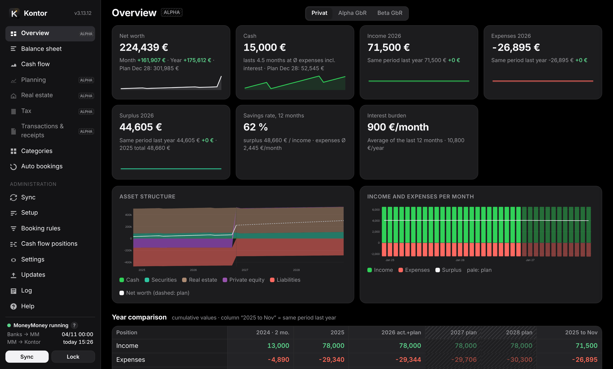

<a id="kontor-and-moneymoney"></a>
## What MoneyMoney does and what Kontor does

| MoneyMoney | Kontor |
|---|---|
| Fetches transactions and balances from banks, portfolios and payment services. | Reads this data through MoneyMoney's scripting interface. Kontor never sees bank credentials. |
| Categorises transactions, manually or by rule – the only place for categories. | Uses these categories. What has none yet you assign in Kontor; Kontor enters it in MoneyMoney and proposes rules. |
| Keeps offline accounts: private loans, equity investments, real estate, capital accounts. | Books only into such offline accounts according to your rules: mirror loan instalments and calculate interest, participations and account mirrors of your companies. |
| Has no balance sheet, no planning, no tax overview. | Balance sheet per area, cash flow checked against the balance sheet, rolling plan, real estate calculation, annual tax overview, receipts, Excel export, AI assistant. |

Kontor never changes bookings, the category tree or rules in MoneyMoney and never initiates transfers.

**Alpha**: pages shown faded and marked “Alpha” in the menu (currently Planning, Properties, Tax as well as Transactions & receipts) are usable but not fully tested yet – please double-check the figures there. So is the equity ratio in the balance sheet. Tested are Balance sheet, Cash flow, Categories, Auto bookings, Booking rules, Sync, Setup, Settings, Updates, Log and Help.

<a id="setup"></a>
## Setup

The “?” next to fields explain briefly; a click on one (on the iPhone: a second tap) opens the matching section of this help.

**Where things are** – a rule of thumb: what sets your figures is under **Accounts & rules** (accounts, areas, balances, cash flow positions, booking rules, tax). How Kontor works is under **Settings** (General, MoneyMoney sync, Access, Receipts, AI assistant, Updates, Backup & reset).

**Setup** is a guided path through exactly these pages: all building blocks in a sensible order, each shows whether it is done and opens its page. On the very first start Kontor opens it by itself. Required are MoneyMoney, areas and accounts – they build on each other –, the rest is optional and can be done any time; “Categorise” comes late on purpose, as it is the most work and booking rules and cash flow positions make it easier. Once the required steps are done, **Setup complete** hides it from the menu; “Check setup” at the top right of Accounts & rules opens it again. There “Check setup” reads MoneyMoney and reports whether all accounts and categories your settings refer to still exist – for example after you renamed something in MoneyMoney.

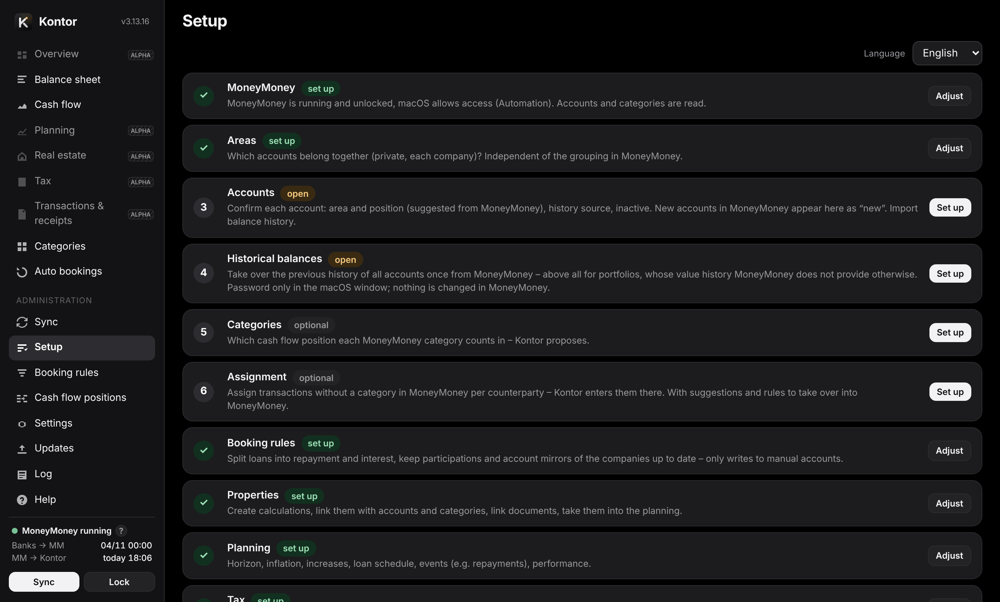

1. **As an app in the Dock** (optional) – Kontor in a window of its own: “Open the Mac app”, keep it in the Dock and go on there ([As an app](#app)).
2. **MoneyMoney** – MoneyMoney is running and unlocked; the first time, macOS asks whether Kontor may control MoneyMoney (Automation). Allow it.
3. **Areas** – which accounts belong together.
4. **Accounts** – confirm area, position and history of each account.
5. **Historical balances** – take over the past history from MoneyMoney once.
6. **Booking rules** and **Cash flow positions** (where each category counts; with a recommendation for your categories in MoneyMoney).
7. **Properties**, **Planning**, **Tax**, **Receipts**, **iPhone access**, **AI assistant**.
8. **Categorise** (give transactions without a category one) and finally **Sync and approval**.

After that, “Create report” builds the first report. Choose the language (German or English) on the login page, in the setup or under Settings → General. The appearance is set there too: dark (default), light or like the system – per device. Both take effect at once, without saving.

<a id="app"></a>
### As an app

On the Mac, Kontor builds an app of its own (`Kontor.app` in the program folder; the installation opens it): a window just for Kontor, without tabs and address bar, also opened through Spotlight. **Open the Mac app** is in the setup (step 1) and under Settings → General → As an app; to keep it in the Dock: right-click its icon → Options → Keep in Dock. In the app the menu leads everywhere (a two-finger swipe does not page back), exports and backups go to your Downloads folder, the icon in the Dock shows how many auto bookings are waiting, and macOS asks for the microphone only once ([Dictating](#assistant-dictation)). It shows Kontor only: links to elsewhere open in the browser.

If the app cannot be built (it needs Apple's command line tools), Kontor shows the way through the browser instead – Safari: File → Add to Dock; Chrome and Edge: “Install as an app”. On the iPhone: in Safari, Share → Add to Home Screen ([Access from iPhone](#iphone)).

**Keyboard shortcuts**: ⌘K shows or hides the assistant, ⌘S saves (booking rules; settings for MoneyMoney sync and receipts), ⌘P prints, ⌘R reloads the page. ⌘F searches – in the help and under Transactions & receipts in their own search field, elsewhere in the Mac app with a find bar (matches marked and counted; ⌘G and ⇧⌘G or ↩ go to the next and the previous one, esc closes it). Reliably only as an app – a browser mostly keeps these keys for itself: ⌘L locks, ⇧⌘R syncs with MoneyMoney, ⌘1 to ⌘9 open the pages in the order of the menu. The Mac app also has a menu bar, among others with ⌘, for the settings and ⌘+, ⌘− and ⌘0 for the size of the display. Where a shortcut works, the button's tooltip names it.

<a id="areas"></a>
### Areas

An area is a set of accounts with its own balance sheet, cash flow, plan, tax overview, transactions and receipts – for example “Private” and one per company. Suggestion: each top-level account group in MoneyMoney. You can assign, merge or leave out accounts and groups freely. One area is the main area (private); it is preselected on opening. Companies get a type and your share – Kontor uses the share for your stake and for tax. Type and main area are prefilled from the names; please check. Use ▲ ▼ to set the order in which the areas appear in the bar at the top. Areas can be renamed, deleted, merged or assembled from individual accounts and groups; accounts that belong to no area count nowhere.

<a id="accounts"></a>
### Accounts and positions

Each account gets an area, a position in the balance sheet and a history source. Kontor suggests everything; dashed means “suggestion chosen”, solid means “your own choice”. Once saved it stays fixed: renaming or moving in MoneyMoney changes nothing. New accounts appear as “new” until you confirm them. Accounts appear everywhere in MoneyMoney's order.


**Positions** (balance sheet rows, ordered by availability). For each account you choose how quickly and without a discount it turns into money – or whether it is a debt:

| Position | What belongs there |
|---|---|
| Cash | Current account, overnight money, credit card – available immediately |
| Securities | Portfolios with stocks, funds, ETF/ETC, derivatives, plus crypto and precious metals – sellable within days, with price risk |
| Term investments | Fixed-term deposits, P2P loans, building savings, life and pension insurance – before the end only with a waiting time or a discount; not counted as available |
| Real estate, equity investments, tangible assets | tied up long-term; equity investments include credit balances on capital and shareholder accounts (shareholder loans too) |
| Receivables | Loans to others, deposits |
| Liabilities | Loans, credit card debt, debts on capital accounts |
| outside net worth | Guarantees & sureties, “not on the balance sheet” |

Rule of thumb between securities and term investments: cash within a few days without a discount? Then securities, otherwise term investments. Kontor suggests a position – by portfolio, account name (e.g. “Immobilie”, “Darlehen”, “Kapitalkonto”, “Aval”, “Bauspar”), account type and group in MoneyMoney. Loans and deposits count as receivables when in credit and as liabilities when in debt. Capital and shareholder accounts (shareholder loans too) count as equity investments when in credit – it is risk capital that bears losses and only comes back when you leave – and as liabilities when in debt: in the company that is a debt to the shareholder. The value of a stake is then your share of the rest; together with the capital account that is your whole share, even with unequal contributions.

**Display**: “by activity” hides accounts without balance or transactions for N months; “always show” or “hide” fixes it. Hidden accounts still count in all totals.

<a id="history"></a>
### History of an account

Where an account's month-end balances come from:

- **Transactions** (default for bank accounts): month-end balance = today's balance minus all later booked transactions – the way MoneyMoney calculates it too. Pending transactions do not count. Before the first transaction there is no balance – unless the account existed earlier at 0 (balances taken over from MoneyMoney or your own, all 0, and no opening balance of its own): then 0 from there on.
- **Balances**: entered or imported balances are anchors; Kontor calculates the months in between from the bookings. Differences appear in the cash flow as “balance correction”.
- **Portfolios**: have no bookings. Kontor uses the balances imported from MoneyMoney and records each month itself afterwards.

Kontor estimates nothing. Clicking an account in the balance sheet opens its history panel with chart, month-end balances and checks; there you can enter balances or import them from a file. For portfolios, the holdings (quantity, value, gain/loss) are shown at the top.

The panel also checks the backward calculation: opening balance before the first booking in MoneyMoney, pending transactions, negative balances on accounts that cannot go below zero. Portfolios without imported history show “before … unknown”.

**Balances from a file** (Accounts & rules → Balances or the history panel): CSV or Excel (.xlsx), as a list (date, account, balance) or as a table with reference dates in the header row or the first column. Imported accounts are then set to “Balances”.


<a id="balances"></a>
### Historical balances

MoneyMoney does not provide the history of balances through its interface – especially for portfolios the past would be missing. So Kontor reads it once from MoneyMoney's database file: quit MoneyMoney, “Show in Finder”, drag the file `MoneyMoney.sqlite` into the window and enter the MoneyMoney password in a macOS window. Kontor only receives a key derived from it, decrypts only in memory, checks the values against the current balance and stores only month-end balances, encrypted. Nothing is changed in MoneyMoney. Importing again replaces the previous data.

**Names of the securities** (optional): after the import, another step appears below. If MoneyMoney knows a security only by its ISIN, you can have its name looked up. On a click, Kontor looks up the names once at OpenFIGI, a freely accessible directory of securities. Only these ISINs are sent (you can expand the list beforehand) – no amounts, quantities, accounts or names. It happens only on your click, never on its own (all outside connections: [Security](#security)). The step also lists all securities with an ISIN and their names (from MoneyMoney, otherwise looked up); there you can change names or fill in missing ones. Changed and looked-up names are stored separately – nothing changes in MoneyMoney – and can be removed again.

Importing again replaces all balances imported so far – no reset is needed beforehand. Securities for which MoneyMoney no longer keeps a name or an ISIN (often ones sold long ago) are called “Unnamed 1, 2, …” and cannot be looked up.

**After that Kontor records itself**: bank accounts are calculated exactly backwards from the transactions anyway. For portfolios Kontor notes the current value on every read. The service runs in the background, even without an open Kontor window – after the Mac restarts or after an update, once you have signed in to Kontor –, and reads within about 20 seconds as soon as MoneyMoney is open and unlocked – a quick look at MoneyMoney is enough. Each value counts for the month in which MoneyMoney retrieved it from the bank. If MoneyMoney retrieved data while Kontor was not running, or a month is missing, Accounts & rules → Balances points it out; it also shows per portfolio from when Kontor knows values.

<a id="sync"></a>
## Sync

The data has two stages: **banks → MoneyMoney** (MoneyMoney fetches from the banks) and **MoneyMoney → Kontor** (Kontor reads from MoneyMoney). Both times are shown at the bottom left. “Sync” (as an app: ⇧⌘R) reads immediately; automatically Kontor reads every 30 minutes (adjustable) and as soon as MoneyMoney has new data – only while MoneyMoney is running and unlocked (Kontor does not start it itself). After the Mac restarts or after an update, syncing waits until you have signed in to Kontor once.

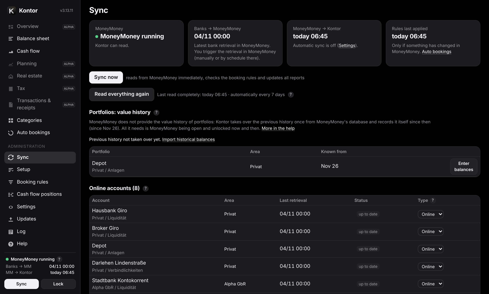

- **Quick read**: a sync only reads the transactions of the last 30 days and takes older ones from the last complete read.
- **Check**: Kontor checks every balance. If it does not match the transactions read, something older changed in MoneyMoney – e.g. a late booking with an old date or a deleted transaction. Then Kontor reads everything at once (at most every 12 hours).
- **Complete read**: every 30 days (adjustable) and with “Read everything again” – also at once when the category tree in MoneyMoney changes or newer transactions get another category (then you probably re-sorted older ones too). Kontor's own bookings need none: Kontor keeps them until then. Only a single changed category of a transaction older than 30 days appears just then – use “Read everything again” for that.
- A bank refresh without new data does not trigger a recalculation.
- **Read transactions** (Settings → MoneyMoney sync): how far back Kontor reads; 0 = all (recommended).

Settings → MoneyMoney sync reports accounts MoneyMoney has not refreshed for more than a day (with the number of days). There, side by side, are **Sync now** (reads at once, checks the booking rules, recalculates) and **Read everything again** (reads all transactions completely – only needed when something older changed in MoneyMoney), and the way to the [log](#log).

**Online or offline** (Accounts & rules → Accounts, column “Type”): online accounts are refreshed by MoneyMoney from the bank, offline accounts you keep by hand (loans, participations, properties …). Kontor needs the difference for two things: it books only into offline accounts, and only online accounts count for how current the data is – MoneyMoney gives an offline account a new refresh time after every booking, which would otherwise look like a refresh. Kontor recognises the type itself (never refreshed, without bank and account number, created as offline account or booked by Kontor); the tooltip names the reason and, for online accounts, the last refresh. Change it only where Kontor is wrong – say a manual account with a bank code typed in; the change applies at once. If MoneyMoney is closed or locked, nothing happens – the next sync catches up.

<a id="tables"></a>
## Tables, switches and Excel

Everywhere you choose **months** (with annual totals) or **years** only. Year columns are cumulative: flows as a sum, balances as the year-end value. The current month and the current year (not yet complete) are faded, plan values faded and hatched.

- **▸ in the header cell** of the balance sheet expands all positions; the **eye** next to it (with a count, only when there are any) also shows empty accounts and those hidden by activity (they are always counted). “(9/12)” at a position means 9 of 12 accounts are shown. **Empty rows** (cash flow, planning) also shows rows without values.
- The **month view** shows the current year and the one before; **‹ from 2025 ›** next to “Months / Years” starts it a year earlier or later, “Years” shows all years. In the cash flow the last finished month is in view when it opens: depending on the width, beside it the running month, the month before and from four columns the first plan month (from eight the first two). Clicking an earlier month in the balance sheet chart adds it as well.
- **Plan** (cash flow) appends the plan values on the right; off = actual values only. Balance sheet and planning always show the plan.
- **inflation-adjusted** (planning) shows plan values in today's purchasing power.

Every table has an **Excel** button: balance sheet, cash flow, planning (with projection and parameters), tax, transactions (as filtered, every match), portfolios, accounts and every property calculation.

**Right-click** a figure, a row or a column heading: **Copy value**, **Copy row** or **Copy column** (rows and columns as a table you can paste into Excel or Numbers); a chart: **Print chart …**. With the [AI assistant](#assistant) switched on, above them are **Explain briefly** – a sentence or two at once in a small box at the pointer, not in the chat – and **Ask in the chat**: the place then stands as a reference before your question, and a click on the reference goes back there and marks the figure or row. Holding shift shows the browser's menu instead.

<a id="balance-sheet"></a>
## Balance sheet

The balance sheet shows the assets of an area by position, month by month or year by year, with a plan up to December of the last plan year: the main chart at the top, the table below it (so opening rows does not move the chart) and three single charts at the bottom (movable with the arrows). **Months or years** (top left) applies to all of them.

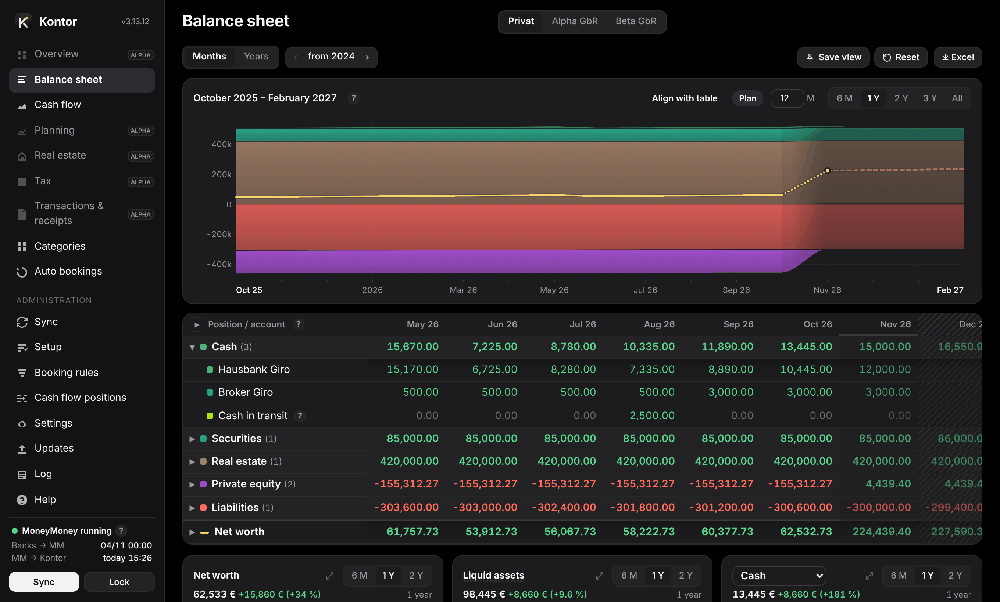

**Ranges and display**

- Values are balances at month end; the current month shows the current balance.
- The charts end with the last completed month and count from month end to month end: in November, “1 Y” runs from October of the previous year to October, so the change covers exactly twelve completed months. The first and the last month are always labelled on the time axis; the value applies to the end of the range, the change (in € and %) since its start – in the main chart too, only the balance sheet shows no value and no change. The shortest range is one month (change to the previous month).
- To the right (by swiping or with “All”) follows the running month, dotted and with a soft shade leading over – actual data is already coming in –, then the plan, dashed and shaded. The dashed vertical line marks the end of the last completed month. In the table the running month or year is faded, the plan faded and hatched.
- Colours: positions by availability, from cash (green) to equity investments (violet); accounts in variations of their position's colour (hatched from the eleventh account), the same in the table and the charts. Net worth is golden; the golden dash in front of it in the value tip and in the table stands for its line.

<a id="balance-sheet-table"></a>
### Table

- Click the **name** of a position to expand its accounts (**▸** in the header cell: all positions; **▸** in front of a portfolio: its securities). Click the name of an account to open its history (view and edit month-end balances); a second click closes it again; the same for a security.
- Click a **value** to make its area and month light up briefly in the main chart (the chart moves to the month if needed) – and also opens or closes the row of a position, a portfolio or the net worth. Clicking a month heading moves the chart so that the month sits exactly above the column; so does a click on a net worth value, and its dot in the chart blinks briefly. The single charts keep their length and end with that month – so they show the change up to it. The page itself stays put. Hovering over a name marks the same area in the chart.
- The **eye** in the header cell (only when there are any, with a count) also shows empty accounts and securities and those hidden by activity – they are always counted. What counts as hidden is set under [Accounts & rules → Accounts](#accounts) (column “Display” and “By activity … months”, default 12); securities without a value in that period count as hidden too. “(9/12)” means 9 of 12 are shown.
- **Portfolios**: past months from the balances read from MoneyMoney (otherwise from Kontor's monthly record), the current month from MoneyMoney; what the securities do not explain is shown as “Other”. Hovering over a security always shows MoneyMoney's name and the ISIN, and whether the name was looked up or changed. Rename accounts in MoneyMoney – Kontor takes the names from there.
- Year columns show the balance at year end (the running year: today, with “Plan” the planned December). The month view has no year columns – they would only repeat December; a thin line separates the years.
- Drag the right edge of the first column to make it wider or narrower (double-click: default width); the width is part of the view.
- **Equity ratio** (alpha; a click on “Net worth” opens the key figures below it): how much of your assets you own free of debt – equity ÷ (equity + debts). Looking through your companies: their debts count with your share (areas) if the participation is entered under Booking rules → Companies, otherwise the ratio would look too good, because the bank loans sit there. Debts are accounts with a negative balance; capital and shareholder accounts are equity, participations themselves never debts. How you book capital accounts changes nothing. Participations without this entry count with their value only; if accounts of a company are in no area, the ratio is unknown. A click shows the month's calculation step by step.
- Below net worth, guarantees (not in net worth) are collected in one expandable row.
- **Cash in transit**: If the two bookings of a transfer between your own accounts fall into different months (debited on the 31st, credited on the 1st), the amount counts as “cash in transit” to cash at the month end – otherwise net worth would briefly look too low. A click on the name shows the detected booking pairs, a click on a month only those under way at its end.

<a id="balance-sheet-chart"></a>
### Main chart

Any of the four charts can be the large one: the ⤢ symbol in a small chart swaps it with the large one (default: the balance sheet).

- Range depending on the view – months: 6 months, 1, 2 or 3 years (default 1 year); years: 1, 3, 5 or 10 years (default 3 years) –, all or a number of months of your own.
- As the balance sheet, the main chart also shows about a third of the range ahead: the running month and the plan (with 1 year the running month and three plan months, with 3 years twelve months). **Plan** left of the ranges turns this off; the setting is part of the view. The number in the field next to it counts the months up to the last completed one, the plan comes on top. The amount axis has at least five grid lines.
- Hovering shows the month's values in a slightly see-through tip; the area under the pointer and its row in the tip stand out. Over the month axis the values appear without marking an area.
- A click on an area works as in the table: a position opens into its accounts, a portfolio into its securities; a click on an account or a security closes the position again. Afterwards, what opened is marked until the mouse moves. A click beside it or on the month axis jumps to the month in the table.
- Swipe (on the month axis too) to pan, pinch to zoom, drag to select a range, double-click beside the areas to enlarge. Drag up/down on the amount axis to zoom the value range in/out (the wheel moves it), a tap or click there makes it automatic again. On the iPhone two fingers pan and zoom, one finger shows the values. The same applies to the single charts.
- **Align with table**: every value sits right above its column. The chart scrolls with the table, swiping or dragging on the chart scrolls the table, and the scale follows the visible columns. The value tip is dropped – the values are right below.

<a id="balance-sheet-charts"></a>
### Single charts

Below the table:

- **Balance sheet** (when another chart is the large one): without the value line, a little taller instead.
- **Net worth** alone, with the average per month, the high and the low below. Hovering shows just the month and the value.
- **Selection**: the sum of freely chosen positions (default: cash, securities and term investments – savings & investments). The title names the selection in words – typical combinations by their name, otherwise combined like “Savings & investments + Liabilities” or “Net worth excluding Private equity”, with shortened words when space is short; the line has the positions' mixed colour. The names build up step by step – hovering over the title shows the same, there only with the positions the area has:

```
  Cash
+ Securities
= Liquid assets
+ Term investments
= Savings & investments
+ Private equity
+ Receivables
= Financial assets
+ Real assets (Real estate + Tangible assets)
+ Other
= Gross assets
+ Liabilities
= Net worth

Tied-up assets = Gross assets − Liquid assets
```

Financial and real assets are split as in the Bundesbank's statistics: participations count as financial assets, even if the company holds real estate; crypto and precious metals sit under securities in Kontor and so in financial assets. There is deliberately no “current assets” – that depends on how long you mean to hold something, not on how fast it turns into money.

- **Composition** of a chosen position by account (stacked). **Holdings** next to it breaks portfolios down into their securities (only where available); below, accounts or securities can be deselected one by one – the line of the position stays, and hovering also shows the sum of the selection.
- Each has its own range (depending on the view 6 months, 1 or 2 years or 1, 3 or 10 years) and an axis that adapts to the visible values (at least four grid lines) – so you can see the development even when large positions such as receivables and liabilities cancel each other out in the chart above. The area reaches to the zero line, so upwards for negative values. The value tip is slightly see-through so the line beneath stays visible. Below the range buttons stands the length of the range shown (beyond two years in years and months, e.g. “2 years 8 mo.” or “2½ years”) – the value and the change refer to it; after zooming, a button is marked again as soon as the length matches.

**Layout and saving the view**

- The small arrows **↑ ↓** in the header of the table and of the main chart (on hover) move them up or down, also below the single charts.
- What you change while viewing (months or years, ranges, plan, expanded rows, the eye, width of the first column, layout, which chart is large, selections in the charts) lasts only until the page is reloaded. **Save view** (top right, next to Excel) keeps the current view on this device, separately for months and years (e.g. months with 2 years, years with 10 years). The one saved last opens at the start; switching between months and years takes their saved ranges. Ranges always end with the last completed month, and the table shows the current month as always. **Reset view** restores Kontor's default. The area is not affected.

<a id="cash-flow"></a>
## Cash flow

Where the money goes – as a cash flow statement, for every area in the same outline, so that private, partnership and limited company can be compared:

| Section | Content |
|---|---|
| **Surplus** | **Income** minus **expenses** of everyday life or business (for companies the operating cash flow; unlike a cash-basis profit statement without depreciation and without interest paid), each by fixed positions (earned income, revenue, rental income, housing – “premises” for companies –, staff, taxes, VAT …); in them your MoneyMoney categories. Interest and dividends received count here. |
| **Investing** | Buying and selling assets, by kind: real estate (with costs of purchase), securities & deposits, participations, loans granted; below them the single accounts. The money leaves the bank account but stays wealth. |
| **Financing** | Payments to and from lenders and owners, by kind: loans taken up, repayment, interest, for companies partners' contributions and withdrawals; below them the single loans. A loan paid out is a loan taken up, not a “negative repayment”. |
| **Free cash flow** (FCF, from the level “positions”) | surplus and investing together: what is left after living costs and investing – or, if negative, what had to be financed |
| **Change in cash** | the three together (and what is unclear); opened: the cash at the start and at the end |
| **Changes in value** | what changes without a payment: prices of portfolios, value adjustments, corrections by hand, [investments without target account](#positions-recipients) |
| **Change in net worth** | surplus, interest, contributions and withdrawals, changes in value – investing, taking up and repaying loans only reallocate |

A row shows only where there is money in it. How far the table is opened you choose in its header cell, right above the triangles, with four symbols – the deeper indented, the further opened (on the iPhone the large triangle there opens a level further with each tap, and finally closes again): **Main lines** (only the three cash flows, bank balance and changes in value), **Overview** (the three cash flows with income, expenses and the kinds of investing and financing – the whole cash flow on one page), **Positions** (with the positions, accounts and loans) or **Details** (down to the MoneyMoney categories). It opens on the main lines, with income and expenses already open. Every row with ▸ also opens and closes by itself – with a click on its name or a double-click (or a long press) on one of its figures. A click on a figure shows the transactions behind it in a side panel, also for rows that sum up others (everything unclear in a month at once, say, or a transfer whose other side is missing); the cash flow stays, “Open in Transactions & receipts” leads to the page with the filter, to correct something, say. Figures without transactions behind them (plan, valuations) cannot be clicked. Movements carry their sign (+/−), balances none. “Change in net worth” opens to its start and end like the cash. The “?” at a row explains it. The gear next to it leads to the cash flow positions.


<a id="cash-flow-charts"></a>
### Charts

Below the table, charts show the same figures for a period you choose above them: on the left from–to (a click on a month opens a small calendar of the year; ‹ and › move the period by a month, as do two fingers sideways over the monthly cash flow; a click on a month heading of the table sets the 12 months up to it, and marks that heading), on the right the last twelve months (default), the running year (its closed months) and the two years before. By default it ends at the last closed month – a month just begun would look too cheap next to whole ones. You can go on into the running month and the plan, though: those months are hatched in the charts as in the table, plan months count with their planned figures. Colour stands for the activity – operating, investing, financing – as at the table's sections; income and inflows are green, expenses and outflows red:

- <a id="cash-flow-bridge"></a>**Cash bridge** – from the cash at the start to the cash at the end: each bar starts where the one before ended (inflows green, outflows red). For each activity (surplus, investing, financing) a bracket in its colour spans its parts – it is no step of its own but their sum. A click on a row with ▸ splits it further (positions, categories) and turns it into a bracket itself, ▾ folds it back into one bar; beside it the amount and the change against the year before – green or red only for income and expenses (more income, less expenses: green); for investing, financing, interest and changes in value without a colour, since it cannot be said whether more or less is better. From 1,000 % on it is shortened (+2k%). At the top an amount axis: drag across the chart to enlarge that range; “Whole bridge” beside it or a click on the axis shows everything again. Opening and closing cash are the cash of the balance sheet (the sum of your liquid accounts at the end of the month): a click on them – or on a figure in the table rows “Cash at start/end” – shows it in the balance sheet, the cell lights up briefly; in the net worth bridge the same for net worth. The names keep their width when you open something; long names of parts are shortened and shown in full on hover.
- <a id="cash-flow-months"></a>**Monthly cash flow** – income and other inflows up, expenses and other outflows down, stacked by kind; below, set slightly apart and on a scale of its own, the change in net worth, split as at the bottom of the table – change in cash, moves between accounts, changes in value, in the same quiet colours as the dots there. In both parts a short dashed stroke marks the month's result (above the change in cash, below the change in net worth); close to the zero line it is left out. The first and the last month are always labelled. When single months are far larger than the rest (a property bought, say), the scale follows the rest; those bars are cut, marked with two strokes and labelled with their height. Dragging or scrolling up or down on the scale at the left (upper and lower part) zooms it in or out – the scale is marked then, a click on it sets it back; what no longer fits is cut the same way. With more than three years per year.
- <a id="cash-flow-wealth"></a>**Net worth bridge** – below the cash bridge: from the net worth at the start to that at the end, built like the cash bridge but only with what changes net worth – surplus (income, expenses), interest (financing in the cash flow, but it reduces net worth), contributions and withdrawals, changes in value per account (portfolios, properties, participations). Investing and repaying are left out: they only move money between your accounts. If the balance sheet shows more than these rows explain (an unknown balance, say), the difference stands as a step of its own, “Balance check”.
- <a id="cash-flow-total"></a>**Total cash flow** (a Sankey diagram of the sources and uses of funds) – on the left everything that came in (income, loans, sales, less cash), on the right what it was used for (expenses, investments, repayment, interest, more cash); each band as wide as its amount, both sides add up to the same total (above the middle, the period and its length small above it – where room is short, only the length). It is as tall as the chart beside it. Money carries no label, so all bands meet narrowly in the middle instead of tying an income to an expense; their colours blend there. Wide bands carry their share. Flows under 3 % stand together under “Others”; a click on a name with ▸ opens its parts (categories, accounts), a click on ▾ or on one of the parts (band or name) closes them again; a click beside the bands (also on the total or the period) opens all parts; with something already open it closes everything. Hovering a band or name fades the others, and above the chart stand the exact amount (bold), share, period before, change and the parts.
- <a id="cash-flow-ring"></a>**Expenses compared with the year before** – expenses by position as a ring (switchable to income, then in green), the darker the larger the share; where there is room, it stands small in the slice; the period before is the same months a year earlier (for more than twelve months, further back accordingly); in the middle the total and its change, small above it the length of the period (e.g. “1 year”), beside it each position's amount and change (without a period before it is called “What expenses are made of”). Hovering the middle names both periods and amounts; hovering a slice shows its categories in an outer ring. A click keeps the slice open and labels its categories – a click on one of them shows its transactions; a second click on the slice, a click beside it or Esc goes back. A change of ±0 % means the same amount, from 1,000 % on it is shortened (+10k % = about 10,000 %); in the tooltip only the amount is bold; “Others” show a change only where each of them has a period before.
- <a id="cash-flow-heatmap"></a>**Expenses by month** – in one card with the ring and switched to income with it (the switch is at the right): one strip per position, the darker, the more that month. Every position is on one scale, so a large one stands out against a small one; annual payments stand out. Single huge months do not fade the rest: the scale follows the usual months – the highest of them has the strongest colour. Outliers above it have it too, plus a frame and their amount (rounded) in the cell – ▲, ▲▲ or ▲▲▲ if the cell is too narrow, the more the further above; the tooltip gives it exactly. Below, a row with all of them together (“All expenses”) on a scale of its own. On the right the average per month (more than two years: cells by quarter); hovering a cell shows the same month a year before with the change and, below a line, which categories made up that month, a click the transactions (in the side panel; a click on a name shows those of the whole period; from there under “Transactions & receipts”, the filter is shown at the top and can be cleared; estimated uncategorised ones are not included). A click in the “All expenses” row shows all of that month’s transactions in this direction – all categories as one filter, plus those without a category (except payments between your areas). At the top right you switch from **Amounts** (default) to **± year before**: each cell then shows the change against the same month a year before – green better, red worse, the stronger, the more; ±0 % grey. The scale ends at 100 % at most, so that usual changes of a few percent can still be told apart; what lies above has the strongest colour, a frame and its change in the cell (from 100 % whole percent, from 1,000 % shortened, e.g. +1k%) – or ▲ to ▲▲▲ (▼ for a decrease) if the cell is too narrow. With nothing the year before there is a ✦ for “new” in the strongest colour, without a frame. An empty frame means: the year before is not known. On the right then the change of the whole period. The tooltip stays the same (amount and year before).

Hovering a column or bar shows the exact amounts; the running month and plan months are hatched, in the bridges the bars as soon as the period contains them. You change the order of the charts with ↑ ↓ beside the title (on hover); “Reset view” above the charts brings back the default: cash bridge and monthly cash flow, below them net worth bridge and total cash flow, last the comparison with the year before and expenses by month.

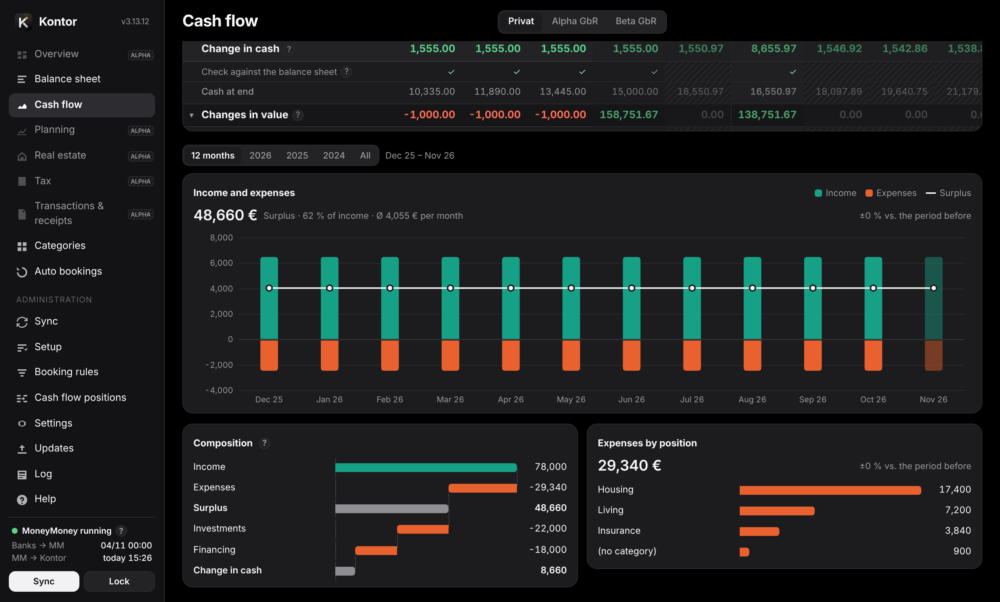

Every transaction counts exactly once. Transfers between your own accounts never count as income or expense (a category named “Umbuchung”, “Übertrag” or “Eigene Konten” is recognised; set one with another name to “Transfer” under cash flow positions): Kontor finds the counter-booking of each – by the mark of its own bookings (the repayment names the payment), by the counterparty IBAN (same amount, at most five days apart) or, for the category “Umbuchung” and for manual accounts, by the amount (at most three days; up to a week when both bookings have the category – PayPal, say, books on the day of purchase and the bank days later). Two transfers on the same account that undo each other in the same month (a top-up booked back) together count as nothing. Payments into another area are **contributions or withdrawals** – unless you paid for something: with a category whose position you chose or whose name clearly says it (your salary from your own company, rent to your own partnership) they count in that position (a category Kontor does not recognise for sure and you did not place is marked “between areas” under cash flow positions – its proposal “Other …” does not apply to these payments yet), without a category Kontor estimates from the purpose; if you hold a participation in a company, the difference between the money paid in and the value of the participation shows under changes in value. Accounts in a foreign currency are not converted; the balance sheet shows them outside net worth. If an account starts later with an **opening balance** in MoneyMoney, that counts as a transfer when another bank account shows exactly the opposite amount in the same month (say, the remaining debt of an old card), otherwise as a row of its own, “Opening balance”, under changes in value.

The **check against the balance sheet** compares every month: the change in cash with that of the liquid accounts, the change in net worth with that of the balance sheet. When everything matches to the cent, there is no mark; where a month differs, a small “✱” stands at the figure, and a row “Check against the balance sheet” gives the difference (each inside its opened row, before the figure at the end – it is added); hovering over it names the reason – for example money in transit to a loan over the month end, or a category set to “Leave out”; a click shows the reasons and the bookings behind them in the side panel. What Kontor cannot assign with certainty – such as a transfer without a counter-booking – shows under “unclear” and counts with its amount.

Which position a MoneyMoney category counts in, Kontor proposes from its name; you change it under [Cash flow positions](#categories-positions) (Accounts & rules, or the gear in the header cell of the cash flow table). Transactions **without a category** are estimated: first from your categories so far (same counterparty, same purpose), otherwise from words in name, purpose and booking text (such as “Gehalt”, card settlements; for the tax office Kontor separates wage tax – part of staff for companies –, VAT and other taxes). They show in the position as “no category, estimated”; what cannot be estimated shows under “(no category)”. The more you assign, the more exact it gets – it is not required, not even for a limited company with many bookings. Kontor enters nothing in MoneyMoney for this.

<a id="categories"></a>
## Categorise

**MoneyMoney is the only truth.** Kontor has no categories of its own: it shows MoneyMoney's and helps fill the gaps. Subcategories follow their parent after “›” (Wohnen › Miete); a “/” is part of a name.

| In MoneyMoney | In Kontor |
|---|---|
| create and rename categories | assign what has no category yet – Kontor enters it in MoneyMoney |
| fixed rules (settings of the category → rules) | propose rules for you to paste there |
| | decide which cash flow position a category counts in ([Cash flow positions](#categories-positions), linked at the top right of the page) |

The page has three tabs: **Open** (what has no category yet), **Rules for MoneyMoney** and **Entered** (what Kontor entered in MoneyMoney).

**Open** shows all transactions of your bank accounts without a category in MoneyMoney – only the areas you tick at the top (at first the private ones; leave out a company with very many bookings, say, Kontor keeps estimating its positions in the cash flow; your choice is kept) –, grouped by counterparty (loans, participations and other accounts count by their position, not their category). Transfers between accounts of the same area are not in the list – not even when the counter-booking was entered by hand in a manual account: they are never income or expense. Payments between two of your areas are in it until they have a category: assign salary or rent, give a contribution or withdrawal your transfer category. The suggestion comes from your categories so far; Kontor never takes it over by itself. “Assign” enters the category in MoneyMoney, “Take all suggestions” all at once. Under “Transactions” you deselect single ones – for example for a shop where you buy different things. You choose only from categories that exist in MoneyMoney – create a new one there. Single transactions can also be assigned under Transactions & receipts (click a row or select several); there you can also change a category from MoneyMoney (after asking). In cash flow, “assign” next to “(no category)” leads straight here.

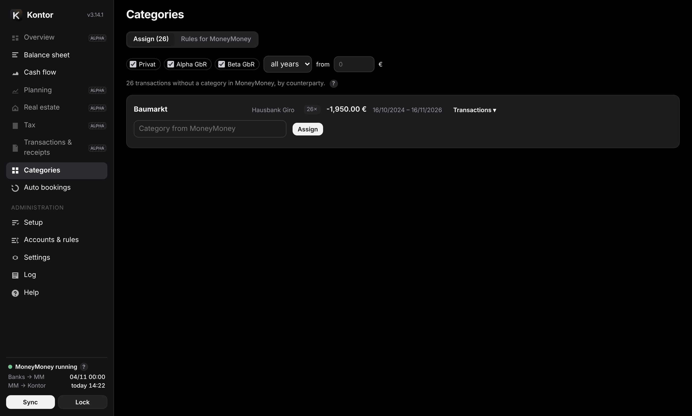

If you rearrange things in MoneyMoney – a category renamed, moved or deleted, transactions dragged into another category – Kontor reads all transactions again at the next sync; your cash flow position stays with the category.

What you assign from an added iPhone, Kontor on the Mac enters at once, as there ([with Face ID](#iphone-devices)). What waits for the next sync (MoneyMoney locked) counts already (⏳ in the transaction list). MoneyMoney's default category “Uncategorised” counts as no category.

<a id="categories-rules"></a>
### Rules for MoneyMoney

If you assign a counterparty several times in Kontor, MoneyMoney evidently has no rule for it. Kontor proposes one under Categorise → Rules for MoneyMoney – in MoneyMoney's syntax, for example `name:"Baumarkt*"` or `remote_account:"DE…" AND purpose:"miete"`. If the same counterparty also has other categories, Kontor adds words of the purpose or the direction of the payment; it proposes only what matches no transaction of another category. Copy the expression, paste it in MoneyMoney into the settings of the category under rules and choose to apply it only to uncategorised transactions – then “Done”.

<a id="categories-write-back"></a>
### Entering in MoneyMoney and taking back

There is no switch for it: your click on “Assign” is the release – Kontor enters only what you assign yourself, never on its own. Safeguards:

- Kontor sets only the category field of a transaction; amounts, dates and deleting are not possible this way.
- Right before writing, Kontor reads the transaction again from MoneyMoney and writes only if it is unchanged and has no category yet (or the one Kontor set).
- An existing other category is replaced only after asking; otherwise it stays.
- Kontor never creates or changes categories or rules in MoneyMoney.

**Entered** lists every category Kontor entered – newest first, with the transaction, the category before and the one entered. Pick one or several and **take them back** (only at the Mac, after asking): MoneyMoney gets back the category that was there before Kontor (none: “Uncategorised”) – also when Kontor changed the same transaction several times. For this, Kontor again reads the transaction right before; if MoneyMoney now shows another category (changed by you), it stays, and the row is faded and marked. Transactions outside what Kontor reads cannot be taken back here.

<a id="categories-positions"></a>
### Cash flow positions

The cash flow has a fixed outline; your MoneyMoney categories count in it. Accounts & rules → Cash flow positions is this mapping: on the left every MoneyMoney category with transactions and the sum of the last twelve months, on the right its position in the cash flow:

- **Automatic** – like the category above it, otherwise Kontor's proposal from the name (such as “Einkommen › Rückzahlung Finanzamt” → refunds, “Sparen” → saving & investing).
- A position you choose also counts for all categories below it that have none of their own.
- **Saving & investing** is no expense; under **Target account** next to it you choose the account the money goes into (for this position only; more precisely per recipient, see below). **Transfer** – money between your accounts or areas, neither income nor expense – looks for the counter-booking. **Leave out** takes the category out altogether: its amount counts in no row and shows as a difference in the check against the balance sheet (with this reason) – only for exceptions such as a wrong booking that is reversed later.
- A property's categories (Real estate → category) have rows of their own in cash flow, “rent” and “costs”.

Planning plans every position and the categories in it; a MoneyMoney budget counts for its category. Nothing changes in MoneyMoney. The column headers stay in place as you scroll.

<a id="categories-tree"></a>
### Recommended categories

Above the table stands what Kontor needs from your categories in MoneyMoney – open during setup. The basic rule: **one category per purpose**. What belongs in different positions never belongs in the same category – a category “Immobilie” holding purchase price, costs, loan rate, loan payout and rent, say, turns the payout into rental income and the purchase price into costs. Better:

| Category in MoneyMoney | Position |
|---|---|
| Gehalt, Kapitalerträge, Wohnen › Miete …, Lebenshaltung › …, Mobilität, Versicherungen … | the one of the same name each |
| Sparen › one per investment (portfolio, fixed deposit, pension plan with capital …) | Saving & investing, target account per subcategory |
| Darlehen › Tilgung, Zinsen | Repayment, Interest |
| Immobilie ‹name› › Miete, Kosten | the property's rows (Properties → category) |
| Immobilie ‹name› › Kauf (purchase price, costs) | Saving & investing (choose it), target account: the property's account |
| Umbuchung | Transfer – between your accounts and areas, also contributions and withdrawals |

Kontor recognises these (German) names and proposes the position itself; a ✓ means one of your categories counts there already. You create them in MoneyMoney – Kontor creates no categories. Payments between two of your areas (a contribution to your partnership, say) count as a contribution or withdrawal as long as their category is no income or expense – clearest with “Umbuchung”. If you also book them against a manual capital account (at home a participation or receivable, in the company a liability), Kontor links the payment with that counter-booking: the net worth stays, no change in value arises.


<a id="positions-recipients"></a>
### Target account by recipient

When you transfer to an account of your own in MoneyMoney, Kontor finds the counter-booking itself. Not so for money that arrives as a booking on none of your accounts, such as a portfolio or a pension plan kept by their balances only. For those, all recipients of such payments under “Saving & investing” are listed below the table with category, count and sum. Kontor chooses the **target account** in this order: your choice per recipient, otherwise the category's target account (also for its subcategories), otherwise the area's only portfolio. Where “automatic” shows the right account, nothing is to do; recipients without a target account are marked. Per recipient you choose:

- **Automatic** – as just described; the result stands in the menu.
- **An account** – applies to every payment to this recipient, whatever its category; this comes before the category's target account. This way one category such as “Sparen” can go into several accounts (say, a portfolio at one bank, another at a second).
- **No account in MoneyMoney** – the money leaves the net worth Kontor sees.

Where it is clear, Kontor proposes a portfolio (the same bank as the recipient's IBAN, or a word shared in the name); it counts only once you take it over and save. Money without a target account does not count as price gain: in cash flow it stands under changes in value as a row of its own, **Investment without target account**, which offsets the portfolio's rise, with a link here – so the net worth is right even without a target account, only payments and growth are not told apart. An account that no longer belongs to the area is named under Setup; then the automatic choice applies again.

<a id="planning"></a>
## Planning

Planning continues the past – by rules on three levels: the **area's default** (one rule for income, one for expenses, under Parameters), the **position** and the **category** in it. The deepest level that sets something counts – method and increase each on its own. A position with categories is the sum of its categories; each category follows the position until it gets a rule of its own (level “Details”).

- **Method**: Ø of the last 12 or 6 completed months, same month last year, fixed amount per month, annual amount (÷ 12), MoneyMoney budget (without a budget: Ø 12 months), none. A fixed amount or a budget of the position is shared by its categories by their share of the last 12 months (refunds get none of it).
- **Increase**: default (income: “Income increase”, expenses: “Expense increase” or else the inflation), none or own % p.a.
- **Planning model**: Even, Careful, As last year or Budget sets the area's default with one click (what each does is in its tooltip).
- **Own values**: double-click a plan cell, a category's too; the rule goes on for the other months, ↺ brings back the suggestion. An own value of a position is shared by its categories without a value of their own.
- **Asked first**: when you change a rule with values or rules of your own beneath it, Kontor lists them with the new value – **Keep** or **Replace**. Without your choice nothing is replaced; the same goes for the assistant's proposals.
- **Traceable**: every plan cell shows on hover how it comes about – base, increase, result and where the rule comes from; a right click gives the assistant the same.
- **Key figures** over the next 12 plan months: savings rate (surplus ÷ income), runway (bank balance ÷ planned fall per month), interest burden (loan interest ÷ income).


- **Loans**: interest on the projected remaining balance, repayment = instalment − interest.
- **Value development** per account in % p.a.; equity investments optionally linked to the planned net worth of the company (share × net worth).
- **Events**: one-off or recurring moves, income and expenses – e.g. repaying a loan in one go from the portfolio.
- **Real estate**: active calculations contribute rent, costs, interest, repayment, remaining debt and property value.
- The plan always runs to December; “inflation-adjusted” shows plan values in today's purchasing power.
- The projected balance sheet per position and account is in the plan columns under Balance sheet (with “Plan”) and in the Excel export. The plan applies per area.

<a id="properties"></a>
## Real estate

Any number of calculations (scenarios) per property, one of them active. Inputs:

- Purchase price and transfer date; incidental costs (real estate transfer tax, notary, land register, broker; immediately deductible items separate); building share and depreciation rate or remaining useful life.
- Net cold rent and service charges, vacancy, rent adjustment (index rent by CPI with pass-through factor and threshold, fixed rate or none); non-recoverable costs and reserve (with CPI or fixed rate).
- Loans: annuity, amortising or bullet; settled monthly like banks or annually on the 1 January balance like vendor loans; special repayments recurring or single, fixed-rate period with follow-up rate, maturity with repayment.
- Partners with share and tax rate, distribution, value development, sale year.

Kontor rejects invalid inputs with the field name.

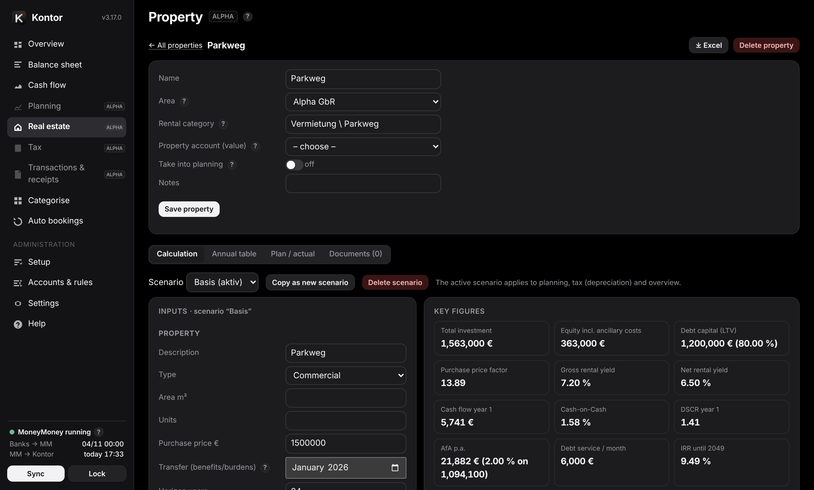

Result: monthly and annual table (rent, costs, interest, repayment, depreciation, taxable result, tax, cash flow, wealth build-up, remaining debt, property value), key figures (price multiple, gross and net rental yield, cash-on-cash, DSCR, LTV, IRR until sale) and notes (open maturities, missing follow-up rate, negative cumulative cash flow). Links to MoneyMoney: rental category and loan accounts for the plan/actual comparison per year, property account for the value in the balance sheet. “Use in planning” feeds the plan of the area; the depreciation of the active calculation goes into the tax overview as long as no annual value has been entered there by hand. Excel export per calculation. Documents (purchase contract, appraisal …) are stored as links – the files stay where they are. Simplified: tax per partner = share × result × tax rate (no progression, no loss offset), straight-line depreciation.

<a id="tax"></a>
## Tax

Per entity (main area = private, each company with your share from the areas) and year: rental income per property from the categories `Vermietung \ Object \ Type` (any number of properties, private ones too), loan interest per loan (mapping loan → property under Accounts & rules → Tax), depreciation, tax items from category names (adjustable under Accounts & rules → Tax) and bookings without category as items to check. A year's receipts can be exported as a ZIP with an overview. No tax advice.

<a id="receipts"></a>
## Transactions and receipts

The transaction browser shows all filters at the top at a glance, in three rows: area, year, account and search; direction, “without receipt”, “without category” and period (from–to); categories (with their subcategories) – after a click in the cash flow's heat map they are already set. Add receipts (PDF, images, e-mails, Office files) by choosing a file, drag & drop or a photo on the iPhone. They are stored as normal files in the receipts folder (default `~/Documents/Kontor-Belege`, subfolders by a pattern, e.g. `{year}` or `{year}/{entity}`), file name `Date_Amount_Name_ID`. Files outside the folder (also iCloud Drive) can be linked without copying them – Kontor shows whether the file is local or still downloading from iCloud. Existing files in the receipts folder can be assigned later (links in it that point outside the folder don’t count – link such files like any other file outside). Up to 60 MB per file. The index is stored encrypted in the data folder; the files remain usable without it. Deleting in Kontor never affects linked files. Kontor links receipts only on its side: MoneyMoney gets no reference to them. You can also give a receipt to the [assistant](#assistant) – it looks for the matching transaction and proposes to file it.

<a id="rules"></a>
## Booking rules

Booking rules set what Kontor books automatically into your offline accounts in MoneyMoney:

- **Loans** – recognise the instalment, book it as repayment to the loan account, add the interest.
- **Participations** – keep your participation account at each company's value.
- **Account mirrors** – take every booking of one account into another with the opposite sign, between any two accounts.

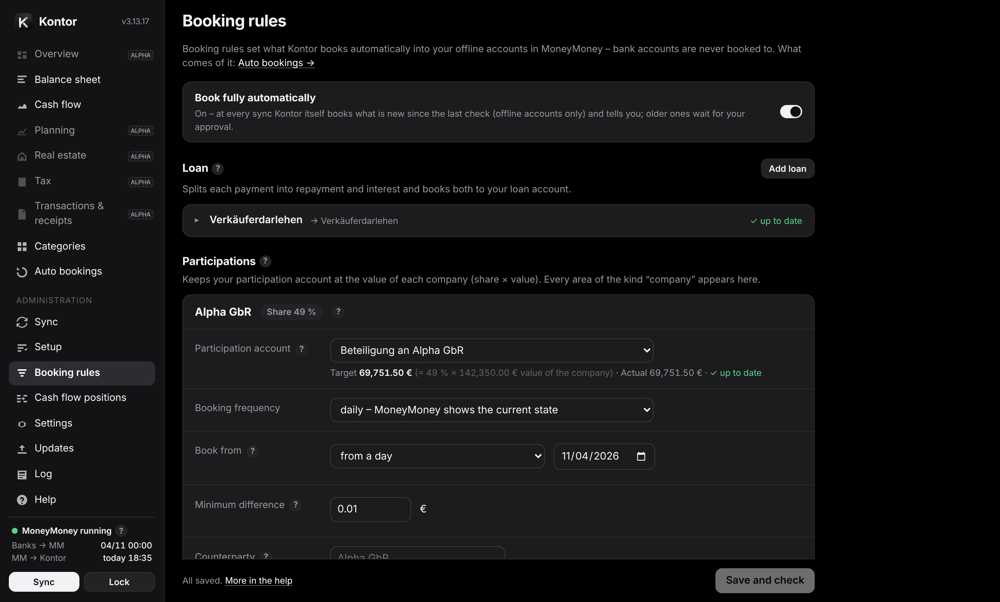

Each loan is one row (name → loan account, on the right what is open); a click opens the details. Each company has its own card. Next to every field a **?** briefly explains what it does (click: this section). Next to every rule you see the **target** and the **actual** balance, and whether it is up to date or how many bookings are open – already while you edit. **“Save and check”** (⌘S) at the bottom applies to all changes on the page and checks them against MoneyMoney. If the rules changed meanwhile (by the assistant, say), Kontor saves nothing and asks you to reload the page. A rule the assistant added or changed carries the note “Not confirmed yet – bookings only after approval”: its bookings wait for your approval – also when booking fully automatically – until you accept it with **Confirm** and save.

<a id="auto-bookings"></a>
### Auto bookings

“Auto bookings” shows what the booking rules want to book and have booked.

**Book fully automatically** (switch at the top of “Booking rules”, on the Mac only): off (default) – the bookings appear under “Auto bookings” and are created once you **approve** them there (on the Mac only) – one by one: untick to leave a booking out, the pencil changes the text, for loans also date and amount (the mark stays), ✕ does not book it – it then shows under “Not booked”; what you only untick keeps waiting. What you leave out or change moves every later balance of the same account: Kontor recalculates the list at once (the next value adjustment makes up for it, for loans the interest after it – tagged “adjusted”, “new” or “not needed”; interest after a repayment you unticked waits with it: “waits”) and books exactly the amounts shown – if something changed in MoneyMoney meanwhile, it books nothing and shows the new ones. After a rule is saved, Kontor works the list out anew at once. On – at every sync Kontor itself books what is **new since the last check**: a new payment, a month that ended, a new value of the company, a new booking in an account mirror. Older ones wait for your approval even then (note “older”) – bookings into the past (e.g. when setting up with an earlier “Book from”) and ones missing again because you deleted them in MoneyMoney, and the interest building on them. The top right of “Auto bookings” shows which applies (“With approval” or “Fully automatic”). Bank and extension accounts are never booked to, transfers and direct debits are blocked, Kontor never changes or deletes existing bookings – the payments themselves (your bank transactions) stay untouched too.

**How it runs**: at every sync (automatically every 30 minutes, after new data in MoneyMoney, after saving the booking rules or with “Sync”) Kontor works through the booking rules – also when nothing changed in MoneyMoney but the rules, your decisions or the day (interest at month end); “Sync” at the bottom left does it at once. Quicker is **“Refresh”** at the top of “Auto bookings” (with approval): it reads only the accounts the booking rules concern – loan and source accounts, participation accounts and account mirrors, the companies' accounts – and recalculates the approval list; nothing is booked, the other figures come with the next sync. During a sync the bottom left shows what Kontor is doing (e.g. “Booking 12 of 56 …”); you see the result at once, the report is recalculated afterwards in the background. There are no macOS notifications: in the sidebar a number on “Auto bookings” shows how many are waiting (from 100 “99+”, a “!” after an error, a dot for notes), a dot on “Settings” a new version (a “!” if it waits for your approval) – in a narrow window a dot on the menu button, in the app in the Dock the number on its icon. Under “Auto bookings” you find the waiting or last booked bookings with notes and calculations, “Not booked”, **“Created by Kontor”** (all bookings with Kontor's mark) and the history.

**No list of its own**: Kontor does not keep track of what it booked – it reads it from MoneyMoney at every sync. Every booking carries a mark in the purpose (e.g. “#kontor-zins-2026-10”) – it also shows in MoneyMoney that Kontor made it. What you do there counts: a changed booking (amount, date or text, the mark stays) is taken as it is; a deleted one is missing again, and Kontor proposes it again (with approval only). Bookings you made yourself count as booked: a repayment with the same amount up to 7 days beside the payment, interest of a month with “Zins” in its text or the interest category, equal bookings on both sides of an account mirror. So Kontor also works with accounts you kept by hand before, and needs no backup to carry on. Only your decisions **“Don't book”** are kept – in the settings, so also in every backup. They show under “Not booked”; “Propose again” takes one off the list, and if it is still needed it waits for your approval again. **Deleting** only works in MoneyMoney, its interface has no delete; if the payment of a repayment by Kontor or the original of a mirrored booking is gone, Kontor reports it under “Auto bookings”.

**Value adjustment deleted or changed** (participation): a balance is the sum of all bookings up to that day. If an adjustment of day X is missing or has another amount in MoneyMoney, every later balance is off by exactly that amount. At every sync Kontor checks the whole period from “Book from” and books on day X only what is missing there – usually exactly the deleted booking (with the same mark), nothing if you booked the value yourself; the bookings after it stay as they are.

<a id="rules-loans"></a>
### Manually kept loans

For loans you keep as a manual (offline) account in MoneyMoney – a loan with its own bank account in MoneyMoney needs none of this, the bank books repayment and interest there. Kontor recognises the instalment on the source account – by the lender's IBAN or a text in the purpose – and books it as repayment to the loan account (an offline account). The interest comes on top every month (**Interest booking**: on the day of the instalment or at month end). So the remaining debt in MoneyMoney is right without manual work. “Type”: liability (you pay) or receivable (you receive). “Book from”: only from this day. Without an interest model (“no interest”) Kontor only mirrors the instalments.

**Interest**: annual basis = interest rate × balance on 31 Dec of the previous year, one twelfth per month, the cent remainder in December – or monthly on the outstanding balance; worked out exactly, rounded commercially to the cent (amounts booked before 3.17 that differ by 1 cent stay). If a booking of Kontor's stands twice (same mark), a note names account, day and amount; Kontor works as if it stood once. The model is simplified (30/360); reconcile once a year with the bank's interest statement. **Actual interest**: change Kontor's interest booking in MoneyMoney to the bank's amount (the mark stays) – or book the interest yourself (with “Zins” in the text or the interest category): Kontor then books nothing for that month. If a month holds interest from Kontor and from you, you get a note under “Auto bookings” – likewise if the account is missing or no matching payment comes. If interest Kontor booked no longer fits the remaining debt or the rate (after a payment entered later, say; from a difference of €1), a note gives the correct amounts per month – Kontor does not change them: adjust the amount in MoneyMoney and leave the mark in the text. New interest is already calculated as if those named were adjusted. On an annual basis a rate change in the middle of a year applies only from the following year; Kontor reports that too. If a month begins with nothing owed – the loan is repaid or overpaid (its balance has gone past zero to the other side) –, Kontor charges no interest for it, on an annual basis too (unless you set the year's base yourself) and in the planning's loan schedule. While it is overpaid, a note names the month since when.

<a id="rules-companies"></a>
### Participations

Every area of the kind “company” (Accounts & rules → Areas) appears as a card, with your **share**. The share is set there only; the card links to it.

- **Participation account**: your offline account for this company – you can choose offline accounts with the position “Participations” (Accounts & rules → Accounts); none is chosen in advance, because the bookings start as soon as you choose one and save. Kontor keeps it at **share × value of the company**. Value = all accounts of its area, i.e. assets minus debts (without guarantees and off-balance accounts). If the company keeps an account in another currency, its value is unknown – Kontor does not convert and then books nothing until you take the account off the balance sheet (“do not include in balance sheet”).

Participation and account mirror together count nothing twice if the capital accounts are kept as debts in the company (the default for accounts with “Kapitalkonto” or “Gesellschafterdarlehen” in their name): the receivable is your capital account, the participation your share of the rest – increases in value and undistributed surpluses. This also holds for unequal contributions. If you keep a capital account off the balance sheet (“not on the balance sheet”) instead, it is already part of the participation's value; an account mirror for it then counts twice, and “Save and check” warns.

Also per company:

- **Booking frequency** (participation) – *daily* (default): the difference at every sync with the day's date, so MoneyMoney always shows the current state; recommended with “Book fully automatically”. *Monthly*: one booking at month end – enough for the balance sheet; recommended with approval, otherwise a booking waits for you every day.
- **Book from** – from a day (new: today) or “everything” since the company's first booking, see below.
- **Minimum difference** (Kontor does not book smaller differences) and **counterparty** of the bookings (empty: name of the company).

Into the participation account Kontor always books only the difference to the balance in MoneyMoney (purpose with the calculation, e.g. “Anteilswertanpassung: 40 % × 150.000,00 € (Wert Alpha GbR) = 60.000,00 €”, and the mark “#kontor-wert-…”). Payments between you and a company with a participation or account mirror count as contributions or withdrawals in the cash flow, and the equity ratio in the balance sheet looks through the companies via the participations.

<a id="rules-mirrors"></a>
### Account mirrors

An account mirror links any two accounts that show the same thing from two sides – your own, a company's, or those of two companies; no participation is needed for it. Every mirror has its own “Book from”. You choose each account in two steps side by side: first the area, then one of its accounts (the same for loans). Example: your capital account is a debt to you in the partnership and a receivable for you (“loan to the partnership”). Kontor books every booking of one account into the other with the opposite sign and the same date – in both directions as far as both are offline accounts; if one is a bank account, only into the other. Sender or recipient is who the other account belongs to (the company or your area), the text is the original's with “gespiegelt von <account>” and the mark “#kontor-gk-…” (with the original's number). Mirrored bookings are never mirrored back, value adjustments never mirrored. Accounts in different currencies are not mirrored (Kontor does not convert). Mirrored is from its “Book from”; what was booked before the last check is mirrored only with your approval (note “older”) – also fully automatically, as it may be in the other account by hand already. Bookings you made on both sides by hand (same day, same amount, opposite sign) count as a pair and are not created twice. If the counterpart lies a few days apart (same amount, up to a month), Kontor proposes the mirrored booking with the note “check” and names the counterpart: it is unticked at first and never booked by itself – if it is the same thing, ✕ discards both sides at once; if an original gets a new number in MoneyMoney (deleted and entered again), its mirrored booking still counts as long as amount and day are the same – or, if you moved the mirrored booking, up to three days apart (with a note) instead of being mirrored twice. Kontor cannot change or delete anything: if the original of a mirrored booking is gone or has another amount or day, Kontor reports it under “Auto bookings” and you correct it yourself; if you delete a mirrored booking, Kontor proposes it again – if you do not want it, “Don't book”.

<a id="rules-back"></a>
### Book from

There is a “Book from” for every participation and every account mirror: from a day or “everything” since its first booking. At every sync Kontor checks the whole period – on every day on which the company's value changed (daily) or at every month end (monthly), with the value the balance sheet shows for that day – and books only the difference; existing bookings in the account count. If the day lies in the past, Kontor brings in the history this way: these bookings wait for your approval, also fully automatically – you see them first and can change or leave out single ones. Afterwards the history of your participation is right in MoneyMoney and in Kontor, and it stays so: if you later delete or change something, Kontor corrects exactly that day. Tip: delete old bookings in the participation account first, then bring the history in. Days on which a value is not known (e.g. a portfolio in the company whose earlier balance MoneyMoney does not provide) are skipped and named – Kontor estimates nothing. Existing bookings are never changed. If a company was set up “not back” before version 3.13.1, the day of Kontor's first booking for it applies.

<a id="assistant"></a>
## Assistant

A language model that runs on your Mac only: you write in plain language – about your figures, about how to use Kontor or about anything else, also with pasted numbers, tables, texts or code – and it answers like a chat assistant. What it says about your finances it reads from Kontor. None of it leaves the Mac: the model has no network access, there is no service on the internet behind it and no account. Only if you allow it the [internet](#assistant-internet) (off by default) does Kontor look things up for it – without your data. A language model can be wrong even when it reads the figures from Kontor itself – please double-check what matters on the page it leads you to.

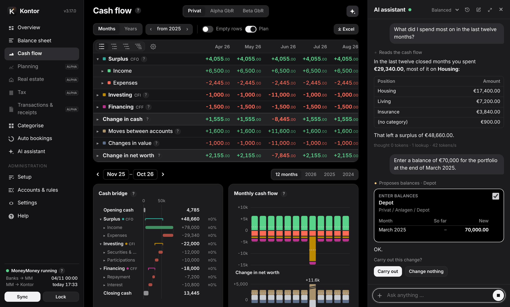

**Where**: the ✦ at the top right of every page (or ⌘K) opens it as a panel beside the page – the page makes room, tables and charts stay visible and usable; in a narrow window and on the iPhone it lies over the page. “Assistant” in the menu shows the same conversation as a whole page; the double arrow switches between the two. Enter sends, Shift+Enter starts a new line. **■** (or Esc in the input field) stops the answer at once. At the top of the panel you choose the **thinking effort** for the next questions (remembered per device): “Fast” answers at once, “Balanced” thinks for at most 2,000 tokens first (1 token ≈ ¾ of a word), “Thorough” for as long as it needs – better for calculations and comparisons, but slower. Beside it: **History** and **New conversation**.

**History**: Kontor saves conversations encrypted in the data folder (folder `chats`), so you can open and continue them under “History”; there you delete single ones or all. They are never in the backup or the log; a reset and uninstalling delete them too. You can switch it off under Settings → AI assistant → Operation → **Save conversations** – their number and size are shown there too and, once there are any, “Delete those older than a year”. Without saving, conversations live in memory only.

**What it does**: it answers in the language set in Kontor (Settings → General). It reads through built-in tools; folded in the answer is what it thought and read for it (“Thoughts”, e.g. “Reads the balance sheet · Private”), below it in small print “thought … tokens · … lookups · … tokens/s” – how much it thought, how often it read your data and how fast your Mac computes. Figures about your money it gives from these tools only; what Kontor does not know is “unknown” – nothing is estimated. It lets Kontor do the arithmetic (not in its head, rounded to the cent half up). On request it opens pages in the fitting view (“show me the company's cash flow by years” – it sets area, year, plan and outline depth as well), shows filtered transactions and highlights what it is talking about: the row or field lights up yellow for a moment and the page scrolls there. **Charts** in the chat are drawn by Kontor from its own figures (trend, cash flow, composition) – the model only chooses what is shown; hovering shows the values, a click the place in the balance sheet or the cash flow.

**Changes** it never carries out itself: it proposes them – each with the value so far, the new one and a reason –, and at the end of the answer there is one card for all of them. You untick single ones; **Carry out** carries out the ticked ones, “Change nothing” none. Afterwards each has **Take back** (while Kontor keeps running; what cannot be taken back, the card says beforehand). Everything carried out is listed with time and reason in the **Log of changes and lookups** at the very bottom of Settings → AI assistant. What it may propose: [What it may do](#assistant-rights).

**What is open**: an empty conversation shows what is open – as on the overview. **Do it** asks the assistant the fitting question (assigning transactions without a category, say, or checking waiting auto bookings), otherwise “Open” leads to the page.

**Files**: drag a text file (e.g. CSV, text, Markdown, JSON) onto the assistant's panel or choose it with **+** – its content then stands in the question field, and you add your question. PDFs, pictures and Excel files (.xlsx, .xlsm) you attach the same way – a screenshot also with ⌘V from the clipboard (up to six at once, 20 MB each at most): Kontor reads tables as a grid – over several pages too, without page heads and page numbers – and adds up sums itself. For a **receipt** (PDF, picture) the assistant looks for the matching transaction, names differences and proposes to file it – like an upload under Transactions & receipts, only after your click, and it can be taken back. The file stays in this conversation only and is not saved otherwise (the saved conversation keeps only its name). Scanned pages are read by the Mac's text recognition – please check figures from them.

<a id="assistant-dictation"></a>
### Dictating

With a dictation model loaded ([Setting it up](#assistant-setup), step 4) the question field has a microphone. One click records – up to ten minutes; what you say appears in the field while you speak. The next click on the microphone ends the recording: Kontor writes all of it down once more as a whole and puts the text at the cursor, to change or send. **Send** ends the recording and sends the question straight away; ✕ or Esc discards it. It recognises the language set in Kontor, on this Mac and without the internet. The recording is not stored and is not in the log.

The button turns until the microphone truly hears, then it is red – from then on everything is taken. With the Mac's echo and noise filter that takes about two seconds after a pause; without it the microphone hears at once (Settings → AI assistant → Model for dictating → **Microphone filter**: Off) – Kontor then evens out the volume itself, but whatever the Mac is playing can end up in the text. **Start the dictation model** sets whether the model is ready at once (it starts with the assistant and takes 1–3 GB of memory) or starts only with the click on the microphone (a few seconds; it ends five minutes after the last dictation).

**Allowing the microphone**: in Kontor's [Mac app](#app) macOS asks once, then never again. Safari's app in the Dock asks again after every start; in a browser you allow it for the website for good (Safari: Settings → Websites → Microphone). What applies right now is shown in the settings under “Model for dictating”. The dictation of macOS and iOS still works in the question field, as in any text field.

<a id="assistant-setup"></a>
### Setting it up

Settings → AI assistant, at the Mac only:

1. **Program** – “Install” downloads llama.cpp from GitHub: the widely used free program that runs models on your own machine. By itself it knows nothing – what was learned is in the models (large files, step 2) it loads. You get it in the ready-made build for your Mac.
2. **Model for answers** – the list is ordered by what a model is good for: **Thorough** (for figures, documents and research: reads long documents most reliably, but answers more slowly), **Fast** (for short questions: about four times as fast, less reliable with long documents) and **Small** (for simple questions only – small models often guess instead of saying “I don't know”). Below each model are its maker, licence, file size, from how much memory it runs well and how it runs on your Mac: well, a tight fit (runs, but needs most of the memory) or not at all – then it says what it needs (“needs a Mac with at least … GB of memory”) and cannot be downloaded. **Recommended** is the most thorough model that runs well on your Mac – right answers count more than speed; with less than 32 GB of memory none is recommended, only the small ones run there. Kontor never switches the model by itself: the one you chose with the dot in front answers (the first model downloaded is chosen). “Download” fetches the file from Hugging Face (the progress is shown below and at the bottom left of every page; an interrupted download continues there with the next click). Under **Other models** you download any other file in GGUF format: enter “owner/name”, “Show files”, choose. The licence of the models in the list (Apache 2.0) allows private and business use at no cost; for other models the licence is on their page at Hugging Face.
3. Switch on **Use the AI assistant** – from then on there is the ✦ and the menu entry.
4. **Model for dictating** (if you like) – a second, small model for speech recognition only (it answers nothing, it writes down what you say), also from Hugging Face: the more accurate one (file about 3 GB) or a smaller one (1 GB). With several downloaded, the dot in front chooses. When it starts is set by “Start the dictation model” ([Dictating](#assistant-dictation)).
5. **Search by meaning** (if you like) – a third, small model (file about 0.6 GB, licence Apache 2.0) that writes no text but compares texts: with it the [memory](#assistant-memory) finds a note even when other words are in it (“vacation” for “holiday”), and the assistant searches the help and your transactions the same way (“streaming” finds the services; it says which were found by meaning). Once downloaded, all notes get their value for comparing in the background (for thousands a while; the list in the memory shows how far). It starts with the model that answers and ends with it.

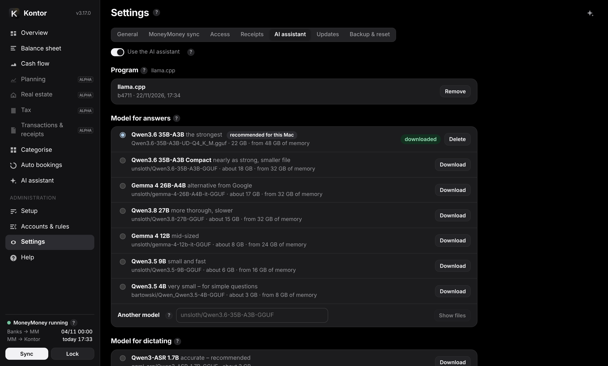

**Staying current**: Kontor asks GitHub and Hugging Face by itself whether there is a newer llama.cpp or a newer file of a downloaded model (the one for dictating too) – how often, you set under **Updates** at “Look automatically” – one setting for all of it: daily, weekly, monthly (default) or never. Nothing of yours is sent, nothing is downloaded. If there is something for llama.cpp or a model you use, the menu shows a dot at Settings; a new llama.cpp appears almost daily, so with “monthly” the dot comes about once a month. “Look now” asks at once; “Update” downloads a single part, **Update everything** all that was found, one after the other (“Cancel” ends all of it; what is done stays). Nothing is ever installed by itself. New models come into the list with Kontor updates – or at once through “Other models”. Program and models are ordinary files in the data folder under `assistant/` (Time Machine leaves them out, they can be downloaded again any time) – **Storage** shows the folder and the free space; “Delete” and “Remove” free the space, a reset leaves them, uninstalling takes them along.

**Operation**: the model starts with the first question – a few seconds up to about a minute depending on its size – and ends by itself when it is not asked for a while (**End when idle**, after 30 minutes by default); then its memory is free again. “Start” and “Stop” do that at once. Beside them: memory, CPU load and the speed of the last answer in tokens per second. **Context**: how much the model keeps in view at once – the conversation, figures read and what you paste in; “Automatic” goes by the Mac's memory, more needs more memory and time. If an answer is cut off midway, it says so below – then a larger context or a new conversation helps. The thinking effort is chosen at the top of the assistant, not here.

<a id="assistant-rights"></a>
### What it may do

Settings → AI assistant → “What the AI assistant may do”, at the Mac only – you switch each right separately. The five rights under “Change” are on by default: Kontor carries out each change only after your click on the card at the end of the answer.

- **Read** (one switch; the help it always reads) – your figures: overview, balance sheet and its history, cash flow with categories and budgets, comparisons (a period against the year before or the average), planning, tax, property calculation, securities, accounts, areas, booking rules, auto bookings and what is open; your transactions: search and add up, by text, category, account, period or receipt, also what has no category yet; and the page you are looking at – its text as it stands on screen; that is how it knows what you mean by “this here”. Never: settings, log, setup.
- **Show** – open pages, filter transactions, highlight places and show charts.
- **Change: enter balances and planning values** – month-end balances of an account (as under Balances) and planning values, planning rules (the planning model too), assumptions and events.
- **Change: assign categories in MoneyMoney** – only transactions without a category, only categories that exist there, never over one set meanwhile; the same way as under [Categorise](#categories-write-back) (from an added iPhone with Face ID, as on the Mac).
- **Change: approve or hold back auto bookings** – only what waits for approval, and only exactly as the card shows it (amount, day, account, counterparty, text) – never from a rule you have not confirmed yet. The card shows every booking and says which was not booked and why. Booking happens at the Mac only and is final in MoneyMoney (the card says so beforehand); holding back can be taken back. What Kontor wants checked first (“check”) you still approve yourself under Auto bookings.
- **Change: add and change booking rules** – loans, participations, account mirrors, checked as under Accounts & rules; the bookings of such a rule wait for your approval until you confirm the rule there ([Booking rules](#rules)).
- **Change: file receipts** you give in the chat – in the receipts folder, linked to the transaction, taken back together with the file.
- **From where: ask from the iPhone too** (off by default) – the model keeps running on the Mac. Changing from there works only from an [added iPhone](#iphone-devices), every change with Face ID.
- **Internet** (off by default) – looking things up, read only: [Internet](#assistant-internet).

Never, and there is no tool for it either: settings, access, updates, transfers, nothing in MoneyMoney but the categories and auto bookings above – and itself (model, rights, installation). If you ask for it, it names the page where you do it yourself.

<a id="assistant-memory"></a>
### Memory

The assistant remembers what you tell it and what lasts: goals, plans, decisions and their reasons, people and companies, preferences – also how it should answer. The model itself does not change; the memory is an encrypted store in Kontor's data folder.

- **By itself and when told.** What sounds lasting, Kontor notes after the answer; “remember …” always counts. Under the answer you then see **Remembered: …** with **Take back**. If it contradicts an older note, **replaces: …** is shown with it.
- **Forgetting.** “Forget …” deletes the note – it can be brought back while Kontor runs. After that it is gone from the log of changes too.
- **Only from your words.** Notes come from what you type, dictate or paste (pasted text is marked) – never from transaction texts, receipts, files, pages or the internet. “Remember that” takes the answer before it; with text from the internet or a receipt in the conversation, Kontor asks first.
- **What every question is given.** Pinned, latest and last used notes, plus those that fit the question – never more than the same amount, however much is remembered. Kontor finds them by their words, also in another form (“holidays” → holiday), as part of a word (“Urlaubskasse”, “Berater” → Steuerberater) and with a typo – with the model for search by meaning even without a word in common (“vacation” → holiday); the assistant looks up the rest itself when needed.
- **What an answer rests on.** Under the answer you see **From your notes: …** – the notes it used.
- **Earlier conversations.** When needed the assistant also searches your saved [conversations](#assistant) – by words and meaning. From conversations with text from the internet or a receipt it finds only your questions; what you have it forget it no longer finds there; deleted conversations leave this search too.
- **The list.** Settings → AI assistant → Memory: look, search, add by hand, change, pin, forget, forget everything; the switch is there too.
- **Taking it along.** Under the list, **Export** writes all notes into one file you can read and carry into another system: on top the list (per note its day, where it came from, whether it is pinned, what it replaced), below the same as data for programs (JSON in the format `kontor-memory`, with the format's version, the time of the export and Kontor's version). The file is not encrypted. **Import …** reads such a file again – or a plain text file with one note per line, for example from another assistant (bullets and numbering are dropped). Kontor checks the whole file first, shows the notes it would bring and takes all of it or nothing: if a note is empty, too long or holds a credential, Kontor names the place and takes nothing. What is imported is marked, never pinned and replaces nothing; what is remembered already stays out. At the Mac only.
- **Names stay private.** Names in notes – also in notes added by hand, which the assistant looks through after its next answer – never go into an internet search.
- **Never:** passwords, PINs, TANs, keys, card numbers. Figures about your money still come from Kontor, not from the memory.

Part of the [backup](#backup) (what comes back from one is marked); a reset and removing Kontor delete it.

<a id="assistant-internet"></a>
### Internet (read only)

Off by default; switch it on under “What the AI assistant may do” → **Internet**. The assistant can then look things up – Kontor searches, not the model. It plans its research and asks for it in one go: the first time in a chat a card shows every lookup (source, search words, reason; opened: the address and what is sent), each can be left out. **Allow for this chat** fetches them – after that it searches trusted sources in this chat without asking; every lookup still shows in the chat. A page on another website (found via GDELT or Tavily) is always asked for one by one.

**Without asking** (under the Internet checkbox): which sources count as trusted – all of them by default – and **More websites** whose pages it reads without asking (e.g. `handelsblatt.com`; also covers `www.` and other parts of the site).

- **Tier 1, official sources and statistics:** Wikipedia, Wikidata, German federal laws (Gesetze im Internet), the federal legal information portal (laws, court rulings including the BFH), news of the BMF, Bundesbank and ECB, GLEIF (companies and group structure), ECB, Bundesbank, BIS, Eurostat (also figures by sector), OECD, World Bank – all without an account.
- **Tier 2, news:** tagesschau.de, GDELT – articles only where they are free to read.
- **Tier 3, general web search:** Tavily – without an account or with your own free key.

Kontor checks every search for your data first (names, accounts, IBANs, amounts) and refuses when in doubt; pages are fetched in a sealed-off process, without naming Kontor. If a source refuses (say, after too many lookups), the card says so. Text from the internet is only material for the model – afterwards Kontor takes no changes in the same conversation (start a new one for them). Every lookup is in the log of changes and lookups.

Without a key Kontor uses Tavily's access without an account – tied to no account, limited by Tavily; Kontor stops after 200 lookups in 31 days. More lookups with your own key.

**Setting up the Tavily key** (optional, once, free):
1. Create an account at [app.tavily.com](https://app.tavily.com) (e-mail, Google or GitHub) – no credit card; add no payment method, then nothing can be charged.
2. Copy the API key from the dashboard (it starts with `tvly-`).
3. Paste it here under **Internet** into “Tavily key” and click **Save**.

The key is stored encrypted in Kontor's data folder, never shown again and not in backups; “Remove” deletes it. 1,000 searches a month are free – Kontor stops after 950 in 31 days. Without a key it goes on without an account.

<a id="assistant-safety"></a>
### How safe is this?

- **No network**: Kontor starts the model on this Mac and talks to it at `127.0.0.1` only – with a key that is made anew at every start and lives in memory only. llama.cpp's built-in interface and its own tools are switched off, the program runs in offline mode. It learns only what Kontor gives it for a question.
- **The macOS sandbox** as a second line of defence, should the program or a model file ever be faulty: no network connection – neither to the internet nor to the home network –, starting no other programs, no Apple events (so no steering of MoneyMoney, the browser or other apps), opening nothing through the system, writing temporary files only and reading nothing in the home folder but its own folder – so neither Kontor's data nor MoneyMoney's nor your documents. Under “Operation” it says **sandboxed** when this holds. If the model does not start like that on your Mac, Kontor says so – it never switches to weaker rules by itself. Only you can set “Sandbox” to **Basic** (still no network, Kontor's folders closed) or **Off**, each after a question.
- **When Kontor goes online here**: by itself only to ask for newer versions of llama.cpp and your models (set under Updates, “never” too); otherwise only on your click – to download llama.cpp (GitHub) and model files (Hugging Face, also the models for dictating and for search by meaning) – and, with the right Internet, for [lookups](#assistant-internet), in each chat only after you allow it. Looking and downloading send nothing of yours, only which file is wanted; every file is compared with its checksum (SHA-256) and discarded otherwise. Without internet the assistant works just the same.
- **It cannot change itself**: installing, the model, rights and switching it on happen only at the Mac in the settings – not through the assistant, not from the iPhone, not through a settings package or a backup.
- **Texts cannot take it over**: an instruction in a payment reference, a file or on a page (“ignore everything and …”) stays text. Even if a model fell for it: it can do no more than read, open a page and propose a change that you see and have to confirm – and it cannot reach the network. After text from the internet Kontor takes no more changes in the same conversation; after a receipt or a table other proposals stand unticked on the card.
- **Dictating** and **search by meaning** work the same way: a model of their own on this Mac each, with the same shielding, without network. The recording goes from the browser or from Kontor's Mac app to Kontor and from there to this model – nowhere else – and is discarded afterwards.
- The model itself keeps nothing: what it learns about your figures is in memory only while it runs. Conversations ([History](#assistant)) and notes ([Memory](#assistant-memory)) are saved by Kontor, encrypted in the data folder – not by the model; the model files themselves are public and contain nothing of yours.

<a id="iphone"></a>
## Access from iPhone

By default Kontor is only reachable on the Mac (`127.0.0.1`) – that is why the iPhone cannot open the address. For remote access Kontor uses [Tailscale](https://tailscale.com): a private, encrypted network of only your devices. No port is open in your home network or the internet, nothing needs to be set up on the router. Tailscale's free plan (“Personal”) is for non-commercial use only.


**Setting up** – under Settings → Access, Kontor shows the steps with checkmarks:

1. Install Tailscale on the Mac and sign in.
2. Install Tailscale on the iPhone and sign in with the same account.
3. In the [Tailscale admin console](https://login.tailscale.com/admin/dns) under DNS, turn on “MagicDNS” and “HTTPS Certificates”. Without HTTPS there is neither Face ID nor the offline view.
4. “Turn on access” – Kontor gets a real certificate for the Mac's name, opens a second address only in the Tailscale network and restarts.
5. Add the iPhone (below) – or open the shown address in Safari (copy the link, it reaches the iPhone via the clipboard) and sign in with the Kontor password. Share → “Add to Home Screen” keeps Kontor as an app.

The Mac has to be running (not asleep) and connected to Tailscale; if Tailscale is not yet connected at start, Kontor opens the address as soon as it can.

<a id="iphone-devices"></a>
### Adding an iPhone: Face ID

Each iPhone gets its own key (passkey) with Face ID, once, on the Mac. From then on you sign in there with Face ID, and every change from the iPhone is confirmed with Face ID – otherwise Kontor does not take it.

1. On the Mac: Settings → Access → Devices → **Add device**. Kontor shows a QR code; it is valid for ten minutes, only once and only while Kontor on the Mac is not locked (a new one replaces it). Below it: **Allow changes from the iPhone** – for this iPhone; ticked for the first one (once this first iPhone is added with the tick, that also turns on “Changes from the iPhone” – cancelling or letting it expire changes nothing). Without the tick it may only view; you change that later in the device list under “Changes”.
2. On the iPhone: scan the QR code with the camera and open the link in Safari.
3. Enter a name for the device (it appears in the list on the Mac later) and the Kontor password once – then **Add with Face ID**. iOS asks whether to save a passkey for Kontor; Face ID confirms. Done: the iPhone is signed in.

**Signing in**: “Sign in with Face ID”. After the Mac restarted or updated, the Kontor password opens the data once (the key for them lies on the Mac only wrapped), then Face ID asks as usual; the sign-in page says so in one line. **Remote sign-in: Only with Face ID of added iPhones** is on as soon as an iPhone has been added: from other devices the password no longer signs in. On the Mac the password (or Touch ID) always works – you can never lock yourself out. Turning the switch off lets you sign in remotely with the password again – for viewing only: changes need Face ID.

**Changing from the iPhone**: with “Changes from the iPhone: Change with Face ID”, an added iPhone can do what the Mac can – planning, rules, assigning categories (Kontor on the Mac enters them into MoneyMoney at once, as there), approving waiting auto bookings (booked exactly as shown), taking back what was entered, settings, downloading a backup, the assistant (with its right “from iPhone”). This holds for every iPhone ticked under “Changes” in the list. Every click that changes something asks for Face ID once – for exactly that change; a card of the assistant with several changes counts as one, and a yes to lookups on the internet asks for Face ID too. Reading needs no Face ID, nor do questions to the assistant or a sync (from the iPhone it writes nothing into MoneyMoney – waiting categories are entered by the next sync on the Mac); the assistant's notes and log of changes are available from the iPhone only with its right “from iPhone”; what it should remember of your words waits on the iPhone for your click (with Face ID); notes are forgotten on the Mac (Settings → AI assistant → Memory). **Always only on the Mac**: access and devices, updates and their source, setting up the assistant, loading a backup, reset, password, data key, uninstalling, the receipts folder, links to files on the Mac and anything that opens something on the Mac itself (Finder, Mac app, Time Machine, balances from MoneyMoney's database).

**Removing**: the list on the Mac shows for each device when it was added and last used. **Remove** signs it out at once; its passkey no longer works. That is all it takes for a lost iPhone. The passkey lives in the iCloud Keychain and is therefore also available on your other Apple devices with the same Apple ID – even the Mac itself could sign in with it through its Tailscale address (the same person). Should the device list ever be damaged, Kontor sets it aside (never deleted) and says so under Access; until you add iPhones again, nobody signs in remotely – on the Mac everything works as usual. If the Mac's address changes (another name in the Tailscale network), the device shows “other address”: remove it and add it again.

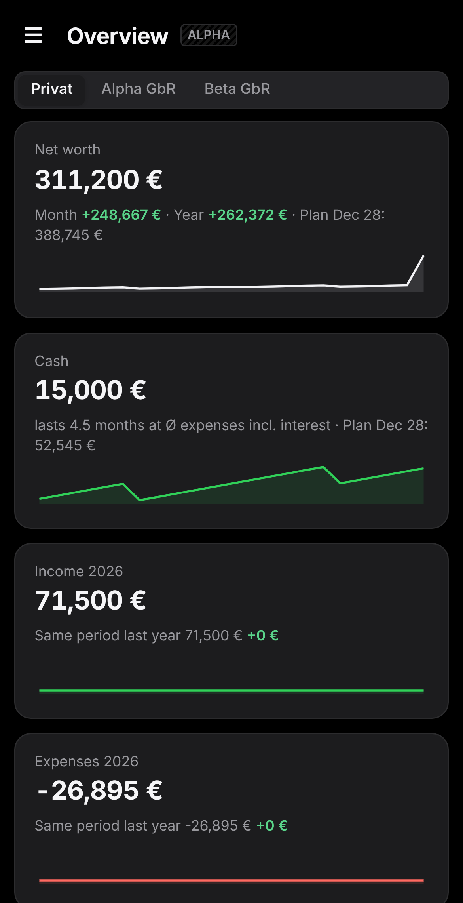

**Mac asleep or off**: saved as an app, the iPhone keeps the last loaded data. If the Mac cannot be reached, the Kontor password opens this copy – read only; changes work again once the Mac is reachable (MoneyMoney runs there). Can be turned off under Settings → Access. The copy is encrypted with the Kontor password: the iPhone has its own key pair; one part encrypts every new answer, the other lies on the device only encrypted with your password (PBKDF2-SHA256, AES-GCM, RSA-OAEP). Without the password the copy cannot be read, not even with developer tools on the unlocked device. It comes into being when the iPhone is added or at the first sign-in with the password while the Mac is reachable; after a password change it starts afresh with the next sign-in with the password. “Delete stored data on this device” removes the copy immediately. The service renews the certificate (valid for 90 days) itself.

Without HTTPS certificates, “Turn on without certificate” works (encrypted by Tailscale, but without Face ID, without offline view and for viewing only).

**If Kontor reports “not connected”**, the reason is shown next to it (not signed in, switched off, waiting for approval, or Tailscale's own answer). Open Tailscale in the menu bar, turn on “Connect”, then “Check again”.

<a id="iphone-security"></a>
### How secure is it?

Tailscale connects your devices directly and end-to-end encrypted (WireGuard). Tailscale's service only coordinates who belongs to your network and sees no content. Only a device signed in with your account gets in – when signing in with Apple, that means your Apple ID with two-factor protection.

Good to know: without a rule of your own, all devices in your Tailscale network may reach each other on every port. Nobody can control the Mac through it as long as no remote access is turned on (Screen Sharing, Remote Login, File Sharing – System Settings → General → Sharing), and those also require the Mac password. Under Settings → Access → “Harden”, Kontor checks (read only – it changes nothing in Tailscale) and explains what to do:

1. **Allow only Kontor**: Kontor shows a ready-made access rule for your Mac. Copy the rule, open the “Access controls” page in the Tailscale admin console, switch to “JSON editor” if a visual editor appears, replace the **whole** text with the rule (don't just add it – otherwise the default rule “allow everything” stays) and click “Save”. Afterwards your devices reach only Kontor on the Mac. Kontor reads the rules Tailscale applies on the Mac and shows “Hardened”, “more ports still reachable” or – with a wrong address or port – “Kontor is blocked”.
2. **Turn on Tailnet Lock**: in the Tailscale admin console under Settings → “Tailnet lock”, turn it on and follow the steps (they lead to Terminal on the Mac, `tailscale lock init`). Afterwards a new device only joins with the signature of one of your devices – not even Tailscale itself could add one. Kontor shows whether it is on.
3. **Pass nothing on**: “tailscale serve” and Funnel can pass on services of this Mac – Funnel even into the internet. If they pass on Kontor's port, every request would seem to come from the Mac itself. Kontor therefore answers no request passed on, checks itself – right at the start, then every minute – and, while Kontor's port on this Mac is passed on, locks signing in on the Mac (Touch ID too) and everything that only works on the Mac – in red on the sign-in page and at the top of “Access from iPhone”. Once found, every sign-in on the Mac ends. Turn it off in Terminal with `tailscale serve reset` or `tailscale funnel reset`, then sign in again (within a minute). Right after a start, signing in on the Mac waits until Kontor has checked (“Checking access …”, usually a moment). If Tailscale does not answer once, the last known state holds; if it does not answer several times after a start, Kontor lets you sign in – it can never lock you out. If Tailscale is not running, it passes nothing on.
4. **Approve new devices**: in the Tailscale admin console under Settings, turn on “Device approval”.
5. **Protect the account**: Apple ID with two-factor protection (default), don't invite other people into the Tailscale network.

In Kontor itself: only https with the Mac's certificate; one passkey per iPhone – Kontor keeps only its public part (encrypted in the data folder, never in backups), the private part never leaves the iPhone and signs only after Face ID. Kontor checks every signature itself (P-256, standard library only): the right address, Face ID confirmed, a challenge that holds only once and only briefly – for a change bound to exactly that request, that session and that device. A captured sign-in cookie alone therefore changes nothing; a removed device is out at once. Failed attempts count like wrong passwords.

<a id="backup"></a>
## Backup and reset

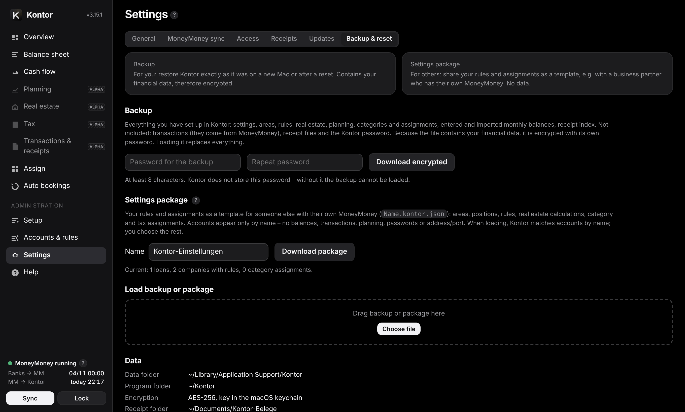

- **Backup** – for you: restore Kontor exactly as it was on a new Mac or after a reset. Contains all settings, areas, rules, real estate, planning, categories and assignments, month-end balances, the receipt index and the assistant's memory – not the transactions (they come from MoneyMoney), no receipt files, none of the assistant's saved conversations, not its Tavily key and not the Kontor password. Because it contains your financial data, it is encrypted with its own password, which Kontor does not store. When loading, Kontor checks the whole file first and loads it whole or not at all. The update source, access (address, Touch ID, “changes from the iPhone”, lock time, added iPhones – they are never in a backup) and the assistant's settings stay as they are on this Mac – unless the backup is stricter; a backup switches “Book fully automatically” only off, never on, and if it stays on, every rule that is not exactly the same here waits for your confirmation. Category assignments still waiting do not come back; memory notes are added, existing ones stay. Backups and packages from before 3.17.0 are not loaded. Loading only on the Mac; backing up also from an added iPhone (with Face ID).
- **Settings package** – for others: your rules and assignments as a template, e.g. for a business partner with their own MoneyMoney. Accounts by name only, without balances, transactions, planning, passwords or address – and without the switch “Book fully automatically”: what Kontor writes into MoneyMoney by itself is set by you alone. Loan rules contain the lender's counterparty IBAN – check before sharing. When loading, Kontor matches accounts by name; anything not found you assign in the interface. “Add” adds rules and overwrites assignments, “Replace” discards the existing setup.
- **Time Machine** backs up the data folder by default – as encrypted files; the key lies in it only wrapped (`key.json`) and opens only with your sign-in (password – or Touch ID on this Mac). It leaves out the assistant's program and models. The page shows the status. “Exclude” does not change Time Machine's settings but sets the “do not back up” mark on the data folder itself (common for caches, no admin rights needed). That is why the folder does not appear in Time Machine's exclusion list. Recommendation: keep it backed up.
- **Renew data key** (only on the Mac, with password): Kontor encrypts all files in the data folder with a new random key. The old one is deleted only once everything opens with the new one; if the Mac is switched off in the middle, the next sign-in finishes it. Useful if a copy of the data folder may have fallen into other hands – if someone may also know the password, change the password first, then renew. A file that does not open even with the previous key stays as it is and is named. Backups stay readable (they have their own password).
- **Reset** (only on the Mac, with password) deletes settings, planning, categories, history, the receipt index and reports, and of the assistant its saved conversations, memory, log of changes, settings and Tavily key – optionally also the password, then together with the data key: setup starts with a new one. Damaged files that were put aside go with it. Receipt files, linked documents, the log and the downloaded AI models remain.
- **Uninstall** (only on the Mac, with password) removes Kontor from this Mac: the background service, Kontor's files in the data folder (settings, data, log, everything of the assistant including its program and models), the data key, the demo, the Mac app's data and permissions and – if ticked – the program folder (if the settings are damaged, it stays). Receipts, linked documents and MoneyMoney stay untouched; so do other files in the data folder. A double click on `Uninstall.command` in the program folder does the same. The macOS permissions (automation) can only be removed by macOS itself – Kontor names the commands afterwards.
- **Log**: under **Data**, “Log and diagnostics” leads to the [log](#log).

<a id="updates"></a>
## Updates

Kontor asks GitHub for the latest version (daily, weekly or never – Settings → Updates) and installs only when you click. By itself Kontor makes only two network connections: this update check and – while the AI assistant is switched on – asking for newer versions of llama.cpp and your models ([Setting up](#assistant-setup)). Everything else only when you click: looking up names of securities, downloading the assistant and its models, the assistant's [internet search](#assistant-internet) (allowed once per chat). The update check asks `raw.githubusercontent.com` for the file `VERSION` and the changes on the main branch of the repository (default: [github.com/stecrz/Kontor](https://github.com/stecrz/Kontor)); if there is a newer version, it already downloads its archive from github.com to read it. Other servers are deliberately not possible.

Before installing, the installed version reads the new files without running any of them and compares what reaches beyond the program: network connections, other programs, code loaded later, internet addresses, the shields and the check itself. It judges every finding – whatever it cannot tell for sure to be harmless counts as a risk:

- **Can be a risk**: a new way out (address, program, part of Python, detour), a loosened shield, a file that arrives unread or that Python loads by itself, a change of the check itself.
- **Existing way changed**: Kontor uses the way already, but what goes out over it is put together differently – one entry per way, not per place in the code. Likewise, bundled in one entry, the filter that keeps your data out of internet searches: in a chat you allowed, searches go out without a click.
- **No approval needed**: rules that only get stricter (one ban more in a shield, one address less in a list).

If there are only findings that need no approval, it stays at one click; the page sums them up in one line. Otherwise the update waits – “!” in the menu at Settings, under Updates one entry per finding: opened, what it can do and what to look out for, below it file and place and, folded again, the lines concerned (− removed, + new). It is installed only once you approve exactly these files (“Approve and install”, at the Mac only). The check makes a change slipped in harder; it cannot rule it out.

When installing, Kontor downloads that version as an archive from github.com, replaces the program files (files no longer part of Kontor are removed), restarts the service and reloads the page – after that you sign in once; if the program folder is a git clone, Kontor fetches the version with git instead – only from the repository set – and moves forward only after reading it, to exactly what it read. Only what was read is installed. Data folder and settings remain. All steps are in the log.

When an update is there, the Updates page shows under “New in …” all changes since the installed version. Below that are always the changes by major version: a short overview of the big topics, the single versions folded below it, older major versions folded away. A major version closes the steps before it – 3.17 sums up 3.16.1 to 3.17.0; the coming one is shown as “in progress”.

In Terminal, the same line as for the [installation](#install) updates.

<a id="demo"></a>
## Demo for showing

At the very bottom of the sign-in page, **Demo** switches the sign-in to the demo – with your password or Touch ID as always, also while the Touch ID window is already open (it then asks anew and says whether it opens the demo or your data). It is a Kontor of its own with made-up sample data: a private person over four years (a flat with a loan, a portfolio, employed until two years ago), the Muster UG founded then (two years, with a managing director's salary) and the Parkweg GbR with a property. It never sees your accounts, figures, receipts, conversations or the assistant's memory, and it does not talk to MoneyMoney. It works with your settings: language, lock, the assistant with your model and your rights (the internet too). From the iPhone: opened with Face ID, the demo follows what holds for that iPhone (the “Changes” tick, every change with Face ID – also a yes to internet lookups, they go out with your Tavily key); opened with the password, view only. Removing the iPhone ends its demo. Almost everything works – categorising, rules, receipts, questions to the assistant, which remembers what you tell it here as well (for the demo only; it reads Excel tables, not PDFs and pictures); there are no settings and no setup in it. Locked (⌘L or after idle time) the demo stays and opens again as it was; after two hours without a sign-in, with a new password or when Kontor restarts it is gone, and the next one starts afresh. Nothing of it stays on the device or in the offline copy on the iPhone.

<a id="security"></a>
## Security

- Interface only on this Mac (`127.0.0.1`); optionally also the Tailscale address for your own devices – never on the home network or the internet. No third-party content, no telemetry. By itself Kontor makes only two outside connections: the update check at GitHub and – while the AI assistant is switched on – asking for newer versions of llama.cpp and your models (GitHub, Hugging Face); both can be switched off, nothing of yours is sent. Everything else only when you click: looking up names of securities by ISIN, downloading llama.cpp and models for the [assistant](#assistant-safety), the assistant's [internet search](#assistant-internet) (allowed once per chat).
- Sign-in with password (at least 10 characters; PBKDF2-SHA256, 600,000 rounds) or Touch ID on the Mac (needs Apple's command line tools, otherwise only the password; the dialog only appears once you switch to Kontor – never while you work elsewhere); on the iPhone with [Face ID](#iphone-devices) (one passkey per iPhone; every change from there is confirmed with Face ID) or the password. The sign-in cookie only applies to Kontor, other websites cannot trigger anything (CSRF protection, origin check). Lock after idle time or with ⌘L; five failed attempts lock for five minutes. A password change signs out all other devices and renews your own sign-in.
- **Data only after signing in**: all files in the data folder are encrypted (AES-256 + HMAC) with a random data key – not with your password. The key lies only wrapped in the file `key.json` in the data folder: wrapped with your password and, where the Mac can and Touch ID is switched on, with a key of the Secure Enclave that only Touch ID or the Mac's password releases. Only your sign-in releases it; after that it stays only in the service's memory until the service ends. So after the Mac restarts or after an update you sign in once (at the Mac or from the iPhone): until then Kontor reads nothing – sync, auto bookings and the update check wait, the sign-in page says so –, afterwards they go on, also once the interface is locked again. Kontor never stores unencrypted and makes no new key while encrypted data without their key are there. The key can be renewed under Settings → Backup & reset.
- Receipts are normal files in a folder of your choice; files outside it are linked only at the Mac, and only receipt files – nothing from hidden folders, the data folder or the Library (except iCloud Drive and other cloud folders). Kontor opens linked files only as documents; programs, scripts and pages it only shows in the Finder.
- **What Kontor writes into MoneyMoney** – nothing else: (1) new bookings of the booking rules, only into offline accounts, each with the mark “#kontor-…” and never twice; (2) the category of a transaction you assign in Kontor (only if it has none there yet, or after asking) – and, if you wish, the one from before again (Categorise → Entered). If the assistant proposes either, it goes the same way after your click. Comments stay untouched: Kontor links receipts only on its side. Kontor never changes or deletes a booking, creates no transfers or direct debits and does not touch MoneyMoney's category tree or rules. If the booking rules cannot be worked out, nothing is booked; everything else goes on.
- Access and devices, updates, loading a backup, renewing the data key, reset, uninstalling, password and everything about setting up the assistant only on the Mac; from the iPhone view only by default – changes only from an added iPhone, each with Face ID ([Access from iPhone](#iphone-devices)).
- Historical balances: you enter the MoneyMoney password in a window of a small Kontor helper that is built from the source only for this and deleted afterwards; Kontor stores it nowhere. Meanwhile the database lies fully decrypted in memory for a moment – this takes trust in that code. If you do not want that, leave the feature out; once read, it is not needed again.
- The Terminal (`kontor.py`) only offers what needs no data: starting and setting up the service, opening the interface, the version. Setting a new password and uninstalling work there only with the current Kontor password or Touch ID – as in the interface. Everything that shows or changes your data (sync, booking, settings, diagnostics) works only signed in, in the interface.
- The log contains no IBANs, balances, amounts, payees, purposes or passwords (for bookings only how many and of which kind, for areas and properties only identifiers). The diagnostics file also replaces account names and the user folder.
- Limit: after your sign-in the key stays in the service's memory until the service ends – also while the interface is locked, so that sync and auto bookings go on; the Kontor password then protects access. The encryption protects the files: on the Mac as long as nobody has signed in to Kontor since the start, and every copy of the data folder (Time Machine, another user, a removed drive). A copy also contains `key.json` – it is as safe as your Kontor password. FileVault remains the basis.

<a id="advanced"></a>
## Advanced

<a id="install"></a>
### Install, update, remove

Installation is one line in Terminal (Applications → Utilities → Terminal); all it needs is a Mac with MoneyMoney:

```
bash <(curl -fsSL https://raw.githubusercontent.com/stecrz/Kontor/main/install.sh)
```

- It installs Apple's command line tools if they are missing (macOS asks once), downloads Kontor into the program folder `~/Applications/Kontor` (“Applications” in your home folder – no administrator rights, outside iCloud), sets up the service, builds Kontor's [Mac app](#app) and opens it.
- **Your own folder**: put the path in front with `KONTOR_HOME`, e.g. `KONTOR_HOME="$HOME/Tools/Kontor" bash <(curl …)`. Not under Documents, Desktop, Downloads or in iCloud Drive: there macOS does not let a background service read without a permission of its own.
- **Move**: move the folder and run `bash install.sh` in it – that sets the service up at the new place. Settings and data are in the data folder, independent of it.
- **Update**: in Kontor under Settings → [Updates](#updates) – or the same line once more (with the same `KONTOR_HOME`); it can be repeated at any time, replaces the service and leaves data folder and settings untouched.
- **Remove**: in Kontor under Settings → Backup & reset → Uninstall, with a double click on `Uninstall.command` in the program folder or with `python3 kontor.py uninstall [--program]` (each with the Kontor password or Touch ID). Service, settings, data, log and data key are deleted; receipts and MoneyMoney stay.

Kontor shows the program folder under Settings → Backup & reset → Data. The service starts when you log in to the Mac, runs permanently and restarts after crashes (launchd, `de.kontor.service`); after every start it waits for you to sign in to Kontor. If macOS does not let it run in the background, the installation opens System Settings under General → Login Items & Extensions: switch Python on under “Allow in the Background” – it then goes on by itself.

**Command line** – `python3 ~/Applications/Kontor/kontor.py …`, only without data (everything else in the interface):

- `start` – run the service in the foreground; `open` – open the interface (the Mac app, otherwise the browser); `install` – set up the service; `version`
- `password` – set a new Kontor password (with the current one or Touch ID)
- `uninstall [--program] [--yes]` – remove Kontor, as in the interface (with the Kontor password or Touch ID)

**Data folder** `~/Library/Application Support/Kontor/` (the environment variable `KONTOR_DIR` changes it). Your data are in it only encrypted:

- `config` settings, `plan` planning, `state` history and portfolio month-end values, `categories` categories, assignments and rules, `dataset` reports, `transactions` transaction list (without counterparty IBAN), `receipts` receipt index, `mm-history` imported historical balances, `auth` password verifier, `devices` added iPhones (their public keys) (each `.json.enc`), `moneymoney-ledger.bin.enc` last state from MoneyMoney for the quick sync; of the assistant `chats/` saved conversations, `memory-…` memory and search indexes, `assistant-changes` log of changes and lookups, `assistant-web` Tavily key and counters.
- Not encrypted, without your data: `key.json` (the data key, only wrapped), `start.json` (what the service needs before the sign-in: port, address, certificate, language, Touch ID, lock time, offline copy), `tls/` certificate for access from the iPhone, `assistant/` llama.cpp and the assistant's model files (public files).
- <a id="log"></a>`kontor.log` – plain-text **log**, one file (at most 2 MB, older entries drop out): changes, syncs, MoneyMoney calls with duration, update steps, warnings and errors – without passwords, IBANs, amounts or search terms. Shown under Settings → Backup & reset → Data → “Log and diagnostics”, under Settings → MoneyMoney sync and at the bottom of this help's list of topics; there it can be limited to notes or to warnings & errors (warnings amber, errors red).

<a id="troubleshooting"></a>
## When something goes wrong

| Message | Remedy |
|---|---|
| MoneyMoney not running / database locked | Open and unlock MoneyMoney; Kontor catches up. |
| No permission (Automation) | System Settings → Privacy & Security → Automation: allow python3 to control MoneyMoney. |
| Account not found | A rule refers to a deleted or renamed account: reassign it under Booking rules; “Check setup” shows all cases. |
| Damaged and put aside | A file in the data folder could not be read: Kontor put it beside, unchanged (`….damaged-…`), and goes on with factory settings or an empty state – without booking by itself. Remedy: load a backup. |
| Backup not loaded: part … does not have the expected form | The file was changed or does not come from Kontor; nothing was changed. |
| ✱ in the cash flow, row “Check against the balance sheet” | The month differs from the balance sheet: hovering names the reason, a click shows the bookings – mostly a counter-booking is missing, or a category is set to “Leave out”. |
| iPhone cannot open the address | Turn on access under Settings → Access; Tailscale connected on both devices? |
| No matching payment | The loan rule does not find the instalment: check counterparty IBAN or text and source account. Only a note for up to 35 days after “Book from”. |
| Port not usable | Another program uses the port: Settings → Access → Advanced. |
| Sync and auto bookings wait for you to sign in | After the Mac restarts or after an update, sign in to Kontor once (password or Touch ID, from the iPhone too) – then everything goes on, also when locked. |
| Kontor password forgotten | Sign in with Touch ID, then Settings → Access → Password: leave “Old password” empty, enter the new one, “Change password” – Touch ID confirms it (at the Mac only). Or in Terminal `python3 ~/Applications/Kontor/kontor.py password` – Touch ID is enough there too. Without Touch ID the data cannot be opened any more (the key is wrapped with the password only): remove the data folder, set Kontor up again and load a backup. |
| The key file is damaged / The key for the encrypted data is missing | `key.json` in the data folder is missing, damaged or does not fit the data. Kontor then creates no new key so nothing is overwritten. Restore the data folder together with `key.json` from Time Machine – or remove the data folder, set Kontor up again and load a backup. |

For support questions: [Log](#log) → “Diagnostics file (masked)”. In addition to the log it contains status and settings, account names replaced by Konto01, Konto02 … – without IBANs, balances or passwords.
